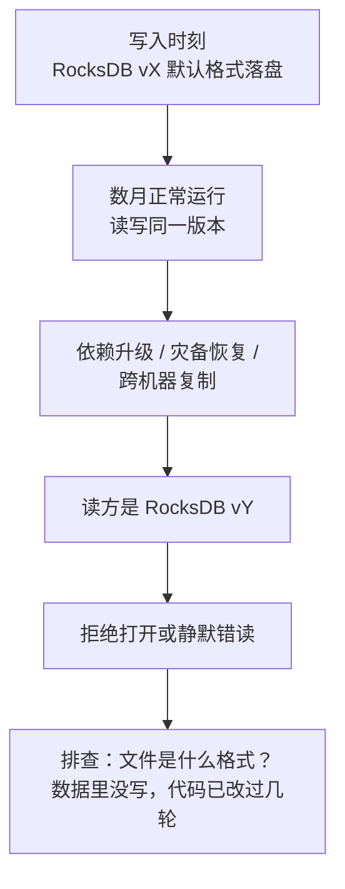
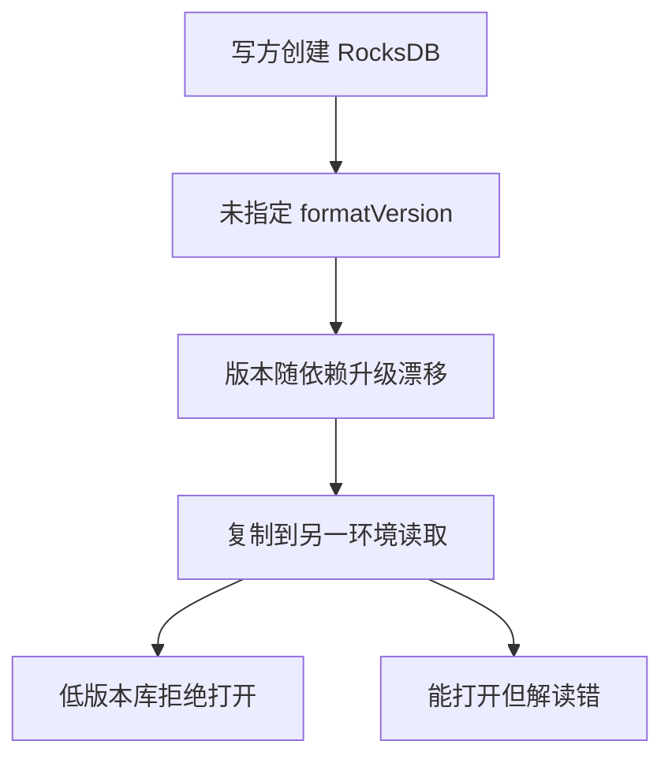
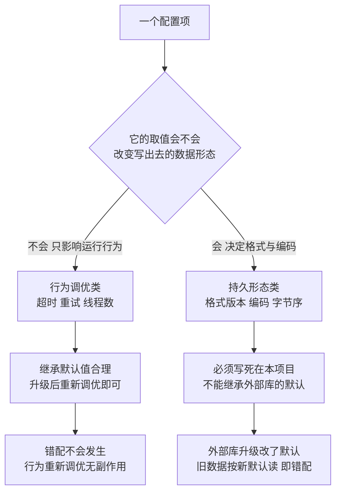

# 案例三十八：没有写下来的版本——默认值里的迁移债

> **要点**：**数据格式的版本如果不显式写入存储**，读的时候就只能靠默认值猜——**猜对了能跑，猜错了要么拒绝打开、要么静默地按错误格式解读**。

一个数据文件被写下来时，除了内容本身，还有一件事必须一起写下来：**它是用什么格式写的**。**这件事听起来理所当然，但它经常被漏掉**——在最初的版本里只有一种格式，不需要区分。本篇要解决的问题是：**格式版本没有随数据写下来，代价是什么**，为什么**这类缺陷往往在很久以后才爆发**。Apache BookKeeper（一个分布式日志存储项目）的这组病例给出了答案。

## 案例出在哪个环节：场景

**项目**：Apache BookKeeper——为日志条目提供低延迟、可持久化写入的分布式日志存储服务。它的元数据用 RocksDB（一种嵌入式键值存储）保存，数据库格式版本有没有被显式写入，就是本篇追问的事。

BookKeeper 用 RocksDB 保存账本（只追加写的记录序列）元数据。RocksDB 有自己的数据格式，由 `format_version` 控制：不同版本使用不同的 SST（Sorted String Table，按 key 排好序后落盘的只读文件） 文件（RocksDB 落盘的数据文件）结构，**高版本 RocksDB 可以读低版本格式，反过来不行**（低版本读高版本会拒绝打开）。

SST 文件长什么样：数据块在前、各类元块居中、固定长度的 Footer 收尾，块与块之间靠 `BlockHandle`（offset 加 size）互相定位——`format_version` 改变的正是这些结构的解释方式，也是"版本号必须随数据写下来"这条要求的对象：


*图源：RocksDB 官方 wiki（github.com/facebook/rocksdb），页面截图，https://github.com/facebook/rocksdb/wiki/Rocksdb-BlockBasedTable-Format。*

这个版本号应当被**显式写入数据库**。RocksDB 自己用不到它，**它是留给"将来某个不知道当时使用了什么配置的人"看的**。

## 版本号没写下来会怎样：问题

上游报告的现象（[上游 commit b00d2e0cd4](https://github.com/apache/bookkeeper/commit/b00d2e0cd4a1)，P1）是：并非所有 RocksDB 实例都指定了 `formatVersion`。

相关的另一条（[commit 697ff570](https://github.com/apache/bookkeeper/commit/697ff5702394)，P1）把默认 `format_version` 设为 5。

这两条合起来暴露了一个完整的问题链。

**第一环：版本未显式指定时，实际使用的版本由 RocksDB 库自身的默认值决定。** **这个默认值随 RocksDB 版本变化**——**换一个 RocksDB 依赖，写出的文件版本就变了**，而 **BookKeeper 侧完全没有记录这件事**。

**第二环：换环境时，读方与写方的假设不一致。** 在一台机器上用高版本 RocksDB 写出的数据库，**复制到另一台装着低版本 RocksDB 的机器上，会直接拒绝打开**。**这是一个"能明确报错"的失败，算是幸运的情形**。

**第三环：真正危险的是静默情形。** 如果格式差异不改变文件能否打开，而**只改变某些结构的解释方式**，那么**读方会正常打开、正常返回，只是返回的内容是错的**。**这类失败没有信号**。

## 为什么隔几个月才爆发

**缺陷的引入与爆发相隔很远。** 写出文件的那一刻，一切正常——文件能被读、能被用。**问题在数月后的一次迁移、一次升级、一次跨机器复制中爆发**。到那时，写文件的代码可能已经改过好几轮，**没人记得当时的默认配置是什么**。从引入到爆发，中间隔着哪些事：



为什么现场缺信息：最需要的那一项——**当时的格式版本——只在写入时刻存在于运行环境里**，链条往下走每一步都在离它更远，**到排查时已经无处可查**。

**现场缺失关键信息。** **排查时最需要知道"这个文件是用什么格式写的"**，**而这恰恰是没被记录下来的那一项**。**只能从间接证据推断**：文件的二进制特征、写入时间、当时的部署版本。**这让排查成本极高**。

**它在测试环境不可复现。** **测试环境的 RocksDB 版本固定，写与读用的是同一个版本，行为一致**。**这个缺陷只在"写入环境与读取环境不同"时成立**——而这正是生产迁移、灾备恢复、版本回滚（把系统状态退回到改动之前的版本）这些真实场景的常态。

**影响面是全部存量数据。** "某次操作出错"只影响那一次，**格式问题影响的是已经写下的所有数据**。**修复除了改代码还要处理存量**——**要么转换，要么保证兼容**。这是它比一般缺陷难处理得多的原因。

**它有两种失败模式，一种响亮一种安静。** **拒绝打开会让服务起不来，立刻被发现**；**静默错读会让服务"正常"运行，直到有人发现数据不对**。**后者是真正需要担心的**。

## 根子在哪：约定要随数据一起写下来

把这份格式约定的存放位置抽象出来，骨架是三层。

> **任何对数据的解释都依赖一组隐含约定（格式、编码、字节序、单位）；这些约定如果只存在于写入方的运行时环境里，而没有随数据一起持久化，那么读取方只能靠环境默认值重建它们——环境一变，约定就失效。**

这个规律的适用范围远大于文件格式。同一条骨架出现在很多地方：

- **序列化数据没有写 schema 版本** → 反序列化方按当前 schema 解释旧数据。
- **时间戳没有写时区** → 读取方按本地时区解释。
- **数值没有写单位** → 读取方按自己假定的单位使用。这与 [[工程知识/缺陷分析：从个案到体系/正确性/案例九：数字越过了边界——Redis 里三次截断导致的崩溃|案例九]] 里数字越过类型边界是同一族问题：数字的含义与它的表示分离了。
- **配置文件没有写版本** → 升级后的程序按新语义解释旧配置。

共同点是：**信息在写入时写方觉得一目了然，因为写方知道上下文；在读取时这个上下文已经消失，而数据本身不足以重建它。**

"随数据一起"是这件事的关键。**把版本写在文档里、写在代码注释里、写在部署手册里，都不算**——**它们都不随数据走**。**只有写进数据本身（文件头、记录前缀、元数据字段），才能保证读取方拿得到**。

## 打个什么比方：一份没有标注单位的体检报告

医院出具体检报告，上面写着"血糖：5.6"。开具的医生知道他用的是 mmol/L，因为医院一直用这个单位。报告上没有写单位。

几个月后，病人换了个城市看病。**新医生看到"5.6"，按自己习惯的 mg/dL 理解**——**在那个单位下，5.6 是极低的危险值**。**于是开出了完全错误的处理**。

两种失败的严重性不同。如果新医生觉得"这个数值不合理，报告可能有问题"，他会去核实——这是"拒绝打开"式的响亮失败。如果他直接采信并据此处理——这就是静默失败，后果严重得多。

**问题不在任何一位医生（各自都在按自己的常识工作）**，在于**报告上没有写单位**。**而"单位"这种东西，在开具的那一刻写方觉得太一目了然了**，**一目了然到很少有人想到要写下来**。

**正确的做法是在报告模板里把单位变成必填项**，**为的是那份报告离开生成环境之后仍然可读**。

## 默认值怎么顶替了显式记录：机制

**默认值能工作，是因为环境恰好还和当初一样**。外部配置存储的做法正好相反：配置从应用里搬出来放进专门的配置存储，应用启动时读取而不是把配置打进包里——环境变了，值跟着变。


*图源：Microsoft Learn 中文文档，CC BY 4.0，https://learn.microsoft.com/zh-cn/azure/architecture/patterns/external-configuration-store。*


默认版本在本项目的出现位置只有一处。

```
bookkeeper-server/src/main/java/org/apache/bookkeeper/bookie/storage/ldb/KeyValueStorageRocksDB.java
```

创建 RocksDB 实例时，`formatVersion` 应当通过 `CFOptions` 显式设置。未设置时，实际生效的是 RocksDB 库自身的默认值。

关键的结构问题在于：**未设置与"设置为当前默认"在代码上无法区分**。**代码里没有这一行，与"写这一行、值等于库默认"是等价的**。**这让评审与静态检查很难发现**——**常见的检查规则不会报"这里少了一行"**，**因为少这一行是合法的**。

于是缺陷以一种特殊形态存在：**一项缺失的配置**，**与写错值的配置完全两样**。"缺失"在配置系统里通常有明确的含义——使用默认值。这个机制本身是合理的（配置就该有默认值），问题出在**这个特定配置项不该有默认值，或者它的默认值不该由外部库决定**。

上游的修复正是针对这一点：显式指定 `format_version`，并**把默认值 5 固定写在 BookKeeper 侧**，**切断对 RocksDB 库默认值的依赖**。这样**无论 RocksDB 依赖怎么升级，BookKeeper 写出的格式版本都是确定的、可预测的**。

这里的修复思路是：**对于影响数据持久形态的配置，默认值应当固定在本项目里。** **外部库的默认值会随依赖升级而变，数据不会跟着变**——**两者的错配就是这类缺陷的来源**。版本号由谁决定，写出的数据在另一台机器上是什么下场，两条路摆在一起看：



控制权在谁手里：**不指定格式版本，决定权就交给依赖升级**，**读方能否打开取决于两台机器碰巧装了什么**；**由本项目固定版本，读方拿到的版本是写方有意写下的**。前一种做法的两个结局里，**能打开但结构解读错的那一种没有报错信号**，**是本篇最要防的形态**。

## 怎么发现：找离开环境就失效的假设

**列出隐含的格式假设，逐个问：数据里有没有记录它？** 格式版本、编码、字节序（多字节数据在内存中的排列顺序）、时区、单位、schema 版本。**凡是"读方需要知道但数据里没有"的项，都是候选人**。

**做跨环境读取测试。** 在不同的依赖版本、不同的机器、不同的 locale（区域与语言等环境设定）下读取同一份数据。**这类测试不需要复杂，只需要环境真的不同**——而测试环境往往做不到这一点，所以要刻意在 CI（持续集成）环境里准备"旧环境"或"另一环境"。

模板与实际配置的偏差要能被检测出来并明确报告，CloudFormation 的 drift（漂移）检测界面是这套机制的实物：检测完成后状态一栏直接亮出 DRIFTED，读方与写方的假设不一致在这里被显式化：


*图源：AWS 官方文档《Detecting unmanaged configuration changes in stacks and resources》页面截图，https://docs.aws.amazon.com/AWSCloudFormation/latest/UserGuide/using-cfn-stack-drift.html。*

**用旧数据测试新代码。** **保留一批历史数据样本，每次升级后读取它们**。**兼容性由此得到直接验证，无需再靠假设**。

**给数据加自描述头并强制校验。** 打开文件/记录时先读自描述信息，**不匹配就报错**。**这让"静默错读"变成"明确拒绝"**——**把最坏的失败模式消除掉**。

**审查配置项时区分两类默认值。** **一类是行为调优参数（有默认值完全合理）**，**一类是决定数据持久形态的参数（不应继承外部默认值）**。**后者应当明确写下并加注释说明为什么是这个值**。

分界取决于"这个值会不会被写进数据里"：



右侧那条路径是缺陷的来源：**外部库的默认值会随着依赖升级而变，而已经写下去的数据不会跟着变**。行为调优类的参数没有这个问题——**升级后按新默认值重新调优，不会有任何旧东西与之冲突**。

## 上游把版本怎么写进去：修复

两处修复配合完成：一处确保所有 RocksDB 实例都显式指定 `formatVersion`，另一处把默认 `format_version` 固定为 5。

合起来的效果是：**BookKeeper 写出的元数据格式由 BookKeeper 自己决定**，**与 RocksDB 库的版本脱钩**。**这为后续升级 RocksDB 扫清了障碍**——**格式版本不变，兼容性就可控**。

修复没有去处理存量数据的转换。这说明在这个具体情形下，固定版本后新旧格式可以共存（RocksDB 高版本能读低版本）。**这类缺陷是否需要迁移存量，取决于新旧格式之间是否存在单向不兼容**，本例没有。

预期跨版本打开时行为明确，拒绝或正常二者之一；修复前实测低版本静默读出错乱结果，与预期对不上。

## 这套防法在哪儿会失效：边界与教训

- **格式约定必须随数据持久化。** **写在文档、注释、手册里都不算，它们不随数据走**。
- **缺失的配置与错误的配置一样危险。** **前者更隐蔽，因为代码里什么都没有**。
- **决定数据形态的配置，默认值要固定在本项目。** **继承外部库的默认值等于把数据格式的控制权交给了依赖升级**。
- **引入与爆发可能相隔数月。** **排查时要问"这个文件写下来的时候，环境是什么样的"**。
- **静默错读比拒绝打开危险得多。** **优先消除静默失败：加自描述头并强制校验**。
- **跨环境测试是主要的一道网。** **读写环境相同的测试发现不了这类问题**。


## 想自己复现一遍怎么动手：验证

1. 上游对照：到 BookKeeper 的提交 b00d2e0c 与 697ff570 里核对两处改动，确认一处让所有 RocksDB 实例显式指定 `formatVersion`、一处把默认版本设为 5。
2. 跨版本读取复现：用较高版本的 RocksDB 写出数据库，再用较低版本的 RocksDB 打开，**确认低版本直接拒绝打开这一可报错的情形**；**核对版本号未被记录时读方只能靠默认值推断**。

3. 静默失真核验：构造格式差异不改变能否打开、只改变部分结构解释方式的场景，**确认读方正常打开并返回内容，而内容是错的，且没有任何信号**。
4. 存量核对：**统计现有的数据库文件中显式记录格式版本的比例**，**对未记录的逐个确认其实际格式**。
5. 断言锚点：**每个实例的格式版本显式写入并可读回**，跨版本读写的两种结果（拒绝打开、静默失真）分别有复现记录。

## 接着读哪几篇：同在缺陷分析里的相邻问题

- API 与 Schema 演进的兼容要求——[[工程知识/软件构建：让变化可以理解、验证与交付/架构与代码/API与Schema演进必须兼容新旧消费者]]。
- 依赖锁定与构建输入——[[工程知识/软件构建：让变化可以理解、验证与交付/开发工具/依赖供应链需要锁定来源与构建输入]]。
- [[工程知识/缺陷分析：从个案到体系/配置/默认值不进账本：建库参数要写进数据目录，读库时对账]] 是本组病例的方法面，讲建库参数写进数据目录自描述、读库时对账。
- [[工程知识/缺陷分析：从个案到体系/正确性/案例九：数字越过了边界——Redis 里三次截断导致的崩溃]] 讲数字含义与表示分离的同族问题。
- [[工程知识/缺陷分析：从个案到体系/性能/案例三十七：锁自己变成了瓶颈——争用背后的临界区错配]] 讲另一类"引入与暴露相隔很远"的缺陷。
- 导读见 [[工程知识/缺陷分析：从个案到体系/缺陷分析：从个案到体系——导读与开源地图]]。
