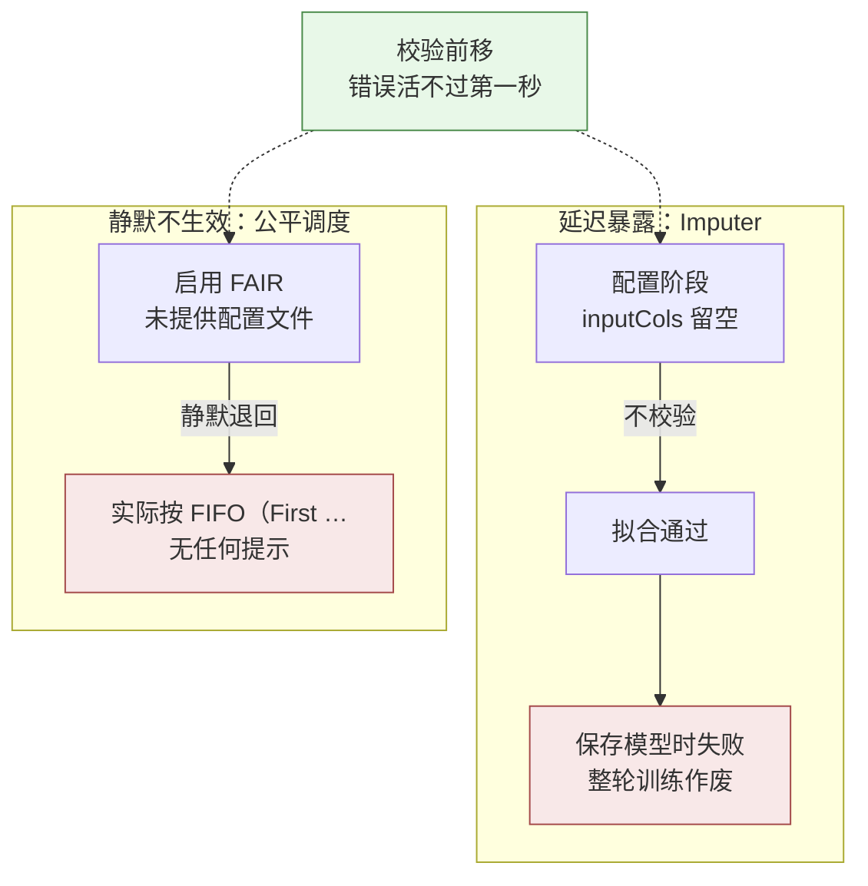
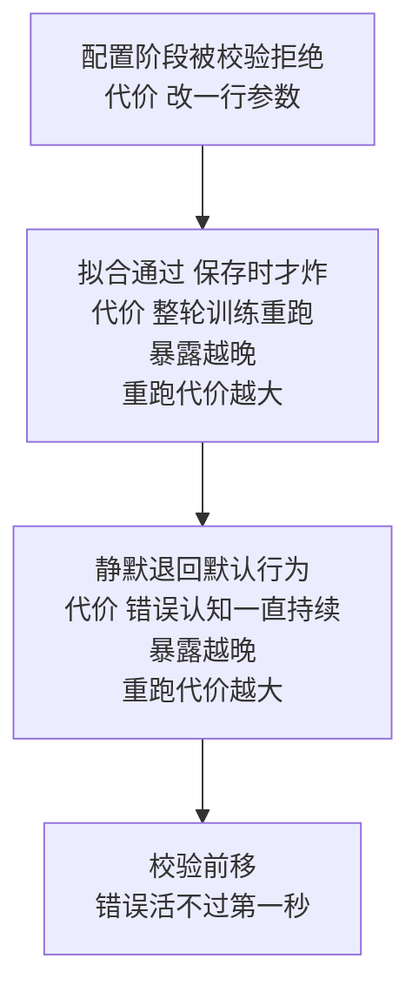

# 案例十五：错误最晚在哪一刻暴露——Imputer 与公平调度的两种延迟

**配置类缺陷有两种延迟形态：拟合通过、保存才炸，以及启用了等于没启用**。读完这篇你能把配置的价值锚在四级链路贯通那一刻。

> **要点**：配置类缺陷的两种延迟形态——错误延迟暴露（拟合通过、保存才炸）与配置静默不生效（启用了等于没启用）——共享同一条不变量：配置的价值在四级链路贯通的那一刻才存在，断在哪一级都等于没配。

## 要解决的问题：案例背景

**项目**：Apache Spark——其 ML 库与 YARN（Yet Another Resource Negotiator，Hadoop 的资源调度器）资源调度是配置问题的高发地。

两个变体要解决的**同一个难题**是：**配置的错误如果没有在配置当下暴露，就会沿着流水线向下漂移，等到暴露时，用户已经为这个错误付出了完整的计算代价**。**识别延迟暴露的形态，才能把校验点前移到代价最低的位置**。



**两条链路的代价差别在虚线那一侧**：左侧的错误最终会暴露，代价是整轮训练；右侧的错误不暴露，代价是用户一直以为配置生效了。**后者更难发现，因为它不产生任何失败信号**。

## 这两种延迟各自是什么

**错误延迟暴露**（[上游 commit 2b54b48c](https://github.com/apache/spark/commit/2b54b48cd852f93e8cf24397df6f3ec5b755233e)，P2）。Spark ML 的 Imputer 在输入列集合为空时不做校验，拟合阶段一切正常，直到**保存模型**时才因空 schema 失败。**同一个错误，暴露时刻从"配置时"推迟到了"训练完成后"——用户要重新配置列，再把整轮训练重跑一遍**。

**配置静默不生效**（[上游 commit 35023e81](https://github.com/apache/spark/commit/35023e81e0b0d1c64e2db0b1a3ba30c29e1fbd4c)，P2）。用户启用应用内公平调度，却不提供调度池配置文件——**作业实际仍按先到先服务排队，多个作业无法按权重共享资源**。配置被接受了、被记住了，就是**没有产生任何效果**，也没有任何提示。


来源：[小林coding《进程、线程基础知识》](https://www.xiaolincoding.com/os/4_process/process_base.html)


## 最小对照实验怎么设计

延迟暴露的最小复现只需三行：

```python
imputer = Imputer(inputCols=[], outputCols=[])   # 空列集合，配置阶段不报错
model = imputer.fit(df)                          # 拟合通过
model.save(path)                                 # 直到这里才失败
```

把 `inputCols` 留空是用户的配置错误，但**错误的第一现场在 `save`，此时整轮训练已经跑完**。

静默不生效那一例的对照是配置与观测的对照：

```bash
spark-submit --conf spark.scheduler.mode=FAIR app.jar   # 未提供 fairscheduler.xml
```

配置被接受，作业按 FIFO（First In First Out，先进先出）排队。**验证方法是看调度池视图里是否出现多个权重池——没有出现，就说明这条配置没有贯通**。

## 这类问题还在哪儿出现过

和 [[工程知识/缺陷分析：从个案到体系/配置/案例四：配置不生效——recover 速率与重复日志]] 的主病例（recover 限速参数在传递链路上丢失）并排放着看，不变量完全一致：**配置的价值在"声明—解析—传递—执行"四级链路贯通的那一刻才存在，断在哪一级、或验证缺位，都等于没配。** **差别只在断裂的位置和暴露的时机**——Imputer 断在"校验缺位"，公平调度断在"传递不达"，recover 断在"参数传递"。**而错误暴露得越晚，重跑的代价越大：配置时发现改一行参数，训练完才发现要重跑整轮训练**。

## 上游怎么修


**同一个配置错误的代价不由错误本身决定，而由它在流水线上哪一刻被撞见决定**——三种暴露时刻的代价差着几个数量级：



前移的目标就是把 B 与 C 两条支路并回 A：**一个 if 加一条明确报错，换来的是整轮训练不再作废、错误认知不再持续**。

两条修复方向一致——**把错误推到最早能发现的时刻**。**Imputer 的修复在拟合入口加参数校验，空输入列当场给出明确错误；公平调度的修复让缺省配置真正生效**，而不是静默退回旧行为。**前者是"启动时校验"，后者是"缺省即正确"，都是把验证前移**。

配置的价值在「声明—解析—传递—执行」四级链路贯通的那一刻才存在，**本质问题在于断在哪一级或哪一级缺校验，都等于没配，且暴露越晚重跑代价越大**。

暴露时机要与前移位置对账——**预写空输入列应在配置阶段被拒绝、缺省配置应真正生效，实测拖到保存模型时才失败，与预期对不上**。

两种延迟形态在工程上的处置也不同。**延迟暴露型缺陷的修复位置是"补一个校验"，校验放在最早能判定对错的地方——通常是配置被读入的那一刻，因为那里的上下文最完整、代价最低**。**静默不生效型缺陷的修复位置是"补一个回执"：让系统把实际生效的值说出来，用户就能拿它和自己写的值对照**。**前者加判断，后者加观测，两者都不是改业务逻辑**。

## 这套说法在哪儿会失效，代价换来了什么教训

- **每个配置项都值得问一句**：如果这个值是空的/错的/缺失的，系统会在哪一步、以什么方式发现？**答不出"最早的那一步"，就是潜在的延迟暴露**。
- **静默退回默认行为比报错更危险**——**用户以为配置生效了，系统按另一套规则在跑，两边还都对得上日志**。
- **校验前移的成本极低**：一个 if 加一条明确报错，换来的是**"配置错误活不过第一秒"**。

"错误在哪一刻被闻到，取决于探测器装在哪"的实物原型是火灾探测报警器：装在厨房烟机旁，炒菜的油烟天天误报；装在无人阁楼，起火三天后才被发现——**探测器没有错，装错位置让代价差出数量级**：


*图源：Wikimedia Commons，作者 Kurtkaiser，CC0，https://commons.wikimedia.org/wiki/File:Fire_detector_and_alarm.jpg。*

校验就是给配置错误装的烟雾报警器：Imputer 的报警器装在 save（阁楼），烟都烧穿屋顶了才响，整轮训练已经作废；前移到配置入口（厨房门口），空列集合一进门就报错。公平调度缺的不是报警器是烟——静默不生效连报警器的电都没接，**补一个"实际生效值"的回执，才让烟可见**。


## 怎么自己动手验证

1. 上游对照：到 Spark 的提交 2b54b48c 与 35023e81 里核对两处修复，**确认一处把空输入列的校验前移到配置阶段、一处让调度模式与调度池配置缺失产生明确提示**。
2. 延迟暴露复现：把 Imputer 的输入输出列集合留空，**修复前配置阶段不报错、拟合通过、直到保存模型时才失败、整轮训练作废，修复后配置阶段即被拒绝**。

3. 静默不生效复现：启用应用内公平调度但不提供调度池配置文件，**修复前作业仍按先到先服务排队、多个作业无法按权重共享资源且没有任何提示，修复后缺少配置被显式指出**。
4. 贯通核对：按声明、解析、传递、执行四级逐项检查该配置，**确认断在哪一级并记录其表现**。
5. 断言锚点：两类缺陷各自的修复前后表现留档，**配置阶段与执行阶段分别读取的实际生效值可对照**。

## 接着读哪几篇：同在缺陷分析里的相邻问题

- 配置与可操作性的行为对齐逻辑已在 [[工程知识/缺陷分析：从个案到体系/配置/案例四：配置不生效——recover 速率与重复日志]] 文内讲清。
- 启动自检的价值见 [[工程知识/缺陷分析：从个案到体系/缺陷分析方法——三分离、判定树与五步法]]。


- [[工程知识/缺陷分析：从个案到体系/配置/案例四：配置不生效——recover 速率与重复日志]] 讲过声明—解析—传递—执行四级链路：断在哪一级，配置都等于没配。**这一篇补两个 Spark 的变体（均已真实复现），它们展示了同一条不变量的另外两种断裂方式**。
