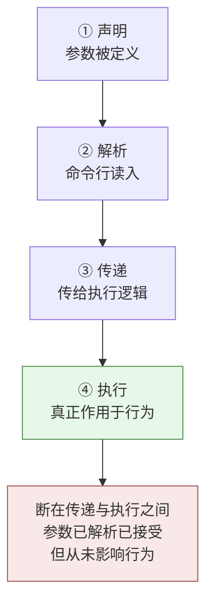
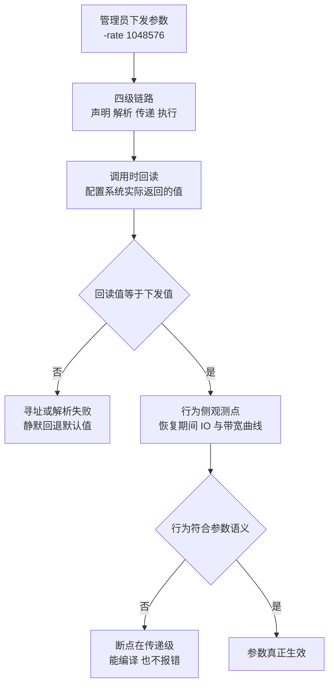

# 案例四：配置不生效——recover 速率与重复日志

两个"系统不听话"的病例：限速参数在传递链路上丢失，同一条失败被反复打印。读完这篇你能修的是行为与预期的对齐。

> **要点**：两个"系统不听话"的病例：**限速参数在传递链路上丢失，恢复全速占满带宽**；**同一条失败被反复打印，错误日志淹没真正的线索**。**要修的是行为与预期的对齐**。

配置类缺陷有一个容易被人轻视的特点：**代码没有错**。参数声明的代码、日志打印的代码都按作者的意图正确执行——**错的是"系统的实际行为"和"操作者的合理预期"之间断开了**。这一篇的两个病例都来自 BookKeeper 的运维路径，**都发生在最需要系统听话的时刻：数据恢复**。

## 要解决的问题：配置明明改了，为什么不生效

先把形状说成一件事：**配置不生效像给恒温空调设了 24 度但屋里还在降温**——**控制面板显示的值（配置文件里的参数）已经改了，压缩机却没收到指令**（代码路径没读这个参数）。这类缺陷最难缠的地方在于「设置动作成功」与「设置生效」是两回事：空调面板会「嘀」一声确认按键，但按键是否接通了压缩机的线路，只有温度计知道。**配置类缺陷的检查对象就是这个线路**。这个比喻到「温度计」为止——现实里两个病例各在哪一环断线，下面逐案展开。

## 病例一：限速参数怎么就不生效了（P1）

**背景**：管理员用 `bookie shell recover` 手动恢复一台故障 Bookie 的数据。恢复要复制大量数据，为了不影响线上流量，工具提供了 `-rate` 参数限制复制速率。管理员指定了速率，系统**全速开跑**——**网络与磁盘 IO 被恢复流量占满，线上业务遭殃**。

**机制**：**问题出在参数链路的传递级**——`-rate` 在命令行被正确解析、也被接受，**但没有接着传进实际的恢复执行逻辑**，**于是在中途静默丢失**。**声明与解析两级都是好的，缺的是把值从解析结果送进执行端的那一环**。[上游 commit 9877db9e](https://github.com/apache/bookkeeper/commit/9877db9e29143cfe3671a1faff7cf0d069801b68) 的修复是**补齐这条传递路径**，**让限速值能真正到达执行端**。


来源：[CSDN @bjmayor《图解分布式事务模式》](https://bjmayor.blog.csdn.net/article/details/154004146)（CC 4.0 BY-SA）


来源：[博客园《解密 Raft 算法》](https://www.cnblogs.com/traditional/p/12588733.html)（CC 4.0 BY-SA）


## 病例二：日志怎么就误导人还刷屏了（P2，上游判定的中等等级）

**背景**：自动恢复流程替换一台已宕机的 Bookie 时，日志里刷出**大量重复的"无法解析网络位置"错误**。**管理员排查故障时被这些错误日志淹没**——**它们看起来像故障的根源，实际只是同一未知 bookie 被重复解析时反复打印的同一条信息**。

**机制**：替换流程会对未知的 bookie（尚未注册进集群元数据的存储节点）反复做位置解析（把 bookie 标识解析成可访问的网络地址），**每次失败都打一条 ERROR**。行为本身没错（确实解析不了），但**打印策略错了**——**同一原因的重复失败不该重复报**。[上游 commit 82171ba1](https://github.com/apache/bookkeeper/commit/82171ba198981695cf5ded4e5420716bfd3ce450) 的**修复是加跳过逻辑，同一原因只打印一次**。

两个病例合起来看还有一个共同点：**它们都"功能没按预期的方式工作"**，**而不是"功能坏了"**。**恢复仍在跑、日志仍在打，系统看上去一切正常**——**这正是配置类缺陷难以靠功能测试拦住的原因**：**测试断言的是"有没有做"**，**而这两个缺陷出在"以什么速度做"和"说了几次"**。

## 为什么这一类危险

配置类缺陷的危险藏在它所发生的时刻与它造成的误导里：

- **发生在最脆弱的时刻**。两个病例都发生在数据恢复时——**集群刚刚损失了一个节点，正是最需要稳定、最不该有意外流量的窗口**。**限速失效的恢复流量，等于在伤员身上又压了一块石头**。
- **伪装成故障根源**。**刷屏的重复错误日志会吞掉真正有价值的线索**：排查的人面对几千条相同 ERROR，**注意力全被它们吸走，真正的病因藏在旁边**。日志的价值不在多，在**信噪比**。

这类缺陷还有一个共同的来源：**参数要在"声明—解析—传递—执行"四级链路上都活着，才真正生效**。**断在哪一级都是同一个现象——"配了没用"**。



四级链路里，**传递这一级是病例一的实际断点**。**它也是最难被发现的一级**：**声明存在所以代码能编译，解析成功所以没有报错**，**唯独执行端拿到的是默认值或什么都没拿到**。前三级都没有可观测的失败信号，"配了没用"因此**只能靠行为侧的证据——看 IO 曲线、看带宽——才暴露得出来**。

这个观察直接给出了排查顺序：**与其反复改配置重试，不如沿着这四级逐级确认"这一级的输出是什么"**。**前两级看代码就能确认，第三级是断点高发区，第四级用行为侧的指标验证**。

用病例一的前后对照看这条链路断在哪里：

```
bookie shell recover -rate 1048576     # 管理员指定 1MB/s
实际行为：全速恢复                      # -rate 在传递链路上丢失
修复后：限速值传入执行端，恢复带宽可控
```

## 上游是怎么修的

**限速这类参数要想生效，前提是它处在控制回路里**。资源使用率越过阈值后限流（控制单位时间放进来的请求数量，超过配额就拒绝）启动、把负载压回阈值以内，这是回路该有的形态：

**配置项写对了但不在回路上，就等于没有**。**这正是「配置明明改了却不生效」的真实含义**——**值被读到了，但没有接到任何动作上**。

**两个修复都小得出奇**，**一个补参数声明，一个加跳过打印的判断**——**发现缺陷的成本远高于修复的成本**。这也是配置类的常态：**难处在意识到"行为和预期不一致"本身就是一条值得记录的缺陷**。**使用者遇到限速失效，通常先怀疑自己参数写错，再默认工具本就如此**。

## 这套防法在哪儿会失效：边界与教训

「读回来确认」只证明配置被加载，不证明它影响了行为——两级核对各自拦住哪一级断点：



生效核对最终要落在行为侧的曲线上：前三级都没有可观测的失败信号，只有「恢复流量占了多少带宽」这一条证据能给出答案。

- **不要把"日志很吵"只当烦人**。**重复错误日志刷屏意味着同一失败路径在反复触发**——**它本身就是一个需要回答的问题，也是信噪比问题**。
- **运维参数要有验证手段**。**限速生效没有生效，看一眼恢复期间的 IO 曲线就知道**——**给关键运维路径配上"参数真的生效了"的可观测点**。
- **写文档不如做校验**。**参数声明链路断了一截，文档写得再细也救不回来**；**启动时对关键参数做一次"读回来确认"的自检，比多写三页文档有用**。"读回来确认"**指的是把配置系统实际返回的值回读并打点**，而不是确认配置文件的字面内容——**文件写对了但没被加载，回读才会暴露**。
- **恢复和降级（主动牺牲部分功能或精度，保住核心链路）路径也要走全量测试**。**它们被触发的频率低，但恰恰在故障时刻运行**——**此时出 bug，等于在救火上放火**。**低频路径的另一个问题是唯一一次运行就在最紧张的场合，没有第二次机会去观察行为是否符合预期**。

## 接着读哪几篇：期望与现实的偏差

- [[工程知识/缺陷分析：从个案到体系/缺陷分析方法——三分离、判定树与五步法]]
- [[工程知识/缺陷分析：从个案到体系/安全/案例五：安全两例——认证绕过与带漏洞依赖]]
- [[工程知识/缺陷分析：从个案到体系/缺陷分析：从个案到体系——导读与开源地图]]
- [[工程知识/缺陷分析：从个案到体系/配置/配置文件定位失败被静默忽略：调优在部署那一刻就丢了]] —— 同为"配置了但不生效"的方法面：寻址失败被静默回退，生效核对作为终局防线
- [[工程知识/缺陷分析：从个案到体系/配置/配置模板的段归属：选项写错段落，严格模式一票否决]] —— 配置资产（模板）从未被加载测试的相邻形态
- [[工程知识/软件构建：让变化可以理解、验证与交付/开发工具/cli的参数设计：限速这类可调旋钮要暴露成参数，不能藏在配置文件里.md]] —— 配置不生效的工程解法：作业级旋钮参数化，调整随调用留痕
- [[工程知识/缺陷分析：从个案到体系/配置/案例十五：错误最晚在哪一刻暴露——Imputer 与公平调度的两种延迟]] —— 同为「配置/参数在最晚一刻才暴露」的相邻形态
