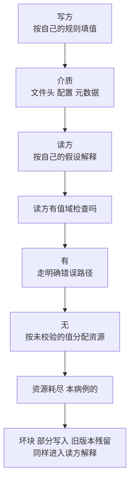
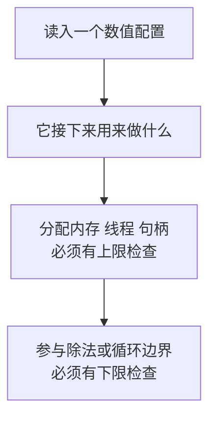

# 配置协议要写进文档：读方与写方对同一配置的假设要显式对齐

一个配置项被多方读写，每方都在自己的代码里维护对它的假设。读完这篇你能把这些假设显式对齐，不再让相遇即故障。

> **要点**：一个配置项被多方读写时，**每方都在自己的代码里维护对它的假设（合法值域、单位、含义），假设散落且互不知情——写方按自己的假设写出文件，读方按自己的假设解释，相遇即故障，故障形态还是资源耗尽这种最吵的一种**。

## 读方与写方的假设对不上，会在哪里断

配置系统的常见模型是"一个配置项、多方读取"：配置文件里写一个值，不同模块各自读它、各自解释。每方对值域、单位、含义的假设写在自己的代码里，彼此之间没有对齐机制。

Apache BookKeeper 的真实病例（上游修复 commit 7733db1c，可查）：**entry log 文件头的元数据里有"文件大小"字段，回收流程读这个字段来申请缓冲区；文件头由写入方按自己的规则填，读取方按自己的假设信——文件头部损坏时，"文件大小"字段的字节是异常残留，读出一个巨大的数值，读取方按这个值申请内存，直接内存（绕过 JVM 堆、由操作系统直接管理的内存）耗尽**，抛出的 OutOfMemoryError 逃出异常处理器，垃圾回收线程停止排期，磁盘涨满写入被拒（异常逃逸的防线在本库稳定性域已有专文，本篇讲的是上游同一批修复里的另一条腿）。

把镜头从"异常要兜底"挪到"假设要对齐"，故障的另一半结构才显形：**读方对配置与元数据的值域假设没有防御**。文件大小、超时时间、重试次数、批量上限——**每个数值型配置被读进来的那一刻，读方就默认了"它在合理值域内"**。**这个默认值对正常写入成立，对损坏文件、外部工具写出的文件、跨版本文件不成立——读方的值域防御是它与写方之间的唯一协议检查，没写防御就是没签协议**。

## 它是怎么做到的：隐式协议的三个断裂点

隐式协议的三个断裂点都出在「各自维护一套假设」上：**写方按自己的理解写，读方按自己的理解读，介质按自己的规则存。三方没有共同的依据，对齐就只能靠文档之外的东西**。


一个数值从写出到被使用要经过三处，每处都能让它偏离双方共同的假设：




数值配置被"写方 → 介质 → 读方"传递，协议藏在两端的代码里，断裂点按位置分三种：

### 写方会在哪一步断裂

**写方没有校验就写（本病例的深层条件——文件头在损坏场景写出了异常值）、或写方的值域比读方宽（写方允许 0 表示"未设置"，读方把 0 当合法大小）**。

### 介质会在哪一步断裂

**值在介质上损坏（磁盘坏块、部分写入、旧版本格式残留字节——本库正确性域"复用缓冲区的残留字节"正是同类上游病例）。介质不可信是存储工程的第一课，读方对"从介质读来的数值"做值域检查是这一课的直接应用**。

### 读方会在哪一步断裂

**读方拿到值直接用，按值分配资源（申请缓冲区、起线程、设超时）——值域上限检查缺席**。**本病例的 OOM（Out Of Memory，内存耗尽被系统终止进程）正是"按未校验的值分配资源"的标准后果**。

三个断裂点的共同根是**协议只存在于两端的实现里，文档与类型系统都不携带它**。"文件大小字段的合法值域是 X 到 Y"这个事实，**写方知道一半、读方知道一半，没有任何一处完整地写下它——协议本身是隐式的，防线的第一性目标就是让它显式**。


*图：Nacos 官方中文架构图——配置服务（Config Service）作为一层显式服务独立于业务层，读写双方通过 OpenAPI 交互，值域与格式的约定由服务层与一致性协议统一承载，写方、介质、读方三处的假设收敛到同一份显式定义里。*

*图源：Nacos 官方文档《Nacos 架构》，[https://nacos.io/zh-cn/docs/architecture.html](https://nacos.io/zh-cn/docs/architecture.html)。*

同一形态在云侧的标准画法：应用实例自己不存配置，运行时统一从外部配置存储取——写方改一处，读方按需拉取，配置的版本与生效范围由存储层统一记账，「两端各猜各的」在这个结构里没有位置：


*图源：[Microsoft Learn 中文文档《外部配置存储模式》](https://learn.microsoft.com/zh-cn/azure/architecture/patterns/external-configuration-store)，CC BY 4.0，文档引用。*

## 假设对不上要怎么修、靠什么兜底

好比两班工人共用一台机床，一个按毫米想、一个按英寸做（读方与写方对同一配置的假设不一致），出件全废——修法是交接本上写死「这台机床一律毫米」（显式协议），接班的人上机前先核对卡尺（值域检查）。上游修复给读方补上了值域防御；防线体系把隐式协议升级为显式约束：比喻到「交接本写死单位」为止。

### 读方为什么要做值域检查

从介质或外部输入读入的数值配置，**使用前检查合法区间（上限防御资源耗尽、下限防御除零与无限循环）——检查失败走明确错误路径，错误信息带实际值与合法区间**。这条防线的成本一行 if，收益是**把"OOM 崩溃"降级为"一条可诊断的报错"**。

### 为什么协议要同时写进文档与类型

配置项的文档标注值域与单位（配置模板里的注释、schema 的 min/max），代码层用带值域的类型或构造校验收编——两处显式化都指向同一目标：假设有唯一写下的地方。

### 写方为什么要做对称校验

显式协议在分布式配置中心里有完整的工业实现。etcd（分布式键值存储，Kubernetes 用它存集群状态）的架构把「写方 → 介质 → 读方」三方假设收进同一条链路：客户端经 gRPC API 访问 EtcdServer（gRPC：Google 开源的高性能接口调用框架），每次修改先过 Raft（一种以易于理解著称的共识算法：靠领导者与日志复制达成多数派一致） 共识（多数节点确认才提交，写方与读方看到的是同一份被确认的值），WAL（预写日志，先把改动写进日志再改数据本身）预写日志（先把改动记入日志再改数据、用于崩溃恢复的机制）在提交前先写介质（介质断裂可重放恢复），bbolt 后端按 revision 版本号存储每次变更（读方拿到的值自带版本，跨版本歧义被版本号消解）。三方各自的假设由共识协议与存储引擎统一承载，正是「协议有唯一写下的地方」的系统级形态：


*图源：Jimmy Song《Kubernetes Handbook · Etcd 解析》，https://jimmysong.io/zh/book/kubernetes-handbook/architecture/etcd/。*

同一形态在中文社区的另一个工业实现是携程开源的 Apollo 配置中心。整体架构里，Portal 与客户端各自连配置服务，读写两端面对的是同一份存放在数据库里的配置，发布流程由 Admin Service 统一记账：


*图源：[Apollo 官方 GitHub 仓库《Apollo 配置中心设计》](https://github.com/apolloconfig/apollo/wiki/Apollo%E9%85%8D%E7%BD%AE%E4%B8%AD%E5%BF%83%E8%AE%BE%E8%AE%A1)，中文官方文档。*

简化后的基本架构更直接地呈现「读方与写方对齐到同一份配置」：Client 定时拉取加上发布通知双通道，保证读方拿到的值与写方发布的一致，值域与格式的假设由 Config Service 层显式承载：


*图源：同上。Client 与 Config Service 之间的内存缓存与长轮询机制，正是「读方按写方的假设解释」在工程上的保证手段。*

写方在写出前检查自己要写的值（配合本库正确性域"清零是复用的入场费"的缓冲区纪律），介质上的坏值从源头减少。

### 防御性读入按什么分级

**值域检查按数值用途分级——分配资源的数值必须有上限检查（内存、线程、句柄都是攻击面或故障面），纯展示数值可宽松**。**把防御花在会变成资源分配的值上**，分级判据见下图。

**分级的依据是"这个值接下来会变成什么"**：



**左侧两类是攻击面与故障面：一个数值只要会变成资源分配或循环边界，外部可控的坏值就能直接影响进程。右侧那类即便读到荒谬的值，后果也只是显示不对。防御的资源应该全部投在左边**。

## 这套说法在哪儿会失效

三条边界防止防线走形。

**值域上限要给合法业务留余地**：**上限按"最大合法值的合理倍数"设定（如文件大小的上限远超当前容量规划），设得太紧会把大但合法的文件判为损坏——上限是防御参数，随容量规划复审**。

**检查失败要区分可恢复与不可恢复**：**单文件元数据非法 → 跳过该文件继续处理其余（按对象隔离，本病例修复的正确形态）；全局配置非法 → 拒绝启动（fail-fast）。一刀切"读入失败即崩溃"会把单点损坏放大成全局不可用**。

**文档化的协议需要版本管理**：**值域随版本演进（格式升级后合法大小变化），协议文档标注适用版本，读方按文件格式版本选对应的值域表——协议本身也是被版本化的配置**。

## 怎么自己动手验证

可复现的验证路径：

1. 构造越界值：准备合法值域外的元数据文件（损坏头部，大小字段为异常值），配合法文件作对照；
2. 未修复基线（正常状态下的指标水平、用来对比异常）：回收流程读入异常值按其申请资源，OOM 崩溃、任务停止——捕获故障；
3. 修复后重跑：同一文件得到明确报错（含实际值与合法区间），流程按对象隔离继续处理其余文件，对照文件不受影响；
4. 断言锚点：**任何介质读入的数值在资源分配前已过值域检查**；越界值触发的是可诊断错误，不是崩溃。

```text
注入 = 元数据大小字段异常（超界 N 倍）
降级断言 = 明确报错（含值与区间），无 OOM
隔离断言 = 其余文件继续回收，对照文件正常
```

"读入即可疑"是存储读取方的默认姿态——**值域检查是这姿态的最低成本实现，也是读方与写方之间唯一跑在运行时的协议确认**。验证时预期与实际的对照规则提前写明：**越界注入预期得到含实际值与合法区间的明确报错，对不上（OOM、任务停止）即值域检查缺失或检查位置在使用之后；合法对照文件预期全流程不受影响，对不上（被判损坏）即上限收得太紧需要校准**。

## 接着读哪几篇：同为"介质上的坏值"家族：写方侧的清零纪律

- [[工程知识/缺陷分析：从个案到体系/稳定性/异常处理器的覆盖面：Error 逃逸终止周期任务]] —— 同批修复的另一条腿：OOM 逃逸后的兜底与任务存活性
- [[工程知识/缺陷分析：从个案到体系/正确性/复用缓冲区的残留字节：清零是复用的入场费]] —— 同为"介质上的坏值"家族：写方侧的清零纪律
- [[工程知识/缺陷分析：从个案到体系/配置/配置类缺陷的静态防线：schema校验与默认值审计]] —— 配置值域显式化的静态防线总纲
- [[工程知识/数据系统：在并发与故障中保存事实/事务与存储/存储引擎的两大路线：B树与LSM的写读取舍]] —— 元数据格式所服务的存储机制背景
