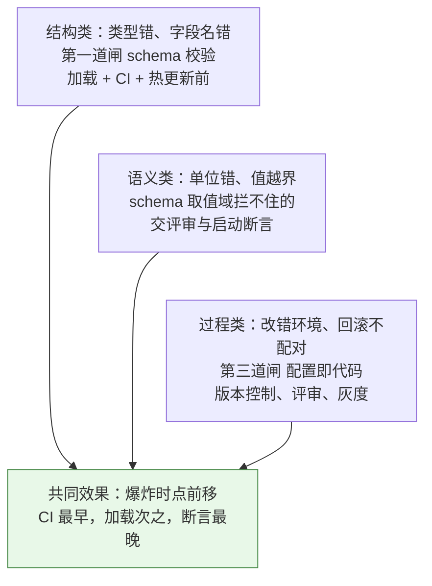
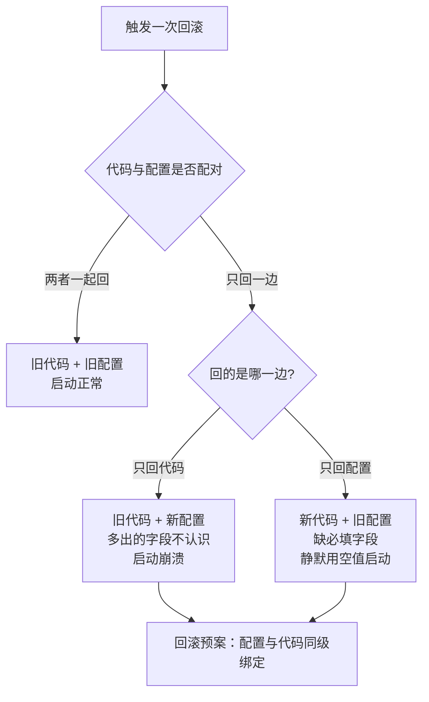

# 配置类缺陷的静态防线：schema 校验与默认值审计

## 要解决的问题

配置事故的形态清单很长：超时单位毫秒当秒，30ms 的超时让所有请求失败；布尔写成字符串，"false" 在弱类型解析里是真值；环境缺一个变量服务用空值静默启动，半个功能上线三天没人发现；配置改了但没生效，改的是默认分支，实际走环境变量分支、回滚（把系统状态退回到改动之前的版本）代码没回滚配置（旧代码不认识新配置多出来的字段，启动崩溃）。共同点：**配置是代码外部的输入，却参与了代码的正确性**——代码评审管不到它、编译器检查不了它、测试环境与生产环境的它还不一样。

**静态防线的思路：把配置当代码对待，用 schema 校验拦住结构错误、用默认值审计拦住语义错误、用配置即代码的 pipeline 拦住过程错误**。

## 它是怎么做到的

**静态校验要覆盖的是「声明」与「实际」之间的落差**。环形队列给了个干净的类比：**头尾指针在一块连续内存上循环，声明的容量与实际用掉的容量，是同一个结构里的两件事**。

*图源：腾讯云开发者社区《图解原理 Linux I/O 神器之 io_uring》，CC 4.0 BY-SA，https://cloud.tencent.cn/developer/article/2187655。*

**schema 校验：结构错误的第一道闸**。配置校验要的就是 Terraform 的 plan 位置：在配置真正生效之前，先跟 schema 比对一遍，这道闸就架在这类生效前时点。配置的 schema（JSON Schema、K8s 的 CRD validation——CRD 即 Custom Resource Definition，Kubernetes 的自定义资源类型机制，validation 指其中写死的字段校验规则）、Protobuf/YAML（YAML 是用缩进层级表达结构的配置语言）的强类型定义声明每个字段的类型、取值域、必填性、单位约束。取值域只能框住越界的那部分错误：timeout 声明 minimum: 1, maximum: 60000 毫秒，能拦下写成 600000 这类越界值，但把 30000 毫秒写成 30 秒（值 30）这类错配仍落在域内，schema 照常放行——**单位错配要靠量纲断言或命名约定（字段带单位后缀）另设防线**。校验挂在三个位置：加载时（启动前 fail-fast，坏配置起不来比带病运行好）、CI（Continuous Integration，持续集成：代码合并后自动构建与测试）时（配置文件与 schema 一起提交，合并前校验）、运行时热更新前（新配置先验后切）。**fail-fast 的语义价值**：**错误配置在启动第 1 秒报清晰错误（字段名、期望类型、实际值，好过运行第 1 小时出现诡异症状再反推三天）**。

**默认值审计：语义错误的第二道闸**。schema 管住"配置长什么样"，管不住"没写的配置是什么行为"。默认值审计清单：**每个可缺省字段显式声明默认值（不靠代码的隐式行为：null 走到下游是变空指针异常即 NPE 还是变零值）**；默认值的安全性审查（超时默认无限等待还是快速失败、重试默认开还是关——攻击面与可用性的默认姿态是决策不是顺手）；**默认值的漂移检测（代码版本升级后默认值变了吗？release note 说清，配置管理系统里默认值是显式数据）**。**危险的默认是"没有默认"**：缺配置时静默用空值跑起来，功能减半的僵尸服务最难发现。

**配置即代码：过程错误的第三道闸**。配置变更走与代码同规格的流程：版本控制（Git（分布式版本控制系统）管理，变更可追溯可回滚）、评审——**生产事故里配置 PR（Pull Request，拉取请求：请求把我的分支改动合入主干）的评审质量普遍低于代码 PR，因为它看起来"只是改个数字"**、灰度（配置变更也灰度：先改 1% 实例观察再全量，配置的爆炸半径与代码同级）、回滚预案（**配置回滚按钮与代码回滚同级，且两者绑定：回滚代码时提醒"这版代码要求的配置字段"**）。

*图示：Terraform 的 write → plan → apply 三步——先算出"这么写会变成什么"，确认后才 apply。图源：HashiCorp Terraform 官方文档《Introduction》，CC BY 4.0，https://developer.hashicorp.com/terraform/intro。*

**三道闸的落点相同，都是把发现时刻往前推**。差别在于能推到哪一步：结构类能推到 CI 提交时，语义类推到进程启动时，过程类只能靠流程约束推到变更前——越往后越依赖人。

回滚要过的一道暗礁：**代码与配置各自回滚会产生四种组合，其中只有一种是安全的，另外两种分别当场启动崩溃与带空值静默上线**——组合本身不危险，不配对才危险。

**三种组合里只有配对的那一种落在安全区**，另外两种一种是启动崩溃、一种是静默降级（主动牺牲部分功能或精度，保住核心链路）——拦住它们的正是机制节里那套三类防线映射：结构类交给 schema 校验（retries 写成字符串在 CI 就红灯），语义类里取值域拦不住的部分交给评审与启动断言（连接池 min > max 的逻辑矛盾、timeout 单位写错靠量纲断言拦），过程类交给配置即代码流程（忘发布的配置改动靠 PR 留痕暴露）。

## 它从哪儿来，要付什么代价

校验的代价是每次都要跨一次边界。就像 `read()` 每次都要跨到内核态（内核代码运行的高权限状态）——省不掉，只能靠批量把次数压下来。这个比方只到「每次校验都要付一次固定代价」为止，怎么把校验批量化要看正文。

配置管理的现代化沿三条线演进。十二要素应用（12-Factor App，2011，Heroku）确立"配置存环境变量、与代码分离"的原则；Kubernetes（2014+）把声明式配置（YAML + CRD 校验 + GitOps 工具链 ArgoCD/Flux）做成平台级标准；JSON Schema（长期以 draft 系列演进，2016 年是 draft-06，至今未成为正式批准的标准）与各语言的 config 库（Pydantic、 viper + schema、 dotenv-expand）把校验做进加载路径。Netflix 的"配置错误是第一大线上故障源"统计（2010s 公开分享）推动配置治理进主流视野。

**把配置从"运行时才知对错的文本"改写成"提交时就可校验的数据"**：schema 让配置有了类型系统，fail-fast 把爆炸时点从"生产流量进来时"前移到"进程启动时"，GitOps 把变更审计从"登录机器手改"升级为"PR 留痕"。**三层前移叠加，配置事故的发现成本降三个量级**。代价：schema 的维护税（字段增删要同步 schema，懒了校验就失效，失效的 schema 比没有更糟——给人假安全感）；**默认值审计没有自动化银弹**（默认值的"安全性"是业务判断：超时该快该慢没有普适答案，审计是人工评审清单，靠纪律不靠工具）；配置即代码的流程摩擦（紧急改配置要等 PR？紧急通道的设计：break-glass 即破窗，紧急时绕开审批直接操作、事后补记录的授权机制）机制允许跳过但要事后补评审——**是流程的必要泄压阀**。

## 这套说法在哪儿会失效

- **密钥与证书（CA 签发的公钥凭证、证明持有者身份）这类敏感配置不走普通配置流程**：它们进 Vault、K8s（Kubernetes 的常用简称、容器编排系统） Secret 这类 secret 管理系统，版本控制里只有引用不含值。**schema 校验对 secret 只验"存在与格式"，不验值**。
- **配置的运行时语义校验有底线**：跨字段的逻辑约束（A 开了 B 必须关）可以写启动断言，但依赖运行时状态的约束（"这个值不能超过当前机器内存的一半"）只能运行时检查，**静态防线的射程要诚实标注**。
- **环境差异本身是缺陷源**：staging 与生产的配置除环境标识外应当结构同构——同 schema、同字段集，靠环境专属 override 列表显式声明差异。**允许"staging 有 production 没有"的字段自由生长，环境漂移的坑比任何单个配置错误都深**。
- **feature flag 是配置的近亲但治理不同**：flag 的创建-使用-清理生命周期比普通配置短，**功能全量后还挂着的僵尸 flag 是独立缺陷族，需要到期提醒与下线清单的清理机制**。

## 怎么自己动手验证

- **schema 拦截实验**：给服务配 JSON Schema，故意提交类型错（retries: "3" 字符串）与越界值（timeout: 600000，超出声明的 60000 上限）。预期：CI 与启动校验双双红灯，错误信息定位到具体字段与期望类型或区间。再单独提交单位错配（timeout: 30，本意 30000 毫秒），预期校验放行——**这个放行本身正是取值域防线的边界证据，说明单位错配需要另设断言**。结构类防线可用性证据。
- **危险默认值审计演练**：对存量服务跑默认值清单（每个可缺省字段的实际默认行为），标注每个默认的安全姿态。预期：**清单里总有若干"静默降级"默认（缺配置就关功能/空值跑），这些即潜在事故点**。第二道闸的人工方法验证。
- **配置回滚配对实验**：模拟"回滚代码两版、配置留在当前"的操作。预期：**启动崩溃或运行时字段错误（新配置要求字段旧代码不识/反之），验证回滚预案里配置绑定的必要性**。过程类缺陷的复现证据。

## 接着读哪几篇：配置漂移与 flag 治理的姊妹篇

- [[工程知识/软件构建：让变化可以理解、验证与交付/测试与交付/灰度与功能开关的边界：交付节奏与配置漂移]] —— 配置漂移与 flag 治理的姊妹篇，本篇补 schema 与默认值防线
- [[工程知识/缺陷分析：从个案到体系/复现与回归/从复现到回归——让证据走完一圈]] —— 配置缺陷的复现依赖环境与配置快照，证据链方法共用
- [[工程知识/软件构建：让变化可以理解、验证与交付/测试与交付/静态分析的证据边界：它证明什么不证明什么]] —— 它划定了结构类检查的证据上限，本篇的 schema 防线位于这一上限之内
