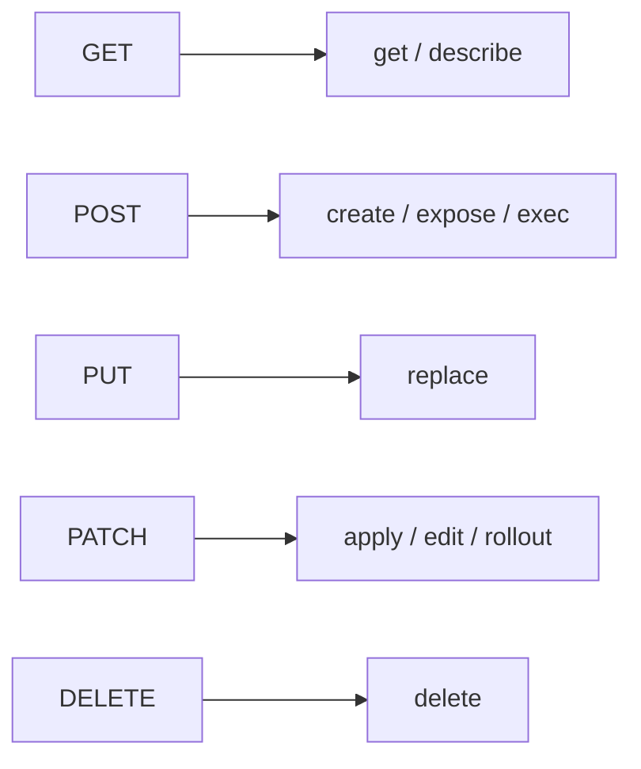
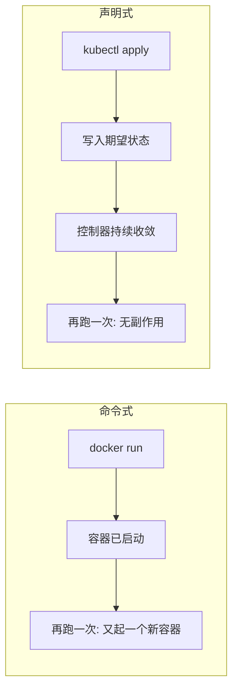
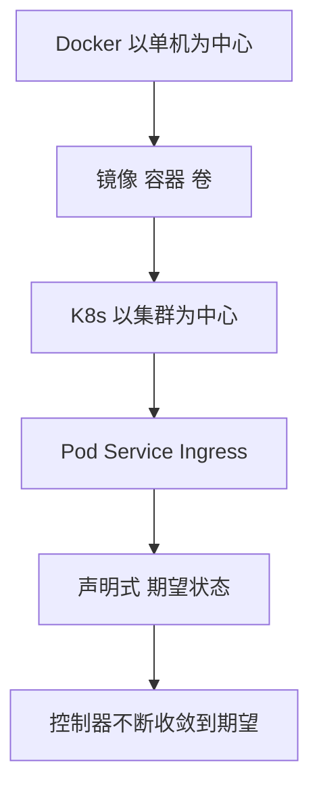

# Docker与K8s词汇的设计逻辑

**`Docker run` 是动词直接用，`kubectl get` 是 REST（表述性状态传递，用统一动词操作资源的接口风格）动词照搬，`kubectl apply` 是声明式语义的入口**。容器生态的命令词汇有两套设计逻辑，本篇把它们的设计逻辑与词源讲清楚，回答"为什么 kubectl 有 get、create、apply 三个看起来重叠的动词"。

本篇要解决的问题是：这几个动词看起来在说同一件事，**选错了当下能跑通，问题要到环境重建时才暴露**——create 写的脚本重跑就报错，replace 漏掉的字段被静默清空。理解之后容器命令行可以推理出来，不用机械记忆。

## 它是怎么做到的：两套哲学与动词表

容器编排里大量的词汇，本质都在解决同一件事：**把应用不该操心的事挪到旁边去**。网络调用的公共逻辑放进一个代理进程，应用只管业务——这就是外交官与边车这两个词背后的同一个念头。


两套词汇的差异源于两套模型关注的对象不同：**Docker关注单机上的进程生命周期**，Kubernetes（容器编排系统，管理跨节点容器的调度、扩缩与服务暴露）**关注集群里的期望状态**。

| 设计哲学 | 代表 | 动词集特征 | 词源背景 |
| --- | --- | --- | --- |
| 命令式（imperative） | Docker（容器工具，把应用与依赖打包成隔离单元） run/stop/rm | **动词即操作**：run 一条命令同时创建加启动 | 进程模型：容器即轻量进程，词汇继承进程动词（stop、kill 与进程信号同源） |
| 声明式（declarative） | kubectl apply/delete | **动词作用于期望状态**：apply 声明期望，控制器（集群里持续运行的调节进程）负责把实际状态收敛到期望 | API 模型：K8s 是数据库，kubectl 是 API 客户端，动词照搬 REST |

kubectl 动词的 REST 词源表。这张表的规律是：**kubectl 的动词几乎都能翻译回一个 HTTP 方法，理解了映射关系就不需要逐个记忆**。



apply 同时挂在 PATCH（HTTP 局部更新的请求方法）与 PUT（HTTP 整体替换资源的请求方法）上，对应 **apply 的两代实现**：client-side apply 走 PUT 语义（整份配置由客户端计算差异），server-side apply（服务端 apply，K8s 1.22 起正式可用）走 PATCH 语义，**由字段所有权决定谁改哪个字段**。

| kubectl 动词 | REST 词源 | 语义 | 与近义动词的区别 |
| --- | --- | --- | --- |
| get | GET | 列出或查看对象 | get 是读，describe 是读加关联对象展开 |
| create | POST | 新建对象 | **create 失败即报错；apply 幂等（重复执行结果不变）** |
| apply | PATCH（server-side）/ PUT | 声明期望状态 | **apply 重复执行无害，create 重复执行报错** |
| edit | PATCH | 编辑后提交 | edit 本质是 apply 的交互版 |
| replace | PUT | 整体替换 | **字段没写全会被清掉，apply 不会** |
| delete | DELETE | 删除对象 | delete 删对象，remove 已废弃 |
| describe | GET（多对象） | 查看详情加事件 | get 给表格，describe 给叙事 |
| expose | POST（Service） | 创建 Service | 一步完成创建与关联 |
| exec | POST（exec subresource） | 进容器执行 | 与 docker exec 同源 |
| logs | GET（log subresource） | 查日志 | 请求走 `/pods/{name}/log` 这类**主资源下的子路径** |
| rollout | PATCH（按子命令） | 管理发布历史 | rollout undo 把历史指针回拨到上一版本，发布历史本身保留 |

## 年代与演进：设计哲学在哪儿换代

路由形态是理解这些词汇的另一把钥匙：一个统一入口按规则把请求分给后端多个服务，客户端不需要知道后端怎么切分——Ingress（K8s 集群外流量进入的统一入口规则）、Service、Gateway 说的都是这层事。


| 词汇/概念 | 出生年代 | 状态 | 设计含义 |
| --- | --- | --- | --- |
| docker run/stop/kill | 2013（Docker 0.x） | 遗留 | 进程动词直搬，命令式哲学的原点 |
| docker ps | 2013 | 遗留 | ps 抄自 Unix process status，容器即进程这一心智模型的证据 |
| kubectl get/create/delete | 2014（K8s 1.0 前） | 标准 | REST 动词照搬，API 客户端哲学的具体体现 |
| kubectl apply | 2016（K8s 1.2，client-side） | 演进 | 声明式入口，last-applied-configuration 注解驱动幂等 |
| kubectl apply --server-side | 2021（K8s 1.22 GA） | 演进 | 服务端 apply，field ownership 让多控制器协作不互踩字段 |
| kubectl edit | 2015 | 标准 | apply 的交互版，编辑器改完即 PATCH 提交 |
| Pod | 2014 | 标准 | 一荚多豆的隐喻：多容器共享网络与存储命名空间 |
| rollout undo | 2015（1.1） | 演进 | 回拨历史指针、发布历史作为资源保留 |
| docker compose | 2014（fig，独立项目） | 演进 | fig 改名 compose，音乐术语：多容器协同如多声部合奏 |

这套词汇设计的收益是**动词集有哲学出处**，学习成本从背每个命令降到学两套模型；代价是**两套模型并存意味着同一件事有两三种说法**（get 与 describe、create 与 apply），**新人要在该用哪个上付出选择成本**。

核心设计的分水岭：get/create/apply 三动词的并存对应两类心智模型——**create 是"我要造一个东西"，apply 是"我要世界变成这样"**。理解这条分水岭后，整个 kubectl 动词集可以按 REST 语义推理出来。

两套模型的差异，落在同一个"部署一个应用"的动作上看得最清楚：



命令式的动作一旦完成就与系统脱钩，**声明式的动作写进的是一份需要被持续兑现的期望**。apply 能重复执行而 create 不能的原因在此：**幂等（同一个操作执行一次和执行多次的结果相同，重复执行不会产生额外副作用）是声明式模型的副产品**，动词本身并无此属性。

两套模型在日常机器上的共存形态，Docker 官方安装概览图画得直白：Linux 上 Docker 直接跑容器，macOS 与 Windows 上 Docker 藏在一台 Linux 虚拟机里——`docker run` 的每个动词最终都落在那台虚拟机的进程上：


*图源：Wikimedia Commons，DaniloBarros，CC BY-SA 4.0，https://commons.wikimedia.org/wiki/File:Docker_Installation_Overview.png。*

声明式收敛依赖的"控制器"具体住在哪里，官方架构图给了全景：控制平面里的 kube-controller-manager、kube-scheduler 持续调节集群状态，每个节点上的 kubelet 执行本机的容器生命周期——kubectl 的动词操作的是这条链路最前端的 kube-apiserver：


图源：[Kubernetes 官方中文文档《Kubernetes 架构》](https://kubernetes.io/zh-cn/docs/concepts/architecture/)（CC BY 4.0）。这张图解释了声明式动词为什么是那个形状：apply 写入的期望状态存在 etcd，收敛由控制平面的控制器完成，命令本身在提交后就与执行过程解耦。

图右下角「容器运行时」那一格放大的样子，就是 containerd（容器运行时） 的全景：kubelet 经 CRI（Container Runtime Interface，Kubernetes 的容器运行时接口） 插件进来，向下穿过 Services、Metadata、Content Store、Snapshotter 几层，最终落到 Runtime 的 shim 与 runc（OCI 容器运行时）——`docker run` 与 `kubectl apply` 两套动词在节点上合流到同一个进程族：


*图源：[containerd 官网](https://containerd.io/docs/)，Apache-2.0。命令动词只到 API 层为止；镜像怎么存（Content Store）、文件系统怎么叠（Snapshotter）、容器怎么跑（Runtime/shim），全由 containerd 的插件分层接管——这正是「词汇即接口」的边界：动词设计只负责到 API 那一行。*

server-side apply 的 field ownership（字段级所有权）是**这套词汇里最精巧的设计**——**每个字段记住谁写的，两个控制器各管各的字段互不干扰**，把声明式协作从口号做到了字段级实现。它没有新词汇，但让 apply 这个词从"客户端 diff"升维成"服务端合约"。

## 两套哲学怎么走到一起，看完能判断什么

Docker 的进程动词（2013）先成型，K8s 的 REST 照搬（2014）把它收编进 API 模型。收编的方式是并存，kubectl 至今保留 run、create（命令式）与 apply（声明式）两套入口。这是有意的过渡设计：命令式让人快速上手，声明式让人长期可靠，两套词汇服务两个阶段的使用者。KinD（Kubernetes in Docker）这个工具的名字本身就是两套模型的合体——用 Docker 的容器跑 K8s 的节点，收编关系写进了名字：


*图源：同上（Wikimedia Commons），Docker Community。*

自己的系统要不要留两套接口，这里就是参照。

- 手上的活是写部署脚本：**用 apply 而非 create，幂等性让重跑无害**（CI/CD，脚本被重试是常态）。
- 手上的活是多团队共享集群：**server-side apply 的 field ownership 直接可用**——各团队管各的字段，冲突在字段级暴露而不是**整对象互踩**。
- 手上的活是评审别人的部署方案：**看到 kubectl create 或 replace 用在 CI 脚本里，可以指出幂等性缺陷**；看到 replace 清字段，**可以指出声明式误用**。
- 想借鉴设计：get、create、apply 的动词三分（读、造、声明）是 API 设计的通用模式——任何"状态加收敛"的系统（配置管理、IaC，基础设施即代码）都能套用这个词汇骨架。

动词的划分对应三种不同的语义，混用正是大部分部署脚本缺陷的来源：



最后那两个分支是评审时最该盯的地方：`create` 用在会被重试的脚本里，第二次执行直接失败；`replace` 看着也是"把东西设成这样"，但它会清掉对象上未被本次声明覆盖的字段，与 `apply` 的收敛语义完全不同。两者的区别不在动作大小，而在是否承认"对象上可能存在别人写的字段"。
- 想避坑：compose 的 fig 出身说明生态词汇会被收购改名而单词不变，依赖工具词源做架构决策时要查它的演进史。

## 怎么自己动手验证

```bash
# 验证 apply 幂等 vs create 不幂等
kubectl apply -f deploy.yaml && kubectl apply -f deploy.yaml   # 第二次 configured/no-op
kubectl create -f deploy.yaml && kubectl create -f deploy.yaml # 第二次 AlreadyExists 报错
# 验证 get 与 describe 的信息层次差
kubectl get pods -A | head -5
kubectl describe pod <name> | head -20
# 验证 docker ps 的词源亲属
docker ps --format '{{.ID}} {{.Status}}' ; ps aux | head -3
```

预期：**apply 两次执行第二次无副作用（幂等证据）；create 第二次报 AlreadyExists（非幂等证据）**；describe 比 get 多出 Events 段（subresource 聚合证据）。结果与预期对不上时（apply 第二次也改了东西），查是否有 replace 语义的注解冲突——**last-applied-configuration 注解是 apply 幂等性的实现载体**。

## 这套说法在哪儿会失效

本篇讲容器生态命令词汇。方法论总纲见 [[工程知识/软件构建：让变化可以理解、验证与交付/开发工具/词汇即接口：Linux与容器命令的词源与设计]]。

Linux 侧命令词源见 [[工程知识/软件构建：让变化可以理解、验证与交付/开发工具/Linux常用命令的词源地图]]。声明式模型的深机制（控制器收敛循环）见 [[工程知识/后端系统：在并发、失败与变化中维持服务/基础设施/容器隔离资源边界与镜像身份]]。

资源模型（K8s 把集群当数据库）的设计深度见 [[工程知识/后端系统：在并发、失败与变化中维持服务/服务设计/服务发现与负载均衡决定请求发往哪里]] 的 Service 部分。

## 接着读哪几篇：同在软件构建里的相邻问题

- [[工程知识/软件构建：让变化可以理解、验证与交付/开发工具/词汇即接口：Linux与容器命令的词源与设计]]：方法论总纲
- [[工程知识/软件构建：让变化可以理解、验证与交付/开发工具/Linux常用命令的词源地图]]：Linux 侧对照
