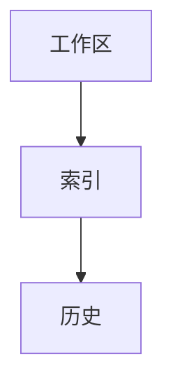
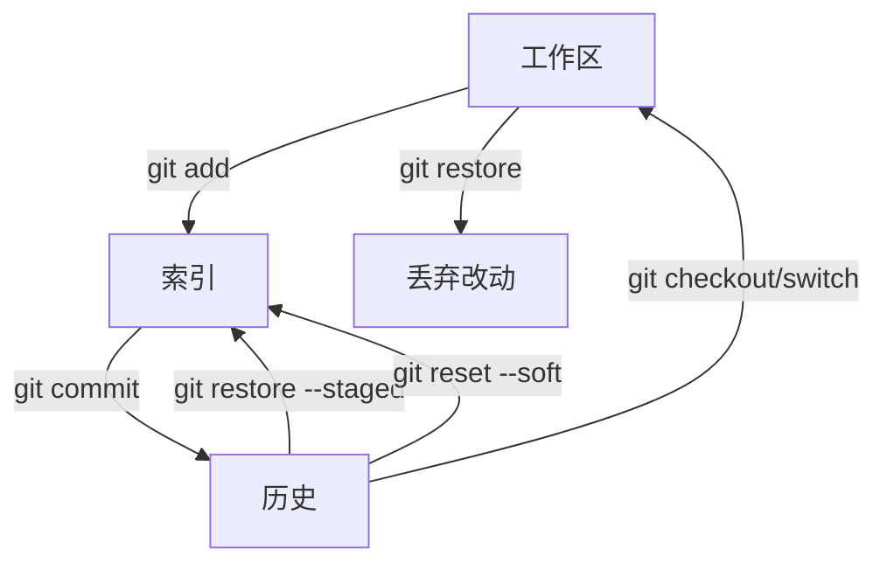

# Git 操作先区分工作区、索引与历史

**Git 命令多到背不完，但绝大多数操作只做四件事之一：改工作区、改索引、改历史、移动指向历史的引用（refs）**。**命令分类比背命令更重要**。要解决的问题是，面对一个"撤销"或"回退"的请求，**先判断它落在哪一层，再选命令——选错层的代价是丢工作**。

## 三层状态是怎么划分的：Git 的机制模型

先把形状说成一件事：**工作区、索引、历史像厨房的三个区域——工作区是案板（食材随便切，乱也没关系）；索引是备餐台（这道菜要用哪些食材先摆好，摆错的可以拿下去再摆）；历史是入库的菜单存根（一经入库不再改动，每张存根记录当时备餐台的完整样子）**。`Git add` 是从案板把食材摆上备餐台，`Git commit` 是把备餐台现状存成一张菜单存根。**多数「手滑弄丢代码」的事故，都是分不清食材在案板还是备餐台**。这个比喻到「备餐台」为止——现实里三层的读写规则，下面展开。



三块区域各管一段，这套机制模型的本质是**把一次改动的生命周期分成可分别操作的三个阶段**。官方手册给出的三区与数据流向是这套模型的原始形态：工作区的改动经 Stage 进入索引，索引经 Commit 落进仓库目录，而 Checkout 把仓库里的版本反向放回工作区——两条方向相反的箭头合起来就是日常操作的完整回路：


*图源：[Pro Git 官方手册中文版《起步 - Git 是什么？》](https://git-scm.com/book/zh/v2)（areas.png）。Checkout 那条反向箭头是"撤销类操作会丢工作"的根源——它覆盖工作区时不问内容是否已提交。*

```text
HEAD/commit 历史 <-> index/staging <-> working tree
refs/branches/tags
```

前一行是三层，后一行的 refs（引用：指向某个 commit 的命名指针，分支、标签、HEAD 都是引用）**不属于三层中的任何一层，它是贴在历史上的人名标签**——历史本身是一条 commit 链，引用只是给链上某个点起了个能叫出来的名字。明白这一点，就能理解**为什么"撤销"有时是移动引用（reset）、有时是新增提交（revert）：前者移动引用的指向，后者往链上追加提交**。

Pro Git 官方书的「What is Git?」章节用一张三区域图说明了三层在磁盘上的位置与数据流向：


来源：Pro Git 官方书「What is Git?」章节（CC BY-NC-SA 3.0）。工作目录是解压出来的文件，暂存区是下一次提交的快照（某一时刻的完整只读副本），Git 目录是仓库本体。

- `git status --short --branch`：当前分支、暂存和未暂存状态。
- `git diff`：工作区与 index；`git diff --staged`：index 与 HEAD。
- `git log --oneline --decorate --graph --all`：引用和历史拓扑。
- `git reflog`：本地引用移动日志，常用于找回误 reset 或 rebase（把已提交的改动重放到新基点上）前的位置。

## 为什么需要一个中间层

索引是 Git 与更早的版本控制系统最显眼的分歧点。Subversion 一类系统里，`commit` 直接把工作区状态送进仓库——没有中间层，也就没有"精选"这件事：一次提交必然包含当时工作区里所有改过的文件。

**Linus Torvalds 在 2005 年设计 Git 时加入索引，解决的是同一个问题：改动是连续的、混杂的，而提交应该是离散的、可审查的**。调试时顺手加的日志、临时注释掉的分支、与本次目的无关的格式调整，都不该混进一次提交。**索引让"哪些改动算一次"成为人的决定，而不是当时工作区状态的机械映射**。

代价随之而来：**多一个要维护的心理模型，多一组配套命令**。这也是 `git commit -a` 存在的原因——它跳过索引直接提交所有已跟踪文件的改动。快的代价是**提交粒度失控**，而**提交历史是给未来读者看的账本：粒度失控的账本在回溯与 revert 时的成本，远超日常的分层操作**。


## 常用操作落在哪一层

历史上每个点都是一次快照，分支与 HEAD 只是贴在上面的可移动标签。Pro Git 中文版的官方图把 commit 链与引用的关系画成两层：下层的三个 commit 各存一份快照，`v1.0` 与 `master` 两个引用、以及 `HEAD`，都只是指向上层某个 commit 的名字——`reset` 移动的正是这些名字，快照链本身不动：


*图源：[Pro Git 中文版（第二版）](https://git-scm.com/book/zh/v2)「分支简介」，CC BY-NC-SA 3.0。上层是引用（v1.0、master、HEAD），下层是 commit 链与快照，「移动引用」与「新增提交」的区别在这张图上一目了然。*



图里画的是命令的数据流：`git add` 把工作区内容写入索引，`git commit` 把索引快照写入历史。`git checkout/switch`、`git restore --staged`、`git reset --soft` 都是从历史取内容回填下层——其中 `git restore --staged` 只按 HEAD 重置索引，改动仍留在工作区文件里。**同一句"我要撤销"，落到不同层是完全不同的命令与后果**：`git restore -- file` **丢掉工作区改动**，`git restore --staged -- file` **只回退索引（文件内容不动）**，而 `git reset` **移动的是当前分支引用（`--hard` 时连带重置索引与工作区）**。**判断依据是"改动现在在哪一层"，不是"想撤销多少"**。

## 日常操作的安全路径怎么走

```bash
git fetch --prune origin
git switch feature/name
git status --short --branch
git diff
git add path/to/intended-file
git diff --staged
git commit -m "type(scope): explain outcome"
```

**默认显式 `git add <paths>`，避免把无关日志、密钥或生成物一起提交**。push 前确认 upstream 和远端差异：

```bash
git branch -vv
git log --oneline --left-right --cherry-pick HEAD...@{upstream}
```

## 撤销方式按「是否共享」选择

| 目标 | 推荐 | 结果 |
| --- | --- | --- |
| 取消未暂存文件修改 | `git restore -- path` | **覆盖工作区文件，先看 diff** |
| 取消暂存、保留工作区 | `git restore --staged -- path` | **只改 index** |
| 撤销已共享 commit | `git revert <commit>` | **创建反向 commit，保留历史** |
| 修改尚未共享历史 | interactive rebase（交互式重排尚未推送的提交）/reset | **移动或重写历史，先建 backup branch** |
| 找回误操作前位置 | `git reflog` 后建新 branch | **先恢复引用，不立刻再 reset** |

**`reset --hard`、`clean -fdx`、强制 push、删除分支都可能造成难恢复的损失**；执行前**精确列出目标、确认 diff 与状态并建立引用**。确需更新重写后的远端历史时，用 `--force-with-lease` 检查远端是否仍是预期位置——**它检查的是"远端是否还是我以为的那个状态"，比 `--force` 安全，但不是无风险命令**。

## Merge 与 Rebase 各自怎么合并历史

- **merge 保留分支拓扑，适合共享分支或希望保留合并上下文**。
- **rebase 重放 commit 形成线性历史，适合尚未共享的个人分支整理**。
- **冲突解决后必须运行测试并检查最终 diff；"Git 冲突已解决"只表示文本层面无冲突，不表示语义正确**。
- **可用 `git merge --abort` 或 `git rebase --abort` 返回操作前状态；中途不要混入无关修改**。

## Worktree 为什么适合自动化任务

**`git worktree` 让多个工作目录共享同一 Git 仓库元数据**。任务系统必须为 worktree **绑定 owner、revision、task generation（任务代次，防止旧任务的残留状态被新任务误认）和 lease（租约：限时持有的使用权，防止两个任务同时操作同一份资源）**；**其他任务仍在使用时不得 prune 或 remove 其元数据**。**每个任务报告实际 `git rev-parse HEAD` 与 dirty state，不能只相信计划中的分支名**。见 [[工程知识/AI 系统工程：从模型能力到生产能力/安全与治理/执行证据必须独立于AI结论]]。

## 提交和审查要守哪些规矩

- **一个 commit 表达一个可审查结果，并同时包含相应测试或迁移**。
- **commit message 说明"为什么和结果"，代码 diff 说明"怎么做"**。
- **不提交密钥、大型生成物、临时日志和个人环境配置；用 `.gitignore` 和 secret scan 门禁**。
- **大规模 rename 或 format 与语义修改分开，便于 review 和 `git bisect`（二分定位引入缺陷的提交）**。

## 故障后按什么顺序恢复

1. **停止继续写历史，保存 `git status`、`git reflog`、HEAD 和相关日志**。
2. **为当前与目标位置创建临时 backup refs 或 branches**。
3. **在新 worktree 或临时分支验证恢复点，不直接破坏当前目录**。
4. **恢复后比较 diff、构建和测试，再决定移动正式引用**。

## 这套说法在哪儿会失效

**历史改写的安全边界只到未共享为止**。**push 后的提交改写要通知全部协作者并走强制推送流程，共享历史的改写成本随协作人数上涨**——**已共享的历史用 revert 生成反向提交，回退的语义是追加，改写只留给私有分支**。

## 接着读哪几篇：同在软件构建里的相邻问题

- [[工程知识/软件构建：让变化可以理解、验证与交付/软件构建：让变化可以理解、验证与交付]]、[[工程知识/后端系统：在并发、失败与变化中维持服务/分布式可靠性/租约必须配合FencingToken阻止过期持有者]]、[[工程知识/软件构建：让变化可以理解、验证与交付/测试与交付/测试策略从风险选择证据]]。
