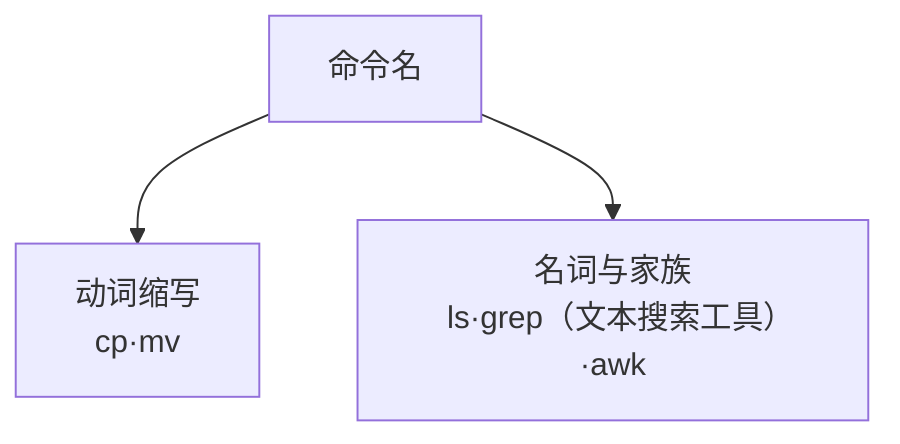
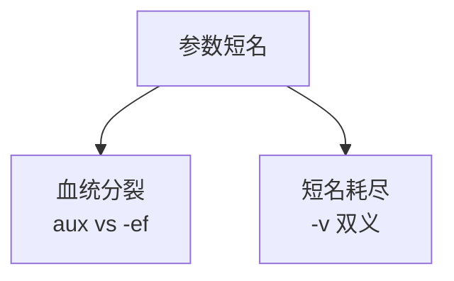
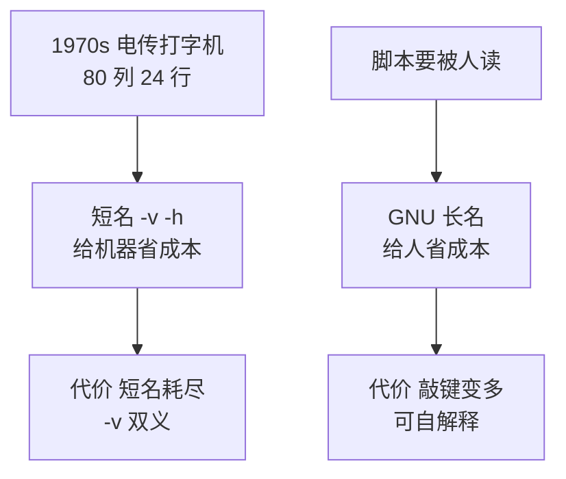

# Linux常用命令的词源地图

**`ls` 是 list，`mv` 是 move，`awk`（文本列处理语言）是三个作者姓氏首字母——Linux 命令名是有来历的**。要解决的问题：**把常用命令的缩写来历、参数短名的原始英文单词讲清楚，新人不需要背"咒语"，靠词源就能把命令行连成体系**。读完你能直接推出陌生命令的含义和参数写法。

## 命令名为什么长这样：按构词逻辑分四类

**命令名像英语单词，多数有词根、少数是外来语——`mkdir` 是 Make（最古老的构建工具） directory 的压缩，`awk` 是三位作者姓氏首字母，看见 `mkfifo` 能按词根猜出"建管道"，看见 `ps aux` 却要背（血统分裂）**。**分类就是分清"哪些像有词根的单词、哪些像专有名词"**。**命令名与参数短名的缩写策略可以分成四类，分清类别后大部分"神秘短名"都能自己猜出来**。但四类的来历不同，读法也不同：





**前三类能推：看见 `mkdir` 就想到 Make directory。第四类只能记——血统分裂是 Unix 分裂史留下的化石**，UNICS（Unix 的前身名字） 是 Unix（贝尔实验室开发的分时操作系统） 的正式展开即 Uniplexed Information and Computing Service、单工信息与计算服务，没有逻辑，只有历史；第四类表里"血统差异"的后果（同功能两套参数）与短名双义（-v 同时认领 verbose 与 version，26 个字母不够用）都属这一档。单列它，是为了先分清哪些能推、哪些要背：**能推的不用背，要背的先知道它为什么难背**。

| 类别 | 代表命令 | 构词逻辑 | 说明 |
| --- | --- | --- | --- |
| 动词缩写 | cp、mv、rm、ln、mkdir | 取动词首部：copy、move、remove、link、make directory | 最直觉的一类 |
| 名词短语缩写 | ls、ps、df、du、id | list、process status、disk free、disk usage、identity | 信息展示类命令 |
| 跨工具家族共享词 | grep、sed（流编辑器）、awk | 全称或姓氏缩写：globally search a regular expression and print、stream editor、Aho Weinberger Kernighan | 文本三剑客各有来历 |
| 参数血统差异 | ps aux vs ps -ef | BSD（Berkeley Software Distribution，加州大学伯克利分校的 Unix 分支） 无横线血统 vs System V 横线血统 | 同功能两套参数的根源 |

参数短名的词源表（只列难词，all/force 这类自解释词不列）：

| 参数 | 原始单词 | 为什么是这个短名 | 常见命令 |
| --- | --- | --- | --- |
| -v | verbose | 啰嗦模式：输出更多细节 | grep/tar/mv/cp |
| -v | version | 打印版本号 | gcc/python/node |
| -h | human-readable | 数字带 K/M/G 单位 | ls/df/du |
| -h | help | 打印帮助 | 大部分 GNU 工具 |
| -n | numeric | 不做名字解析（显示数字） | netstat/ss/top |
| -n | no-clobber | 不覆盖已有文件 | cp/mv |
| -r / -R | recursive | 递归处理目录 | cp/rm/chmod |
| -f | follow / force | 跟随符号链接 / 强制执行 | ls -f 与 rm -f 语义不同 |
| -i | interactive | 逐个确认 | rm -i/cp -i |
| -p | preserve / parents | 保留属性 / 连父目录一起建 | cp -p/mkdir -p |
| -u | user / update | 按用户过滤 / 只复制更新的 | ps -u/cp -u |
| -t | tag / target | 打标签 / 指定目标 | Git（分布式版本控制系统） tag -t/rsync -t |
| -x | extract / exclude | 解包 / 排除 | tar -x/rsync -x |
| -a | all / append | 全部 / 追加 | ls -a/tee -a |
| -b | block-size / buffer | 块大小 / 缓冲区 | dd/du -b |
| -c | command / count | 执行命令 / 计数 | sh -c/head -c |
| -l | long / list / login | 长格式 / 列表 / 登录 shell | ls -l/crontab -l/bash -l |
| -s | silent / size / summary | 静默 / 大小 / 汇总 | curl（命令行 HTTP 客户端） -s/du -s |
| -w | wait / width | 等待 / 宽度 | wget（命令行下载工具） -w/fsck -w |

## 哪些要背、哪些能推：年代与血统

**命令的年代与血统决定它落在哪一档：遗留的要背（血统分裂与短名双义都源于此），标准的能推（长参数纪律与家族一致性）**。

| 命令/参数 | 出生年代 | 状态 | 门道 |
| --- | --- | --- | --- |
| ls/cp/mv 等核心缩写 | 1969-1971（PDP-7（DEC 的小型机，Unix 的诞生地）/PDP-11（DEC 的经典小型机，C 语言的诞生地） 时代） | 标准 | 打字机时代省按键的缩写传统，POSIX（Portable Operating System Interface，Unix 系统调用与工具的接口标准） 定为标准 |
| ps aux vs ps -ef | BSD（1978+）与 System V（1983+）双血统 | 遗留 | 两套参数同功能并存，是 Unix 分裂史的活化石 |
| -v verbose / -v version 双义 | 1970s 起 | 遗留 | 短名空间耗尽后各自认领，无标准可协调 |
| --verbose 长参数 | GNU（1983+） | 标准 | 长名自解释，是 GNU 对打字机时代的纠偏 |

**核心缩写传统起点的那台机器也有实物存世。Unix 第一版就写在 DEC PDP（Programmed Data Processor，DEC 的小型机产品线）-7 上——`ls`、`cp` 这批两字母缩写的第一次运行，发生在这台机柜式小型机的纸带与磁芯之间；上表第一行的"PDP-7/PDP-11 时代"指的就是这类机器的键盘与纸带时代**：


*图源：Wikimedia Commons，作者 Matias Fjeld（Matiashf），CC BY-SA 3.0，https://commons.wikimedia.org/wiki/File:Pdp-7-oslo-2004.jpeg，2004 年摄于挪威奥斯陆的一次 PDP-7 修复现场。PDP-7 是 DEC（Digital Equipment Corporation，数字设备公司）1964 年发布的机柜式小型机，1969 年 Ken Thompson 与 Dennis Ritchie 在贝尔实验室的一台 PDP-7 上写出 Unix 的前身——本表第一行的"1969-1971（PDP-7/PDP-11 时代）"年代锚点就是它。*

| tar -x 磁带词源 | v7 Unix（1979）磁带时代 | 遗留 | 名字停在磁带时代，功能早已是通用归档 |
| ss vs netstat | ss（2001，iproute2） | 演进 | netstat 的继任者，更快更现代的 socket 视图 |
| lsof（列出进程打开的文件与套接字的命令） | 1994 | 标准 | 排查"谁开着这个文件"的事实收集标准件 |
| GNU coreutils 家族 | 2002 整合 | 标准 | --force/--verbose 全家族一致的长参数纪律 |

**收益与代价：词源讲清后，新工具的参数可以按家族猜（GNU 家族的 --verbose/--force 全家族一致）；年代与状态分档把"哪些要背（遗留）、哪些能推（标准）"划开，学习成本从机械记忆降到分类记忆**。代价是**血统差异**（BSD 与 System V）造成的同义参数分裂，**这份地图的取舍是只收高频与难词，完整覆盖交给 man（Unix 手册页命令）手册**。

**短名经济是硬件约束的化石，审美只是外壳：命令词汇成形于 PDP-11 这类小型机的电传终端时代——80 列 24 行、每敲一个字符都是真成本，两三字母缩写是那个约束下的最优解**。看着这些老机器，ls、cp、dd 的长度选择不用解释：


*图源：同上（Wikimedia Commons），Jeff Keyzer。*

（吉祥物 Tux 企鹅选型是这段社区史的注脚）。

## 这份地图看完能判断什么

**1970 年代终端是电传打字机，80 列 24 行，每敲一个字符都是真成本，两三字母缩写是那个约束下的最优解**。**GNU 长名是对这份遗产的反思：脚本要被人读，可读性比敲键数重要**。**这个判断在今天依然成立，它是"给机器省成本"与"给人省成本"两种价值观的分界**。看到这里，看任何一个工具的参数设计，都能判断它站在哪边、为什么。

**两种价值观各自的代价不同：短名给机器省成本，代价是短名耗尽后 -v 这类双义；长名给人省成本，代价是敲键变多——但可自解释**：



**今天几乎所有新工具都选右侧：键盘成本随硬件下降趋近于零，而读代码的人的成本没有变**。**仍在用短名的场合多半是交互式一次性命令，这条判据可以用来预测任何新工具的参数风格**。

- **手上的活是排查线上问题：这表里的难词（-n、-h、-i）大多是观测与安全词，知道词源就能跨工具迁移（ss -n 与 netstat -n 同义）**。
- **手上的活是写脚本：优先长参数，血统短名（-v 双义类）在脚本里是隐患，宁可敲长**。
- **手上的活是给团队定规范：GNU 家族的长参数纪律（全家族一致）是可以直接抄的范本，血统遗留参数写成对照表放进团队 wiki**。
- **想借鉴设计：tar 的"名字停在磁带时代"是警示——词汇一旦定型就很难改，命名时把当下技术当永久词源是包袱**。

## 词源推断靠谱吗：验证

```bash
# 验证血统差异：同一台 Linux 上两套 ps 参数都活
ps aux | head -3
ps -ef | head -3
# 验证 -h 双义：同一家族内也分裂（三条分别执行）
ls -h / | head -3
df -h | head -3
du -h /tmp | head -3
```

**预期：ps aux 与 ps -ef 输出同内容不同格式（血统共存证据）；-h 在 ls/df/du 全族都是 human-readable（家族内一致性证据）**。**结果与预期对不上时（某命令的 -h 打印帮助），查它的 --help，确认它属于哪个家族血统**。

## 这份地图管不到什么：边界

本篇是 Linux 侧词源明细。方法论总纲（三层词汇结构、长短双轨的来历）见 [[工程知识/软件构建：让变化可以理解、验证与交付/开发工具/词汇即接口：Linux与容器命令的词源与设计]]。容器侧词汇（Docker（容器工具，把应用与依赖打包成隔离单元）/kubectl 的动词集）见 [[工程知识/软件构建：让变化可以理解、验证与交付/开发工具/Docker与K8s词汇的设计逻辑]]。这些命令穿过的 shell 机制（管道、重定向）见 [[工程知识/软件构建：让变化可以理解、验证与交付/开发工具/Linux调查先收集事实再改变状态]]。

## 接着读哪几篇：同在软件构建里的相邻问题

- [[工程知识/软件构建：让变化可以理解、验证与交付/开发工具/词汇即接口：Linux与容器命令的词源与设计]]：方法论总纲
- [[工程知识/软件构建：让变化可以理解、验证与交付/开发工具/Docker与K8s词汇的设计逻辑]]：容器侧对照
