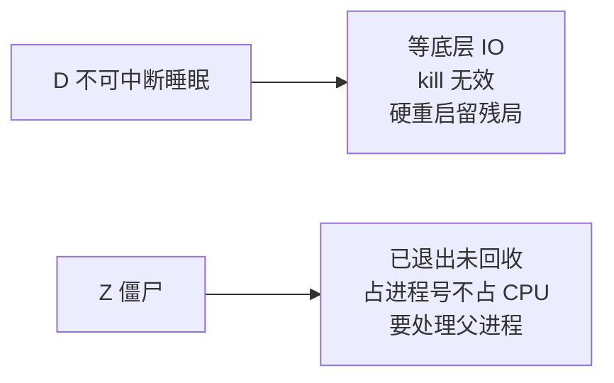
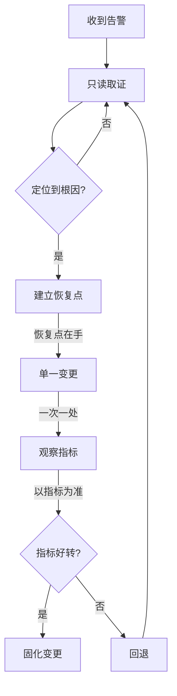

# Linux 调查先收集事实再改变状态

**故障面前先重启是本能，可重启抹掉了现场**。**读完这篇你能学会在动手改变系统之前先把证据收齐**。

线上出问题的时候，最自然的动作是"先试试重启"。这个动作像消防员进场先把所有灯关掉再找火源——灯是灭了，火在哪反而看不见了。**危险不在重启本身，而在它抹掉了现场：进程退出了，内存里的状态没了，连接追踪表（内核记录每条连接状态的表，网络与防火墙依赖它）清空了，而问题往往还没复现过第二遍**。要解决的问题是，**在动手改变系统之前，先把足以定位问题的证据收齐**。

这条纪律背后的不对称很直白：**观察的成本是几分钟，回退的成本是几小时。** **杀掉一个 PID（进程号，系统里每个运行中进程的编号）只要一秒，但被它持有的锁、写了一半的文件、下游等待它的连接，全部变成需要逐个清理的残局**。

## 要解决的问题


进程状态决定了**它能响应什么：运行、睡眠、不可中断睡眠、僵尸等状态各有不同含义**。**调查时先看状态，就能判断进程是在等 CPU、等 IO 还是已经退出，避免凭猜测动手**。

状态里最容易动手就错的两种是 D 与 Z：**D 表示进程在等底层 IO，此时 kill 也杀不掉，因为它不接收信号，硬重启只是把等待中的 IO 变成待清理的残局**；**Z 表示进程已退出但父进程未回收，它占的是进程号而不是 CPU，杀它无效，要处理的是父进程**。**把这两种状态认错，操作就从取证变成了破坏**。



**两种状态都指向"先别动"：D 等的是 IO 完成，Z 等的是父进程回收，都不是靠 kill 推进得了的**。

| 问题 | 首选 | 关注 |
| --- | --- | --- |
| 文件/内容在哪 | `find`, `rg`, `stat`, `du` | 路径范围、权限、挂载点 |
| 哪个进程在运行 | `ps`, `pgrep`, `pstree`, `systemctl` | PID 复用、父子树、启动时间 |
| 谁占用文件/端口 | `lsof`, `fuser`, `ss` | namespace、权限、监听/连接状态 |
| 日志发生了什么 | `journalctl`, `less`, `tail`, `rg` | 时区、轮转、request/task ID |
| 资源为什么慢 | `vmstat`, `pidstat`, `mpstat`, `iostat` | 队列、尾延迟（最慢那部分请求的延迟）、采样间隔 |
| 网络在哪断 | `getent`, `curl`, `ss`, `ip`, `mtr`, `tcpdump`（命令行抓包工具：把网卡上的数据包按条件过滤打印出来） | DNS/TLS/代理/权限/隐私 |
| 文件何时变化 | `inotifywait`, audit/event source | watcher 丢事件、递归、轮转 |

**命令的价值来自它回答哪个问题，而不是数量**。运行前确认主机/容器、用户、cwd、目标路径、时间窗口和权限。

**从收到告警到固化变更，只读与写入的分界要显式画出来：取证阶段只读；动手阶段一次只做一个单一变更，每步之后观察指标，好转才固化变更，恶化就退回取证**：



**这张图里唯一的循环出口是 B：无论变更成功还是失败，都回到取证**。**多数事故的恶化发生在跳过 D 直接做 E——没有恢复点的变更是不可逆变更**。

## 文件与文本怎么查：文件与文本

**参数要交代清楚：先报明确的位置（显式路径），再说明按什么条件筛（按内容搜还是按日期筛），绝不说「帮我随便找找」——工具不会也不该替你猜范围**。

```bash
rg -n 'pattern' /explicit/path
find /explicit/path -type f -mtime -1 -print
du -xhd1 /explicit/path | sort -h
stat /explicit/path/file
```

**`rg` 适合内容搜索；`find` 适合按元数据筛选**。处理包含空格或换行的文件名时使用 `-print0`（用 NUL 字符即空字节分隔结果，文件名内容不会与分隔符混淆）和能读 NUL 的消费者（如 `xargs -0`）。**不要用 `cat file | grep` 代替 `rg pattern file`，也不要让未校验变量展开成 `/`、home 或工作区根目录**。

## 哪个进程在干什么：进程与服务

```bash
ps -eo pid,ppid,lstart,stat,%cpu,%mem,args --sort=-%cpu
pstree -ap <pid>
cat /proc/<pid>/status
ls -l /proc/<pid>/fd
systemctl status <unit>
journalctl -u <unit> --since '2026-08-31 10:00:00'
```

**停止前验证 PID 对应的命令、启动时间、cwd 和 owner，优先让服务管理器执行 stop**。**单杀父 PID 会留下子孙进程**，详见 [[工程知识/后端系统：在并发、失败与变化中维持服务/任务与并发/任务生命周期必须覆盖进程、日志、超时与清理]]。

## 网络问题先看什么：网络

好比打电话听不出问题在哪段：是没接通总机（域名解析）、总机接通转不到分机（连接建立）、还是分机响了没人接（服务在听但没人处理）——要一层层换问题问。网络问题的第一现场通常是 I/O 模型。I/O 多路复用（一条连接上同时承载多个请求、互不阻塞）这一层，决定了你看到的是「连不上」还是「连上了但没人处理」。


*图源：ToolsBook《干翻 nio，王炸 io_uring 来了，史上最详细说明及最全图解》，CC 4.0 BY-SA，https://www.toolsbook.org/2024/05/nio-iouring.html。*

排查按"先解析、再连通、再监听"的顺序走，每步命令只回答一个问题：

```bash
getent hosts example.com
curl -v --connect-timeout 3 --max-time 10 https://example.com/health
ss -lntp
ip -s link
```

**`ping` 失败不能证明 TCP（传输控制协议，负责把数据完整、有序地送达） 或 HTTP 不可达，很多网络会过滤 ICMP（互联网控制报文协议，ping 使用的协议）**；**`curl` 成功也只证明这个 URL、这份身份、这个时间点**。**抓包可能包含凭据和业务数据，限制接口、host、时间和文件权限**。

## 机器当下忙不忙：性能快照怎么读

看性能快照（某一时刻的完整只读副本）时，**先弄清进程在等什么——先看哪项指标异常，再顺着异常找等待来源，而不是拿到数据就动手改**。**连接与线程的绑定关系是最常见的等待来源：协调器管着的连接，得逐个交给线程去用**。比喻到「先看异常再找器官」为止，等待来源怎么定位看下文与图。


*图示来源：同上 ToolsBook《干翻 nio，王炸 io_uring 来了》连接与线程绑定一图。*

连接等待之外，CPU、内存、磁盘各自的排队量由下面的命令逐项给出。

```bash
uptime
vmstat 1 5
pidstat -dur 1 5
mpstat -P ALL 1 5
iostat -xz 1 5
```

**这些命令提供入口，不给出根因**。**把采样（只采集一部分数据以控制记录开销）和用户请求、trace、应用队列对齐**，再进入 [[工程知识/性能工程：从用户等待到资源瓶颈/观测与诊断/系统指标与观测]]。

## 动手改状态前过哪些门：破坏性操作门禁

执行删除、权限变更、kill、iptables（Linux 防火墙规则工具）/nft、mount、sysctl 之前：

1. **用只读命令解析精确目标并打印出来**；
2. **确认当前 namespace（隔离进程、网络、挂载点等资源视图）、host、用户和 cwd**；
3. **备份配置或创建恢复点，写明回滚（把系统状态退回到改动之前的版本）步骤**；
4. **对单个目标试运行，观察指标**；
5. **记录命令、退出码、stdout/stderr 和变更后验证结果**。

**不要在未展开的变量、宽泛 glob（`*.log` 这类通配符匹配模式）或符号链接（指向另一个路径的引用，递归时可能转出去）边界不清时运行递归操作**。**优先使用可恢复的移动或隔离，而不是直接删除**。

## 管道组合怎么会出错：Shell 管道正确性

- **引号保护变量：`"$value"`；参数用数组而不是拼接命令字符串**。
- **管道失败可能被最后一个命令掩盖；脚本按环境使用 `set -euo pipefail`，同时理解其边界并显式处理预期失败**。
- **使用 `--` 分隔选项与文件名，避免以 `-` 开头的路径被当成参数**。
- **命令输出不是稳定 API——不同版本的 `ps` 列序会变，解析脚本随之失效**。**自动化优先 JSON 等结构化格式或 `/proc` 等正式接口，并做 schema 校验（按预定字段与类型核对每条记录，字段缺失或类型不符直接报错）**。

## 这套纪律要付哪些代价：拿什么换什么

好比动手术前核对清单要花几分钟，手术台上却省下的是找纱布和止血的时间——清单费的是等待，买的是不出二次事故。**这套纪律起作用的机制是：观察成本低且可重复，改变状态的成本随现场丢失而放大，所以把动作次序定成先收集事实再改变状态——一次调查定位问题，省下反复试错的命令与时间**。**代价是每次都多花几分钟读 `ps`、`ss`、`lsof` 的输出，哪怕问题最后很简单**。比喻到「几分钟换二次事故」为止，什么时候可以放松纪律看下文按回退成本的分类。

这笔账在两类环境里结论相反。**有回滚能力的环境（容器重建、声明式配置——用配置文件描述期望状态、由系统自动向它收敛）里，直接试的成本被压得很低，纪律可以放松到"先记下当前状态再动手"**；**回退困难的环境（改了挂载、杀了持有状态的进程、清了生产缓存）里，几分钟的前置观察省掉的是小时级恢复**。**判据是回退成本，不是问题紧急程度——越紧急越容易跳过取证，而越紧急的场景越承受不起二次故障**。

文件何时变化这一项的下钻：[[工程知识/缺陷分析：从个案到体系/资源与容量/文件监视器数量失控：递归监听与上限裁剪]]——监听类工具自身的开销也要收进观测清单。

## 接着读哪几篇：同在软件构建里的相邻问题

- [[工程知识/后端系统：在并发、失败与变化中维持服务/任务与并发/后台任务不能依赖终端会话维持生命周期]]、[[工程知识/性能工程：从用户等待到资源瓶颈/观测与诊断/性能问题定位]]、[[工程知识/AI 系统工程：从模型能力到生产能力/安全与治理/执行证据必须独立于AI结论]]、[[工程知识/软件构建：让变化可以理解、验证与交付/开发工具/本地复现环境是修线上问题的第一现场]]、[[工程知识/软件构建：让变化可以理解、验证与交付/开发工具/静态分析在门禁里定位为证据生成器]]。
