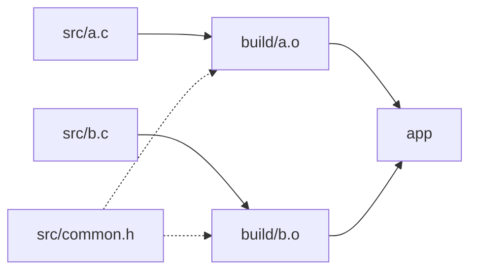
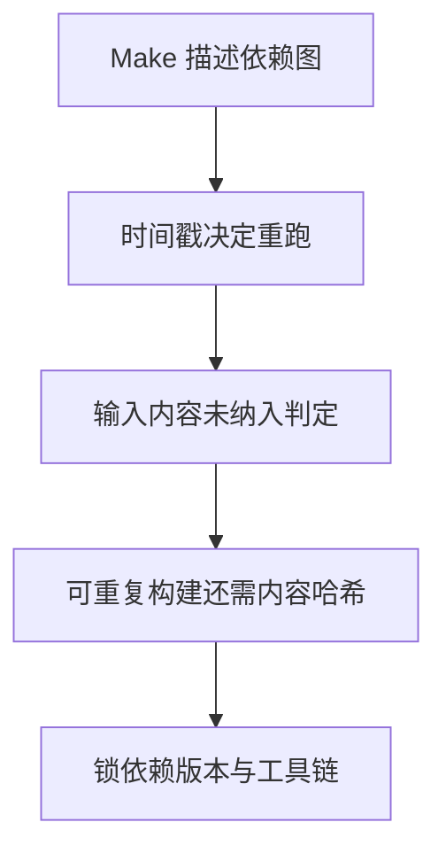

# Make 描述依赖图，不自动保证可重复构建

把常用命令收进 Makefile（Make 工具的构建脚本文件，里面写着"怎么从源文件做出成品"）之后，**构建在另一台机器上结果不同，也说不清产物由哪些输入决定——这是 Make（Unix 世界最老牌的构建工具，按文件新旧决定哪些要重新编译）最常被误判的地方**。要解决的问题是：**Make 依据什么判断目标需要重建、它提供哪些保证、不提供哪些保证，以及依赖锁定与环境隔离该由谁承担**。

Make 的本质是**根据目标、依赖与时间戳构建有向无环图**，只重建过期目标。它把"什么依赖什么"从人的记忆搬进文件，但**不能自动提供 hermetic build（封闭构建：构建过程与宿主机环境隔离，只认显式声明的输入）、依赖锁定或跨平台一致性**。

## 这套设计回答当年什么问题

Make 由 Stuart Feldman（斯图尔特·费尔德曼，贝尔实验室研究员）于 1976 年在贝尔实验室写出。当时的痛点是编译一个由几十个源文件组成的程序：全量重编译慢到没人愿意等，手工挑文件重编又必然漏编，而漏编造成的诡异行为比慢更难查。

Feldman 的判断是：**依赖关系本身是稳定的，值得单独声明一次；"哪些文件变了"则是由文件系统回答的事实，不必由人维护**。于是 Make 只做两件事——**声明依赖图、比对时间戳**。这个切分让它活了近五十年：**依赖声明的格式没变，变的只是它上面长出来的构建系统**。

理解这一点就解释得了 Make 今天的位置：**它是声明依赖的最小语法，不是构建系统**。Cargo（Rust 语言的官方构建与包管理工具）、Gradle（Java 生态的主流构建工具）、npm（Node.js 的包管理器）各自重写了依赖模型，但它们回答的是"依赖从哪来"，**Make 回答的是"谁需要重做"，两者不在同一层**。

## 这套机制的基本模型是什么

```Make
target: prerequisites
	recipe
```

这个三元组的直观形态，Software Carpentry 的 Make 教程给了一张标准的依赖图：`books/*.txt` 的四个源文件经 `count_words`、`analyze` 等规则生成 `*.dat` 中间产物，最终汇成 `results.txt`——箭头方向就是「目标依赖先决条件」的方向，Make 在这张图上沿时间戳比对决定谁需要重建：


*图源：Software Carpentry《Automation and Make》fig/04-dependencies.png，CC BY 4.0，https://swcarpentry.github.io/make-novice/06-dependencies/。*

recipe 行默认必须以 Tab 开头——Tab 是键盘上的制表符、一个命令按键产生的缩进字符，recipe 指 Makefile 里每个目标下的具体命令——**这是 Make 语法里最著名的坑，因为空格与 Tab 在屏幕上难以区分，报错信息也只说 "missing separator"**。**目标文件不存在，或任一 prerequisite（先决条件：目标的输入文件，Make 拿它的时间戳与目标比对）比目标新时，recipe 执行**。

```make
.PHONY: test clean

PYTHON ?= python3

test:
	$(PYTHON) -m pytest

clean:
	$(RM) -r build .pytest_cache
```

`.PHONY` 防止同名文件让命令目标意外跳过；`?=` 允许调用方覆盖，`:=` 立即展开，`=` 递归展开。变量引用使用 `$(NAME)`。

## 有哪些常用模式、各自解决什么

依赖图的形状决定增量构建对不对——下面的模式与自动变量都在回答"形状是否真实完整"：

```make
BUILD_DIR := build
SOURCES := $(wildcard src/*.c)
OBJECTS := $(patsubst src/%.c,$(BUILD_DIR)/%.o,$(SOURCES))

app: $(OBJECTS)
	$(CC) $(LDFLAGS) $^ -o $@

$(BUILD_DIR)/%.o: src/%.c
	@mkdir -p $(@D)
	$(CC) $(CPPFLAGS) $(CFLAGS) -c $< -o $@
```

自动变量：`$@` 当前目标，`$<` 第一个 prerequisite，`$^` 所有去重 prerequisites，`$(@D)` 目标目录。

上面这份 Makefile 的实际形状，依赖关系见下图：



实线是 Make 能从 `$(wildcard)` 推出来的显式依赖，**虚线是头文件依赖——Makefile 里没写，Make 也就不知道**。**改完 `common.h` 而 `app` 不重建，是这类依赖缺失最典型的症状**。

补法分两步：GCC（GNU Compiler Collection，GNU 编译器套件） 与 Clang 用 `-MMD -MP` 在编译时生成记录头文件依赖的 `.d` 文件，再在 Makefile 末尾用 `-include $(OBJECTS:.o=.d)` 把这些文件包含进来。**只生成不 include，Make 依然看不见头文件依赖——这是最容易漏的一步**。

## 正确使用的边界在哪儿

- 目标应可重复执行，尽量从声明的输入生成声明的输出。
- recipe 每行默认由独立 shell 执行；需要共享 shell 状态时写在同一行，或显式使用 `.ONESHELL` 并理解其错误语义。
- shell 变量用 `$$name`，因为 `$` 先被 Make 解释一遍。
- **并行 `make -j` 要求依赖图真实完整；缺失依赖会产生偶发竞态（结果取决于执行时序、因而不可重现的并发缺陷），且往往只在负载高时才暴露——典型形态是 `app` 链接时某个 `.o` 还没编完：单核串行里该 `.o` 总是先完成，依赖缺失被顺序掩盖，`-j` 多任务争抢 CPU 后才随机踩中**。
- 删除目标只写明确的构建产物路径；不使用未验证变量、宽泛 glob 或工作区根目录。
- 语言自己的构建工具（Cargo/Gradle/npm 等）仍是事实来源，Make 作为统一入口而非重写其依赖模型。

## 可重复构建还需要什么

可重复构建要求构建参数本身可追溯。把配置从应用里挪到独立存储，应用启动时读取、运行时可更新——参数不再是散落在各处的隐式输入。


*图源：Microsoft Learn 中文文档，CC BY 4.0，https://learn.microsoft.com/zh-cn/azure/architecture/patterns/external-configuration-store。*

配置之外，产物与输入的对应关系同样可以显式化——静态内容托管模式把「页面里引用哪些文件、文件实际放在哪」从应用代码里分离出来：应用只交付含链接的页面，文件由存储服务直接供出。构建产物的可追溯用的正是同一条思路：产物里引用的每个组件，其真实来源要在声明里查得到：


*图源：同上（Microsoft Learn 中文文档），CC BY 4.0。*

Make 只决定执行顺序，不决定执行环境。这条边界画出来是这样：



**左半边是 Make 的承诺，右半边是它的沉默区。多数"本地能编、线上编不出来"的排查跑偏，是因为把右半边的变量当成左半边的依赖问题去查——依赖图是对的，变的是图外的东西**。

要拿到可信构建，还差下面几块拼图：

- **锁定编译器、运行时、依赖和镜像**；
- **明确环境变量、网络和缓存输入**；
- **生成物携带源码 revision（源码的版本号或 commit 哈希）和构建元数据（构建时间、工具链版本等描述构建条件的记录）**；
- **CI（Continuous Integration，持续集成：每次改动都自动构建与测试）与本地使用同一入口**；
- **缓存键包含全部影响输出的输入**；
- **测试真实执行而不是只打印命令**。

代价在这里摆得很清楚：**Make 用"时间戳更新"换来了近乎零成本的增量判断，同时把正确性押在了时间戳可信上**。而时间戳恰恰是最脆的一环，它会往两个相反的方向错：**跨机器构建时文件从版本库检出，mtime（文件的修改时间）被重置为检出时刻，全部目标都会重建，多做的功只是浪费；反过来，构建机之间时钟不同步，目标可能比依赖看起来更旧，从而静默跳过重建——这一次该做的功没有做**，多做功倒不至于。这正是 reproducible-builds 项目要消除时间戳、路径与环境变量影响的原因：**可重复构建的目标"同样的输入在任何机器上产出同样的字节"，而不是"能构建"**。

## 调试与验收怎么做

```bash
make -n target       # 预览，不执行
make --warn-undefined-variables target
make -j4 target
```

- [ ] **从版本库全新检出的代码（clean checkout）可构建，增量构建与全量结果一致**。
- [ ] **`-j` 并行没有偶发失败**。
- [ ] **`clean` 只删除可重建产物**。
- [ ] **recipe 失败能返回非零状态，不被管道或多命令掩盖**。
- [ ] **构建输出可绑定 revision、工具链和依赖锁**。

构建可重复性要与两次构建对账——**同一 commit 在两台机器各构建一次，产物哈希（把任意长度数据压成固定长度指纹、不可逆）对账（哈希不一致等于存在未声明的依赖源：时间戳、路径、环境变量），对不上的来源逐个显式声明进构建脚本**。

跑一遍的收获是：**两台机器产物哈希不同，两类原因都要查——Makefile 写错（漏声明头文件依赖，导致一台增量一台全量），以及声明之外的影响源（时间戳、环境变量）**。**用 `make -d` 比对两台机器各自重建的目标列表，就能区分这两类**。

## 接着读哪几篇：同在软件构建里的相邻问题

- [[工程知识/软件构建：让变化可以理解、验证与交付/软件构建：让变化可以理解、验证与交付]]、[[工程知识/软件构建：让变化可以理解、验证与交付/测试与交付/测试策略从风险选择证据]]、[[工程知识/AI 系统工程：从模型能力到生产能力/安全与治理/执行证据必须独立于AI结论]]。
