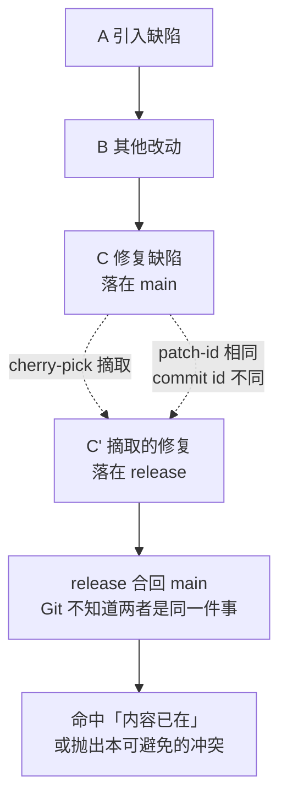
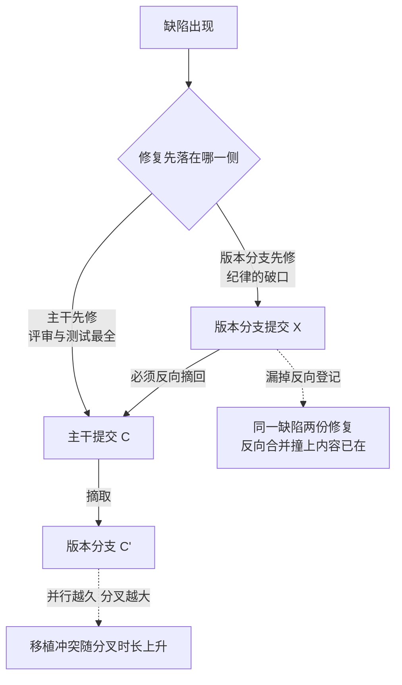

# cherry-pick 摘取的是补丁：摘取分支决定冲突面

`Git cherry-pick` 生成的提交与原提交内容相同，但 sha、父提交、历史完全不同。读完这篇你能说清这个身份分裂会给合并与追溯带来什么。

`Git cherry-pick <commit>` 把一个提交的变更应用到当前分支顶端，生成一个新提交。新提交与原提交变更内容相同（patch-id 一致），但 sha、父提交、所在历史完全不同。**这个身份分裂是 cherry-pick 所有问题的根源：两个分支各自有了"同一个修复"的不同提交，此后的合并、追溯、重复检测都要面对"内容相同但历史无关"这个事实**。

治理靠三条纪律：**移植登记（原提交与目标分支的映射）、按序移植（依赖链不倒序）、双分支验证（原侧回归加目标侧测试）**。

## 要解决的问题：复制的到底是什么，冲突从哪来

身份分裂可以画出来。同一个修复被摘到两个分支后，两个提交的关系是这样的：

**C 与 C' 在 Git（分布式版本控制系统） 眼里是两个毫无关系的提交。后续把 release 合回 main 时，等效性必须由人或者 `git cherry` 来判断**。

图取自 [Pro Git 官方书第 5 章](https://git-scm.com/book/en/v2/Distributed-Git-Maintaining-a-Project)，各 1440×660，CC BY-NC-SA 3.0。第一张是摘取前的历史（topic 分支上 e43a6 提交），第二张是摘取后的历史——同一变更落在 main 上时生成了新的提交哈希（把任意长度数据压成固定长度指纹、不可逆）。两图对上本篇第一节的 C 与 C'：新提交内容与原提交相同、哈希不同，Git 眼里是两个提交。两图的摘取方向是 topic 摘到 main，正文示例是 main 摘到 release——方向反过来了，身份分裂的机制两边一致。

## 它是怎么做到的：冲突、重复与批量

**冲突的来源：上下文错位。** **cherry-pick 用三方合并应用变更，base 是原提交的父。目标分支上同区域代码已经偏离时产生冲突**。三类高频冲突：

- 前置依赖缺失：原提交依赖更早的提交，单摘它必然冲突或编译不过。补齐前置提交再摘。
- 同区域演进分叉：两边都改了同一函数。人工决策取哪边或做融合。
- 重命名错位：目标分支已重命名文件或符号。git 的 rename 检测失效时手工映射。

编译检查是冲突判定的延伸：无冲突不等于**移植成功**。接口变了而调用没改这类语义冲突，要到编译与测试阶段才暴露，**所以 cherry-pick 后必须编译并跑目标分支的测试**。

**重复的检测与处理。** 同一修复被摘到多个分支后，反向合并会撞上"内容已在"。`git cherry <upstream> <branch>` 按 patch-id 对比两侧提交，`git log --cherry-pick --left-right A...B` 列出两侧等效提交。**patch-id 的局限是上下文差异过大时，同一逻辑变更的 patch-id 并不相同，会漏报——检测辅助人工，不替代评审**。

**批量移植的纪律。** 一次摘几十个提交时按三条执行：

命令行的 cherry-pick 之外，图形客户端把同一操作做成了右键菜单：GitHub Desktop（GitHub 官方桌面客户端）里选中某个提交，右键菜单里的「Cherry-pick…」项会把该提交摘到当前分支，底部提示「Copy to my-feature」说明摘取目标是 my-feature 分支——**菜单背后的机制与命令行完全一致，都是把一个提交的补丁重放到另一条历史上**：

*图源：GitHub Docs 官方文档《Cherry-picking a commit in GitHub Desktop》，https://docs.github.com/zh/desktop。*

- 按序移植：沿原分支顺序 `git cherry-pick A^..B`，依赖链不倒序，**倒序必然冲突成灾**。
- 分段验证：按提交顺序每 5 到 10 个为一段，段末编译并跑目标分支测试，**把错误定位在段内，而不是**最后一起爆。
- 移植登记：**每个补丁记下"原提交 sha、目标分支、目标新 sha"的映射表。漏移植检查与问题回溯都查这张表**。

## 读完这一段你能判断什么：选择与回避

**cherry-pick 与 merge 的选择。** 整条分支要过来用 merge（保历史），个别提交要过来用 cherry-pick（轻、准）。**大量提交走 cherry-pick，是 merge 的场景被错用，登记与冲突成本指数上升**；反过来，**分支终将合并时 cherry-pick 会制造内容重复的合并冲突。先定合并策略，再选摘取工具**。

**重复修复的收敛。** 长期并行的版本分支里，同一缺陷修两遍的风险真实存在。纪律是"先摘后改"：**修复先在主干完成（评审与测试最全），版本分支一律摘取；版本分支上直接修的，必须反向摘回主干，双向登记。单向纪律的破口就是双份修复的起点**。

两个方向各有一条登记路径，也各有一个破口，单向漏在哪画出来才看得出：

**双向登记的目的就是把「内容已在」挡在合并之前**；版本分支活得越久，这条纪律越贵，也越不能省。

**冲突高峰的预防。** 版本分支存在越久，与主干分叉越大，移植冲突越多。**分叉控制（定期把主干同步回版本分支，缩小上下文差）与窗口收窄（版本分支存活期与发布节奏对齐）是两条预防手段**——长命分支是移植地狱的成因。

## 这套说法在哪儿会失效

**空提交与跳过。** 目标分支已含等效变更时 cherry-pick 报"空提交"。默认行为是跳过并提示；`--keep-redundant-commits` 会保留一个无 diff 的提交，污染历史。**看到空提交提示先核等效性：patch-id 检测加人工确认，确认等效才跳过**。

**`-x` 是低成本高收益的默认。** `git cherry-pick -x` 在新提交信息里记录原提交 sha，是追溯链的最低成本形态。**不带 `-x` 的移植在几个月后无法自动追溯来源，团队规范应默认要求**。

**连续冲突的停止条件。** **批量移植中连续 3 个以上提交冲突，就停止机械继续——说明两侧分叉超出摘取的适用范围，改走 merge 或重新评估移植清单**。

## 怎么自己动手验证

可复现的验证路径：

1. 冲突复现：制造前置依赖缺失的单摘，预期冲突或编译失败，补前置提交后成功。
2. 等效检测验证：同一修复摘到两分支后跑 `git cherry <upstream> <branch>`，预期 patch-id 等效被检出。

输出每行是一个 commit，行首 `+` 表示这个提交在 upstream 里没有等效项，`-` 表示已存在等效项——所以"等效被检出"看到的是 `-`。人为改动上下文后预期漏报：**同一逻辑变更因上下文不同而算出不同 patch-id，会显示成 `+`**。

3. 登记核对演练：按移植登记表抽查 10 个补丁，预期原 sha、目标 sha、分支映射全部可追溯。
4. 断言锚点：**移植登记表是流程必需件（无表不批）、`-x` 是团队默认、批量移植有分段验证与停止条件。三件齐备，cherry-pick 才从随手一摘变成有账可查的移植流程**。

预期是"移植过的补丁在登记表里全部可追溯"，**对不上就说明有补丁绕过了登记流程，先查流程破口再补内容**。

cherry-pick 的正确心智模型是打补丁：**补丁贴在哪个分支、周围代码什么样，决定它贴得上贴不上**。

## 接着读哪几篇：同在软件构建里的相邻问题

- [[工程知识/缺陷分析：从个案到体系/稳定性/案例十一：上游修好了，你这边没有——一个发行分支的移植缺口]]：漏移植的个案与登记的价值
- [[工程知识/软件构建：让变化可以理解、验证与交付/开发工具/Git操作先区分工作区、索引与历史]]：cherry-pick 在 Git 对象模型里的位置
- [[工程知识/软件构建：让变化可以理解、验证与交付/开发工具/依赖升级按风险分层：验证阶梯、节奏策略与 CVE 响应]]：补丁节奏的同类分层
- [[工程知识/软件构建：让变化可以理解、验证与交付/开发工具/依赖升级的半衰期策略：跟随与锁定的平衡]]：摘取补丁的节奏与升级策略衔接
