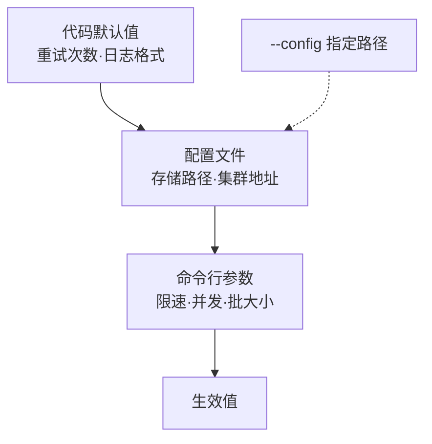
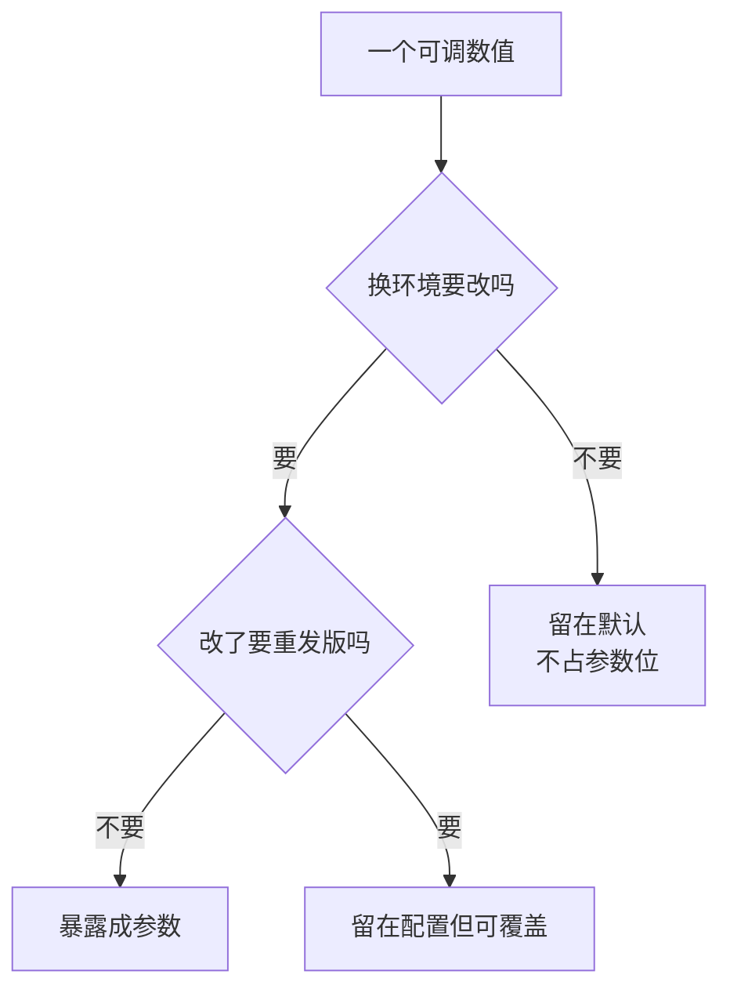

# cli 的参数设计：限速这类可调旋钮要暴露成参数，不能藏在配置文件里

运维工具（恢复、迁移、清理类 cli）里有一类旋钮是每次使用都可能要调的：限速、并发度、批大小、超时。**这类旋钮要暴露成命令行参数；藏进配置文件，每次调整就变成"改文件、找路径、确认生效"的仪式**。参数设计的判据按使用模式分：**每次变的进参数、环境相关的进配置、几乎不变的进默认值**。

## 要解决的问题

运维 cli 的使用模式与常规工具不同：一次恢复作业中，操作者要根据实时情况调参——白天限速低（保前台）、夜里放开；故障恢复期并发压低（保稳定）、例行维护放开。

旋钮藏在配置文件里，代价有三层：每次调整要登录机器改文件或在配置中心翻路径；调整行为本身有风险（改错文件、忘了改回、多实例改漏）；而**"这次作业用的什么参数"不可追溯——配置文件的当前值不代表作业时的值**。

参数化的本质是**把旋钮的调整与作业的调用绑定：参数进命令行**，作业历史（shell history、审计日志）自动记录每次的参数值，可追溯性白拿。

## 它是怎么做到的：旋钮的分级与暴露规则

**第一级：每次可能变的——命令行参数。** 限速、并发度、批大小、超时、目标范围（要恢复的 ledger 或分区清单），特征是**值随作业场景变**，暴露为 `--rate`、`--concurrency` 这类参数，且带合理默认值。默认值取最常用场景的安全值，比如默认限速取前台 IO 余量核算出的保守值。

参数互锁：相关参数做校验（并发度乘单任务开销不超过总限速），互锁的报错信息写清约束——**参数的自由度与校验的严格度同时给**。

**第二级：环境相关、部署时定——配置文件。** 存储路径、集群地址、认证信息、监控上报地址，特征是同一部署内不变、跨部署不同。进配置文件，且参数可覆盖。

**第三级：几乎不变的——默认值。** 重试次数、日志格式、统计间隔，藏在代码默认值里，文档提一句即可。暴露出来反而增加选择负担——clig.dev 的原则是**参数面要小，少而精的参数好过面面俱到的参数墙**。

三级依次覆盖：代码默认值兜底，配置文件用 `--config` 指定路径（不指定时用默认路径），命令行参数最优先，最终落进生效值——每层住着哪类旋钮见图中标注：



**箭头方向就是优先级方向，右边覆盖左边。这条覆盖链是 cli 的标准语义，必须在 `--help` 输出里可见，否则操作者不知道自己的改动有没有生效**。


*图：rsync 的 `--help` 输出（rsync 3.1.3 实测）。`--bwlimit=RATE` 把限速旋钮暴露成命令行参数——「limit socket I/O bandwidth」直接写在参数旁，每次作业可调、调用历史自动留痕，这正是「每次都变的旋钮进参数」的原型。*

*图源：rsync 官方 `--help` 输出截图，https://rsync.samba.org/ 。*

旋钮的三级暴露在老收音机上是实物：调谐与音量旋钮装在面板上——每次听都可能要拧的，做成命令行参数；微调（在预训练模型上用小数据继续训练以适配具体任务）电容与中周藏在机壳里——装机时定、跨环境才动的，进配置文件；出厂校准点封在电路里——几乎不动的，留在默认值。把机壳里的微调全搬到面板，面板就成了一墙没人敢动的旋钮：


*图源：Wikimedia Commons，作者 Robert Ashworth，CC BY 2.0，https://commons.wikimedia.org/wiki/File:RCA_Victor_Radio_-_13574518794.jpg。*

参数审计就是给自家 cli 做一次"面板规划"：哪些旋钮该上面板（每次作业想调的限速并发）、哪些该进机壳（部署时定的路径地址）、哪些封在出厂位（重试次数日志格式），按调整频率归位——**归错位的旋钮，正是案例四里"配置不生效"与作用域错位的来源**。

**作用域对齐是参数化的第一课。** 一个真实形态的缺陷是：恢复命令不收限速参数，操作者只能改全局配置文件里的限速——改完影响所有并发作业，别的恢复任务被波及，改回又是一次操作。**作业级旋钮（本次限多少速）被放进了全局作用域（配置文件）**。判据是：**作业级旋钮进参数（作用域等于本次调用），全局级旋钮进配置（作用域等于部署）**。

## 读完这一段你能判断什么：现有 cli 的参数审计

可复现的验证路径之前，先看审计怎么走：拿到一个可调数值，按「换环境要改吗 → 改了要重发版吗」两问分流，第一问答"不要"的直接留在默认、不占参数位，答"要"的再按第二问分进参数或可覆盖的配置：



审计按「换环境是否要改 → 改了是否要重发版」推进，两个都答是才进参数层：


**审计三问。** 一问哪些旋钮每次作业都想调——拉操作者访谈，在作业日志里 grep（文本搜索工具） 配置文件修改记录，**改得越频繁的越该参数化**。二问现有参数的作用域对不对——**作业级旋钮误进配置、全局级旋钮暴露成参数，都要归位**。三问参数的默认值与校验齐不齐——**无默认值的必填参数要在 `--help` 标明，校验缺失的补互锁**。

审计的产出是一张参数表：参数名、作用域、默认值、校验规则、变更频率。**表驱动的设计比想到什么加什么可靠**。

**加参数的时机。** **第一次出现"需要调但调不了"的场景时加，而不是预先把所有可能都暴露**。恢复工具上线时限速是罕见需求，配额收紧后变成每次都要调——滞后到这时才加，中间每次作业都在绕路。**已暴露的参数不轻易删（脚本依赖），只标 deprecated**。

## 这套说法在哪儿会失效

**参数不替代预案。** 限速参数化让调整方便，但调多少仍要核算（前台 IO 余量、业务低峰），那是容量管理的事。**参数是执行手段，核算依据在容量文档里**。

**参数语义要稳定。** `--rate` 的单位是 ops/s 还是 MB/s，要在 `--help` 里明确写下且不轻易改。**单位歧义是参数误用的头号来源**：MB/s 与 Mb/s（字节与比特）相差 8 倍，写错的后果是限速值差一个数量级；ops/s 与 MB/s 属于不同量纲，混用则根本无从换算，只能靠显式单位区分。**改单位等于 breaking change，要走版本化**。

**敏感信息不进命令行。** 密码、token 走凭据文件或由密钥管理注入。要注意的是，**交互式执行 `export TOKEN=xxx` 同样会进入 shell history，并不是绕开风险的写法**——真正安全的是不经过命令行与环境变量的凭据文件，或在进程列表里不可见的注入方式。clig 的边界与此一致：**参数面只放非敏感值，敏感值的传递路径单独管**。

## 怎么自己动手验证

四步验证构成一条可复现路径——参数化验收、覆盖链验证、互锁验证、断言锚点，全部可脚本化重放：

1. 参数化验收：恢复作业用 `--rate` 全程调参，**作业历史含每次的参数值，配置文件零改动**。
2. 覆盖链验证：默认值、配置文件、命令行三级各设不同值，**实际生效值为命令行**。
3. 互锁验证：设置并发乘开销超限的组合，预期报错信息含约束说明。互锁指参数之间存在联合约束——**并发度乘单任务开销不得超过总限速，超限与否按这个乘积与限速值的比较判定，不是各自独立校验**。
4. 断言锚点：**作业级旋钮全部参数化、覆盖链语义在 `--help` 可见、参数表在文档维护。三件齐备，运维 cli 才从改文件的仪式变成带参调用的流水操作**。

```text
作用域断言 = 作业旋钮进参数全局进配置
追溯断言 = 每次作业的参数值留痕
安全断言 = 敏感值不进命令行
```

预期是"一次作业的全部参数都能从审计日志复现"，**对不上就说明还有旋钮住在配置文件里**。

运维 cli 的参数设计，是把调整成本从操作者身上挪进工具里。**旋钮按使用模式分级暴露，作用域与调用绑定，历史自动留痕**。一句话说尽：**操作者每次都想动的旋钮，没资格住在配置文件里**。

## 接着读哪几篇：策略层级的覆盖顺序

- [[工程知识/性能工程：从用户等待到资源瓶颈/存储与网络/节流参数与容量匹配：全局限流值要按单点容量乘副本数算]]：限速值的核算依据
- [[工程知识/缺陷分析：从个案到体系/配置/案例四：配置不生效——recover 速率与重复日志]]：配置生效面的同类个案
- [[工程知识/软件构建：让变化可以理解、验证与交付/开发工具/Linux常用命令的词源地图]]：cli 惯例的词汇层
- [[工程知识/缺陷分析：从个案到体系/配置/案例三十五：后写的覆盖了先写的——策略层级的覆盖顺序]]：覆盖顺序的通用机制
