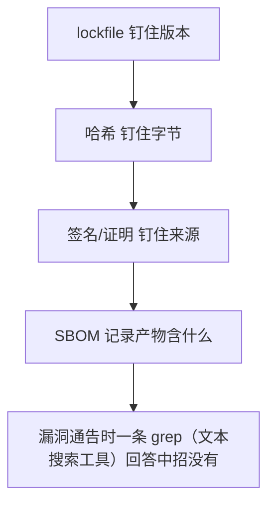
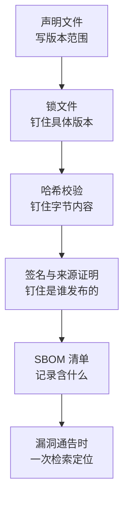

# 依赖供应链需要锁定来源与构建输入

构建一个现代应用，**自己写的代码常常只占产物的一小部分，其余来自 registry（包仓库）、基础镜像、工具链与安装脚本**。要解决的问题是：**这些外部输入每一个都能改变产物内容，而多数团队只记录了"安装成功"**。构建结果会受传递依赖、镜像、脚本、工具链和仓库状态影响，**仅记录成功无法复现、审计或安全回滚**（把系统状态退回到改动之前的版本）。

本质是**把源码之外每一个可影响产物的输入，固定成可追溯的身份**，并在隔离环境中验证其来源与行为。一个 lockfile 相同的构建，**仍可能因 registry、平台 wheel（Python 的二进制包格式，或时间轮）、编译器、环境变量或安装脚本而产生不同产物**：供应链治理的目标知道每个输入是谁、从哪来、做过什么，而不是**让命令今天跑通**。

## 从版本解析到信任链断在哪几处

依赖管理从来不只是"把包下载下来"。版本解析在包管理器出现之前就存在：Makefile 里写死链接库路径、`npm install` 早年的嵌套依赖树，都试图回答同一个问题——这次构建用的到底是什么。

转折点出现在传递依赖变得不可数之后。**一个直接依赖能拖进一大串间接依赖（依赖的依赖），人不再可能逐个审查**，于是信任从"我读过这段代码"变成**"我相信这条链路上每一环"**。

锁文件、哈希、签名（用私钥对数据生成可验证的防篡改标记）、SBOM（Software Bill of Materials，软件物料清单：一个软件用到的全部组件列表）、构建证明是这条信任链上的不同环节——SLSA（Supply-chain Levels for Software Artifacts，软件供应链安全等级框架，其分级证明构建过程可信），各自回答不同的问题——先钉住版本，再钉住字节，再钉住来源：



**少任何一环，链子就在那里断**：只有 lockfile 挡不住 registry 被劫持后返回同名不同内容的包，只有哈希挡不住"这个包本身是恶意的"，只有 SBOM 挡不住"记录了但没验证来源"。

「每个输入都有登记在案的身份」的实物原型是图书馆的卡片目录：馆藏的每一本书都有一张卡片——书名、作者、来源、编目号逐项登记，任何一本馆里的书都能凭卡片回答"它是谁、从哪来、排在哪"：


*图源：Wikimedia Commons，作者 TBurmeister (WMF)，CC BY-SA 4.0，https://commons.wikimedia.org/wiki/File:Card_catalog_at_the_Indiana_State_Library_-_cabinet_exterior.jpg。*

供应链治理就是把这套目录搬进构建：lockfile 是编目号（钉住版本）、哈希是书的指纹（钉住字节）、签名是采购凭据（钉住来源）、SBOM 是馆藏清单（记录含什么）——**漏洞通告来时"一次检索定位"，靠的正是每个输入都有一张卡片，没有卡片的输入就是混进馆里的书**。

这张卡片在工业标准里有确定的格式。SLSA 定义了一份构建证明（provenance）要写清什么：外部参数是构建的外部接口、必须原样记录并被下游验证（图例里标 to be verified），内部参数由构建平台自己设定、因平台可信而免检（标 trusted），构建类型说明用的是哪套构建模板，解析后的依赖（resolvedDependencies）逐个落在纸上——参数里给的是仓库地址，证明里记的是地址最终解析到的那次提交：


*图源：[SLSA 官方规范 v1.2《Build: Provenance》](https://slsa.dev/spec/v1.2/build-provenance)（provenance-model 官方图）。图中 Build Caches 与 Control Plane 单独标注为"不记录进证明"——哪些输入要留下痕迹、哪些可以不写，是这套格式的显式约定。

## 构建输入要锁定哪些

从声明到能回答"中招没有"，**五层逐级收紧**：声明文件写版本范围，锁文件钉住具体版本，哈希校验钉住字节内容，签名与来源证明钉住是谁发布的，SBOM 清单记录含什么——漏洞通告来时一次检索定位：



**四层锁定各自回答一个不同的问题，缺任何一层都会留下可被替换的环节**：


```text
源码 revision + lockfile + registry/mirror
      + toolchain + compiler flags + generated files + environment
```

**锁文件固定解析结果，但仍需校验仓库来源、完整性、签名或证明、平台差异**。**依赖升级要区分安全补丁、行为变化和破坏性版本，记录直接依赖、传递依赖与回滚组合**。
「漏洞通告时一次检索定位」在 SBOM 消费平台里有现成的样子。OWASP Dependency-Track 的漏洞审计界面（OWASP 即开放 Web 应用安全项目，Dependency-Track 是其组件漏洞追踪平台）按组件与版本逐行列出已知 CVE（Common Vulnerabilities and Exposures，公开披露的安全漏洞编号）：mixin-deep 1.3.1 的 CVE-2019（2019 年披露的漏洞编号）-10746 与 macaddress 0.2.8 的 CVE-2018（2018 年披露的漏洞编号）-13797 均标 Critical，CVE 后缀的年份即披露年份。每条记录带 analyzer 来源、归因时间与人工分析记录（Exploitable/Suppress）。SBOM 记录"含什么"，平台把它翻译成"中招没有、有多严重、要不要升级"：


*图源：OWASP Dependency-Track 官网截图（https://dependencytrack.org/），OWASP 基金会项目。*


## 风险怎么进门禁

- **安装脚本与构建脚本都可能执行代码；在隔离环境和最小权限（只授予完成任务所必需的最小权限）下运行**。
- 依赖混淆、恶意接管、typosquatting（用近似名字冒充流行包）和缓存污染需要**私有源策略与名称保护**。
- **漏洞扫描有误报与漏报，不能替代版本、调用路径和可利用性分析**。
- 生成代码、基础镜像、模型权重和插件**同样属于供应链输入**。

## 动手跑一遍会看到什么：一次锁文件对账

lock 文件与依赖声明的对账，把"构建可复现"从口号变成命令：

```bash
# 声明层：requirements.txt 写范围（requests>=2.28）
# 锁定层：requirements.lock 写精确值 + 哈希
grep -A1 'name = "requests"' requirements.lock
# name = "requests"
# version = "2.31.0"
# hash = "sha256:942c5a7585f9d4e..."   ← 锁的是字节，不只是版本号

# 构建时校验（哈希不符就地失败，不提供 fallback）
pip install --require-hashes -r requirements.lock
# 哈希不符 → "THESE PACKAGES DO NOT MATCH THE HASHES" → 构建终止

# SBOM 生成与对账
pip freeze --all > sbom.txt   # 生产用 cyclonedx/syft 生成标准格式
```

跑一遍的收获：**锁文件回答"哪天构建都得到同一份字节"，SBOM 回答"这份产物里有什么"**。两者合起来，**才能在漏洞通告发出时用一条 grep（文本搜索工具）回答"中招没有"**。

## 这些结论的量级靠什么数字支撑

时间窗的账：公开基准显示 CVSS（Common Vulnerability Scoring System，通用漏洞评分系统：给漏洞严重程度打 0-10 分的标准） 9 以上的漏洞，**平均 5 天内出现可利用代码**；而升级一个传递依赖，在没有锁定与 SBOM 的仓库里要人工确认影响链，耗时以小时到天计。**供应链工具的投入就是把确认时间从小时压到分钟**。

投毒的现实量级：**主流注册表每年下架的恶意包以千计，typosquatting 与账号劫持占大头**。防御的性价比排序是**锁定哈希（零成本、恒久有效）> 传递依赖最小化 > 自动化漏洞扫描 > 构建隔离**。

案例衔接：[[工程知识/缺陷分析：从个案到体系/安全/案例四十四：投毒不是写错，是写给你看——依赖投毒的三个真实剧本]] 是本篇机制在缺陷域的完整展开。

## 这套说法在哪儿会失效

**锁版本不能证明依赖无漏洞或行为适合业务；缓存命中、扫描绿色、包能安装，三者都不是完整的安全结论**。**锁定回答的是"这次和上次一样"，不是"这次是对的"**。

## 怎么自己动手验证

构建可复现要与产物比对对账——同一来源两次构建应产出相同产物；出现差异时，先确认不可复现的输入是否已被登记。

新依赖通过许可证、来源、哈希、维护状态、漏洞和最小行为测试；构建两次比较产物，或记录不可避免的差异。升级后跑 API、性能、安全、兼容和回滚测试，保留上一份可部署的 lockfile 与镜像。

预期是两次构建产物一致，对不上就说明有输入没被登记进锁定范围——逐个追到具体输入为止。

## 接着读哪几篇：同在软件构建里的相邻问题

- [[工程知识/软件构建：让变化可以理解、验证与交付/软件构建：让变化可以理解、验证与交付]]
- [[工程知识/软件构建：让变化可以理解、验证与交付/开发工具/依赖升级按风险分层：验证阶梯、节奏策略与 CVE 响应]]
- [[工程知识/AI 系统工程：从模型能力到生产能力/安全与治理/模型与数据供应链需要可验证来源]]
- [[工程知识/软件构建：让变化可以理解、验证与交付/架构与代码/购买与自建的决策框架：每条约束都摆上桌面]]：购买路线的供应链治理
- [[工程知识/后端系统：在并发、失败与变化中维持服务/基础设施/TLS握手与证书链：信任是怎么一层层背书的]]：信任链在供应链的同构应用
- [[工程知识/软件构建：让变化可以理解、验证与交付/开发工具/依赖升级的半衰期策略：跟随与锁定的平衡]]：本篇锁来源，该篇定版本节奏，是锁定的两个维度
- [[工程知识/软件构建：让变化可以理解、验证与交付/测试与交付/CI流水线把反馈速度和发布证据连接起来]]：门禁证据链的姊妹篇，锁定与证据共同回答"这次发布里到底是什么"
