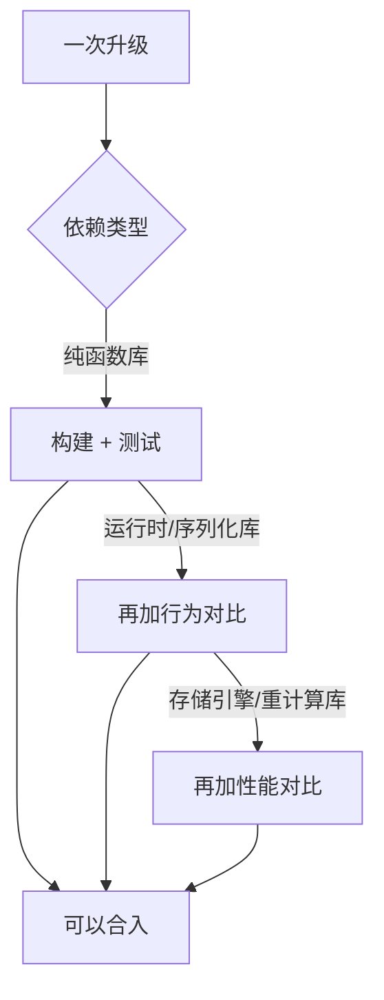
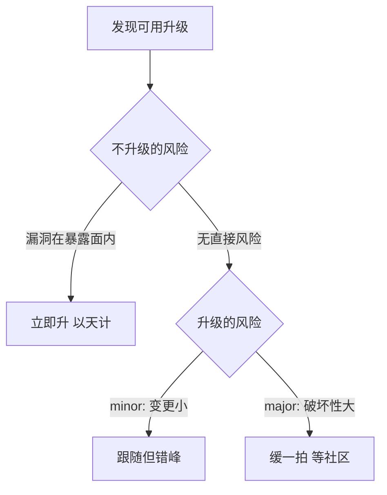

# 依赖升级按风险分层：验证阶梯、节奏策略与 CVE响应

> **要点**：**升级的风险不按版本号走，按依赖类型与暴露面走**——**验证阶梯按类型定深度（构建、测试、行为对比、基准四级）**、**节奏按风险定快慢（CVE 补丁立即、minor 错峰、major 等社区先行验证）**、**CVE 响应速度本身是工程能力的度量**；三者组合后，**"敢不敢升"变成"按哪层验证、按什么节奏升"的对照表决策**。

## 要解决的问题

**依赖升级的失败有两种形态**：**升完直接断（编译失败、接口缺失）**，**升完没断但行为变了（语义漂移、性能回退、升级把前提带走）**。**前者在构建期暴露，后者在产线数周后才显形**——**两种形态对应两套防御**。**常见误区是把升级当同质操作**：**要么全部重验（minor 也跑全量回归，成本失控导致升级堆积）**，**要么完全不验（major 直接进主干，产线爆炸）**。本篇把升级治理分三条线：验证深度按依赖类型分级、升级节奏按风险分级、CVE（Common Vulnerabilities and Exposures，公开披露的安全漏洞编号） 响应按暴露窗口计时——**三线各治各的失败形态**。

## 验证阶梯怎么按依赖类型定深度：机制一

先把形状说成一件事：升级验证像药品放行的检验阶梯——批号核对（构建验证：包装没破、标签对得上）、试药记录（测试网：既有的临床数据还作数）、双盲复测（行为对比：新旧两批药喂同样的病人对比疗效）、稳定性和血药浓度监测（性能基准）。**感冒药走前两步就够，心血管药四步全走**。这个比喻到"血药浓度"为止——现实里四级各挡什么失败，下面逐级展开。

升级验证走四级阶梯，深度按依赖类型来选：

1. **构建验证**：编译与打包通过——所有升级的底线，挡住接口缺失与符号冲突；
2. **测试网**：单元与集成测试覆盖调用面——**调用面窄、行为简单的内部库到这层够用**；
3. **行为对比**：金样测试（关键输入的输出快照对比）或双跑对比（新旧版本喂同样的输入、对比输出），**覆盖测试测不到的语义漂移**；
4. **性能基准对比**：同负载下升级前后的延迟与吞吐对比。

基准的环境要求见 [[工程知识/性能工程：从用户等待到资源瓶颈/观测与诊断/基准测试必须先定义负载和测量误差]]，数据库侧同类要求见 [[工程知识/数据系统：在并发与故障中保存事实/可靠性与运维/数据库基准必须描述负载与资源边界]]。

**按类型定深度的对照**：**纯函数库走到测试网**；运行时环境JDK（Java Development Kit，Java 开发工具包）、解释器与序列化库必须做行为对比（**格式与语义的静默变化都在这里**）；**存储引擎与重计算库必须做基准对比**——**行为全对但慢三倍的升级是失败的升级**。**升到哪一级停，取决于这个依赖改的是哪一层**：



**semver 的承诺范围要认清**：**major 断兼容是明示的**，**minor 与 patch 的不断兼容只是自觉**（破坏兼容的行为并未被禁止），**patch 里带行为变化的案例每个生态都有**——**"minor 不用跑全量验证"是错误假设**，**阶梯按依赖类型走，不按版本号走**。

**分级验证的实物原型是断路器的分级脱扣**：家庭配电箱里，**插座回路、照明回路、总闸各自按所保护对象的故障电流配置不同的脱扣阈值**——**没有人为了一盏灯跳闸去重测全屋线路**：


*图源：Wikimedia Commons《Circuit breaker 2 pole on DIN rail》，作者 Wtshymanski，CC BY-SA 3.0，https://commons.wikimedia.org/wiki/File:Circuit_breaker_2_pole_on_DIN_rail.JPG。*

**每个断路器只对它保护的回路负责**——升级验证同理：**纯函数库的变更让测试网那级脱扣就够**，**存储引擎的变更必须让性能基准那级也过**，**阈值配错（全按总闸配）或完全不带保护（不装断路器）是配电与升级共同的两种失败形态**。

## 升级节奏怎么按风险定快慢：机制二

**升级时机按风险分三档**：

- **CVE 与安全补丁立即升**：**漏洞公开后暴露窗口就是攻击窗口，升级以天计，不走常规窗口**；
- **minor 跟随但错峰**：**跟随上游节奏，避开自己的发布窗口叠加**；
- **major 缓一拍**：**等社区把首批坑踩平（1-2 个 patch 后进）**，**走绞杀者式过渡——新代码路径用新 API，旧路径逐块迁移，两代并存期由开关控制**（增量迁移的边界见 [[工程知识/软件构建：让变化可以理解、验证与交付/架构与代码/重构的安全边界由测试网和绞杀者模式共同划定]]）。

**分界线是"不升级的风险"与"升级的风险"谁更大**：



**CVE 响应速度是工程能力的度量**：**从漏洞公告到补丁上线的时长**（影响判断、补丁获取、验证、发布全链路）**反映依赖治理的成熟度**——**超过公开利用的典型周期（PoC 公开后数天），风险敞口按天计**。**改进靠三件套**：SBOM（Software Bill of Materials，软件物料清单：一个软件用到的全部组件列表） 清单（知道自己在用什么才能算暴露面）、**公告订阅与影响判断流程**（判断框架见 [[工程知识/缺陷分析：从个案到体系/影响判断/影响判断——这条修复值不值得跟]]）、**预构建的验证流水线（补丁到位直接跑阶梯，不从零搭环境）**。

**应急例外要显式记录**：**紧急安全补丁可能只有 major 路径，此时验证阶梯压缩**（构建、冒烟、灰度——新版本先放一小部分流量验证，逐步放大到全量）密切观察，**风险从"升级断裂"换成"漏洞暴露"**——**压缩验证是风险交换，决策要留痕**，**假装压缩没有风险是下一次事故的起点**。

## 隐性成本藏在哪、什么会放大它：机制三

**滞后的依赖用日志和补丁代码付利息**（案例七的形态）：**依赖带着已知缺陷运行时，周边代码为绕缺陷堆出补丁逻辑与重复日志**，**升级后这层绕行代码还要移除**——**滞后的成本在漏洞之外还有这层利息**（案例见 [[工程知识/缺陷分析：从个案到体系/兼容与升级/案例七：兼容与性能——滞后的依赖与放大的日志]]）。

**依赖图的负债核算**：**每个直接依赖都是长期负债**（升级、安全、license、废弃监控），**加依赖的决策像加雇员一样过评审**——**能标准库解决的不引三方**，**依赖的价值要与维护成本对账**。

**版本多处声明是升级的分裂种子**：**同一依赖在构建脚本、锁文件、文档、部署清单多处出现版本号**，**升级只改一处，其余各处静默漂移**（治理见 [[工程知识/缺陷分析：从个案到体系/兼容与升级/依赖版本的多处声明：升级只改一处，其余各处都是分裂的种子]]）。

**废弃公告盯梢**：**作者声明 deprecated 的依赖（哪怕还能用）进迁移计划**，**拖到生态断供再迁就是被动 major 升级**。

升级节奏在主流平台上有现成的托底形态。GitHub 的 Dependabot 在 Insights → Dependency graph → Dependabot 标签下按清单（go.mod、Cargo.toml）逐个记录检查时间，发现新版本即按 schedule 自动开升级 PR（Pull Request，拉取请求：请求把我的分支改动合入主干）。「CVE 立即、minor 错峰」的节奏策略可以映射成 security updates 与 version updates 两条通道各自的调度配置：


*图源：GitHub Docs《About Dependabot version updates》配图，https://docs.github.com/en/code-security/dependabot/dependabot-version-updates，文档引用。*

## 多环境共存时要兼容哪些组合：兼容矩阵

多环境（开发、预发、线上、多语言客户端）共存时，兼容性是矩阵问题：**依赖版本与消费方版本的每个组合，要么验证过、要么显式声明不支持**。矩阵爆炸的控制手段与 API 演进一致[[工程知识/软件构建：让变化可以理解、验证与交付/架构与代码/API与Schema演进必须兼容新旧消费者]]：**支持窗口收窄（只支持 N 与 N-1）**、数据格式双写（迁移期间同一份数据同时写入新旧两个存储）过渡、**旧版本显式 sunset 时间表**。

## 这套分层在哪儿会失效：边界

三条边界防止治理走形。

**验证阶梯不能全压到产线**：**灰度发布是最后一层验证**，**前面各层的作用是让灰度的爆炸半径可控**——**把行为验证全推给灰度，等于拿真实流量跑测试**。

**锁文件审计进 CI（Continuous Integration，持续集成：代码合并后自动构建与测试）**：**定期核对锁文件与声明的偏差**（`npm ls`、`pip check` 类工具）、传递依赖里的隐式变化，**CI 把"锁文件与声明不一致"设为失败**——**隐式漂移是"明明锁了版本还是变了"的根因**。

**补丁摘取与升级共用验证阶梯**：版本分支摘安全补丁（cherry-pick）与主干升级走同一套阶梯，**摘取不降验证标准**（摘取的纪律见 [[工程知识/软件构建：让变化可以理解、验证与交付/开发工具/cherry-pick摘取的是补丁：摘取分支决定冲突面]]）——**"只是摘补丁"不是跳过基准对比的理由**。

## 想自己验一遍怎么动手：验证

四条可复现的验证路径逐条执行：

1. 升级演练：隔离分支升到目标版本，走验证阶梯到该类型要求的深度，**记录每层实际发现（断在哪层、修了什么）**——**沉淀成该依赖的"升级档案"**，**下次升级的预期成本有据可查**；
2. CVE 响应演练：模拟一条 CVE 公告，**计时走完"影响判断、补丁获取、验证阶梯、发布"**，目标时长与实际对比——**链路堵点在计时里现形**；
3. 兼容矩阵回归：多客户端场景升级后在每个支持格跑冒烟，**任何一格断裂先决策（扩大支持或收窄窗口）再合并**；
4. 断言锚点：**SBOM 清单存在且随构建更新、CVE 响应时长有度量、验证阶梯按依赖类型有对照表**——**三件齐备，升级从"拍脑袋的勇气活"变成"按表执行的例行活"**。

```text
阶梯断言 = 验证深度按依赖类型对照
节奏断言 = CVE立即minor错峰major缓拍
度量断言 = 响应时长与SBOM在管
```

**依赖升级的治理水平体现在两张表上**：**验证阶梯的类型对照表、升级节奏的风险对照表**——**表配齐后，每个依赖的每次升级都有明确的验证深度与时限**，**CVE 的响应从救火变成计时赛**。

## 接着读哪几篇：补丁摘取的节奏与登记

- [[工程知识/缺陷分析：从个案到体系/兼容与升级/案例七：兼容与性能——滞后的依赖与放大的日志.md]] —— 滞后依赖的利息形态
- [[工程知识/缺陷分析：从个案到体系/兼容与升级/依赖版本的多处声明：升级只改一处，其余各处都是分裂的种子.md]] —— 版本声明纪律
- [[工程知识/软件构建：让变化可以理解、验证与交付/开发工具/cherry-pick摘取的是补丁：摘取分支决定冲突面.md]] —— 补丁摘取的节奏与登记
- [[工程知识/缺陷分析：从个案到体系/影响判断/影响判断——这条修复值不值得跟.md]] —— CVE 影响判断的入口
- [[工程知识/软件构建：让变化可以理解、验证与交付/架构与代码/重构的安全边界由测试网和绞杀者模式共同划定.md]] —— major 升级的过渡模式
- [[工程知识/软件构建：让变化可以理解、验证与交付/架构与代码/API与Schema演进必须兼容新旧消费者.md]] —— 兼容矩阵的同构手段