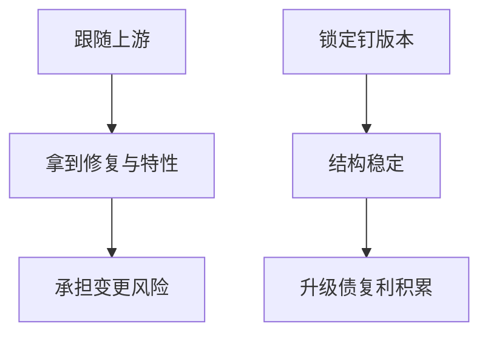
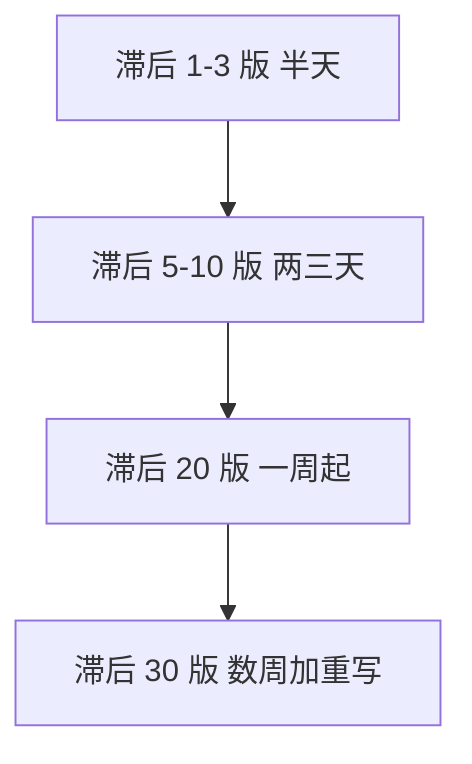
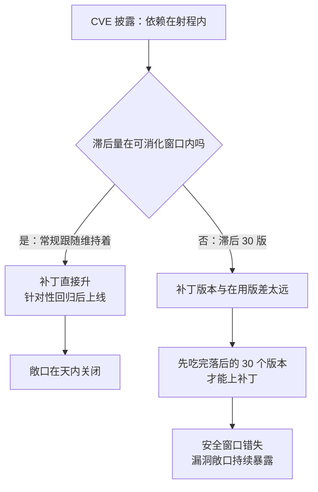

## 要解决的问题

跟随与锁定是两种成本结构：**跟随上游能拿到修复与特性，但要持续承担变更风险**；**锁定把版本钉住换稳定，但升级债在复利积累**——节奏管理就是在这两种成本结构之间找平衡点：

依赖升级在两个事故形态之间走钢丝：**从不升级——某天必须升级时发现隔了 50 个版本**（**积累的 breaking changes 一顿消化不完，安全漏洞没有补丁可用，这叫升级债**）；**追着升级——每次 minor 都跟**——**新版本的质量风险、breaking 的概率、升级成本本身都在重复支付**，**而多数依赖的升级对你毫无收益**。问题的本质：**升级成本随滞后量非线性增长——复利效应，但升级收益只在特定时点出现：安全补丁、需要的新特性**。**半衰期策略把升级从"要不要升"的二元争论改写成节奏管理**：**常规跟随（保持滞后在可消化窗口内）+ 锁定例外（稳定期冻结）+ 安全插队（漏洞补丁越过一切节奏）**。策略名叫"半衰期"，是因为**滞后量像放射性物质一样按固定节奏被定期消化**（**每次窗口批量升级清掉一半积压**），**而不是攒到某天一次性还清**——**半衰期越短，任何时点的存量滞后越少，单次升级成本越低**。

## 它是怎么做到的

**升级债的复利**。**滞后 3 个版本升到最新：消化 3 个版本的 changelog，通常半天**。**滞后 30 个版本：30 个版本的 breaking changes 叠加、废弃 API 的迁移链、中间版本的已知缺陷要绕过**，**通常是周起步，且测试套件对旧行为的断言全部要重写**。

升级债的窗口化消化在机房里有直接的实物：服务器主板上的固件与安全补丁按月度维护窗口批量刷写——窗口节奏越密，任何一台机器与最新补丁基线（正常状态下的指标水平、用来对比异常）的差距越小；拖到季度末集中刷，单台停机时间与回滚（把系统状态退回到改动之前的版本）风险全部翻倍。**运维的维护窗口就是升级债的半衰期安排**：

*图源：Wikimedia Commons，NOIRLab/NSF/AURA/T. Slovinský，CC BY 4.0，https://commons.wikimedia.org/wiki/File:CERN_server_room_(15275174106).jpg。*

（「半衰期」这个名字取自放射性衰变：**每过一个半衰期存量减半，五个半衰期后只剩 3%**——升级债的窗口化定期消化与这条曲线同形）。

成本曲线不是直线：**滞后 1-3 版半天、5-10 版两三天、20 版一周起、30 版数周加重写**，**每上一档的抬升都不成比例**：

**抬升来自 breaking changes 的相互叠加**——**A 废弃的 API 在 B 里被删除，你要先迁到 B 的中间形态才能理解 C 的迁移说明**。**滞后量翻倍，成本不止翻倍（复利），这是"从不升级"的真代价**——**不升级省下的每次半天，最后连本带利一次还清**。

**常规跟随的节奏设定**。**按依赖的三档分类定节奏**。**框架与运行时（Web 框架、语言大版本）：跟随 minor、立即上 patch**（**breaking 只在 major 出，minor 的升级成本低且持续保持消化窗口**）。**工具链（构建、lint、测试框架）：季度窗口批量升**（**工具的行为变化影响构建产物，批量升一次回归一轮**）。**库依赖（功能库）：自动 patch**（renovate/dependabot 的 PR（Pull Request，拉取请求：请求把我的分支改动合入主干）机器人，patch 级自动合并跑 CI（Continuous Integration，持续集成：代码合并后自动构建与测试）、minor 人工过目（changelog 扫一眼 + 测试））。**节奏的度量：滞后天数的中位数**——每个依赖"最新版发布日"与"你在用版发布日"的差，**全库中位数反映升级健康度（超过半年即红灯）**。

**锁定例外：什么时候该冻结**。三类场景锁。**发布冻结期：版本发布窗口内锁全部依赖**（**升级引入的变化与发布本身的风险叠加，排开**）。**稳定运行期：系统进入"别动它"阶段（无新需求、风险厌恶），锁 minor 只吃 patch**。**依赖整体下线期：依赖进入淘汰名单（社区停滞、有继任者），锁定并规划替换**（**此时升级是浪费，替换才是正事**）。**锁定是显式决策不是遗忘**：**锁定的依赖要有清单与理由**（"锁到 X 版，因为 Y，解锁条件是 Z"），**无理由的锁定就是升级债的起点**。

**安全插队通道的可用性由平时的滞后量决定**，CVE（公开披露的安全漏洞编号）披露后补丁能否尽快上线，取决于滞后量是否在可消化窗口内：

**安全插队：越过节奏的通道**。**漏洞披露（CVE 有 exploit、依赖在射程内）时，补丁升级插队**：**跳过常规评估（安全补丁的 breaking 风险与被利用风险不对称）**，**直接升级 + 针对性回归（漏洞相关路径 + 冒烟），全量回归可以后补**。**安全插队的前提是常规跟随把滞后压在窗口内**——**隔 30 个版本时安全补丁也升不动**（**补丁版本与你的版本差太远，要先把落后版本吃完才能上补丁**），**半衰期策略与安全响应是共生关系**：

**决定补丁能不能插进队的是平时的滞后量，CVE 本身反而在其次**：**窗口内常规跟随维持着，敞口在天内关闭**；**滞后 30 版则安全窗口错失，漏洞敞口持续暴露**。**这条通道能不能用，正是建立在这个前提上**。

滞后量在机器上怎么见：GitHub 仓库的 Insights → Dependency graph → Dependabot 标签**按 go.mod、Cargo.toml 等依赖清单逐个记录上次检查时间**——**机器人扫过哪些清单、各自落后多远一屏可见**，**半衰期策略的滞后中位数红灯线在日常运维时就长在这样的界面上**（本库「依赖升级按风险分层」篇配了该页面的截图）。

来源：[博客园《解密 Raft 算法》](https://www.cnblogs.com/traditional/p/12588733.html)（CC 4.0 BY-SA）

## 它从哪儿来，要付什么代价

依赖管理的工具化在 2010s 完成：npm（Node 的包管理器）/yarn/pnpm 的 lockfile（2018 前后 lockfile 标准化）、Dependabot（2019 被 GitHub 收购进平台）、Renovate（白名单策略与批量分组升级的开源标杆）、deps.dev/Snyk/OSV（Operating System Verification，操作系统验证研究）的漏洞数据源。语义化版本（SemVer）提供升级成本的信号系统；"hyrum's law"（观察到的行为都会被依赖）解释了为什么"理论上不 breaking"的升级照样炸。Google 的"trunk-based 单调升级"（依赖永远最新）是另一个极端样本，代价是无限工程师投入。

**把升级从"事件驱动"（每次升级是一次项目决策）改写成"节奏驱动"（策略先行、机器人执行、异常人工）**：**patch 自动化消掉 80% 的升级劳动**，**minor 的窗口化（季度批升）把碎片决策聚成批处理**（把多个请求合并成一批同时计算、提高硬件利用率），**安全通道保证紧急时的响应速度**。**升级从"要不要"的反复争论变成"节奏表 + 例外清单"的运行状态**。代价：**自动升级机器人本身是新风险源**——**自动合并的 patch 在 CI 绿灯时引入测试没覆盖的行为变化，即 Hyrum 定律的自动化版**；**锁定文件与安全补丁的矛盾（lockfile 精确锁版本，补丁要显式解锁，机器人策略要给安全补丁开白名单通道）**；**跟随策略有下限成本**（**每季度批量升级的人工窗口是固定支出**，**依赖少的小项目用不上这套机器，"手动 + 年度大升"更经济**）。

## 这套说法在哪儿会失效

- **SemVer 是信号不是承诺**：major 号的变更未必 breaking（社区有虚升 major 的惯例，如 Meta 开源的前端框架 React 18 的实际迁移成本低于预期），**patch 也可能 breaking——Hyrum 定律：你没意识到的依赖被改了**。**升级决策的最终依据是 changelog + 测试，版本号只做初筛**。
- **传递依赖是升级的暗面**：**你锁了直接依赖，传递依赖（依赖的依赖）仍在漂移**（**lockfile 是快照不是控制**——**新装机器时解析出的传递树可能不同**）。**审计面要覆盖传递树**（`npm ls`/`go mod graph` 的输出进 CI 检查），**不只是 package.json 的直接清单**。
- **升级窗口与测试置信度联动**：**跟随策略的胆量由测试套件决定**（**覆盖高的模块敢自动升，覆盖低的只能人工评估**）。**升级策略与测试投资是同一件事的两面**，**讨论升级争吵不休的团队，先看测试置信度够不够**。
- **"永远最新"的例外**：库作者与平台团队（要兼容老用户的运行时、发库的兼容性矩阵）反向操作——**要主动测最老支持版本与最新版本两极，中间版本抽测**。**你是消费方还是供给方，策略方向相反**。

## 怎么自己动手验证

- **滞后画像测量**：**对项目全量依赖算滞后天数**（你在用版与最新版的发布时间差），出中位数与分布。预期：**健康项目多数依赖滞后 <90 天**，分布长尾（少数请求耗时远高于其余大部分）**有几个"僵尸依赖"（滞后 2 年+）——这几个长尾是升级债清单的第一手输入**。
- **升级成本曲线实验**：**挑一个滞后 5 版的依赖升级记录成本（人时 + 修复数），再挑滞后 20 版的记录**。**预期：后者人时数倍于前者，且修复集中在废弃 API 迁移**，**两点连线粗估本项目的"滞后-成本"曲线，节奏窗口据此校准**。**复利效应的实证**。
- **机器人绿灯事故演练**：**让 renovate 自动升级一个 minor（带行为变化），观察 CI 是否拦截**。**预期：测试覆盖的行为变化被拦、未覆盖的直接合入（绿灯但行为已变）**——**用一次演练确认"自动化的边界=测试的边界"**，**为白名单策略提供证据**。

## 接着读哪几篇：供应链篇讲来源锁定

- [[工程知识/软件构建：让变化可以理解、验证与交付/开发工具/依赖供应链需要锁定来源与构建输入.md]] —— 供应链篇讲来源锁定，本篇讲版本节奏，锁定的两个维度
- [[工程知识/软件构建：让变化可以理解、验证与交付/架构与代码/API演进的兼容性纪律：废弃流程与版本策略.md]] —— SemVer 的承诺与违约从消费侧看，升级策略是 API 纪律的下游
- [[工程知识/软件构建：让变化可以理解、验证与交付/测试与交付/覆盖率的三种读法：行分支与路径覆盖的证据强度.md]] —— 升级自动化的胆量由测试置信度决定，覆盖率是升级策略的地基
- [[工程知识/软件构建：让变化可以理解、验证与交付/开发工具/依赖升级按风险分层：验证阶梯、节奏策略与 CVE 响应.md]] —— 跟随与锁定按风险分三档的节奏展开
