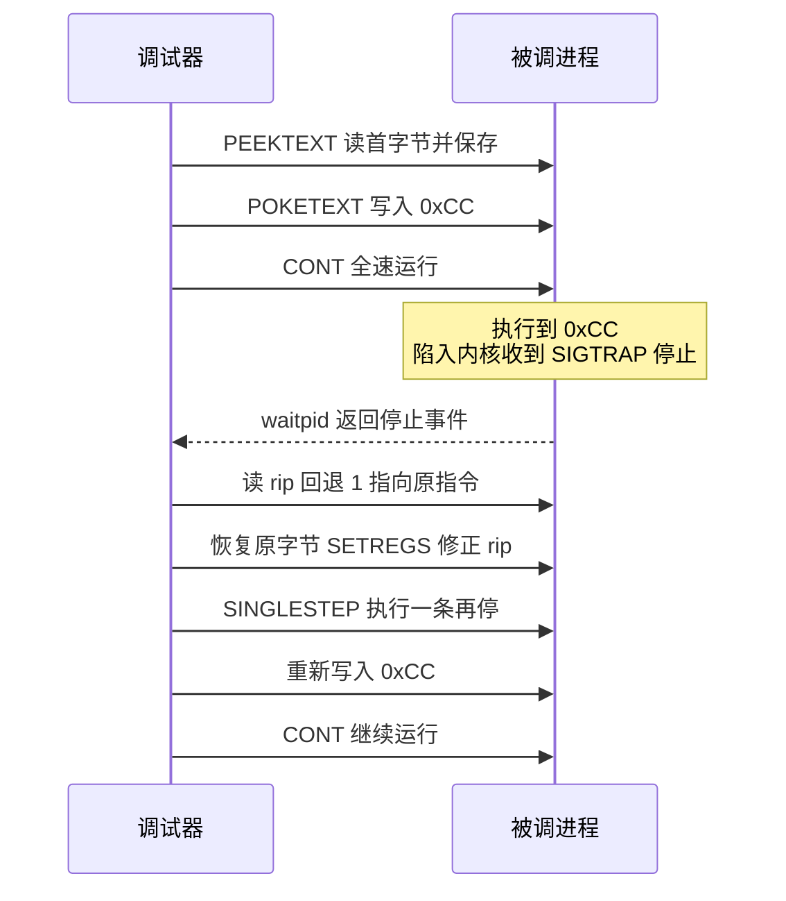
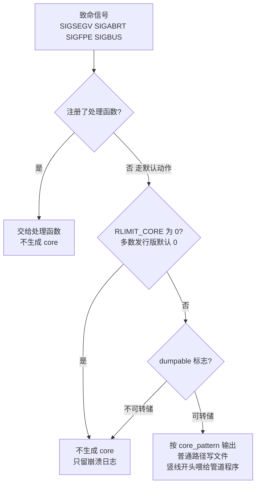

# 崩溃现场三件套：core dump、ptrace与调试器的停止语义

**程序崩溃之后，现场是易逝品**：**进程退出，内存归还内核，寄存器内容随之消失**。读完这一页你能说清三件事：调试器凭什么让进程停在任意一行、core dump 由谁在什么条件下生成、以及崩溃现场的机器地址怎样翻译回源码行。

> **要点**：调试器的停止能力来自 ptrace（Linux 的进程跟踪接口，一个进程借此读写另一个进程的内存与寄存器）加软件断点（把目标指令首字节改写成陷阱指令 0xCC）；**core dump 来自内核在致命信号默认处理时的主动保存**，能不能生成由 RLIMIT_CORE 与 `/proc/sys/kernel/core_pattern`（内核配置项：崩溃快照文件的命名与处理方式）两道开关决定；机器地址翻译回源码行靠 DWARF（调试信息格式：可执行文件里描述变量与行号的数据） 调试信息，**strip（删除可执行文件内调试信息的操作）之后只剩地址**。**三件套共享同一条链：现场、地址、源码行**。

## 要解决的问题是什么：现场如何被留住

**线上进程崩溃，等工程师登上机器时进程早已退出**，能拿到的往往只有一行 `Segmentation fault`。**如果当时没有任何机制把内存映像、寄存器、函数调用链保存下来，这次崩溃就只是一条日志**，**事后无法回答"死在哪个函数、参数是什么、当时的调用链长什么样"**。

留住现场有两条路，对应进程的两种状态。

**进程还活着**：调试器通过 ptrace 接管它，想停就停、想看就看，这是活体检查。

**进程已经死了**：core dump 把死前一刻的完整内存映像与寄存器保存成文件，这是事后验尸。本库多篇缺陷案例依赖第二条路——案例二十里多个崩溃的堆栈位置都指向同一个访问方法，这条规律就是判断生命周期缺陷的证据，见 [[工程知识/缺陷分析：从个案到体系/并发/案例二十：关闭之后还有人在用——生命周期的时序竞态]]；案例三则从反面提醒，崩溃留下 core dump，永久等待连这个都没有，两类症状的可观测材料完全不同，见 [[工程知识/缺陷分析：从个案到体系/并发/案例三：并发两面——写回调卡死与心跳竞态]]。

三件套各管一段：**ptrace 管"怎么停"**，**core dump 管"死后留下什么"**，**DWARF 管"地址怎么说回人话"**。**缺任何一件，链条断在相应位置**。

## 它是怎么做到的，本质是什么

三件机制共用一个底层事实：**x86 CPU 把"停下来交给操作系统"做成了指令**。理解这一点，**三件套都能从它推出来**。

### 软件断点：一条指令的偷梁换柱

调试器设置断点 `break main` 时，事情发生在被调试进程的内存里。调试器先读出目标地址的第一个字节并保存，再把 `0xCC` 写进去。

`0xCC` 是 INT3（x86 断点陷阱指令） 指令的编码，**Intel 把它设计成恰好一个字节，任何指令的首字节换成它都不影响后续指令的边界**。此后进程全速运行，**CPU 执行到这个地址，识别出陷阱指令，切换进内核**，内核给进程打上 SIGTRAP（跟踪陷阱信号：断点触发时发给调试目标的信号） 信号标记；**因为进程处于被跟踪状态，SIGTRAP 让它停止**，调试器的 `waitpid` 恰好等待这个停止事件并接管控制权。

调试器拿回控制权后的动作是一条固定链路：读出 rip（x86 的指令指针寄存器），此时它已经指向 INT3 的下一条指令，回退 1 指向被改写的原指令；把保存的原字节写回去；设置 rip 指回这条指令；单步执行一条（ptrace 的 PTRACE_SINGLESTEP 让进程只执行一条指令就再次停止）；重新写入 `0xCC`；继续运行（PTRACE_CONT）。**如果不做最后这一步重写，断点命中一次就消失**。

*图源：Sy Brand《Writing a Linux Debugger》系列博文，https://blog.tartanllama.xyz/posts/writing-a-linux-debugger/breakpoints/（作者个人博客公开图，注明出处引用）。*

**条件断点慢的原因也藏在这条链路里**：**条件判定只能发生在调试器一端**，于是**循环里每次命中都要走完"停止、读寄存器、判条件、恢复、单步、重写、继续"整个来回**，**每次都是两次进程间切换**。**命中频率高时，断点本身成为程序的主要开销**。

### 硬件断点：四个寄存器的边路

**x86 CPU 另有一套不改动代码的机制**：调试寄存器 DR0（x86 调试寄存器 0） 到 DR3 各存一个地址，DR7 做控制开关。**CPU 在每条指令执行前拿指令地址与这四个地址比对，相等即产生调试异常**。它的优势正好补软件断点的短板：**不写内存**，**只读段（代码段通常只读）与自修改代码（JIT 即时生成的机器码）都能用**；代价是**数量上限就是 4 个地址**。调试器里 `hbreak` 走这条路。

### ptrace：贯穿所有停止语义的通道

**上面两种断点，加上单步、观察点、attach 到已运行进程，全部经由同一个接口实现**。**ptrace 的模型是两个进程：tracer（跟踪者，通常是调试器）与 tracee（被跟踪者）**。tracer 用一系列请求操作 tracee：PTRACE_ATTACH 挂上、PTRACE_PEEKTEXT/POKETEXT（ptrace 写目标进程内存的请求）读写内存、PTRACE_GETREGS/SETREGS（ptrace 设置目标进程寄存器的请求）读写寄存器、PTRACE_CONT 放行、PTRACE_SINGLESTEP 单步。**tracee 每次收到信号都会停止并等 tracer 处置**，**这是整个调试循环的节拍来源**。

### core dump：内核的最后一张照片

**core dump 与调试器无关，它的生成者是内核自己**。SIGSEGV（段错误信号：进程访问了非法内存地址）、SIGABRT（abort 异常终止信号）、SIGFPE（浮点异常信号，如除零）、SIGBUS（总线错误信号：地址未对齐等硬件级错误）这些致命信号的处理动作分三种：**进程自己注册了处理函数就交给函数**；**默认动作是"core"类信号时，内核在杀死进程之前把进程的完整地址空间、寄存器、资源使用情况写成一个文件**。这是一条内核内的判定链，**三道开关任何一道关上都没有文件**：

两个细节值得展开。

**默认值是关着的**：**多数 Linux 发行版 RLIMIT_CORE 默认为 0，崩溃照旧发生，文件一个不剩**，**这是"崩了却找不到 core"最常见的原因**，`ulimit -c unlimited` 打开它。

**core_pattern 有两种形态**：**普通路径形态直接写文件**，`%e` `%p` 等格式符区分进程；**竖线开头的管道形态把转储内容喂给指定程序**，systemd（Linux 的服务管理器）系的发行版普遍配置成 `|/usr/lib/systemd/systemd-coredump`——核心转储（进程崩溃时的内存现场文件）因此集中存放在，core 文件因此集中存放在 `/var/lib/systemd/coredump/` 并有自动清理策略，`coredumpctl` 是它们的查询入口。

**core 文件本身是一个 ELF 文件**：ELF 头之后没有节头表，只有程序头表，两类段各司其职——**PT_NOTE 段装寄存器与线程状态这类元数据**，**PT_LOAD 段按虚拟地址逐段装内存映像**，调试器就是照着这两张表把快照（某一时刻的完整只读副本）摆回原位的：

*图源：Memfault 博客《Linux Coredumps (Part 1) — Introduction》，https://interrupt.memfault.com/blog/linux-coredumps-part-1（厂商技术博客公开图，注明出处引用）。*

**截断与安全是两个要预先算的代价**。**转储文件大小约等于进程虚拟地址空间（VSZ）总量，多进程大内存的服务要按这个预算准备磁盘**；**超过 RLIMIT_CORE 的部分被砍掉，而线程信息恰恰位于文件尾部**，**截断的 core 常常表现为"打开能看，线程列表不全"**。**转储内容是内存原文，数据库连接串、密钥、用户数据都在里面**，**core 文件的权限管理要当作敏感数据对待**。

### DWARF：机器地址与源码行之间的翻译层

**断点给你一个 rip 地址，core dump 给你一串返回地址，它们都是数字**。**把这串数字翻译成"哪个文件第几行"靠编译时嵌进可执行文件的 DWARF 调试信息**，其中 `.debug_line` 段的行号表记录了机器地址区间与源码位置的对应。`-g` 编译选项生成它，strip 删除它，`addr2line` 命令手动查询它。这与性能剖析是同一个依赖：火焰图（按调用层级堆叠的耗时分析图、越宽的块越耗时）的函数名同样来自符号表，**符号缺失时两者一起退化成无意义的地址串**，见 [[工程知识/性能工程：从用户等待到资源瓶颈/观测与诊断/性能剖析与火焰图]]。

## 实践：从配置到读出现场

**事前配置（不做就没有现场）**。打开 core 限制并在服务管理里固化：`ulimit -c unlimited` 只影响当前 shell，systemd 服务要写 `LimitCORE=infinity`，**容器要确认运行时没有把 core 大限回 0**。确认 core_pattern 的实际形态：`cat /proc/sys/kernel/core_pattern`，看到竖线开头的配置就用 `coredumpctl list` 找文件，看到普通路径就去该路径找，**两处对不上就是白等**。

**调试器侧的基本操作**。构建时生成调试信息（`-g` 或 `--debug` 按语言选择），保留带符号的二进制与版本对应关系。

- 断点：`break`；硬件断点：`hbreak`；条件断点：`break <位置> if <条件>`
- 崩溃后读 core：`gdb <可执行文件> <core文件>`
- `bt` 输出函数调用链，`frame <编号>` 切换到某一帧
- `info registers` 看寄存器，`x/16x <地址>` 看内存原文

这套操作的全流程与按假设投放探针（向系统注入的检测点或检测请求）的纪律互为表里：**core dump 回答"死的时候在哪"**，**单变量假设检验回答"为什么死在那里"**，两者的完整方法见 [[工程知识/软件构建：让变化可以理解、验证与交付/测试与交付/调试从假设到最小复现]]。

**容器与不可变环境的调试**。**容器里 attach 一个已运行的进程常被 ptrace 拒绝**，原因是**内核的安全限制 ptrace_scope**（Yama 机制，`/proc/sys/kernel/yama/ptrace_scope`，默认只允许父进程跟踪子进程）与容器缺少 SYS_PTRACE capability（Linux 细粒度特权机制，拆分 root 权限） 的双重拦截。解法按顺序：调试器以父进程身份启动被调程序（`gdb --args ./程序 参数`），绕开 ptrace_scope；确实要 attach 已运行进程，**给容器加 SYS_PTRACE capability 并按需放宽 ptrace_scope**。

## 效果从哪儿来，要付什么代价

三件套带来的收益是**崩溃从"一条日志"变成"可逐层检查的证据"：断点让因**果可以按单条指令验证，**core dump 让离线分析成为可能（凌晨崩溃，上午复盘）**，**DWARF 让数字变回人话**。代价分三块：

- 调试器路径：**目标进程大幅减速（断点命中循环每次两个进程切换）**
- core dump：磁盘按 VSZ（Virtual Size，虚拟内存大小，进程地址空间总大小）预算，加上转储期间进程暂停的时间窗口
- 调试信息：二进制体积与符号文件的版本管理——**每个发布版本都要留对应的带符号构建产物**，**错配版本的符号表会把地址翻译成错误的行号**

## 这套说法在哪儿会失效

**断点改写的是内存**。只读代码段、自修改代码（JIT 生成的机器码在断点存续期间可能被自己重写）、以及**校验自身完整性的加壳程序都会让软件断点失效或失真**，**这些场景换硬件断点（数量上限 4 个）或观察点**。

**core 的默认状态是关闭**。**RLIMIT_CORE 默认 0、容器回写 0、磁盘配额不足三种形态都会让"等 core"落空**，**事前配置检查是唯一解法，事后无法补救**。

**截断的 core 是残缺现场**。RLIMIT_CORE 设了具体数值时，超过的部分被砍，**线程信息在文件尾部最先丢失**；**磁盘满同样产生残缺文件，读到一半发现调用链不全要立刻怀疑文件本身**。

**转储是安全事件**。**core 里有内存原文，密钥与用户数据都在其中**；**多租户机器上 core 文件的属主与权限、集中收集通道的加密，都要按敏感数据对待**。

**ptrace 不是通用接口**。**macOS 用 Mach exception ports，ARM 用 BKPT 断点指令，RISC-V 用 EBREAK**（RISC 与 RISC-V 分别是精简指令集计算机与其开源版本），**机制同族但接口不同**，跨平台工具（lldb，LLVM 编译器基础设施的调试器）抽象了差异，直接用 ptrace 写脚本时无法跨平台复用。

**符号错配比没有符号更糟**。崩溃二进制与符号表版本不一致时，addr2line（把地址翻译回源码行号的工具）与 bt 会自信地输出错误的文件行号，**排查被引向完全错误的位置**，**验证手段是拿一个已知函数地址做翻译核对**。

## 怎么自己动手验证

1. core 生成链全流程：写一个解引用空指针的小程序，先 `ulimit -c 0` 运行确认无文件，再 `ulimit -c unlimited` 运行确认文件出现，对照 `/proc/sys/kernel/core_pattern` 解释文件的位置与命名。
2. gdb（GNU 调试器）读现场：用上一步的 core 文件执行 `gdb ./程序 core文件`，预期 `bt` 的最内层帧就是解引用的那一行，`info registers` 的 rip 与 bt 顶帧地址一致。

3. 断点命中链路可见化：gdb 里 `break main` 后 `run`，`x/1xh $pc` 看到首字节已被换，`continue` 再次命中后用 `x/i $pc-1` 看恢复后的原指令——偷梁换柱与还原都在眼前。
4. 硬件断点数量边界：连设 5 个 `hbreak`，预期第 5 个报错，边界就是 4 个调试地址寄存器。

5. 符号依赖验证：同一程序编译两次（一次 `-g` 一次 strip 后），对同一 core 各跑一次 bt，**预期前者有文件行号、后者只有地址与** `??`。
6. 容器前提验证：**容器内 attach 一个已运行进程，预期默认被拒绝**；**加 SYS_PTRACE capability 后预期成功**。

## 接着读哪几篇

- [[工程知识/软件构建：让变化可以理解、验证与交付/测试与交付/调试从假设到最小复现]] —— 断点与 core dump 是探针，投放顺序与假设检验的方法在那篇。
- [[工程知识/缺陷分析：从个案到体系/并发/案例二十：关闭之后还有人在用——生命周期的时序竞态]] —— core dump 堆栈位置规律用于判断生命周期缺陷的实战案例。
- [[工程知识/性能工程：从用户等待到资源瓶颈/观测与诊断/性能剖析与火焰图]] —— 同样依赖符号表的姊妹观测手段。
- [[工程知识/性能工程：从用户等待到资源瓶颈/观测与诊断/进程内存异常：堆转储与句柄清单的现场诊断]] —— 活进程的内存现场诊断，与本文的死进程现场互为两半。
- [[工程知识/缺陷分析：从个案到体系/并发/案例三：并发两面——写回调卡死与心跳竞态]] —— 崩溃与永久等待两类症状在可观测材料上的差别。