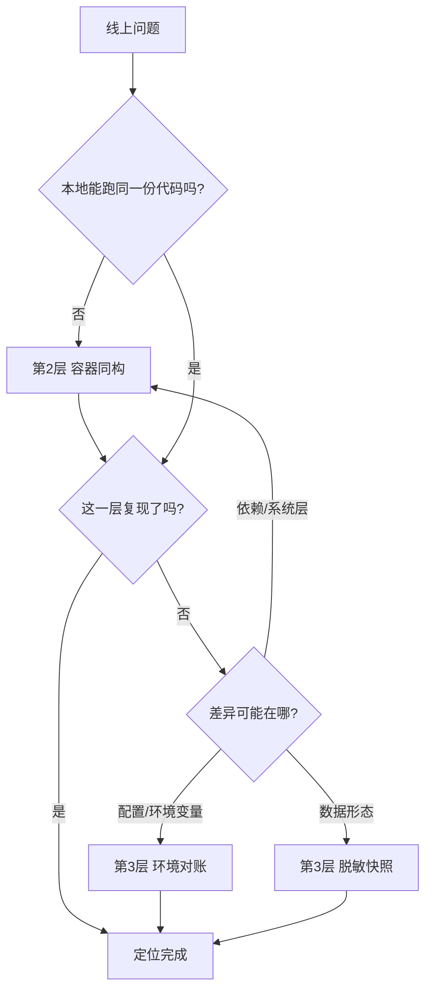
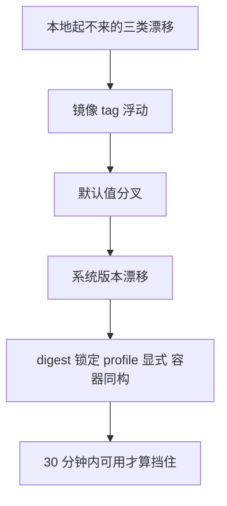

# 本地复现环境是修线上问题的第一现场

**线上排查卡在两头：不敢在生产上试，本地又起不起来——依赖漂移、配置漂移、数据形态拿不到。修复速度的上限由复现速度决定，复现不了的问题只能靠加日志盲改**。要解决的问题是把"本地复现"从运气变成工程能力。

## 它是怎么做到的，本质是什么

**好比法医重建案发现场：把与案情有关的要素（位置、时间、在场者）按原样摆回来，不必把整条街搬进实验室。复现的前提是把触发条件从线上搬进可控环境，条件包括代码版本、依赖版本、数据结构与访问序列。环境与线上越接近，复现成功率越高，而接近程度受成本约束，所以复现环境的目标是覆盖触发条件，不是复制生产规模**。这个比喻到「搬要素不搬整条街」为止，三层各搬什么看下表。

## 三层复现能力各复现什么

| 层 | 复现什么 | 手段 |
| --- | --- | --- |
| 进程内 | 单个逻辑 bug | 最小输入 + 单测级复现 |
| 系统级 | 依赖交互 bug | compose（Docker Compose，本地编排多容器）的全部容器 + 种子数据（预置的模拟线上数据） |
| 数据级 | 线上数据触发的 bug | 脱敏数据快照 + 时间相关重放（按线上实际发生的时间顺序回放请求与定时任务） |


*图：Docker（主流容器运行时）官方架构图（Docker Docs）。系统级复现的第 2 层就建立在这张图的结构上：锁定镜像版本（digest）+ compose 编排全部容器，让本地与线上跑在同一组镜像上——图里 Client 到 Docker daemon 再到 Containers 的链路，就是第 2 层复现的执行路径。*

*图源：Docker Docs，[Docker concepts > What is Docker's architecture?](https://docs.docker.com/get-started/docker-concepts/building-images/build-tag-and-publish-an-image/)。*

**数据级是最常缺的一层：bug 由线上特定数据形态触发，本地合成数据造不出空集合、极端比例、坏字符这些形状。解法是脱敏（遮盖敏感字段的部分内容、保留可辨识形态）快照（某一时刻的完整只读副本）管道——线上库的 schema（表结构）、行数分布与触发样本一起拉回来。快照管道必须脚本化：一条命令拉快照、起环境、注入样本，全程无手工步骤，否则第二次就跑不出同样的结果**。

「按触发条件成套备齐、开箱即用」的实物原型是老木匠的工具箱：每一格对应一类活计，凿子刨子锯按工序排布，箱子一开，干活的全套条件就在手边——不带齐工具就上门，修到一半回家取工具，工期全耗在往返上：


*图源：Wikimedia Commons，作者 Ctsu，CC BY-SA 4.0，https://commons.wikimedia.org/wiki/File:Toolbox-vintage-werkzeugkiste-alt-01.jpg。*

**复现环境就是排查现场的工具箱：代码版本、依赖版本、数据形态、访问序列四格都要备齐——缺哪格，问题就在哪格复现不出来；「一条命令拉快照、起环境、注入样本」就是"开箱即用"的脚本化形态**。

三层按差异可能藏的位置选择，多数问题在第 1 层就能定位完成；这张决策图把选择过程画成分支判断：



**三层各自只回答一个问题，不回答别的：第 1 层只回答差异在不在代码，第 2 层只回答差异在不在依赖与系统，第 3 层只回答差异在不在配置与数据形态。先在最快的第 1 层试一次，失败就按"差异可能在哪"直接跳到对应层**。**多数人卡在第 3 层，因为配置优先级（环境变量 > 配置文件 > 代码默认值）是本地与线上分叉的头号来源，而它不产生任何报错**。

## 依赖冻结怎么防漂移

**漂移的根源是同一份配置有多个副本：本地一份、容器一份、线上一份。收敛的办法是把配置挪到独立存储，各实例读同一处，改一处全部生效**。


**本地起不来的根因多半是漂移：镜像 tag（标签，可变指针）浮动、本地默认值与线上默认值不同、JDK（Java Development Kit，Java 开发工具包）与驱动这类系统版本漂移。三道防线分别挡住三类漂移——镜像 digest（内容哈希，钉住不可变版本）锁定挡 tag 浮动、环境用 profile（按环境分组的配置开关）显式声明挡默认值分叉、容器同构锁定挡系统版本漂移——全部防线合流到「从零启动」这条环境回归上**。

三类漂移各有一道防线，漏掉哪一道，对应的那类漂移就会原样穿过去：



**三道防线合流到同一条回归上，是因为任何一道都可能单独失效：digest 锁了镜像但 profile 没声明，默认值照样在本地与线上分叉。只有定期从零启动整套环境，才能验证三道防线同时成立——环境自己也需要回归测试（改动后重跑旧用例、确认没有破坏既有功能）**。防线原则是 [[工程知识/软件构建：让变化可以理解、验证与交付/开发工具/依赖供应链需要锁定来源与构建输入]] 的延伸。

## 动手跑一遍会看到什么：三层复现的最小流程

**好比衣服穿上身不合身，逐层排查是哪一层的问题：先换件同样的衣服（容器锁镜像），再换里面的内衬（数据种子），最后查尺码表（配置与依赖），每换一层就试穿一次，合身了就停在那一层**。一个"线上 500、本地正常"的配置类缺陷，三层各做一件事：

```bash
# 第 1 层 进程内：直接跑
python main.py                 # 本地正常 → 差异不在代码，去第 2 层

# 第 2 层 容器：锁同构镜像
docker run --rm -v $PWD:/app myapp:prod-v1.8.3 python main.py
# 容器里复现 → 差异在依赖或系统层，对账：
pip diff local.txt prod.txt    # 发现 prod 的 redis-py 5.0 vs 本地 4.6

# 第 3 层 环境：拓扑与数据形态
docker compose up -d redis postgres
diff <(env | grep APP_) /etc/app/config.yaml
# 发现：环境变量 APP_RECOVER_RATE=0 覆盖了 yaml 里的 100
```

跑一遍的收获：**复现是二分（每次把搜索范围砍半、按对数速度收敛的查找法），每层只回答"差异在不在这层"，三层把"线上不复现"的玄学压缩成有限的排查路径**。

## 真实案例里发生了什么：复现能力与第一现场

**配置漂移类缺陷如 [[工程知识/缺陷分析：从个案到体系/配置/案例四：配置不生效——recover 速率与重复日志]]，第 3 层的 env 与 yaml 对账五分钟就能定位；时序类缺陷如 [[工程知识/缺陷分析：从个案到体系/并发/案例三十二：取到了已经不存在的那个——估算器的读取竞态]]，本地要靠第 1 层注入人工延迟（sleep、断点挂起）才能稳定触发。复现不了的问题修不了，复现路径本身就是修复方案的一半**。

## 哪些问题该建本地复现环境、哪些不该

**判断标准只有一条——这个缺陷要不要靠反复试错才能定位。要试很多次时，每次都走线上流程的代价会超过搭环境的代价；一次就能定位的则相反。必须建复现环境的场合：正确性缺陷、配置与依赖相关的行为差异、需要反复迭代的疑难问题。这些场合的共同点是"要试很多次"，而每次试错的成本被复现环境摊薄**。

**不划算的场合看一个判据：只试一次的问题（一次性的数据修复、改一行文案的线上修补）直接改，先花几小时搭环境不划算**。

## 怎么自己动手验证

**环境可用性记三项：从零启动到跑通要多久（冷启动）、十道指定任务能独立跑通几道（复现成功率）、种子数据与线上抽样差别多大（种子数据偏差）。复现环境可用性要与种子数据偏差审计对账——预写种子数据的行数与空值率应贴近线上抽样，偏差过大时复现结论不可信**。比喻到「三项考核」为止，具体命令与口径见下表。

- **冷启动（缓存或服务刚启动、还没有数据与连接的状态）测试：干净机器上 clone 后一条命令启动整套环境，30 分钟内可用；超时环节记入改进清单**。
- **复现成功率统计：线上问题工单里"本地成功复现"的比例，目标 70% 以上；复现不了的走"加日志、观察、再复现"循环**。
- **种子数据与真实分布的偏差审计：行数、空值率、极端值分布对比线上抽样**。

**复现成功率统计的结果与 70% 的目标对不上时，说明种子快照失真或依赖漂移没挡住，先查快照管道与 digest 锁定这两处，再谈复现率**。

## 这套说法在哪儿会失效

**规模依赖的问题（容量、需要真实流量的性能）本地复现不了：那是压测环境的事，见 [[工程知识/后端系统：在并发、失败与变化中维持服务/基础设施/容量规划与压测要用同一个负载模型说话]]，复现环境只管正确性。算法复杂度退化、锁竞争（多个执行流争抢同一把锁造成的等待开销）这类"小数据量也能看出趋势"的性能问题不在此列，它们属于复现环境的射程**。

**并发与时序 bug 的复现要工具化：确定性调度器（固定线程交错顺序，让每次执行走同一条路径，从而稳定复现竞态）、故障注入（主动向系统注入故障来验证容错能力的测试方法）、时钟控制，与 [[工程知识/软件构建：让变化可以理解、验证与交付/测试与交付/混沌工程验证系统是否真的能处理故障]] 配合**。

**复现环境不等于生产同构：目标是"能复现问题"，成本远低于生产级同构；追求同构反而做不起来**。

## 效果从哪儿来，要付什么代价

**一套能在本地跑起来、数据结构接近线上的环境，收益是问题当天能复现、调试过程可反复执行，不用等线上排队腾窗口；代价是要持续维护种子数据与依赖版本，数据分布偏离线上时需要更新**。维护要付什么见上文防线一节。

## 接着读哪几篇：从孤证到可裁决

- [[工程知识/软件构建：让变化可以理解、验证与交付/测试与交付/调试从假设到最小复现]]：复现方法论的上游，本文把它延伸到环境工程
- [[工程知识/软件构建：让变化可以理解、验证与交付/开发工具/依赖供应链需要锁定来源与构建输入]]：依赖锁定原则
- [[工程知识/缺陷分析：从个案到体系/复现与回归/证据链的够用判据——从孤证到可裁决]]：复现产出的证据如何达到够用标准
