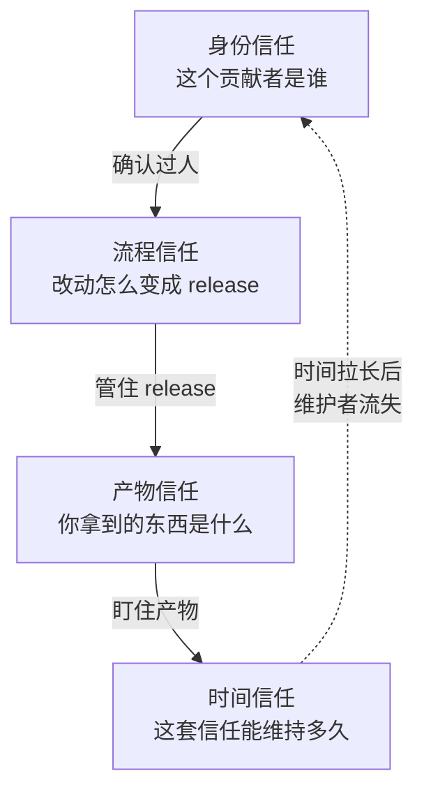
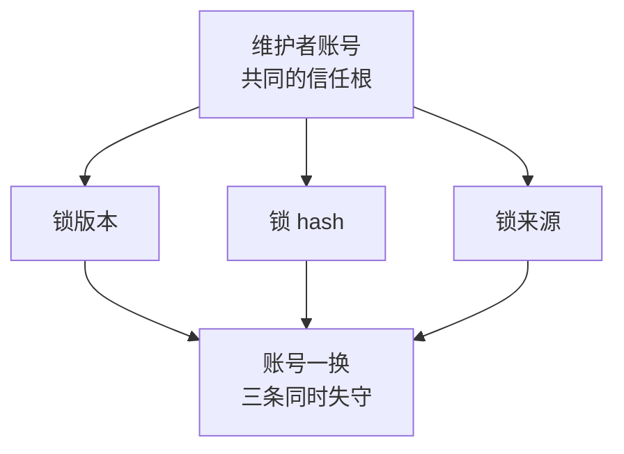
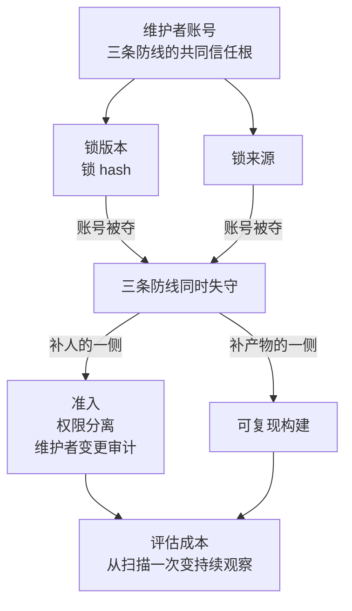

# 维护者信任是供应链信任的地基

锁版本、锁 hash、锁来源这三道防线，在维护者本人就是攻击者时会一起失效——**因为每一把锁都在他手里**。读完这篇你能把上游项目和流程纳入依赖评估，会看贡献者集中度和维护者变更，也知道这些评分降低的是概率而不是风险。

## 先记住哪几句

| 维度 | 回答 |
| --- | --- |
| 要解决的问题 | 依赖信任评估只覆盖"包里是什么"，漏掉了"包由谁、怎么产生"。xz 后门证明：当维护者本身就是攻击者，锁版本、锁 hash、锁来源的防线全部失守，因为每一个"锁"都在他手里。 |
| 本质 | 把上游项目的"人"和"流程"纳入依赖评估对象：贡献者集中度、维护者准入与变更、release 权限分离、构建可复现性。 |
| 做法 | 依赖准入时跑 scorecards 并人工复核低分项；把"维护者变更"列入例行审计信号；release 权限与 commit 权限分离；关键依赖要求可复现构建。 |
| 边界 | 信任评估也有边界：scorecards 高分不等于无后门（社会工程学不进静态指标），贡献者分散不等于无卧底（xz 潜伏两年多）。评分是降低概率，不是消除风险。 |
| 效果与代价 | 对关键依赖维持一份"人的画像"：谁在维护、怎么准入、release 态度如何。代价是评估成本从"扫描一次"升级为"持续观察"，仅对关键依赖值得。 |
| 验证 | 对依赖清单跑一次 scorecards；挑 3 个关键依赖做维护者变更回溯（近一年 release 是否有无名新维护者接手）；对其中最关键的一个抽查构建是否可复现。 |

## 它是怎么做到的：信任的四根柱子与各自失效模式

四根柱子里，**身份是最外层的那一根：凭据由谁签发、谁能换掉它**。联合身份把这件事集中起来——身份由专门的提供方签发，各服务信任这份凭据，不再各自维护一套账号。**这正好对应维护者变更的审计点**。

*图源：Microsoft Learn 中文文档，CC BY 4.0，https://learn.microsoft.com/zh-cn/azure/architecture/patterns/federated-identity。*

开源供应链的信任可以分成四根柱子，每根都有独立的失效模式。四根柱子是递进关系，每一根建立在前一根之上：

**最下面那条虚线是容易被忽略的回路：维护者耗尽热情后账号闲置，攻击者以"接手维护"的名义入场，身份认证从源头被重新签发**。xz 事件走的正是这条路——**前面三根柱子都还在，人已经被换掉了**。

**柱一：身份信任（这个贡献者是谁）。** 失效模式：细粒度 commit 权限缺失——**所有 maintainer 共享一个粗粒度 CODEOWNERS，一人被盗全仓库沦陷**；贡献者匿名度异常——无名新账号突然获得关键路径写权限。观察信号：**贡献者集中度（一人包办全部关键 commit）、账号年龄与贡献历史的断层**。

**柱二：流程信任（改动怎么变成 release）。** 失效模式：release 权限集中——**release 经理与主要贡献者是同一人，社会工程学只需攻破一人**；tag 与构建产物分离——tag 指向的 commit 与发布 tarball 内容不一致（xz 模式）。观察信号：**release 是否走 CI（Continuous Integration，持续集成：代码合并后自动构建与测试）构建而非本机构建、tag 与 CI 产物是否逐字节一致**。

**柱三：产物信任（你拿到的东西是什么）。** 与柱二衔接：**可复现构建是产物信任的硬证据，任何人能从同一源码构建出相同产物，"构建者私自注入"就无处藏身**。失效模式：构建不可复现（时间戳、随机种子、路径依赖进产物），注入可以藏在构建噪声里。

**柱四：时间信任（这套信任能维持多久）。** 失效模式：burnout 与静默放弃——**维护者耗尽热情后账号闲置，等待被接管（xz 前传：原维护者 burnout 被投毒者利用）**；项目转入维护模式后贡献者流失，攻击者以"接手维护"名义入场。观察信号：issue 响应时长、commit 频率的长期趋势、bus factor（多少人同时退出才会让项目停摆）。

## 为什么 scorecards 是必要但不充分的
三条防线看着各自独立，实际挂在同一根钉子上——**钉子一拔，三条同时失效**：

为什么光靠 scorecards 不够，要从 xz 的防线结构说起：xz 事件的关键结构是：**锁版本、锁 hash、锁来源这三条防线共用同一个信任根——维护者账号，账号一换三条同时失守**，所以要往人的一侧和产物的一侧各补一道。

补上这两侧的代价是**评估成本从扫描一次升级成持续观察**，这也解释了为什么这道治理只对关键依赖值得。

锁版本、锁 hash、锁来源三条防线共用一个信任根——维护者账号，这个结构的实物形态是一把锁配多把钥匙：**钥匙再多，锁芯只有一个，换了锁芯，全部钥匙一起失效**：

*图源：Wikimedia Commons，大都会艺术博物馆藏品，公有领域，https://commons.wikimedia.org/wiki/File:Lock_And_Key_(CH_18164871-2).jpg。*

**xz 后门没有撬任何一把锁——它换的是锁芯本身：投毒者以维护者身份合法入场，版本号、hash、来源在他手里逐个「正常」产生，下游三条防线逐条核对、逐条通过**。锁人的治理补的正是这道缺口：**确认锁芯还在原来那个人手里，而且这个人还是当初那个人**。

OpenSSF scorecards 是把四根柱子的观察信号自动化的一次尝试，它把多数信号做成了自动化检查——Maintainers、CI-Installed、SAST（Static Application Security Testing，静态应用安全测试）、Binary-Artifacts 等。**它的价值是把"人的观察"变成"可比较的分数"，让依赖准入有客观起点**。不充分之处有二：

1. **静态指标看不见潜伏。** xz 的接手者 Jia Tan（后查明的投毒者化名）贡献了两年多合法代码、通过了所有社区流程，scorecards 在后门注入前会给 xz 打高分。**社会工程学的本质是利用流程的合法性，静态评分对此失明**。
2. **低分项目的合法解释。** 单维护者项目（bus factor 等于 1）可能是作者本人坚持的作品（如 SQLite——广泛嵌入应用进程的单文件数据库），不必然是风险。**评分要触发人工判断，不能替代判断**。

## 防线怎么分层：按依赖的关键度升格治理

分层治理的前提是**判定集中在一处**。身份架构设计给的就是这个形状：身份判定集中在专门的一层，各服务向它确认而不是**各自实现一套**。

*图源：同上（Microsoft Learn 中文文档），CC BY 4.0。*

| 依赖级别 | 判断标准 | 治理动作 |
| --- | --- | --- |
| 基础库（xz 级） | 几乎所有下游都会拉取（压缩、加密、网络协议库） | scorecards 年审 + 维护者变更例行审计 + 可复现构建验证 |
| 关键依赖 | 直接影响产品行为与数据语义 | scorecards 准入 + 协作记录留存（release 节奏、维护者名单存档） |
| 普通依赖 | 可替换、影响面小 | 扫描器例行扫描即可，不做人审 |

这个分层与依赖升级分层[[工程知识/软件构建：让变化可以理解、验证与交付/开发工具/依赖升级按风险分层：验证阶梯、节奏策略与 CVE 响应]]同构：**治理强度跟着爆炸半径走**——爆炸半径指这个依赖出问题时，会有多少下游系统连带受损，拉取它的项目越多、它在越底层，半径越大。

## 与依赖供应链理论篇怎么分工

[[工程知识/软件构建：让变化可以理解、验证与交付/开发工具/依赖供应链需要锁定来源与构建输入]] 锁的是"物"（版本、hash、签名、构建输入），本篇补的是"人"（谁维护、怎么准入、release 怎么产生）。**两篇合起来才是一套完整的供应链信任评估：只锁物不锁人，xz 后门那样从维护者身份入手的攻击无从防起；只锁人不锁物，包内容被偷换同样防不住**。

## 怎么自己动手验证

- **scorecards 批量跑**：对依赖清单里全部直接依赖跑 scorecards（`scorecard --repo=github.com/xxx/xxx`），低分项人工复核。注意 scorecard 的检查面覆盖 GitHub 托管仓库，非 GitHub 依赖要用其他方式补全观察。预期：多数项目 CI、分支保护、依赖更新检查得分正常；Binary-Artifacts（仓库里是否提交了二进制产物）是常见扣分项。**维护者集中度不在 scorecard 的检查项内，它属于人工观察——最接近的自动化项是 Maintainers（维护者名单是否公开）**。
- **维护者变更回溯**：挑 3 个关键依赖，读近一年 release 的 commit 历史与维护者名单变化。预期：**能说清每个项目"现在谁在维护、维护者怎么产生的"，说不清的就是治理缺口**。
- **可复现构建抽查**：对最关键的一个依赖做源码构建与发布产物的 diff。预期：多数项目可通过；**通不过且无解释的项目，其产物信任为零**。

预期是"三个关键依赖都能说清当前的维护者是谁"，**对不上就说明审计信号没建起来，先补维护者变更的例行观察**。

## 接着读哪几篇：同在软件构建里的相邻问题

- [[工程知识/软件构建：让变化可以理解、验证与交付/开发工具/依赖供应链需要锁定来源与构建输入]]：锁"物"的一篇，与本篇锁"人"互补
- [[工程知识/软件构建：让变化可以理解、验证与交付/开发工具/依赖升级按风险分层：验证阶梯、节奏策略与 CVE 响应]]：治理强度分层的同构参照
- [[工程知识/缺陷分析：从个案到体系/安全/案例四十四：投毒不是写错，是写给你看——依赖投毒的三个真实剧本]]：投毒形态在缺陷域的展开