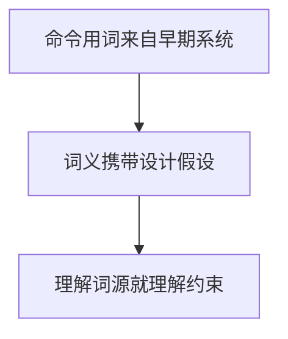
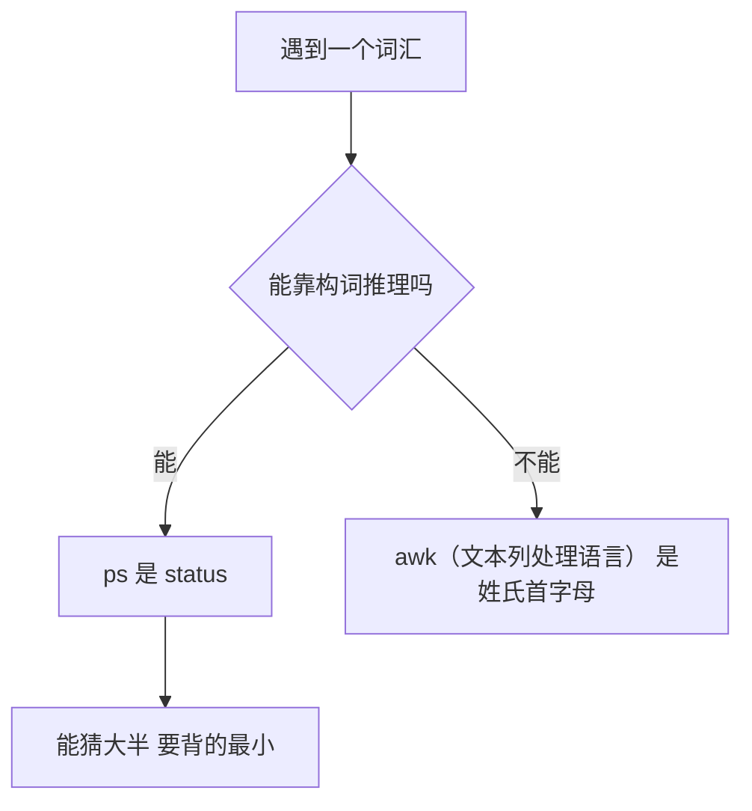
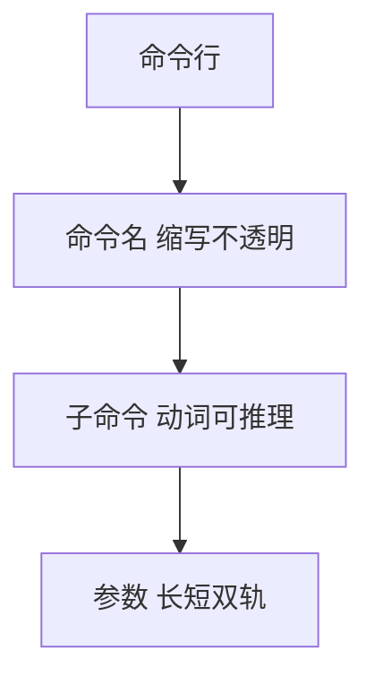

# 词汇即接口：Linux与容器命令的词源与设计

`ls -l` 里的 l 是 long，`Docker ps` 的 ps 是 process status，`kubectl get pods` 的 get 是 REST 的 GET（HTTP 读取资源的请求方法）——REST 即 Representational State Transfer、表述性状态转移，Web API 设计的一套动词约定；GET 是 HTTP 协议里"读取"的动词。CLI（命令行界面）的世界浸泡在缩写传统里。

**要解决的问题：新人面对的命令行不是自解释的，它的词汇表是一套有来历、有设计意图的体系；把这套词汇的词源与设计逻辑讲清楚，命令行就从"背不完的咒语"变成"能猜出来的语言"。**

## 它是怎么做到的：三层词汇结构



CLI 词汇分三层，每层有自己的构词逻辑，见下图：

| 层 | 例子 | 构词逻辑 | 记忆负担来源 |
| --- | --- | --- | --- |
| 命令名 | ls、cp、mv、ps、grep（文本搜索工具） | 缩写传统：初代 Unix 打字机时代省按键 | 缩写不透明（ps 不是"照片"） |
| 子命令 | Docker（容器工具，把应用与依赖打包成隔离单元） ps、kubectl get、Git（分布式版本控制系统） commit | 动词-名词对：动词决定操作类型，名词决定对象 | 一个动词在不同工具里语义漂移 |
| 参数/开关 | -v、-f、--force、--verbose | 长短名双轨：短名省敲，长名自文档 | 同一短名跨命令含义不同（-v 在 mv、grep、tar 里都是 verbose，在 mkdir 里不存在） |

为什么会有长短双轨：POSIX（IEEE 制定的可移植操作系统接口，一套命令行与系统调用的约定）与 GNU 约定 `--long-name` 是 `--` 前缀全拼（自解释、可读脚本首选），单字母短名继承自 1970 年代电传打字机时代的按键经济（当时终端一屏 80 列 24 行，省一个字符是真金白银）。`-v` 命令行工具一半当 verbose（啰嗦模式）一半当 version（打印版本），两代设计习惯共存于此。


词源推理是有边界的：能猜的与只能查的，从「遇到一个词汇」这个节点就分了岔：



**分界线画清楚，收益与代价才谈得明：可推理的那部分把命令行从机械记忆变成推理，剩下的控制在最小范围。**

收益与代价：词源视角的收益就体现在这里——知道 ps 是 process status，Docker ps（Docker：容器工具，把应用与依赖打包成隔离单元）不用记；知道 kubectl 动词照搬 REST（Representational State Transfer，用标准 HTTP 动词组织 API 的风格），apply 的幂等（同一操作执行多次与执行一次效果相同）性即同一操作重复执行结果不变。

代价是**这套推理有边界：血统差异**（BSD（Berkeley Software Distribution，加州大学伯克利分校的 Unix 分支）与 System V 两套 Unix 实现分支）与历史偶然（awk（文本列处理语言）取自三位作者姓氏首字母）推不出来，这部分仍然要查。这份总纲的价值在把"能推理的"与"只能查的"分界线画清楚。

## 各词汇什么年代、什么状态

词汇的三代演进各有分界点，一代一个心智模型，见下图：

| 代际 | 年代 | 心智模型 | 词汇特征 | 状态 |
| --- | --- | --- | --- | --- |
| Unix 初代 | 1969-1979 | 打字机时代的按键经济 | ls/ps/df 两三字母缩写、短参数 | 遗留（缩写不透明，只能查） |
| GNU/BSD/System V | 1983-2002 | 自文档运动 | --verbose 长参数双轨、血统分裂 | 标准（长参数纪律）+ 遗留（血统差异永存） |
| 容器时代 | 2013-2015 | 进程模型 / REST 模型 | docker ps 动词直搬、kubectl REST 照搬 | 演进（声明式 apply 正在收编命令式） |

三代词汇按"命令名决定动词、子命令选对象、参数修饰动作"的顺序堆叠，后一代包住前一代：



**每一代都解决了上一代的痛点（缩写省按键、长名自文档、动词可推理），但都没有清掉上一代的词汇，三代在今天的命令行里共存，词源是分清叠加层的唯一线索。**各代明细见 [[工程知识/软件构建：让变化可以理解、验证与交付/开发工具/Linux常用命令的词源地图.md|Linux常用命令的词源地图]] 的年代血统表与 [[工程知识/软件构建：让变化可以理解、验证与交付/开发工具/Docker与K8s词汇的设计逻辑.md|Docker与K8s词汇的设计逻辑]] 的年代演进表。


来源：[腾讯云开发者社区《30 张图揭开「内存管理」的迷雾，瞬间豁然开朗》](https://cloud.tencent.cn/developer/article/2671629)（CC 4.0 BY-SA）


## 为什么说词汇是接口设计史的活标本

**每代词汇都是那代人对"人和机器怎么对话"这个问题的一份答卷**：打字机时代回答"怎么省按键"（缩写经济），GNU 时代回答"怎么让脚本可读"（自文档长名），容器时代回答"怎么让操作可推理"（动词语义照搬 REST）。**把词汇当接口看，接口设计课就从抽象概念变成手边的实例**——ps 的两字母取舍、--verbose 的命名纪律、apply 的幂等语义，全都是能摸到的设计决策。**这是本系列把词源当正课讲而非趣闻汇编的原因：知识背后代表的思想与设计取舍，本身就是最有价值的部分。**

词汇与设备的绑定关系在实物上最直观：命令行词汇从电传打字机的键盘走进绿屏终端，每个动词按键背后的语义契约没有变——回车确认、Ctrl-C 中断（硬件或软件打断 CPU 当前工作、转去处理紧急事件的机制）、Tab 补全，这些手指记住的东西就是词汇作为接口的证据：


*图源：Wikimedia Commons，Jamie Cox，CC BY 2.0，https://commons.wikimedia.org/wiki/File:Zenith_Z-19_Terminal.jpg。*

Go 语言把这个思路玩出了花：工具链的修 bug、发版、周边工具全画成口袋鼠角色的不同姿态——词汇与角色绑定后，「go fix 是修代码的工具」不需要任何文档就能记住。

## 看完能判断哪些事

- 手上的活是写一次性脚本：优先长参数（--verbose），脚本三个月后还要有人读，可读性值钱。
- 手上的活是交互式敲命令：短参数省事高效，但血统差异的坑（-v 双义、ps 两套）要知道在哪查。
- 手上的活是设计 CLI 或 API：三代词汇是现成的取舍参照系——短名的输入经济、长名的自文档、动词语义的可推理，各有适用场景；apply 的幂等性设计可以直接借鉴到自己的工具上。
- 新人入门顺序：先学构词类别（动词缩写/名词短语），能猜出大半命令；再啃血统遗留，把"只能背的"控制在最小范围。

## 怎么自己动手验证

```bash
# 亲眼确认短名冲突的普遍性
for cmd in mv cp tar mkdir grep curl; do $cmd --help 2>&1 | head -1; echo ---; done
# 验证 GNU 长参数在所有 coreutils 的一致性
ls --help | grep -E "^\s+-" | head
```
预期：coreutils 家族的长参数高度一致（--force 在 rm/mv/cp 语义相同），短名则各工具自治。数字对不上即某工具长参数不认时，查它是否属于 BSD/系统 V 血统——ps aux 的 aux 在 BSD 血统无横线、系统 V 用 -ef，血统差异是参数风格分裂的根源。

## 这套说法在哪儿会失效

本篇是命令词汇的方法论总纲。具体工具的词源明细见 [[工程知识/软件构建：让变化可以理解、验证与交付/开发工具/Linux常用命令的词源地图.md|Linux常用命令的词源地图]] 与 [[工程知识/软件构建：让变化可以理解、验证与交付/开发工具/Docker与K8s词汇的设计逻辑.md|Docker与K8s词汇的设计逻辑]]。

shell 本身的机制（管道、重定向、通配符）见 [[工程知识/软件构建：让变化可以理解、验证与交付/开发工具/Linux调查先收集事实再改变状态.md|Linux调查先收集事实再改变状态]]。词源数据在上古 Unix 文档与 GNU 手册里，核心工具的构词都能在 man（Unix 手册页命令） 手册的 SEE ALSO（"另请参阅"小节，列出相关命令）与 GNU coreutils（GNU 的基础命令工具集）手册查证。

## 接着读哪几篇：Linux 篇词源明细

- [[工程知识/软件构建：让变化可以理解、验证与交付/开发工具/Linux常用命令的词源地图.md|Linux常用命令的词源地图]]——Linux 篇词源明细
- [[工程知识/软件构建：让变化可以理解、验证与交付/开发工具/Docker与K8s词汇的设计逻辑.md|Docker与K8s词汇的设计逻辑]]——容器侧明细
- [[工程知识/后端系统：在并发、失败与变化中维持服务/服务设计/HTTP语义的分层：方法、状态码与头部的约定角色.md]] —— HTTP 是词汇即接口命题的最大工程实现
- [[工程知识/后端系统：在并发、失败与变化中维持服务/基础设施/网络命名空间与容器网络：vethbridge与overlay.md]] —— ip/netns 命令族的设计语义
- [[工程知识/AI 系统工程：从模型能力到生产能力/Agent与工作流/结构化输出的约束解码：让模型输出可解析.md]] —— 接口形状固定才能被机器消费
