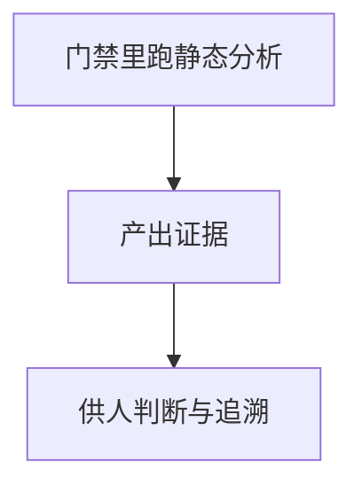
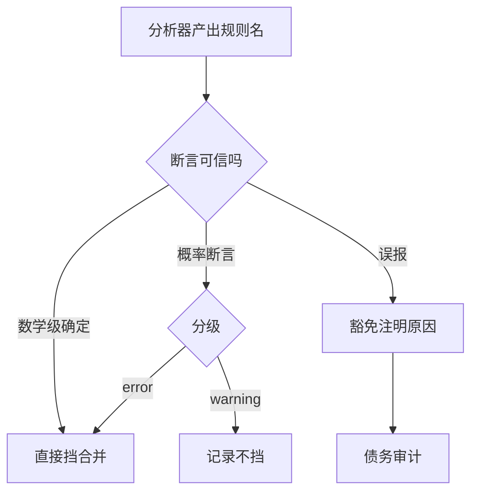
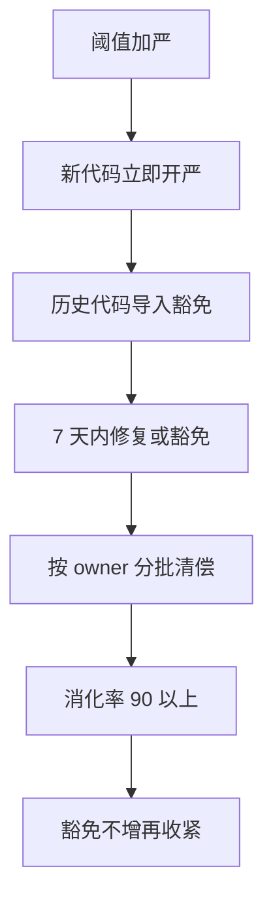
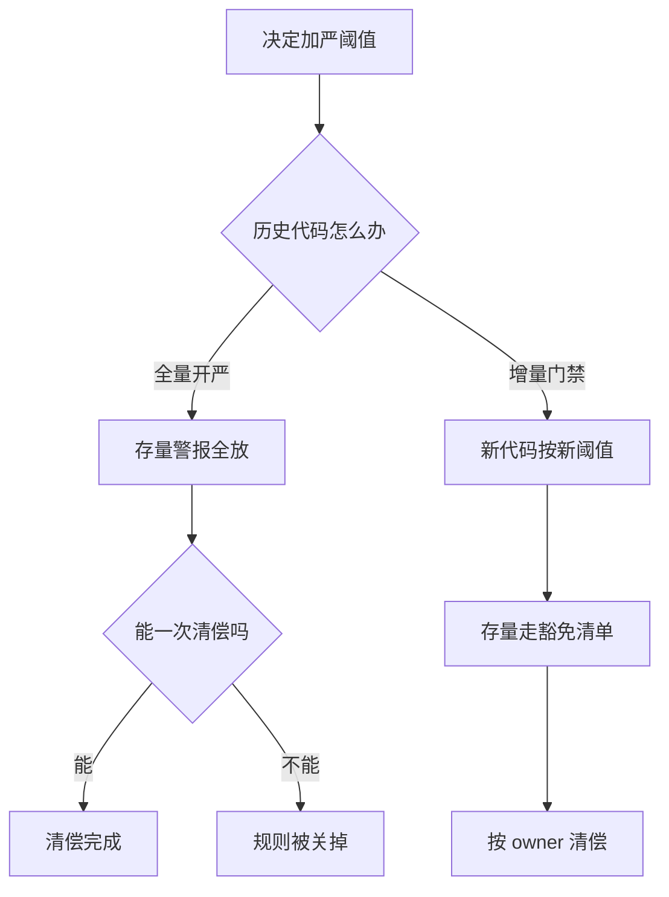

# 静态分析在门禁里定位为证据生成器

**静态分析工具在 CI（Continuous Integration，持续集成：代码合并后自动构建与测试）里常见的两种失效方式：报了几千条没人修（警报疲劳），或一开严了挡不住任何东西干脆关掉（门禁失效）**。**要解决的问题：静态分析的价值不在"检查"这个动作，而在它产出的证据能不能进决策——警报要么变成修复行为，要么变成明确的豁免记录，中间态都是债务**。

## 它是怎么做到的：分析器在证什么

**打个比方：机场安检仪看的是行李的透视图（代码的形状），能发现刀的轮廓，判断不出谁会拿刀做什么——它证明「箱子里有一把刀」，不证明「这个人会行凶」**。**这个比喻到「形状可证、意图不可证」为止，断言可信度怎么分层看下文**。



静态分析在门禁里的定位：


**静态分析不改代码，它生成断言：这段代码有未初始化读（UB）、这个模式匹配漏了分支（穷尽性）、这条路径返回了 None（类型）**。**断言的可信度分层**：

| 层 | 断言性质 | 门禁行为 |
| --- | --- | --- |
| 编译器/类型检查 | 数学级确定 | 直接挡 |
| 证实类分析（UBSan 等运行时） | 运行即证 | 测试路径必开 |
| 启发式 linter | 概率断言 | 分级：error 挡、warning 记录 |
| 格式化器 | 无断言纯变换 | 自动修，不挡 |

**把它定位为"证据生成器"：门禁消费证据**，见 [[工程知识/软件构建：让变化可以理解、验证与交付/测试与交付/发布门禁必须绑定真实证据]]，**证据要可信、可追溯、可豁免**。**不可信的警报进门禁等于门禁自毁**。

证据从分析器到决策的流向，每一层决定它进不进得了门禁：



## 为什么门禁上的检查必须是证据

**门禁与本地检查的差别不在检查项多少，而在后果：本地 lint 报了可以无视，门禁报了会挡住合并**。**挡住合并这件事要有正当性，正当性来自证据三要素——可定位（哪一行、哪条规则）、可解释（为什么算错）、可豁免（什么情况下允许它存在）**。**缺一条，被挡的人就会去找绕过门禁的办法，绕的人多了门禁就废了**。

**这条定位来自实践侧的共识：Google 的工程实践文档把代码评审与静态分析并列为"让变更可理解"的两道手段，并强调分析器的产出要能直接进评审视野**（来源：[Google Engineering Practices](https://google.github.io/eng-practices/)）。**LLVM（编译器基础设施，模块化编译与优化） 项目的 Clang 静态分析器文档同样把报告定位成给开发者看的诊断，而不是给管理者看的统计**（来源：[Clang Static Analyzer](https://clang-analyzer.llvm.org/)）。

**加严阈值不能一次性全量开：从「阈值加严决定」分出两条并行轨道，新代码走增量门禁立即开严，历史警报按 owner 分批清偿，两条轨道在「警报消化率 > 90%」这个节点合流后才允许再收紧**：



**两条轨道的合流点就是阈值能不能继续收紧的判据——合流之前调阈值只会把历史债务藏进豁免清单**。

**代价也要讲清楚：加严阈值会把历史代码的警报一次性全放出来**，**团队要么花几周清偿，要么整体关闭规则**。**正确顺序是先在新代码上开严（增量门禁），历史债务走豁免清单分期清偿，别一上来就全量开**。

**两种做法的分岔在"开严的那一刻历史代码怎么办"**：



**左边那条路最常见的终点是右下角：警报太多清不动，最后整条规则关掉，门禁比不开之前还弱**。**右边把存量与新代码分开处理，新代码从第一天就守新阈值，存量按 owner 分期还**。**存量那侧的清偿进度与误报率是同一个观察面：规则报得准，owner 才愿意还**。

## 为什么豁免要写成显式债务

**豁免好比借钱打的借条：写清谁借的（owner）、什么时候还（到期时间），账才查得动；没写日期的借条等于永久不还，没写名字的借条找不到债主**。**警报导入（alert suppression）必须留痕迹：行内 pragma 注明原因与 issue 号，或集中豁免文件注明 owner 与到期时间**。**没有到期时间的豁免是永久债务；没有 owner 的豁免是孤儿债务**。**周期性债务审计：豁免数量趋势、按 owner 分组的清偿率，豁免在涨说明门禁阈值与代码现实脱节**。**这个比喻到「借条三要素」为止，债务审计的具体口径以下文为准**。

**静态分析的工具链位置决定了它能看到什么：源码先经前端（Clang、LLVM-gcc、GHC（Glasgow Haskell Compiler，Haskell 编译器）等各语言前端）转成中间表示 LLVM IR（Intermediate Representation，编译器中间表示：源码与机器码之间的中间形式），IR 经优化器处理后交给各目标后端生成机器码**。**分析器的证据正是从这张图的前半段产出的——语义分析、类型检查、数据流分析都在源码到 IR 这一段完成，它们看得到结构，看不到运行时的实际取值；而后端那一段（寄存器分配、指令选择）已经是行为世界的领地，静态手段在这里只能做保守推断**。**这也解释了为什么"证据可定位"是分析器的硬要求：它的证据只描述代码的形状，越靠近后端的部分，静态断言的可信度越低**。


*图源：LLVM 官方架构文档（The Architecture of Open Source Applications, Chapter 11 LLVM），CC BY 3.0，https://www.aosabook.org/en/llvm.html。*

## 动手跑一遍会看到什么：一条自定义规则从 AST 到门禁

**分析器的工作方式：拿着「句尾必须画句号」的检查单逐句核对（AST 遍历），看到违反处打个标记（报警报），检查单钉进验收流程（进门禁）**。**用 Python 的 `ast` 模块（AST，抽象语法树：把代码按语法结构组织成的树，分析器就在这棵树上找模式）写一条"发现未关闭文件句柄（程序持有的资源引用标识）"规则，二十行内看到分析器的全部工作方式**：

```python
import ast

class UnclosedFileVisitor(ast.NodeVisitor):
    def visit_Assign(self, node):
        # open(...) 赋值给变量，但该函数内没有对应的 with 或 close
        if isinstance(node.value, ast.Call) and getattr(node.value.func, "id", "") == "open":
            self.findings.append(node.lineno)
        self.generic_visit(node)

    def __init__(self):
        self.findings = []

tree = ast.parse(source)
v = UnclosedFileVisitor(); v.visit(tree)
# findings = [42] → 门禁输出：第 42 行的文件句柄无关闭路径，合并被拒
```

**跑一遍的收获：分析器的产出是一份带位置的证据清单，它的价值取决于两条纪律——证据可定位（行号 + 规则名 + 修复建议），证据可豁免（`# noqa: rule-id` 显式标注，豁免进了 review 视野）**。**没有豁免通道的规则会在历史代码上全红，最终被整体关闭**。

**真实工具把这个过程做成了可视化界面：semgrep Playground 左侧写规则（`print("...")` 模式），右侧放测试代码，点 Run 之后命中处直接高亮、底部给出计数——上面二十行的 Python 脚本做的事，在界面上一目了然，规则、代码、命中位置三者的对应关系就是「证据可定位」的现场**：


*图源：semgrep Playground 官方环境（semgrep.dev/playground/new），2026-09-27 截图，规则与命中数为界面真实状态。截图类按「真实界面截图」判据处理：页面自摄自用，图注注明来源与日期。*

## 真实案例里发生了什么：证据生成器在门禁链上的位置

**静态分析与** [[工程知识/软件构建：让变化可以理解、验证与交付/测试与交付/CI流水线把反馈速度和发布证据连接起来]] **的关系是供血：流水线的门禁环节（测试、安全扫描、发布审批）消费的每一份证据里，静态分析供的是"不用运行就能证明的错误"**。**缺陷域的同构教训：**[[工程知识/缺陷分析：从个案到体系/正确性/案例二：静默错算——Spark SQL Union 的别名陷阱]] **那类运行时才现形的静默错值，靠类型与 lint 规则（列名显式匹配）在合并前就能拦住——分析器的规则库每加一条，就是把一个已付过学费的错误模式变成永久防线**。

## 怎么自己动手验证

**验证的锚点与目标见下方清单第一条**。**与预期对不上时先看豁免增量而不是先调阈值——豁免在涨说明门禁阈值与代码现实脱节**，**调阈值只会把债务藏起来**。**统计口径见下方清单**。

- **警报消化率：新警报在 7 天内被修复或显式豁免的比例，目标 >90%**。**统计口径用 `git log --since="7 days ago"` 圈定新增警报的引入时间，再看这批警报的当前状态**。
- **豁免清单审计：过期未清偿的豁免数、无 owner 豁免数，两者都应为 0**。
- **误报率抽样：每周人工抽 20 条 active 警报核对真伪，误报率超过 20% 时先修规则而不是先关门禁**。

## 这套说法在哪儿会失效

- **静态分析证不了行为正确性**：**它挡 UB 与类型错误，挡不住业务逻辑错——那是测试与评审的领地**，见 [[工程知识/软件构建：让变化可以理解、验证与交付/测试与交付/测试策略从风险选择证据]]。
- **不同语言的警报质量差异大**：**格式与风格规则服从工具自动修（如格式化器），语义警报才值得进门禁，不要把两类混在一个开关里**。
- **分析器自身的升级是变更**：**规则版本变化带来警报集变化，升级要走与代码变更同样的门禁流程（新警报豁免评审）**。

## 接着读哪几篇：同在软件构建里的相邻问题

- [[工程知识/软件构建：让变化可以理解、验证与交付/测试与交付/发布门禁必须绑定真实证据]]：门禁框架，本文是静态分析证据如何进这个框架
- [[工程知识/软件构建：让变化可以理解、验证与交付/开发工具/依赖升级按风险分层：验证阶梯、节奏策略与 CVE 响应]]：分析器自身作为依赖的升级管理
- [[工程知识/AI 系统工程：从模型能力到生产能力/安全与治理/执行证据必须独立于AI结论]]：证据独立性原则在 AI 场景的同构表达
- [[工程知识/缺陷分析：从个案到体系/复现与回归/内存错误的检测要靠影子内存：红区、悬垂隔离与代价账.md]]：表格里"运行即证"那一层的 UBSan 从哪里来、与 ASan（AddressSanitizer，内存错误检测器） 的射程怎么分工