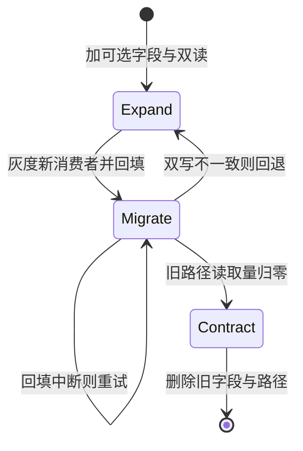
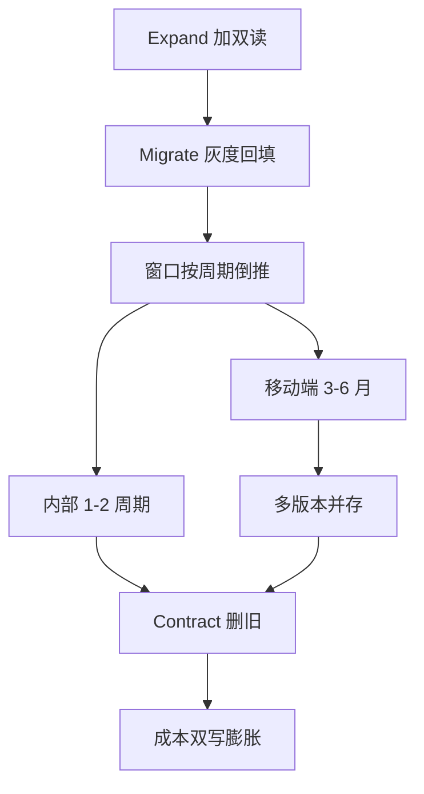

# API 与 Schema 演进必须兼容新旧消费者

**线上不会只有一个版本的客户端，删一个字段就可能让还在跑的旧版本读不出数据**。读完这篇你能把危险变更拆成可观测的兼容阶段，安排先扩展再迁移最后删旧路径，也知道灰度（新版本先放一小部分流量验证，逐步放大到全量）中途该怎么回滚（把系统状态退回到改动之前的版本）。

## 先记住哪几句

| 维度 | 回答 |
| --- | --- |
| 要解决的问题 | 线上新旧客户端、worker、缓存和回滚版本会并存，一次性替换字段或语义会让部分消费者无法读取或产生错误解释。 |
| 本质 | 把不可逆变更分成可观测的兼容阶段，让数据和代码在迁移窗口内同时满足新旧约定。 |
| 做法 | 先扩展可选字段/双读，再迁移消费者和数据，确认覆盖后停止旧写入并删除旧路径；记录消费者、停止条件和回滚组合。 |
| 效果与代价 | 支持灰度、暂停和回滚，降低发布爆炸半径；代价是双读/双写、迁移状态、短期重复逻辑和兼容测试成本。 |
| 边界 | schema 校验通过不代表业务状态兼容；数据库事务不能覆盖远端 API，字段删除、默认值和排序语义改变仍可能破坏消费者。 |
| 验证 | 保留旧客户端/worker 做接口约定回归，测试部分发布、回填中断、双写（迁移期间同一份数据同时写入新旧两个存储）不一致、重试和回滚后新旧版本的交互。 |

**线上变化通常不是一次性替换：旧客户端、旧 worker、缓存、消息、数据库和回滚版本会与新代码并存**。兼容设计把迁移分成可观察的小步，避免"发布成功但旧消费者无法读取"的事故。**马丁·福勒把这套做法称为演进式数据库设计，其核心主张是迁移步骤可回滚、可重复执行**（来源：[Evolutionary Database Design](https://martinfowler.com/articles/evodb.html)）。

**兼容性的真实对象是消费者对默认值、错误、排序、幂等（同一操作执行多次效果与执行一次相同）和状态转移的全部假设，字段表只是它的表面形状；只验证 schema 能解析，仍可能让旧 worker 误处理新状态**。

"一次性替换"的反面教材在铁路史上有现成的画面：1846 年的 Gloucester 车站，英国大西部铁路（宽轨）与伦敦及西北铁路（标准轨）的轨距在此接壤，乘客与货物要在站台上手工搬运换乘——两套消费者各按自己的"schema"修建的线路，接通那一刻的兼容成本全部落在中间的站台上：

*图源：Wikimedia Commons，公有领域（1846 年出版），https://commons.wikimedia.org/wiki/File:Break_of_Gauge_at_Gloucester.jpg。*

## 要付什么代价，什么情况下该用

**三个阶段不是免费的。Expand（先加新结构并保持旧读写可用）阶段多一条读写路径，Migrate（迁移消费者与回填数据）阶段双写，Contract（收缩删除旧路径）阶段要验证覆盖度，每一段都在增加需要维护的东西**：

| 阶段 | 多出来的维护项 | 何时可以不做 |
| --- | --- | --- |
| Expand | 新旧字段并存、双读分支、兼容测试用例 | 变更是纯新增可选字段，旧消费者忽略它即可 |
| Migrate | 双写校验、回填任务、进度记录、不一致对账 | 消费方数量为一且可同步发布，同一次上线内改完 |
| Contract | 确认所有消费者已迁移、删除前的读取量观测 | 字段从未真正上线使用过 |

**判定的分水岭是消费方数量与可控程度：内部 worker 能同步发布，三阶段可以压缩到一次上线；对外 API 或移动端 App（手机上的客户端应用）的消费方不可控，三阶段要按升级长尾（少数请求耗时远高于其余大部分）展开**。

来源：[腾讯云开发者社区《消息队列：听我解释，我真的不是只有Kafka！》](https://cloud.tencent.com.cn/developer/article/1866156)（CC 4.0 BY-SA）

## 最小演进实验怎么做

**让旧客户端、旧 worker 和回滚版本同时运行，依次执行 expand、回填中断和 contract；记录读写结果、错误分类、重复副作用（操作对外部状态产生的额外影响）和回滚后的可见数据**。

三阶段流程的每一步都可以停住或回退，状态转移的全部路径如下图：

## Expand / Migrate / Contract 三步怎么走

新旧并存的窗口期有多长，轨距史也给出过量级：芬兰轨道博物馆把从 600mm 到 1676mm 的八种轨距并排铺在同一条演示线上，每种轨距一辆自己的车——这就是 Expand 阶段的尽头形态：基础设施同时服务所有版本，哪一种都不被排除，直到各自的"消费者"完成迁移再逐段收缩：

*图源：同上（Wikimedia Commons），Unnerving duck。*

**演进窗口里最容易被忽略的是消费者侧的速率。新旧两版 schema 并存的这段时间，消费者要同时处理两种格式，实际吞吐会低于稳态（系统运行指标进入平稳区间后的状态）**。

队列是吸收这个波动的标准做法——把突发摊平成消费者能承受的稳定速率：

超出队列承载能力时，形态就变成了这样：

**新旧并存期间两套逻辑都要维护，而队列溢出后消费者还要承担吞吐折损，这两笔代价分开算才看得出窗口开多久合适，所以兼容窗口的账要算两笔：一是并存时长的日历成本，二是这段时间内消费者侧的吞吐折损。只算前一笔，窗口排期一定偏乐观**。

1. **Expand**：**增加可选字段、新表/索引或双读路径，保持旧读写可用**。
2. **Migrate**：**灰度新消费者、回填数据、双写或事件重建，比较事实和延迟**。
3. **Contract**：**确认所有消费者已迁移，停止旧写入，最后删除字段/路径**。

**字段删除、类型收窄、枚举重编号、默认值变化、排序/分页语义改变和消息顺序改变都可能是破坏性变更。数据库事务不能覆盖远端 API，schema 通过也不能证明业务状态兼容**。

## 这些量在什么数量级：兼容窗口的账

**兼容窗口的时长由消费方更新周期倒推：内部消费方（同团队可控）窗口 1-2 个发布周期；外部消费方（移动端 App）窗口 = 用户升级完的时长，移动端典型长尾 3-6 个月——服务端要同时服务多个在役版本的协议，三阶段中的 Contract 最早只能排到窗口末端执行**。**双写的成本账：新旧两套字段并存的存储膨胀（通常 10-30%）、写路径的双份校验——窗口期是租来的，拖长窗口的维护成本会吃掉兼容的收益**。窗口两条分支的时点相差数月，全流程如下：

**Contract 的最早时点由窗口末端决定，窗口期内的双写与存储膨胀就是租这段时间的价钱**。

## 真实案例里发生了什么：静默失真的同构教训

**Schema 演进的静默失败在缺陷域有实录**：[[工程知识/缺陷分析：从个案到体系/正确性/案例三十九：身份在改写中丢失——RLS 子查询与视图 DEFAULT 的静默失真]] 讲视图改列序后 INSERT 按位置排列的静默错值——**Schema 变更破坏消费方假设的典型形态，错误不报错、数据悄悄写错位置**。**防线的同构点：Expand 阶段加的每个新字段，消费方迁移完成前旧路径要持续验证（行为对比测试）**，与本库 [[工程知识/软件构建：让变化可以理解、验证与交付/测试与交付/发布门禁必须绑定真实证据]] 的证据门禁直接衔接。

## 怎么自己动手验证

**验证的锚点是旧版本消费者回归：旧客户端读新服务、旧 worker 消费新消息，行为应与升级前一致**。与预期对不上时先查默认值的解释差异，多数解析失败出在旧消费者对新增字段的处理上，schema 本身是通的。

**保留旧版本客户端/worker 做接口约定回归；测试部署顺序、部分发布、重试、回滚、数据回填中断和双写不一致**。**每次变更记录消费者、迁移进度、停止条件和删除时间，不靠"应该没人用了"**。

## 接着读哪几篇：输入输出的形状与演进的纪律由接口约定先行约定

- [[工程知识/后端系统：在并发、失败与变化中维持服务/服务设计/API接口约定定义输入输出和演进边界]] —— 输入输出的形状与演进的纪律由接口约定先行约定
- [[工程知识/软件构建：让变化可以理解、验证与交付/测试与交付/发布门禁必须绑定真实证据]] —— Contract 前的消费者覆盖确认要用真实读取证据
- [[工程知识/软件构建：让变化可以理解、验证与交付/架构与代码/API演进的兼容性纪律：废弃流程与版本策略]] —— schema 兼容是机制面，废弃流程是纪律面
