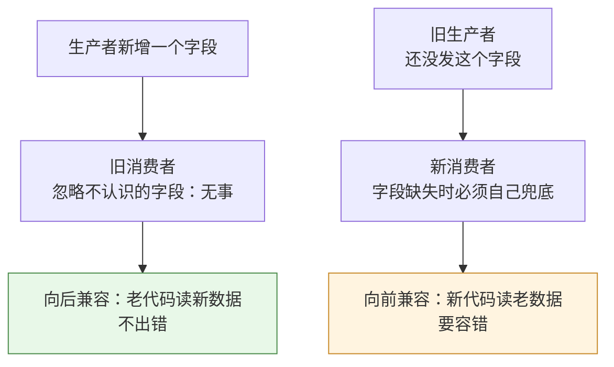
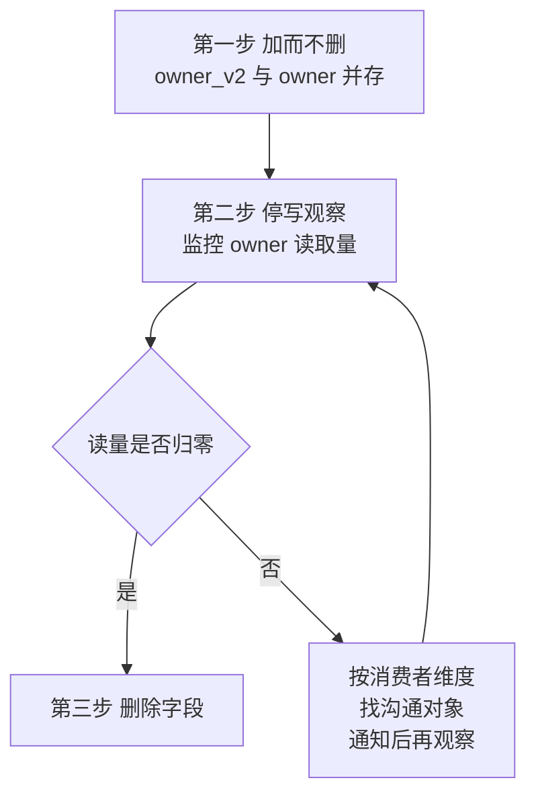

## API 一变，哪些人的代码会坏：要解决的问题

**同一个新加字段，对两侧消费者的含义相反——这就是向后兼容与向前兼容的分界**：

**兼容性有两个方向，方向不同，承担成本的一方也不同，两方向来自同一个字段的有无**：**新生产者有而旧消费者不认识，向后兼容由生产者守**；**旧生产者没有而新消费者要读，向前兼容只能由消费者自己兜底**。


**两侧义务不对称正是合同的麻烦所在**：**向后兼容由生产者守（加了不能破坏旧的）**，**向前兼容只能由消费者守（新的要容忍没有）**——**生产者的纪律和消费者的纪律是两件事**。

## 兼容怎么守、破坏怎么走流程：机制

先把形状说成一件事：**API 演进像老字号改菜单**——**加新菜（向后兼容：老客人不点新菜不受影响）**、**招牌菜换个更贵的价签要先贴告示留旧价一段时间（废弃流程：给依赖者留迁移期）**、直接把招牌菜下架（破坏性变更：老客人扑空，必须升"菜单版本"让所有人知道规矩变了）。**语义化版本就是菜单封面上的版本号**：**封面升了大号（MAJOR，主版本号）**，**老客人才知道要重新研究菜单**。这个比喻到"重新研究菜单"为止——**现实里消费者不止人还有程序**，程序不会"看告示"，所以**破坏性变更要走带版本号并行的正式流程**，下面展开。

**兼容的两个方向**。**向后兼容（新增不破坏旧消费者）**：**加字段（可选字段带默认值）、加端点、加响应字段**——**旧消费者忽略新东西，继续工作**。**向前兼容（旧生产者不破坏新消费者）**：**新消费者容忍字段缺失（可选语义、默认值兜底）**——**这要求消费端对未知与缺失有宽容协议**：**Protobuf（Google 的二进制序列化格式，按字段编号编码）保留 unknown field，JSON 宽松解析**。**破坏性变更**（删字段、改类型、改语义、改必填性）**是合同违约，需要版本升级或废弃流程**。

**语义化版本是合同号**。**MAJOR.MINOR.PATCH（主版本、次版本、补丁版本三段）**：**MAJOR 含破坏性变更（消费者必须改代码）**，**MINOR 向后兼容的新增（消费者可选用）**，PATCH 修复。**三段各管一类变更，位次就是承诺强度**：


*图源：Wikimedia Commons，作者 Leetrout，CC BY-SA 4.0，https://commons.wikimedia.org/wiki/File:SemanticVersioning.png。三段的顺序固定，升哪一段就意味着对消费者做出了哪一档承诺。*

**SemVer 是模块/包层面的约定**，**对 HTTP API 常用 URL 版本（/v1/）或 header 版本（Accept: application/vnd.x.v2+json）承载 MAJOR 号**。**版本号是承诺的载体：升号即承诺，消费者按号决策升级节奏**。

**版本路由这件事在架构上有标准的承载层**：**所有消费方的调用先经过统一网关（统一接收 API 调用并按路由规则分发到后端的入口层）**，**由网关按版本与路由规则分发到后端的不同实现**——**废弃流程里的标记、观测与分流动作，就是在这一层按消费者的调用记录执行**：


*图源：Microsoft Learn 中文文档《网关路由模式》，CC BY 4.0，https://learn.microsoft.com/zh-cn/azure/architecture/patterns/gateway-routing。*

**废弃是流程，是删字段前的一段路**。**成熟 API 平台的废弃纪律（Google AIP-162 为代表）**：**标记（Deprecated 头/字段标注/文档声明）**→ **通知（消费方监控废弃告警，changelog 与邮件）**→ **宽限期（时长写明，6 个月到数年，给下游排期）**→ **迁移指引（新旧映射表、自动化迁移工具）**→ **下线（到期后返回 410 Gone 或直接删除）**。**每一步都有观测**：**废弃字段的调用率下降曲线决定下线安全性**，**调用率不降说明下游没动，下线就是事故**。

**变更的语义红线比结构红线更隐蔽**。**结构兼容（字段还在）不等于语义兼容**：**字段的含义变了（米改厘米）**、**取值域变了（枚举加值）**、错误码语义变了（404 从"无此资源"变"无权限伪装"）、**时间戳格式变了（秒改毫秒）**、**分页语义变了（offset 改 cursor）**。**结构由 schema 校验兜底，语义靠文档约定与消费者测试兜底**——**接口约定测试在 CI（持续集成，代码变更后自动构建与测试的流水线）里跑真实消费场景**，**语义漂移才会被抓住**。

## 这套纪律怎么来的、付什么价：背景与代价

SemVer（Semantic Versioning，语义化版本）由 Tom Preston-Werner 在 2013 年标准化，**把散乱的版本约定收成一份规格**；**Google AIP（API Improvement Proposals）与其内部 API 演进纪律（2016 年后公开）代表平台级实践**；**HTTP 生态的 deprecation 标准化（RFC 8594 的 Deprecation header 与 Sunset header）在协议层补位**。REST（Representational State Transfer，用 HTTP 动词操作资源的接口风格）与 RPC（Remote Procedure Call，远程过程调用：像调本地函数一样调远端服务）**两大生态都沉淀了废弃流程模板**（**Stripe 的 API 版本策略是商业 API 的标杆：版本固定、迁移窗口数年**）。

**把"删除"改写成"有观测的退役流程"**：**化石 API 卡在没人知道删了会炸谁，技术倒在其次**。**废弃流程给删除动作装上仪表（调用率监控）与缓冲（宽限期）**，**把不可逆的社会工程变成有数据的工程决策**。代价：**多版本并存的成本（每版本一份完整代码路径，bug 修 N 处，测试矩阵翻倍）**；**宽容协议的复杂度转嫁**（**unknown field 保留、可选语义让消费端代码满是 null 分支，复杂性从生产者转到消费者**）；版本策略的过度设计（**内部 API 抄商业 API 的数年窗口，没必要**——**内部 API 的消费方可强制同步升级，窗口几天到几周就够**）。**适用判定：外部/开源 API 纪律越重越好，内部 API 纪律按组织半径缩放**——**半径内靠协调，半径外靠合同**。

## 版本号管不到什么：边界

- **破坏性变更不总是要升 MAJOR**。**安全漏洞的字段删除、法务要求的清理（GDPR 数据字段）**，可以走"短窗口强制下线"，**但要在 release note 与告警里写明理由**。**纪律服务于工程**，不是教条。
- **gRPC（跨语言远程过程调用框架）/Protobuf的兼容语义自带一部分**。**字段编号保留不复用（deleted field reserved）是协议层纪律**，**比 JSON API 少一档结构风险，但语义红线照样要人守**。
- **版本共存期的新功能双写（迁移期间同一份数据同时写入新旧两个存储）**。v2 出来后 v1 还活着时，**新功能做不做 v1**？纪律：**v1 进入维护态（只修 bug 不加功能）**，**逼升级的引力来自新功能的排他**。**双写全部功能等于把 MAJOR 升级变成空话**。
- **消费者侧的兼容责任**。生产者守纪律，消费者也要守：**不解析未声明的字段（或显式容忍 unknown）**、**不依赖响应字段的顺序**、**错误处理不 match 具体错误文案**。**脆弱消费者让最好的生产者纪律也防不住**。

## 兼容承诺守没守住怎么验证：验证

- **接口约定测试跨版本实验**：**消费者测试套件对 v1 与 v2 各跑一遍（同一套业务场景断言）**。预期：**结构兼容的变更（加字段）在两版本都绿**；**语义变更（改枚举含义）在接口约定测试里红**——**接口约定测试抓住结构之外的红线**。**语义红线的可执行验证**。
- **废弃调用率观测实验**：**标记废弃字段后接入调用率监控（按消费者维度）**，跑一个宽限期。预期：**调用率曲线分形态（自觉消费者快速归零、滞留消费者不动、僵尸消费者无人认领）**，**曲线决定下线决策与沟通对象**。**退役流程仪表化的实测**。
- **SemVer 违规扫描**：**用 API diff 工具（openapi-diff、buf breaking）对比两个版本的真实 schema**。预期：工具报出"删字段/改必填"类 breaking 变更，与 release 声明的版本号对照，可发现"MINOR 号里藏 MAJOR 变更"的违诺。**版本承诺的可审计证据**。

## 演进的账怎么算：可运行示例与案例回流

**推演账里的三步与调用率曲线的三种形态是一一对应的**，**曲线停在哪种形态决定第三步能不能执行**：



**只有最左边那条链能走到删除，另外两条都绕回第二步**——废弃流程的时间主要花在这两条回环上，而不是删字段那一刻。

```text
一次字段废弃的三步推演账（通用形态）：

第一步 加而不删：新字段 `owner_v2` 与旧字段 `owner` 并存发布（新旧消费者都能用）
  第二步 停写观察：服务端停止写 `owner`，监控其读取量 →
    三个消费方已迁移，一个内部脚本还在读 → 通知迁移
  第三步 删：读取量归零后从 Schema 删除 → 完成一轮演进
  版本策略账：URL 大版本（/v2/）留给破坏性变更；
    小演进走兼容规则（只加可选字段）
  兼容测试账：CI 里用新旧两版消费者回放真实流量样本，跑不兼容即拦
```


## 接着读哪几篇：存量篇展开 schema 兼容机制

- [[工程知识/软件构建：让变化可以理解、验证与交付/架构与代码/API与Schema演进必须兼容新旧消费者.md]] —— 存量篇展开 schema 兼容机制，本篇补废弃流程与版本策略的纪律面
- [[工程知识/软件构建：让变化可以理解、验证与交付/测试与交付/接口约定测试的适用边界：消费者驱动与提供者验证.md]] —— 接口约定测试是兼容性纪律的可执行化身
- [[工程知识/软件构建：让变化可以理解、验证与交付/架构与代码/错误处理的分类学：错误类型与恢复策略的映射.md]] —— 410 Gone 与 4xx 族的语义稳定性是错误分类的接口侧约定
- [[工程知识/软件构建：让变化可以理解、验证与交付/开发工具/依赖升级的半衰期策略：跟随与锁定的平衡.md]] —— 升级策略是 API 纪律的消费侧
