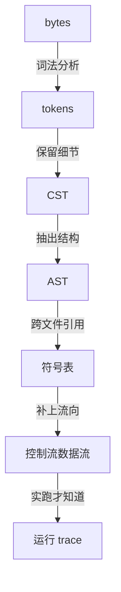
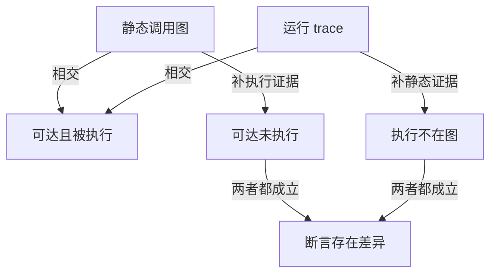

# AST提供语法结构，语义仍需符号与运行证据

## 要解决的问题：代码的表示层次各自能回答哪些问题

用文本匹配改写代码时改到了注释、同名的无关符号或嵌套结构里的错误位置，而语法正确的重写未必保持了语义。本篇回答：**代码的表示层次各自能回答什么、符号解析与类型检查与运行证据补充了哪部分语义、哪类任务应当选择文本匹配或结构匹配或运行记录，以及重写之后要核对哪些内容**。

它解决的是用文本匹配代码结构时误改注释、同名符号或嵌套语法的问题。核心机制是 AST（Abstract Syntax Tree，抽象语法树：把代码按语法结构拆成的树） 保留语法节点和层级，符号表、类型检查与运行 trace 再补足跨文件语义；收益是**结构化重构更稳**，代价是**解析器、构建上下文和多语言适配成本增加**。用真实动态派发、反射和配置开关样本对照静态结论与运行覆盖。

抽象语法树（AST）把源代码的语法结构表示为节点和关系，忽略大部分空白和表面格式。它适合需要理解「这是函数/调用/类型/作用域」的任务；正则适合边界明确的文本匹配。两者不是 AI，也不是互相完全替代。

## 代码的表示层次有哪些

代码表示是分层的，每层只看见上一层给它的东西。I/O 模型也是这样分层的：底下是连接与线程的绑定，上面才是业务逻辑。


```text
bytes/text -> tokens -> concrete syntax tree -> AST
         -> name/type/control/data-flow graph -> semantic model
```

这几层各自的回答能力不同，**越往右越接近"这段代码实际做了什么"**，代价是**获取成本越高**：



AST 能表达语法节点和嵌套，但**通常不能仅凭自己回答跨文件符号解析、动态派发、运行时反射（程序在运行时读取和操作自身结构的机制）和真实数据流**；这些需要 symbol table、type checker、CFG（Control Flow Graph，控制流图）/DFG（Data Flow Graph，数据流图：以数据依赖为边描述计算的图结构）、构建系统或运行证据。

## 怎么按需选择方法

| 任务 | 优先方法 | 原因 |
| --- | --- | --- |
| 查固定日志字符串/配置行 | 文本/正则 | 简单、快、无需完整语法 |
| 重命名符号、修改调用参数 | AST/CST + 符号解析 | 避免误改注释和同名文本 |
| 保留格式的代码重写 | CST/专用 codemod | AST unparse 可能改变格式/注释 |
| 多语言结构搜索 | Tree-sitter/语言服务器 | 增量解析和统一查询接口 |
| 判断测试是否经过目标代码 | 静态调用图 + runtime coverage/trace | 静态可达不等于运行时执行 |
| 安全/污点分析 | AST + CFG/DFG + 规则/类型 | 需要控制流和数据传播 |

## 最小 Python 示例怎么跑

```python
import ast

tree = ast.parse(source)
for node in ast.walk(tree):
    if isinstance(node, ast.Call):
        print(ast.dump(node.func), node.lineno, node.col_offset)
```

解析时记录语言、语法版本、文件编码和构建条件。Python AST 节点随版本演进；生成代码前用对应版本 parse/compile/test 回归。

## 要付哪些代价，哪些情况下该用

每往右走一层，工具链的负担都要再加一档：AST 需要对应语言的解析器，符号解析需要构建上下文（依赖版本、编译选项、宏定义），运行证据需要能真实跑起来的环境与可复现的输入。**代价不是线性的，跳过中间层又会把结论架空——只做 AST 就说"改这些调用点"，等于默认了符号解析的结果**。

「谱面正确不等于音乐成立」的实物原型是交响乐总谱：总谱把每个声部每个小节的音高、时值、力度写得清清楚楚——这是"语法层"；但**哪个声部实际怎么进、独奏与乐队如何应和，要等指挥与乐队真奏出来才知道——总谱上查不到的错音、错位，演奏一响就现形**：


*图源：Wikimedia Commons，作者 Gerarus，CC BY-SA 4.0，https://commons.wikimedia.org/wiki/File:Nabucco,_score,_2014.jpg。*

AST 就是谱面：语法结构完整可查（哪些音符、什么时值），**但它不回答"这段实际会怎么响"**。符号表是分谱与声部归属（这个音归谁奏），类型检查是配器规则（这声部能不能奏这个音域），运行 trace 是演奏录音（实际怎么响的）。**"静态可达不等于运行时执行"，正如"总谱上有这段不等于乐队奏过这段"——判定测试是否覆盖目标代码，看的是录音（coverage/trace），不是谱面**。

## 什么样的代码变更才算可靠

判定的分水岭是改动的风险半径：**改注释或格式化，文本匹配足够；改符号与调用，至少要 AST 加符号解析；判断某段代码有没有被真实执行，只有运行证据能回答，静态调用图给出的是可达集合，不是执行集合**。

判定的分水岭之后，落成可执行的清单：

1. 用语法/符号条件定位目标，不只依赖行号。
2. 给候选节点计算结构指纹，同时保留文件 revision 和上下文。
3. 生成最小 edit，检测目标是否唯一；多匹配或零匹配立即停止。
4. 重新 parse/type-check/compile，并运行覆盖目标行为的测试。
5. 比较 diff，保证注释、格式和无关区域没有意外改变。

**「结构指纹」只能帮助重新定位，不能证明语义等价。代码移动、重载、宏、生成代码和动态语言都会产生歧义**。

## AI 编码 Agent 的边界在哪儿

Agent 改代码时最容易漏的是跨层的那一跳。就像从用户态（普通程序运行的低权限受限状态）跨到内核态（内核代码运行的高权限状态）——看得见调用，看不见对面的实现。这个比方只到「跨层那一跳最容易被漏掉」为止，怎么补符号表与运行证据要看正文。


AI 适合理解任务、选择 AST/文本/语言服务器、生成迁移和解释失败；**框架必须验证目标 revision、实际 patch、编译/测试/coverage 和产物**。**AST 找到调用不代表测试真正执行到它**；代码仓库的完整索引、探索和增量更新模型见 [[工程知识/AI 系统工程：从模型能力到生产能力/Agent与工作流/代码智能体需要结构索引、任务探索与运行证据]]，事实约束见 [[工程知识/AI 系统工程：从模型能力到生产能力/安全与治理/执行证据必须独立于AI结论]]。

## 有哪些反模式

- **用正则解析任意嵌套语法，再通过堆叠例外修补**。
- **仅凭 AST 节点名称判断跨文件语义**。
- **代码重写后只检查文件能保存，不重新解析和测试**。
- **把具体行号当作稳定身份，不绑定 revision 和结构上下文**。


**AST 级判断要与符号解析对账——名字重定向、动态派发、装饰器包装都会让语法树与运行时行为分叉，重构前用符号解析（引用查找、调用图）核对每个改点，对不上的位置以运行证据为准**。

## 怎么自己动手验证


静态可达与运行时执行是两个大小不同的集合，它们的差集决定了**哪些结论只能由运行证据给出：**



两个集合的差异无法靠补一条静态规则消除，所以判断某段代码有没有被真实执行时，覆盖与 trace 是唯一的裁判。

最小验证：对一个重命名任务，用结构条件定位目标并与文本匹配的结果对照，**断言文本匹配会命中注释与同名的无关位置，而结构条件筛选后的候选唯一**。重写完成之后**重新解析、类型检查并运行覆盖该符号的测试**。

执行对照：对同一处改动，比较静态调用图判定的可达集合与运行覆盖记录的实际执行集合，**断言两者存在差异，差异部分交给运行证据判定**。

## 接着读哪几篇：同在软件构建里的相邻问题

- [[工程知识/AI 系统工程：从模型能力到生产能力/Agent与工作流/AI辅助研发必须形成证据闭环]]、[[工程知识/AI 系统工程：从模型能力到生产能力/Agent与工作流/代码智能体需要结构索引、任务探索与运行证据]]、[[工程知识/软件构建：让变化可以理解、验证与交付/软件构建：让变化可以理解、验证与交付]]、[[工程知识/软件构建：让变化可以理解、验证与交付/测试与交付/测试策略从风险选择证据]]。
- [[工程知识/软件构建：让变化可以理解、验证与交付/语言与运行时/动态链接把符号绑定推迟到装载与首次调用]] —— 符号解析的另一半：编译期（代码编译成可执行文件时发生的阶段）查引用在本文，运行期按名绑定与地址回填在那篇
