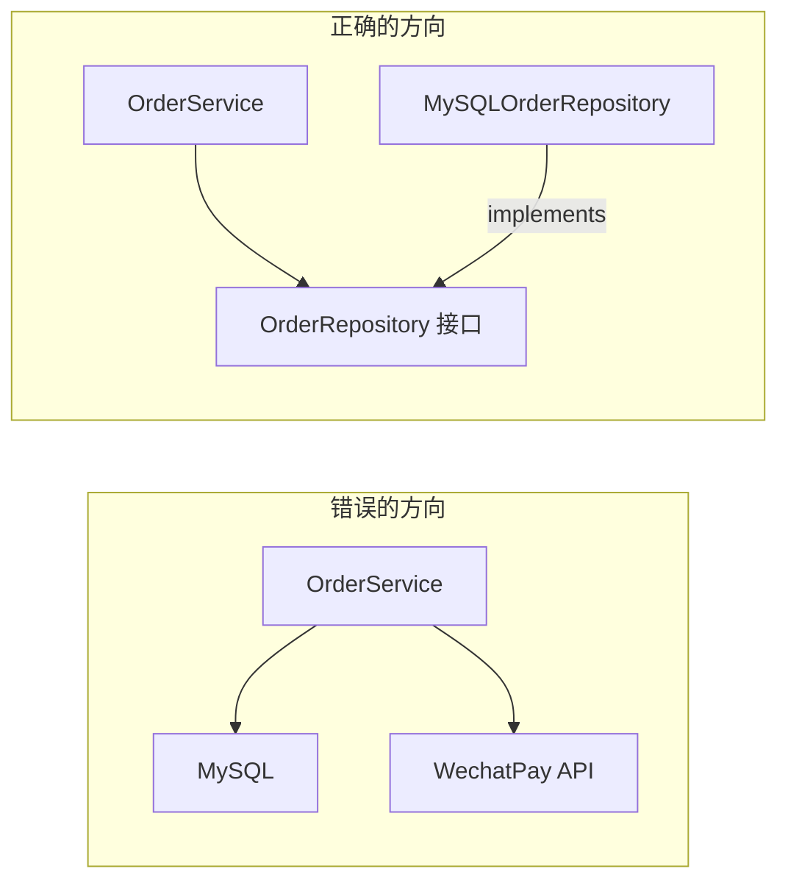
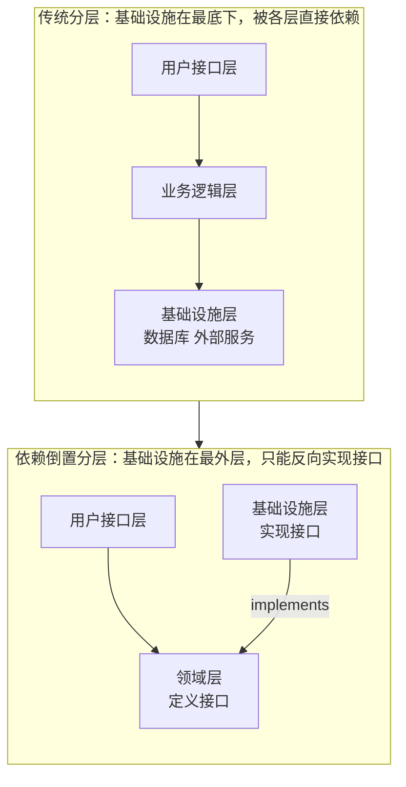
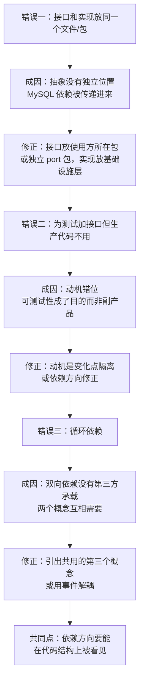

# 分层与依赖方向决定可测试性和演进成本

## 改一行代码为什么要启动半个系统：要解决的问题

好比每次试一支新台灯，都要先把整个小区的电闸、水表和燃气总阀全部打开，还得请三家邻居到场（启动数据库、缓存、消息中间件并替换外部服务）——灯没问题，是接线方式让验灯的成本失控。测试一段业务逻辑需要先启动数据库、缓存与消息中间件，还要替换三个外部服务，一次测试耗时数分钟且不稳定。本篇回答：分层与依赖方向怎样决定可测试性、接口应当由哪一侧定义、依赖在什么位置注入，以及架构约束怎样变成可自动检查的事实。比喻到「接线方式决定验灯成本」为止。

## 分层与依赖方向怎么起作用：机制与本质

先把形状说成一件事：依赖方向像家庭装修里"电线走墙里、家具摆面上"的规矩——家具（业务逻辑）可以随时挪动，因为墙里的电线（外部实现）位置固定、接口是插座；反过来把电线沿着家具走，换一个沙发就得砸墙重布线。依赖指向稳定方向，就是在装修时先定插座、再摆家具。这个比喻到"摆家具"为止——现实里依赖方向决定改动传播到哪些文件，下面逐句展开。

**依赖方向决定一处改动会传播到哪些文件**。业务逻辑依赖外部实现时，**替换实现或调整外部接口都需要改动业务代码**；**把依赖指向由使用方定义的接口之后，实现的变更被限制在装配位置**。**可测试性与演进成本来自同一条方向关系，因此两者总是一起改善或一起恶化**。

## 这件事发生在什么场景：改一行代码，要启动半个系统

一个下单服务，测试它要先起 MySQL（开源关系数据库）、Redis（内存键值数据库）、Kafka（分布式消息队列），还要用替身（mock，替真实依赖参与测试的假实现）顶替三个外部 HTTP 服务。跑一次测试 4 分钟，还不稳定——时不时因为网络超时红一次。

**测试写得再好也无济于事，依赖方向反了：业务逻辑直接依赖了数据库和外部服务这些"细节"，于是测试业务逻辑就必须带上所有细节。**

依赖集中的形态在主机时代就有实物：下图是 Living Computer Museum 的 DEC PDP（Programmed Data Processor，DEC 的小型机产品线）-10（DEC 的大型机）大型机机房——一屋子蓝色机柜是全部计算与存储，所有终端的每一次调用都指到这一处。今天"改一行要起半个系统"的测试困境，是这种集中依赖在代码结构里的翻版：依赖指向不可替换的具体物，隔离就无从谈起。


> 图：Living Computer Museum 的 DEC PDP-10（DECsystem 10）机房，来自 [Wikimedia Commons](https://commons.wikimedia.org/wiki/File:DEC_PDP-10_(DECsystem_10)_mainframe_computer_system_at_Living_Computer_Museum_(strongly_edited_image).jpg)，CC BY-SA 3.0，摄影 Joe Mabel。

依赖方向决定两件事：**改一个东西会牵连多少东西**，以及**测试它要拖上多少东西**。

## 依赖为什么必须指向稳定方向：方案

依赖方向从细节指向策略时，替换细节实现不动策略层；方向反过来，换一个实现就牵动整条业务链。

核心原则只有一条：**依赖方向应该从"易变"指向"稳定"，从"细节"指向"策略"。**比喻到「桥墩打基岩」为止，错误方向的具体形态看下图。

错误的方向让业务服务直接依赖具体的数据库驱动与支付 SDK（软件开发工具包）；正确的方向让业务服务只依赖一个接口，由基础设施层的实现来满足它：



反转把依赖收窄到接口一条边上，测试与替换随之受益。

- `OrderService` 只依赖 `OrderRepository` 接口，不知道 MySQL 存在
- 测试时注入一个内存实现，**不需要数据库，测试从 4 分钟变成 200 毫秒**
- 换数据库时，`OrderService` 一行不改

把这条原则放到整个分层上看，差别是基础设施层的位置：传统分层里基础设施在最底下被所有层依赖，依赖倒置之后它变成最外层，只能依赖别人：



左边换数据库要动业务逻辑层，右边领域层从头到尾不知道数据库是什么，替换实现只改装配位置。这也是为什么右边才谈得上"给领域层注入测试替身"——左边的业务逻辑层直接 import 了数据库驱动，注入点根本不存在。

层间依赖关系的对照参考中文资料：[领域驱动设计详解：是什么、为什么、怎么做（CSDN，图 9 层依赖关系）](https://blog.csdn.net/qq_21267357/article/details/126933953)、[软件架构思想系列：分层架构（uml.org.cn）](http://www.uml.org.cn/zjjs/202406174.asp)。

### 稳定依赖原则要求什么

**一个组件应该只依赖比自己更稳定的组件**。判断稳定性：

```
不稳定性 I = 出向依赖 / (出向依赖 + 入向依赖)
```

- `I = 0`：所有人都依赖它，它不依赖任何人（最稳定，如基础类型、领域模型）
- `I = 1`：它依赖所有人，没人依赖它（最不稳定，如 controller、main）

  依赖应该从 I 大的指向 I 小的。 如果业务核心依赖了 controller，方向就错了。盖楼是现成的对应：地基（I=0，谁都用它、它不用谁）浇筑一次就不动，脚手架（I=1，到处搭、用完就拆）天天变——脚手架可以靠在楼上，楼不能砌在脚手架上；把业务核心砌在 controller 这样的脚手架上，脚手架一拆，楼跟着塌。

### 怎么分层才不变成摆设

分层的典型形态是四层结构，每层只依赖相邻的下一层。

| 层 | 内容 | 依赖谁 |
| --- | --- | --- |
| 接口层 | HTTP handler、RPC（Remote Procedure Call，远程过程调用：像调本地函数一样调远端服务）、CLI（Command-Line Interface，命令行界面） | 应用层 |
| 应用层 | 用例编排、事务边界 | 领域层 |
| 领域层 | 业务规则、实体、领域服务 | 无（只依赖自己） |
| 基础设施层 | 数据库、缓存、MQ（Message Queue，消息队列：异步传递消息的中间件）、外部客户端 | 实现上层定义的接口 |

  **关键是领域层不依赖任何外部东西**。它是你系统里最该稳定的部分，**如果它依赖了 Spring（Java 生态的应用框架）、依赖了 ORM（对象关系映射，把数据库表映射为代码里的对象）注解，那它就不再是领域层了**。医院科室的分工是同一条：诊疗规范（领域层）写在病历制度里，不写在挂号系统（接口层）的操作手册里，也不绑定某个厂家的检验仪器（基础设施）——规范换了挂号软件、换了仪器厂商都依然成立；**哪天规范里写死"用某家厂家的仪器"，规范就被厂家绑架了**。

三层是这套分层最直观的形态，下图是它的职责与调用关系：展示层（presentation tier）把任务翻译成用户能理解的形式，逻辑层（logic tier）处理命令、做判断并在两侧之间搬运数据，数据层（data tier）负责存储与取回：


*软件三层架构：用户界面层、业务逻辑层、数据访问层自上而下依次调用，职责边界决定修改影响范围（图源：博客园「软件三层架构模型」）*

*三层的职责与调用方向（图源：Wikimedia Commons，Bartledan 绘，公有领域）*

这张图画的是调用方向的「正常情况」：逻辑层既能向下查数据也能向上回结果。本文强调的约束更进一步——**层与层之间的依赖要能被替换：数据层换一个实现，逻辑层不该察觉**。

## 收益从哪来、付什么价：效果与代价

### 用了这套分层能拿到哪些收益

- 测试金字塔（大量单元测试为底、少量集成测试居上、端到端测试最少的比例结构）能立起来：领域层和应用层可以纯单元测试，只有少量集成测试碰真实基础设施
- **替换成本可控**：换数据库、换 MQ、换 RPC 框架，改的是基础设施层的实现类
- **编译依赖减少**：改一个外部客户端不会触发半个系统重编译

### 这样分层要付什么代价

- **多一层接口**：每个仓储一个接口 + 一个实现，文件数量翻倍
- **绕**：排查问题时要在接口和实现之间跳转，IDE（集成开发环境）的 "go to implementation" 用得多
- 过度抽象的风险：如果某个"接口"永远只有一个实现，也没有测试替身（替真实依赖参与测试的假实现）需求，这层就是纯开销

## 动手时从哪儿开始

### 第一步：当前依赖图怎么画

**凭印象画的依赖图和实际 import 关系经常不一致，而后面所有改动都建立在这张图上，图错了方向就判反了。不要猜。**资产盘点不靠记忆靠扫码：库房里"账面上应该有什么"和"货架上实际有什么"对不上是常态，逐件扫码（统计 import）才是盘点——**凭印象编的账，后面每一步都在错误的账上做决定**。用一个简单办法：统计每个包的 import，看谁依赖谁。如果发现：

- 业务包 import 了 `database/sql` 或 ORM → 依赖方向反了
- 领域模型上有 `@Column`、`@JsonProperty` 这类注解 → 领域被基础设施污染了

### 第二步：接口该由谁定义

**接口应该由调用方定义，而不是由实现方提取**。

错误做法：把 `MySQLOrderRepository` 的所有 public 方法抽成 `IOrderRepository`——**这样接口会跟着实现走，包含一堆调用方根本不需要的方法**。

正确做法：在 `OrderService` 里写下"我需要什么"—`FindByID`、`Save`，然后让实现去满足它。**接口隔离（调用方不 import 不需要的方法）与依赖倒置（依赖指向由调用方定义的抽象）在这里组合生效**。

### 第三步：依赖该在哪里注入

**所有 `NewXxxRepository(...)` 的调用集中在 `main` 或专门的 `wire` 文件**（wire，依赖注入装配工具）里。**业务代码里不出现 `new` 外部依赖**。这个集中完成装配的位置就叫组合根（composition root，依赖的组装点唯一且位于程序入口）。

### 第四步：方向靠什么锁住

**把方向约束写成一条架构测试**（架构约束的可执行检查，见 [[工程知识/软件构建：让变化可以理解、验证与交付/架构与代码/架构适应度函数：把架构约束写成可执行检查]]），断言领域包的 import 白名单：

```go
// 领域层只允许 import 标准库和自身
func TestDomainHasNoInfraDeps(t *testing.T) {
    // 解析 domain/ 下所有文件的 import，发现非白名单就失败
}
```

**这条测试比任何文档都管用——它让"依赖方向"变成编译器能检查的事实，而不是靠 code review 记忆**。限高杆是同一个思想：限高 2 米不能靠司机自觉记着，得在路口立一杆物理的——**杆子不商量，超高的车过不去；架构测试就是 CI（Continuous Integration，持续集成：代码合并后自动构建与测试）流水线里的那根杆，违规 import 到这里就地失败，比任何评审上的口头提醒都硬**。

依赖倒置这条原则在架构层面最完整的表述是 Clean Architecture 的同心圆：企业业务规则在最里层，外面依次是用例、接口适配器、框架与驱动，穿过圆心的箭头只有一个方向——依赖一律朝里：


*图源：Robert C. Martin《The Clean Architecture》，https://blog.cleancoder.com/uncle-bob/2012/08/13/the-clean-architecture.html。*

图右下角那两个端口值得单独看：`Use Case Input Port` 与 `Use Case Output Port` 都画在用例这一侧，由内层声明、由外层实现——这正是本文「接口由调用方定义」这条规则在架构图上的写法。稳定依赖原则给出的判据（依赖从 I 大的指向 I 小的）与这张图描述的是同一件事：圆心那一层的 I 最小。

分层边界要与依赖扫描对账——用 import 检查器（或包依赖图）扫出跨层反向引用，扫出的每一条与设计的依赖方向对账，对不上的要么改依赖方向、要么承认分层已变并更新设计。

## 哪些做法一看就错：常见错误

### 错误 1：接口和实现放同一个包错在哪

`order_repository.go` 里同时有接口和 MySQL 实现，那么 `OrderService` import 这个包时，**MySQL 的依赖还是被传递进来了**。**接口要单独放在使用方所在的包或独立的 port 包（port：调用方声明的抽象出口），实现放基础设施层**。装修合同与施工队必须分开签是同一件事：合同（接口）写的是"墙面完工后平整度不超 2 毫米"这样的验收标准，归你保管；施工队（实现）是照标准干活的人，可以换——**合同和某一家施工队的工牌装订在一起，换队时连合同都得重签，你反而被这家绑住了**。

### 错误 2：只为测试加的接口错在哪

**只在测试里用的接口是坏味道。正确的动机是"变化点隔离"或"依赖方向修正"，可测试性只是副产品。**

### 错误 3：循环依赖怎么毁掉分层

`OrderService` 依赖 `UserService`，`UserService` 又依赖 `OrderService`。**解法是引出两者共用的第三个概念（比如 `OrderPolicy`），或者用事件解耦**。两家公司互相垫资是同一个困局：A 的项目等 B 打款才能开工，B 的项目等 A 打款才能启动——谁也动不了，**解套的办法是找一个双方都认的第三方担保（共用概念）或改成货到付款（事件解耦），把"你等我、我等你"变成各自独立推进**。

三条常见错误的形态不同，成因都指向同一件事——依赖方向没有被显式约束：



**第一条最容易被忽略：接口与实现放在同一个包里，使用方 import 这个包的时候，实现侧的依赖照样被传递进来，抽接口等于没抽**。**第二条说的是动机——只在测试里用的接口是坏味道，正确的动机是变化点隔离或依赖方向修正，可测试性只是副产品**。**第三条的解法是把两者共同需要的部分抽成第三个概念，让依赖从双向变成两个单向**。

## 想自己验一遍怎么动手：验证

验收一个接口：不起数据库直接跑（单测）、换成内存版实现再跑（替换实现）、再人为引入一个非法引用试探（负例），三种都符合预期，接口才算合格。

最小验证：对一行业务逻辑写一条单元测试，断言测试运行过程中不需要启动数据库、消息中间件与外部服务。再写一条架构测试，断言领域包只引用白名单内的包，人为引入一次非法引用时该测试失败。比喻到「三种插法」为止。

方向验证：把实现替换为内存版本，断言业务代码无需改动即可运行。

## 接着读哪几篇：同在软件构建里的相邻问题

- [[工程知识/软件构建：让变化可以理解、验证与交付/架构与代码/策略与依赖注入把变化关在边界外]] · [[工程知识/软件构建：让变化可以理解、验证与交付/架构与代码/错误处理是策略问题，异常只是运输手段]] · [[工程知识/软件构建：让变化可以理解、验证与交付/架构与代码/设计模式解决的是变化点的隔离]] · [[工程知识/软件构建：让变化可以理解、验证与交付/架构与代码/架构适应度函数：把架构约束写成可执行检查]]：依赖方向是适应度函数最常检查的架构性质
