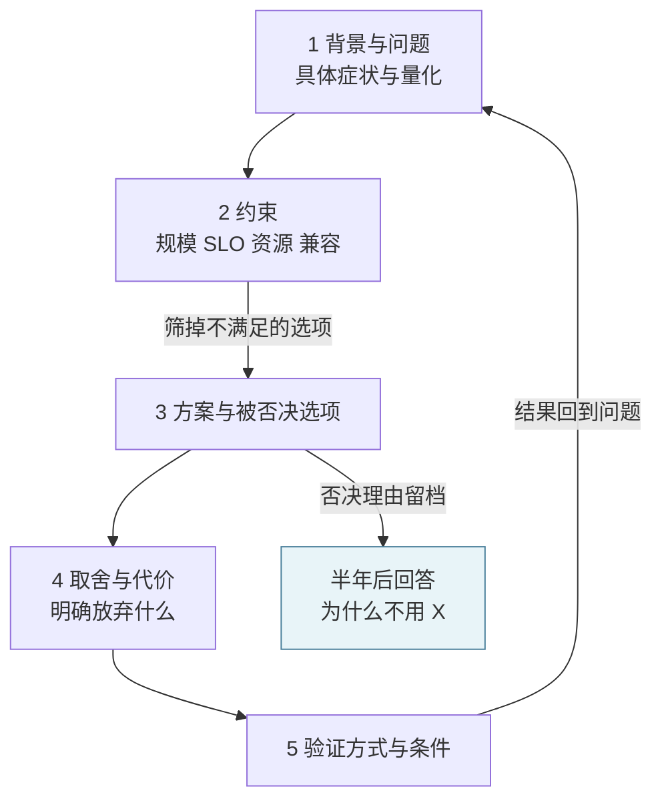

# 技术方案先写清约束、取舍与验证

它解决的是团队在没有统一问题、规模和约束时直接争论技术名词，最后选出「理论更强、实际无法运营」的方案。**做法是先量化现状和成功标准，再比较选项、显式记录被否决理由、验证计划和退出条件；收益是评审能围绕证据收敛，代价是前期要投入调查和实验**。方案文档让未来的人知道当时为何这样选、何时应该重开决策，而不是证明作者正确。

## 评审会上为什么吵一小时还没结论：要解决的问题

一个方案评审：有人主张用 Kafka（分布式消息队列，靠日志追加支撑高吞吐订阅），有人坚持 RabbitMQ——另一种分布式消息队列（生产者写入、消费者读取的缓冲中间层），走交换机（在局域网内按地址转发数据帧的设备）路由、低延迟投递见长。争论了 40 分钟，各自举出对方方案的缺点。

最后有人问了一句："我们这个场景，峰值多少消息、能容忍多少延迟？"

答案是：**每秒 200 条，延迟 1 秒以内可接受。**

这个量级下，两者都绰绰有余——**争论的选项根本不是决定因素**。真正的约束（团队只有 3 个人、没人运维过 Kafka）反而没人提。

问题在于：**方案里没有写约束。** **没有约束，"哪个更好"就没有答案**。

约束之间的关系本身也是可画出来的：同一件事上，几个目标常常此消彼长，改一个方向就要接受另一个方向的损失。这张图给出的是最经典的一组——功能、安全、易用三者互相牵制，往一个角移动就要离开另外两个角：


*图源：Wikimedia Commons「Security Tradeoff triangle」，作者 Tactical Tech Collective，许可 [CC BY 4.0](https://creativecommons.org/licenses/by/4.0/)。**写约束的意义就在这里：三个顶点不可能同时到达，约束就是用来定住"这次愿意牺牲哪一个"的。约束不写下来，讨论就退化成对三个顶点各自说好话**。*

## 方案文档必须写全哪五个部分：方案

这一节的机制：**五部分把"决定依赖哪些事实"逐项显式化**，格式倒在其次——约束显式了，争论才有同一前提；被否决选项显式了，重开决策才有起点。先把形状说成一件事：方案文档像装修前的报价单——背景与问题是"房子现在哪儿漏水"，约束是"预算上限、住几口人、物业几点能施工"，方案与被否决选项是"全屋翻新还是只修漏水，另两个报价为什么没选"，取舍与代价是"工期拖两周、入住要搬出去"，验证方式是"完工后怎么验水路"。**缺了约束的报价单，比的就是谁家瓷砖好看——评审会上吵一小时还没结论，就是这么来的**。这个比喻到"验水路"为止——现实里五个部分各写到什么程度，下面逐节展开。

### 背景与问题写到什么程度才算够

**五个部分不是并列清单，它们之间有筛选、回溯与留档三种关系——约束筛掉选项，验证回到问题，否决理由留给后来的人**：



**顺着这些箭头写，文档才不是格式填空——起点仍然是那句具体症状**。

方案文档里「画架构图」这一步同样有取舍：画到哪一层、给谁看，本身就是约束的一部分。C4（Context/Container/Component/Code 四级缩放）官方给的示例是 Spring（Java 生态最主流的应用开发框架）社区的 PetClinic 容器图——同一系统按可部署单元切开，每格写清技术选型与职责，评审时一眼看出「哪个方块用什么技术、谁依赖谁」：


图源：[c4model.com 官方仓库](https://github.com/simonbrowndotje/c4model)（CC BY 4.0）。容器图不画类与函数，只画可部署单元——**这正是「方案文档只写和决策相关的部分」的画图版：层级选错，图就会变成没人看的教程**。

**用具体症状开头，不要用抽象描述**。

- 差："当前系统性能不足，需要优化。"
- 好："订单查询接口 p99 = 1.8s，超过 SLO（服务等级目标，服务对可用性或延迟作出的量化承诺）的 500ms。过去一周告警 23 次，日均影响 400 个用户。"

  **后面所有决策都要回到这个问题。问题描述含糊，方案就没法验证有没有解决**。装修报价的量房环节是同一个道理："房子住着不舒服，帮我看看"没法开工，"冬天窗边比屋里低五度、关窗后噪音还到 60 分贝"才能定方案——**先量哪儿不舒服、量到什么程度，后面每一笔钱花在哪才说得清**。

### 约束为什么最容易被跳过又最关键

约束分四类，都要量化：

| 类型 | 例子 |
| --- | --- |
| 规模 | 峰值 QPS 5000，日增数据 200GB |
| 延迟/SLO | p99 < 500ms，可用性 99.9% |
| 资源 | 3 人团队，预算 2000 元/月，无专职运维 |
| 兼容 | 不能停机迁移，需支持旧客户端 6 个月 |

**"团队没有 Kafka 运维经验"是合法且重要的约束，不写下来方案就会选一个团队驾驭不了的东西**。

### 方案为什么必须带上被否决的选项

不要只写最终选择。**写清楚考虑过哪些、为什么不选**。看过房的都懂：中介带看的三套房，最后定下 B 套，**为什么放弃 A 和 C 才是决策记录**——"A 贵 20 万""C 通勤多 40 分钟"写下来，半年后家里人再问"当初为什么不看 A"，翻记录就行；没写，同样的争吵每周重演一遍。

```markdown
### 选项 A：Kafka 凭什么当候选
- 优点：吞吐高、生态成熟
- 否决原因：需要专职运维，团队无经验；当前量级用不上
- 若规模涨到 5 万  可重新评估

### 选项 B：RabbitMQ 凭什么当候选
- 优点：运维简单，团队有经验
- 否决原因：当前消息量下功能过剩，且引入了新的组件

### 为什么选 Postgres LISTEN/NOTIFY
- 理由：当前 200 QPS 量级足够；复用已有数据库，零新增组件
- 已知限制：超过 5000 QPS 时需要迁移
```

**"为什么没选 X"是文档里最有价值的部分**，半年后有人问"为什么不用 Kafka"，答案就在这。

### 取舍与代价怎么写才不藏

明确写出这个方案放弃了什么：

```markdown
选择 LISTEN/NOTIFY 的代价：
- 吞吐上限约 5000 QPS（Kafka 可到百万）
- 消息不持久化，消费者离线期间的事件会丢
- 无法跨数据库实例

这些在当前的 200 QPS 和"可容忍丢事件"的前提下可接受。
```

  **写不出代价说明还没想清楚**。健康饮食里"为了控糖放弃含糖饮料"就是一笔明确的取舍：得到的是血糖平稳，付出的是聚餐时少了一样选择、偶尔嘴馋要忍——**说不清自己放弃了什么的人，多半也没想清楚图的是什么；方案的代价栏就是这笔账**。比喻到「代价栏是一笔交换账」为止：控糖还能偶尔破例，方案的代价是长期背着跑的，写下来才赖不掉。

### 验证方式该验证什么

怎么知道方案生效了：

- **上线前**：压测目标（p99 < 500ms @ 5000 QPS）
- **上线后**：监控指标（错误率、延迟、积压）
- **回滚（把系统恢复到上一个可用版本）条件**：什么情况下回滚，怎么回

**方案落到执行层的形态就是一块人人可见的任务板：验证项、上线项、回滚项各占一列，完成与否不用开会问**：体检报告是同一个思路的实物版：验什么项目、参考区间多少、超了怎么办（验证项、阈值、回滚条件）在报告上一目了然，不用等医生口头转达——比喻到「标准写在明处」为止：体检一年一次，方案验证项跟着上线全程走，**所以任务板要挂在人人看得到的地方**。


*图源：Wikimedia Commons，Logan Ingalls，CC BY 2.0，https://commons.wikimedia.org/wiki/File:Scrum_task_board.jpg。*

## 收益从哪来、付什么价：效果与代价

### 用了这套写法能拿到哪些收益

- **评审聚焦**：**有了量化的约束，争论从"哪个技术好"变成"哪个满足约束"**
- **决策可追溯**：**半年后能理解当时的取舍，而不是"不知道为什么这么设计"**
- **减少返工**：**写约束的过程本身就会暴露被忽略的前提**

### 这样写要付什么代价

- **写文档要时间**：一个完整方案 2-4 小时
- **约束可能写错**：**基于错误约束做的决策，文档写得多清楚也没用。约束需要和业务方确认**
- **小改动不需要**：改一个接口不用写方案。**判断标准是这个决策的影响是否超过一个月**。

## 动手时按什么顺序做

### 第一步：为什么先写约束和问题再想方案

顺序很重要。**先想方案的话，会不自觉地选择熟悉的工具，然后倒推理由。先量化约束，让约束来筛选项**。装修先定"预算多少、住几口人、能不能改水电"再看方案，与先看样板间再凑预算，是两种结局——后者总能给自己找一套说辞，钱却超了；约束先行，样板间不合格当场就筛掉。

### 第二步：约束为什么要发给相关方确认

首先是规模和 SLO。（服务等级目标，例如可用性或延迟要达成的内部目标）**"我们预期峰值多少"这个问题，不同人的答案经常差一个数量级**。

### 第三步：为什么至少写两个被否决的选项

只写一个方案，看起来像"通知"而不是"方案"。**列出的选项越多说明考虑得越充分**。

### 成本和运维负担要写到多细

**很多方案的隐性成本是运维。"需要 7×24 值守"这种代价必须写出来，否则审批的人不知道自己在批准什么**。

### 第五步：回滚条件怎么定

上线前就想好：什么情况下回滚？回滚需要多久？**没有回滚方案的方案不能上线**。买票时就看清退改规则是同一个动作：高铁票改签免费、特价机票退票收八成手续费——出发前（上线前）就该知道哪种情况下退、退多少、多久到账；**到了要退票才去翻规则，能选的只剩最差的那条**。

## 哪些写法一看就错：常见错误

### 只有选什么没有为什么错在哪

"我们决定用 Redis 做缓存"——为什么不用本地缓存？为什么不用数据库自带的？**没写就等于没决策**。相亲里只报"定下来了，对象是做 IT 的"就是这个形态：做什么工作、家在哪儿、为什么是这个人，一概没说——**听的人既没法判断这个决定靠不靠谱，也没法在你回头出问题时帮你想起当初的理由**。

### 约束写得含糊错在哪

**"需要高性能"不是约束。"p99 < 100ms" 才是**。含糊的约束无法验证，也无法筛选方案。

### 隐藏代价错在哪

只写优点，不写"需要额外维护一个集群"。**审批的人会以为没成本。代价必须显式**。

### 不写何时重新评估错在哪

技术选型有前提条件。**写清楚"如果 QPS 涨到 X，需要重新评估"，让后人知道边界在哪**。

### 把方案文档写成教程错在哪

大段粘贴 Kafka 的架构介绍——评审的人不需要。**只写和决策相关的部分**。

## 接着读哪几篇：同在软件构建里的相邻问题

- [[工程知识/后端系统：在并发、失败与变化中维持服务/服务设计/API接口约定定义输入输出和演进边界]] · [[工程知识/软件构建：让变化可以理解、验证与交付/架构与代码/分层与依赖方向决定可测试性和演进成本]]
