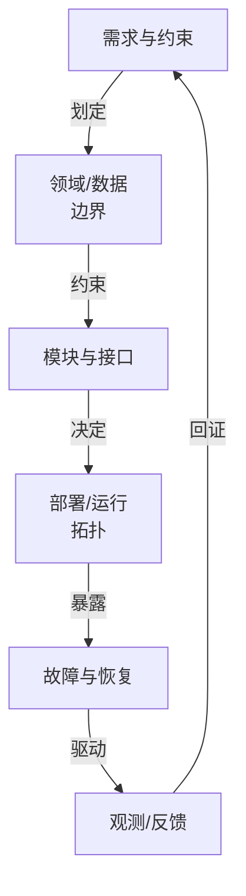

# 架构组织高成本决策与演进边界

架构是**对高成本决策的组织**：系统边界、状态归属、依赖方向、失败传播和演进路径。

它回答一次变化沿哪些边界传播，而不是**把单体、微服务、事件驱动等名词列成清单**。

读完这一页你能判断**哪些选择属于改动不起的高成本决策**，该为它们留下哪些记录，以及**怎样让架构约束被自动检查**。

架构判断的价值在于**提前暴露不可逆成本**：**一旦数据所有权、事务边界或协议发布出去，再改动就需要迁移、兼容和故障恢复**。**先写约束和退出条件，再选择结构**，才能避免把复杂度转移给未来的值班者。

架构判断是否做到位，判据是能否回答三个问题：**一次变化会沿哪些边界传播、哪个团队承担失败、怎样灰度（新版本先放一小部分流量验证，逐步放大到全量）和回滚（把系统状态退回到改动之前的版本）**；回答不了，**图画得再复杂，结构名词本身也没有决策价值**。

## 要解决的问题：哪些选择属于高成本决策需要在早期确定

系统的边界划分、状态归属与依赖方向散落在各个模块的实现细节里，**改动一处需要同时协调多处，失败发生时传播路径无法预先说明**。本篇回答：**哪些选择属于高成本决策需要在早期确定**、系统边界与状态归属与失败传播各自怎样表达、难以逆转的选择需要记录什么，以及**架构约束可以怎样被自动检查**。

## 它是怎么做到的，本质是什么

好比盖楼先定的事：地基打多深、承重墙在哪、电梯井留不留（边界划分、状态归属、依赖方向）——**这些定完之后改一堵隔断墙容易，挪一个电梯井要把整层砸了重来（改动成本随规模与流量上升），所以要早定、要记录**。系统边界、状态归属、依赖方向与失败传播几种选择一旦确定，**改动的成本随代码规模与在线流量的增长而上升，因此这些选择需要在早期确定并留下记录**。架构的价值在于**把这类高成本决策集中表达，使后续的局部改动可以独立进行**；**把名词清单当作架构时，这些决策仍然散落在各处**。比喻到「挪电梯井要砸楼」为止。

## 先看驱动力：什么在推着架构改

好比给公司选新办公室：先盘清哪些部门天天要面对面（业务变化快的耦合紧）、哪些资料必须锁一个保险柜（一致性）、预算和水电容量（SLO/规模）、各个团队谁管哪个区（团队边界）——选址就是被这些问题推着定的。| 驱动力 | 要回答的问题 |
| --- | --- |
| 业务变化 | 哪些规则变化频繁，哪些能力必须稳定？

|
| 一致性 | 哪些状态必须原子变化，哪些允许最终一致？ |
| SLO/规模 | 延迟、吞吐、可用性、恢复目标和数据量是多少？

|
| 团队边界 | 谁拥有数据、代码、值班和发布？ | 比喻到「问题推着选址」为止。

| 安全合规 | 身份、租户、数据驻留、审计和删除如何强制？ |
| 演进成本 | 如何兼容旧客户端、迁移数据、灰度和回滚？ |

**没有可量化约束时，不要根据「更先进」选择架构**。

## 有哪四个核心模型

1. **领域/数据模型**：**实体、值、状态机、不变量和事实来源**。
2. **模块模型**：**高内聚职责和明确 API；依赖指向稳定的抽象**。
3. **运行模型**：**进程、线程、队列、存储、网络和资源生命周期**。
4. **故障模型**：**可能部分失败的位置、检测、重试、补偿和恢复顺序**。

## 这几种结构该怎么选

### 模块化单体适合什么阶段

同一部署单元内保持模块边界，**事务和本地调用简单**。**团队和规模尚未证明需要独立部署时通常是默认起点**。风险是**模块边界只存在文档里、共享数据库被任意访问**。

### 微服务拆开的是什么、付什么代价

用**独立部署/数据所有权**换取**团队自治、隔离扩缩和不同发布节奏**；代价是**网络、分布式事务、版本兼容、观测和值班负担**。**只有当某个边界需要独立扩缩、故障隔离或团队所有权时才划分出来**。

*图源：Wikimedia Commons，David Monniaux，CC BY-SA 3.0，https://commons.wikimedia.org/wiki/File:Paris_servers_DSC00190.jpg。*

### 事件驱动把耦合改成了什么

**发布事实让多个消费者异步反应**，适合**解耦和削峰**；代价是**重复、乱序、延迟、schema 演进和最终一致性**（不承诺实时一致、但保证停止写入后副本终将一致）。**消息系统不等于事件驱动设计**，**事件必须有稳定语义和 owner**。

图：事件驱动架构的生产者—代理—消费者结构。来源：Microsoft Learn《Architectural styles》，https://learn.microsoft.com/zh-cn/azure/architecture/guide/architecture-styles/event-driven（CC BY 4.0）。

### 分层与端口适配守住哪条线

**把领域策略与数据库、消息、HTTP、模型供应商等易变依赖分开**。**接口应按调用方需要设计，避免「万能 repository/service」把实现细节重新泄漏**。

图：分层（N-tier）架构的逐层调用结构。来源：Microsoft Learn《Architectural styles》。

三种结构的选择依据不在名字，在它们各自把哪一类成本高昂的决策固定了下来：

| 结构 | 固定的决策 | 换来什么 | 代价落在哪 |
| --- | --- | --- | --- |
| 模块化单体 | 同一部署单元、共享事务 | 本地调用与事务简单 | 边界要靠纪律维持，共享库易被任意访问 |
| 微服务 | 独立部署与数据所有权 | 团队自治、隔离扩缩 | 网络、分布式事务、版本兼容、值班 |
| 事件驱动 | 事实的语义与 owner | 解耦与削峰（用队列把瞬时高峰摊平到更长的时间段） | 重复、乱序、schema 演进、最终一致 |

举例说明代价怎么发生：一个下单服务拆成微服务后，原来一个本地事务完成的"扣库存加创建订单"，变成**两个服务间的协作**，需要 **outbox 保证事件不丢、消费方幂等（同一个操作执行一次和执行多次的结果相同，重复执行不会产生额外副作用）去重、以及一套补偿流程处理扣成功但建单失败**。**这三样在单体里由数据库事务免费提供**。

这些结构可以组合：模块化单体内部用端口适配，通过 outbox 发布事件，其中少数模块再按证据独立成服务。

## 接口与数据要怎么演进

- **API/schema 做 additive-first 变更**：**先兼容读写，再迁移消费者和数据，最后删除旧字段**。
- **数据所有者定义不变量**；**跨边界不直接写对方表，通过 API/事件表达意图与事实**。
- **重试写操作带幂等键**（请求自带唯一标识，重复提交只生效一次）；**消息消费者能去重**；**长流程显式记录状态和补偿**。
- **缓存说明事实来源、失效、TTL（Time To Live，数据的存活时间，到期作废）、权限键和陈旧容忍度**。
- **每个依赖设置 deadline、并发上限、错误分类和降级（主动牺牲部分功能或精度，保住核心链路）**；**熔断（依赖持续报错时暂时不再调用它，直接走失败路径，防止拖垮自己）不能代替容量设计**。

## 决策记录要写下哪些字段

对难以逆转的选择记录：**背景、约束、选项、决定、后果、验证指标、回滚和复查触发器**。**架构图只画「当前关键边界」，不追求一次表示所有代码**。

架构决策要与演进实测对账——**每个高成本决策（选型、分层、边界）写下当时预期与复审时间**，演进中实测与预期对账（**预测的扩展点真的被扩展了吗、预测的成本真的发生了吗**），**对不上的决策回炉重议，硬撑没有前途**。

## 验证架构而不是欣赏架构图

- **接口约定测试**验证**版本兼容和错误语义**；
- **故障注入（主动向系统注入故障来验证容错能力的测试方法）**验证**超时、重试、队列积压和恢复**；
- **容量测试**验证**瓶颈和背压（下游处理不过来时把压力传回上游减速）**；
- **迁移演练**验证 **expand/migrate/contract 与回滚**；
- **安全测试**验证**租户、身份和数据流边界**；
- **线上 trace/metrics** 验证**调用图是否与设计一致**。

## 反模式长什么样

- **先选微服务/Kubernetes/消息队列（生产者写入、消费者读取的缓冲中间层），再寻找问题**。
- **多个服务共享表并互相写，部署分开但耦合更深**。
- **用无限重试和超时掩盖状态机缺失**。
- **把框架对象和供应商 SDK（软件开发工具包）传遍领域核心**。
- **架构只描述成功路径，不写取消、重复、部分成功和恢复**。

## 接着读哪几篇：决策框架的架构组织视角

- [[工程知识/软件构建：让变化可以理解、验证与交付/软件构建：让变化可以理解、验证与交付]]、[[工程知识/后端系统：在并发、失败与变化中维持服务/分布式可靠性/部分失败决定分布式系统的设计]]、[[工程知识/软件构建：让变化可以理解、验证与交付/测试与交付/测试策略从风险选择证据]]。

- [[工程知识/软件构建：让变化可以理解、验证与交付/架构与代码/购买与自建的决策框架：每条约束都摆上桌面.md]] —— 决策框架的架构组织视角
