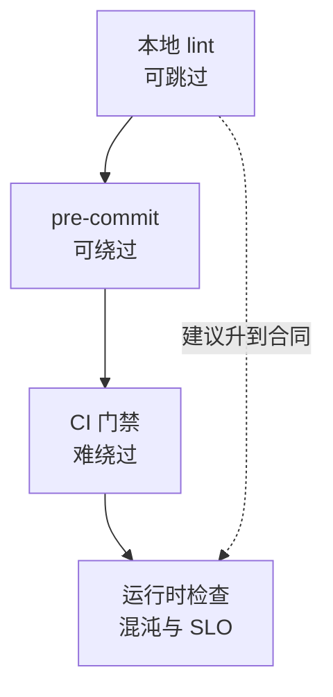
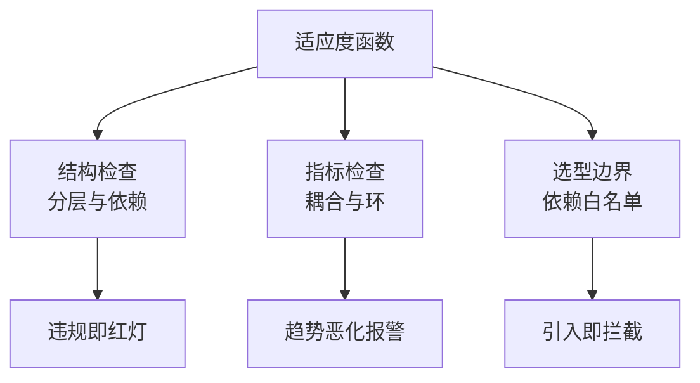
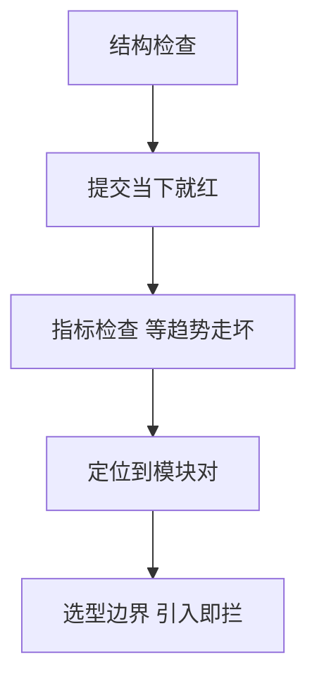

## 架构规范为什么守不住：要解决的问题

好比小区贴出《住户规约》禁止楼道堆物（规范停在文档），三个月后楼道照堆——直到物业装上电梯载重监控、超载报警（把规约变成自动执行的检查），堆物才真正消失。架构图上画的分层（controller 不直连 dao、模块间单向依赖），三个月后代码里就有人绕过。

code review 能挡住看得见的违规，挡不住悄悄长出来的环形依赖、跨层调用、被随手加进核心模块的第三方依赖。规范并不缺，缺的是执行——规范停在文档里：**规范不可执行，违规就不可发现，架构腐化是常态而非事故**。

**适应度函数把"架构必须保持的性质"（分层、依赖方向、模块边界、技术选型边界）写成自动化检查，跑在 CI（Continuous Integration，持续集成：代码合并后自动构建与测试）里，违规即红灯**。比喻到「监控装上才守得住」为止。

## 「性质」怎么变成红灯：机制

先把形状说成一件事：架构适应度函数像体检指标——"身体健康"写在纸上没人执行，规范停留在文档；"血压不高于 140、静息心率不高于 100"是能自动测的可执行约束，测完超标就标红，红了你不能说"下次注意"，违规即阻断。三类检查物对应三类体检项目：结构检查量器官连接对不对——依赖方向、无环；指标检查量各项指标有没有恶化趋势——耦合度、变更耦合；选型边界检查量有没有吃禁忌药——依赖白名单。这个比喻到"禁忌药"为止——现实里约束写在哪一层（本地、提交前、CI、运行时）决定它的强度，下面展开。

**适应度函数要能自动跑，前提是检查者在被测系统之外。从外部观察而不是问应用自己，结论才有独立性。**

*图源：Microsoft Learn 中文文档，CC BY 4.0，https://learn.microsoft.com/zh-cn/azure/architecture/patterns/health-endpoint-monitoring。*

三类检查物。结构检查（依赖与分层）：ArchUnit（Java）、import-linter（Python）、dependency-cruiser（JS/TS）解析代码的 import/依赖图，断言"web 层不依赖 dao 层""模块间无环""共享内核只被白名单引用"。

这些工具的规则即断言（noCycles、layeredArchitecture、classes()...shouldNotDependOnClassesThat），DSL（Domain-Specific Language，为特定领域设计的小语言）直接表达架构约束。规则从现状提取时，dependency-cruiser 的真实项目样例库是现成的对照物：它把 commander、vue 等流行 npm（Node 的包管理器）项目的依赖图跑成图——下图里 commander 的 lib 模块内部调用与对 Node 内建模块（events、fs、path、process）的外部依赖一目了然，"依赖图现状即基线（正常状态下的指标水平、用来对比异常）"这句话指的就是这类产出：

*图源：[sverweij/dependency-cruiser 真实项目样例文档](https://github.com/sverweij/dependency-cruiser/blob/develop/doc/real-world-samples.md)（GitHub 页面实拍，MIT 项目文档引用）。*

指标检查：模块耦合度（传入传出依赖数）、包间循环、变更耦合（Git 历史上两个模块频繁同改，提示边界划错）。选型边界检查：依赖白名单（这个服务不许引 Kafka——分布式消息队列——客户端）、技术雷达的 ring 约束（评估、试用、采用、hold，用 lint 到 CI 的门禁实现）。

**执行位置决定约束强度**。本地 lint（即时反馈、可跳过）→ pre-commit（强制、可绕过）→ CI 门禁（强制、难绕过）→ 生产运行时检查（适应度函数的运行时形态：混沌工程注入验证弹性、可观测性 SLO（服务等级目标，例如可用性或延迟要达成的内部目标）即运行时适应度）。**同一个约束写在不同位置，语义从"建议"升到"合同"**：

三类检查物各自抓的性质不同，合起来才覆盖"结构没走样、耦合没恶化、选型没越界"：

三类检查物抓到违规的时间点不同，处置动作因此也不同：结构检查在提交当下就红，改这一处即可；指标检查要等趋势走坏才有信号，定位只能到模块对；选型边界检查在依赖被引入的那一刻拦住，拦在合入之前。

反馈要过三个设计点。**失败信息要能定位到违规点与规范出处**（哪条规则、哪个模块、为什么有这条规则）；**豁免机制要显式**（annotation suppress、白名单文件，豁免记录进注释与到期时间）；**规则演进与架构演进同步**（架构决策变了，适应度函数先改，再放行代码——顺序不能反）。

适应度函数站的位置，是产品下线前的自动验收站。下图是一张 Debian GNU/Linux 光盘封套：压盘之前，构建系统对每个包跑完整套自动化检查，进得了这张光盘就是对"可安装、可升级、依赖闭合"这组承诺的一次验收。适应度函数在架构层做的是同一件事——每次提交都过一遍架构承诺的检查，不过就不许进主干。

> 图：Debian GNU/Linux 4.0 光盘封套，来自 [Wikimedia Commons](https://commons.wikimedia.org/wiki/File:Debian-cd-cover1.png)，GPL 许可，设计 Tobias Wagner。

## 这套做法从哪来、付什么价：背景与代价

好比园区从保安巡逻改成闸机：**闸机不困不累、人人必查，全量且不衰减**；但闸机的规则表也要维护——园区改了布局闸机没改，架构改了规则没改，**正常访客被拦在门外，挡住合法变更**；而且**闸机只认工牌，认不出访客是不是来搞破坏的，查依赖图但查不了语义腐化**。代价：**规则全集是第二份架构描述，有维护成本与漂移风险**——架构改了规则没改，门禁变成阻碍；反过来规则松了门禁失效；过度约束把本可局部决定的依赖关系全部占用，小团队的灵活被门禁吃掉；结构性检查有盲区（它查依赖图，不查"模块职责是否还在膨胀"，语义腐化依赖评审）；import 解析对动态语言的天花板（Python 的运行时导入、JS 的动态 require，静态检查有覆盖缺口，需要运行时验证补位）。**适用判定：多人协作的中大型代码库、架构边界即团队边界（康威定律生效处）收益最大；单人原型与探索期项目，门禁收益不抵摩擦**。比喻到「闸机认工牌不认意图」为止。

Fitness Function 借自遗传算法（衡量基因适应度的函数），Neal Ford、Rebecca Parsons、Patrick Kua 在《Building Evolutionary Architectures》（2017）引入软件架构，思想源头可追到 Michael Nygard 的 "ultra-large scale" 与治理自动化讨论。工具生态随后成型：ArchUnit、dependency-cruiser、import-linter，ThoughtWorks 技术雷达持续跟踪。

关键的改写是把架构治理从人的评审改写成机器的持续检查：**评审是采样（只看提交到面前的），适应度函数是全量（每次 CI 全代码库检查）；评审的强度随人疲劳衰减，机器不衰减**。持续检查让"演进式架构"成立——**允许架构变，但每次变都被适应度函数验证"想保的性质没丢"**。

## 这套约束在哪儿会失效：边界

- **先立规则再自动化**。规则从现有架构提取（依赖图现状即基线），**先锁"不允许变差"**（ratchet 模式：现状之上的新增违规零容忍，存量逐步清），再收紧到目标态。**一上来写理想态规则，全库飘红，团队学会的第一件事是绕过门禁**。
- **适应度函数验证架构性质，不验证业务正确性**。业务逻辑的测试归测试金字塔，**两者混写会让规则库变成第二个测试套件，职责不清、维护翻倍**。
- **粒度要对齐架构决策的粒度**。决策是"分层"就查分层，是"服务边界"就查跨服务调用面（API 合同），是"数据所有权"就查数据库访问白名单。**粒度错位（用类级规则表达服务级决策）规则爆炸且没人看得懂**。
- **跨仓库架构需要平台级检查**。单仓库工具只看单库，跨库约束（A 服务只许通过网关调 B）位于平台层：服务网格的策略、API 网关（统一接收 API 调用并按路由规则分发到后端的入口层）的配置校验、依赖清单的集中审计。**单库工具挑不动跨库的担子**。

## 想自己验一遍怎么动手：验证

- **规则有效性实验**：在 ArchUnit 写分层规则，故意提交一个跨层调用（controller 直连 dao）。预期：CI 红灯，错误信息定位到具体类与规则名。约束可执行性的直接证据。
- **依赖图基线提取**：对存量代码库跑 dependency-cruiser 的依赖图导出，与架构图人工对照。预期：图上有架构图没有的边（现实与文档的漂移量），漂移点即需要决策的存量违规。规则从现状提取的方法验证。
- **ratchet 模式实测**：survival rate 配置（只对新代码生效），观察 4 周存量违规数的走向。预期：新增违规为零、存量缓慢下降。渐进收紧策略的行为证据。

## 约束的账怎么算：可运行示例与案例回流

约束违反自动出红灯，不用人挨个核对；但账目本身也是要维护的资产，常年不改的规则会挡住合法变更。把口头架构约束写成适应度函数的推演账（通用形态）：四类约束的写法见下文。

- 约束一 分层依赖：上层不得反向依赖下层。静态分析查 import 方向，出现 `web -> dao` 直连即失败（一次检查替代一次人工评审）
- 约束二 圈复杂度：单函数圈复杂度 ≤ 15，超出即拦合并（复杂度在评审里争不赢，在门禁里不用争）
- 约束三 循环依赖：模块间不得成环，依赖图跑环检测
- 约束四 API 稳定性：公开接口签名变更需走废弃流程，对比两版接口 diff

维护账：适应度函数本身也是代码，随架构演进同步改；长期不改的函数会挡住合法变更，每季度复核阈值**与例外清单**。

口头约束失效的实录——"禁止 web 层直连数据层"写了三年设计文档，静态检查一跑出现 47 处违规（口头约束随人员流动蒸发，可执行的检查才长期有效）；上门禁后新增违规归零，存量按月清。误报侵蚀信用的实录——复杂度阈值拍脑袋定 10，一半老代码超标，团队学会集体"豁免"，门禁名存实亡；按模块基线分批收紧后门禁恢复拦截力。函数腐化的实录——服务划分之后旧的单体依赖检查还在跑，合法跨服务调用被拦，开发者绕过检查工具直连（适应度函数与架构要同步演进，例外要显式登记）。约束的可执行化与架构决策的记录见 [[工程知识/软件构建：让变化可以理解、验证与交付/架构与代码/架构组织高成本决策与演进边界.md]]、分层方向的底层逻辑见 [[工程知识/软件构建：让变化可以理解、验证与交付/架构与代码/分层与依赖方向决定可测试性和演进成本.md]]。

## 接着读哪几篇：静态分析提供证据

- [[工程知识/软件构建：让变化可以理解、验证与交付/测试与交付/静态分析的证据边界：它证明什么不证明什么.md]] —— 静态分析提供证据，适应度函数是它在架构域的定向应用
- [[工程知识/软件构建：让变化可以理解、验证与交付/测试与交付/灰度与功能开关的边界：交付节奏与配置漂移.md]] —— 门禁挡违规提交，灰度（先放开给一小部分用户验证、再逐步加量的发布方式）挡事故发布，两道闸位置不同
- [[工程知识/软件构建：让变化可以理解、验证与交付/架构与代码/购买与自建的决策框架：每条约束都摆上桌面.md]] —— 选型边界是适应度函数的一类检查物，决策框架是它的上游
- [[工程知识/软件构建：让变化可以理解、验证与交付/架构与代码/错误处理的分类学：错误类型与恢复策略的映射.md]] —— 异常只留给编程错误的约定可入适应度检查
- [[工程知识/软件构建：让变化可以理解、验证与交付/架构与代码/领域建模的实施路径：从事件风暴到聚合边界.md]] —— 跨聚合不得共事务的边界纪律可写成适应度检查
- [[工程知识/后端系统：在并发、失败与变化中维持服务/服务设计/微服务划分的判据：从团队认知到数据边界.md]] —— 划分后的边界纪律可用适应度函数持续检查
