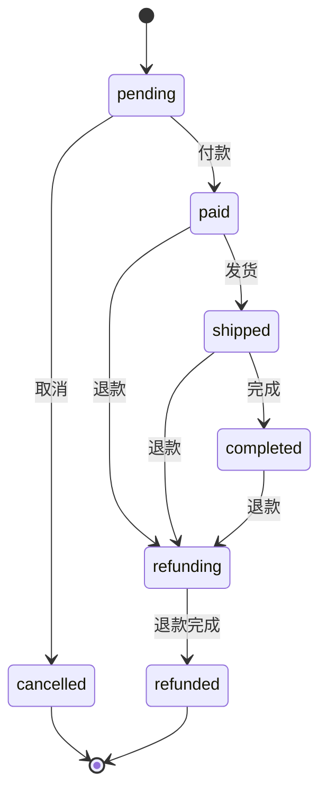
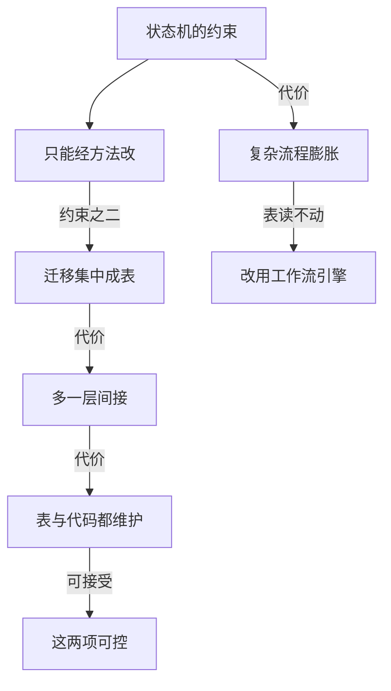

# 状态机把隐式状态变成显式约束

## 要解决的问题：状态字段为什么需要私有化并走统一入口

同一件事用多个布尔字段描述，运行中出现了设计上没有考虑过的字段组合，也没有地方可以说明某个对象为什么处在该状态。本篇回答：**状态字段为什么需要私有化并走统一入口、迁移表怎样把允许的变化集中表达、迁移伴随的动作应当放在哪里**，以及**状态数量到什么规模就不适合继续用代码中的表**。

## 这件事发生在什么场景：那个能"从已发货退回待付款"的订单

**订单的状态最初用几个布尔字段表示，组合空间远超合法状态数**。

```go
type Order struct {
    Paid      bool
    Shipped   bool
    Cancelled bool
    Refunded  bool
}
```

**业务代码里到处是按布尔组合分支的判断，规则散落在各个 if 里**。

```go
if o.Paid && !o.Shipped { /* 可以发货 */ }
if o.Cancelled && !o.Refunded { /* 需要退款 */ }
```

问题：**这些字段的组合有 2^4 = 16 种，但合法的只有寥寥几种。**

**实际出现过的 bug 都来自非法组合，每种都对应一笔说不清的业务处置**。

- `Paid=true, Cancelled=true` —— **已付款又取消了，没人退款**
- `Shipped=true, Refunded=true` —— **已发货又退款，货和钱都没了**
- **一个订单从 `已发货` 直接被改回 `待付款`（因为直接改了布尔值）**

**布尔字段的组合爆炸，是隐式状态建模的典型后果。** **非法状态在代码里是可表示的，所以迟早会出现**。


来源：[稀土掘金《深度解析 Raft 分布式一致性协议》](https://juejin.cn/post/6907151199141625870)（CC 4.0 BY-SA）


## 方案是什么：让状态成为一个值，迁移成为唯一入口

先把形状说成一件事：**状态机像酒店的房卡系统**——**房卡只有一种状态值（枚举：有效房卡、失效房卡），不存在「半有效」**；**前台改卡要走唯一窗口（迁移表 + 单一入口）**，**新卡激活必须旧卡失效（不允许的状态组合根本做不出来）**；**押金退还跟换卡绑在同一个动作里（副作用跟着迁移走）**。**没有房卡系统的酒店靠口头约定管理，就会出现「已退房却还开着灯」**——**布尔组合管状态就是这种口头约定**。**这个比喻到「口头约定」为止**——现实里五步各自的代码形状，下面逐条展开。

### 为什么用枚举而不用布尔组合

```go
type OrderStatus string

const (
    StatusPending   OrderStatus = "pending"    // 待付款
    StatusPaid      OrderStatus = "paid"       // 已付款
    StatusShipped   OrderStatus = "shipped"    // 已发货
    StatusCompleted OrderStatus = "completed"  // 已完成
    StatusCancelled OrderStatus = "cancelled"  // 已取消
    StatusRefunding OrderStatus = "refunding"  // 退款中
    StatusRefunded  OrderStatus = "refunded"   // 已退款
)
```

**7 个状态就是 7 个，非法状态无法表示。**

**状态机本身的形态可以先用一个最小的例子建立直觉**——下图的闸机只有锁住与解锁两个状态，但"**圆是状态、箭头是允许的变化、图上没有的箭头就是禁止的变化**"这套读法已经完整：


*图源：Wikimedia Commons「Turnstile state machine」，作者 Chetvorno，许可 [CC0](https://creativecommons.org/publicdomain/zero/1.0/)。图上每个圆是一个状态，每条箭头是一次允许的迁移；"从哪个状态能到哪个状态"不再散落在各个 if 里，而是在一张图上被穷举，迁移表就是这张图的机器可读形态。*

**订单的 7 个状态按同一套读法画出来，合法路径七条边，此外一律拒绝**：



### 2. 迁移表：哪些转换是允许的

```go
var transitions = map[OrderStatus][]OrderStatus{
    StatusPending:   {StatusPaid, StatusCancelled},
    StatusPaid:      {StatusShipped, StatusRefunding},
    StatusShipped:   {StatusCompleted, StatusRefunding},
    StatusCompleted: {StatusRefunding},
    StatusRefunding: {StatusRefunded},
    StatusCancelled: {},
    StatusRefunded:  {},
}
```

**这张表是整个设计的核心**——它把"什么能发生"从散落各处的 if，变成一处可审查的数据。

### 为什么所有状态变更要走同一个入口

```go
func (o *Order) Transition(to OrderStatus) error {
    allowed := transitions[o.Status]
    if !slices.Contains(allowed, to) {
        return fmt.Errorf("订单 %s 不能从 %s 迁移到 %s", o.ID, o.Status, to)
    }
    o.Status = to
    return nil
}
```

**关键点：状态字段私有，外部无法直接赋值。** **所有变更必须经过 `Transition`，非法转换在编译期（代码编译成可执行文件时发生的阶段）或运行时立即失败**。

### 4. 状态迁移的副作用放哪

**迁移通常伴随动作（付款后要扣库存、发货后要通知）**。三种做法：

| 做法 | 适用 | 缺点 |
| --- | --- | --- |
| 在 `Transition` 里直接做 | 简单场景 | 领域对象依赖了外部服务 |
| **发布领域事件** | **推荐** | 需要事件机制 |
| 返回"需要执行的动作"列表 | 纯函数式 | 调用方要处理返回 |

**推荐发布事件**：`Transition` 把订单迁移到 `shipped` 后发布 `OrderShipped` 这样的领域事件（领域模型内发生的业务事实，如"订单已发货"，只陈述事实不指挥动作），**由订阅者处理通知、物流等**。**这样领域对象（承载业务规则的业务类，不含技术细节）保持纯净**。

### 什么时候不需要状态机

| 情况 | 建议 |
| --- | --- |
| **状态 ≤3 个且是线性的** | **枚举 + 顺序校验就够了** |
| **状态多且有分支/回退** | **用状态机** |
| 状态是"标志位"而非生命周期 | **用布尔或独立字段，别硬凑** |
| **流程经常变** | **用工作流引擎（流程定义存进数据库、可在线改流转规则的可配置引擎），少改代码** |

## 效果从哪儿来，要付什么代价

**状态机在事件分发这一层见得最多**。**Reactor（事件驱动模型：就绪事件分发给对应的处理器） 就是一个事件状态机**：**多个来源汇到一个分发点，按事件类型决定下一步落在哪个处理链条上**。


*图源：ToolsBook《干翻 nio，王炸 io_uring 来了，史上最详细说明及最全图解》，CC 4.0 BY-SA，https://www.toolsbook.org/2024/05/nio-iouring.html。*

**收益**

- **非法状态不可表示**：`已发货 + 已退款` **这种组合在类型层面就不存在**
- **迁移表可审查**：产品经理也能看懂"从 A 能不能到 B"
- **变更集中**：**加一个新状态只需改迁移表，不用改散落各处的 if**
- **可测试**：**遍历迁移表自动生成测试用例**

**代价**

- **多一层间接**：**不能直接 `o.Status = paid`，必须走方法**
- **迁移表要维护**：**业务变化时表和代码都要改**
- **复杂流程会膨胀**：**状态与迁移的数量增长到迁移表难以通读时，硬编码的表就难维护了**——这时该考虑工作流引擎（同上表，流程定义外置可改）
- **历史事件难以表达**："为什么到了这个状态"需要额外的事件日志

**四条代价不是并列的缺陷清单，它们各自对应状态机引入的一个结构性变化**：



**右边两条值得单独看：迁移表膨胀是信号**——**状态与迁移多到表读不动时，说明该把流程定义挪到引擎里去了**；"为什么到了这个状态"则根本不在状态机的职责范围内，状态机只回答"现在是什么、能变成什么"，历史原因要靠事件日志另记。**这两条常被当成状态机的不足，实际是它的边界**。

## 从什么地方做

**第一步：找出"多个布尔字段描述同一件事"的地方**

`Paid`/`Shipped`/`Cancelled` **这类字段同时出现 = 隐式状态机**。**这是重构的第一优先。**

**第二步：枚举出所有真实出现过的状态**

**从数据库里 `SELECT DISTINCT` 现有组合**。**实际存在的组合往往比设计文档里的多**——那些"理论上不该存在"的组合就是历史 bug。

**第三步：和产品确认哪些迁移合法**

画出状态图，逐个确认。这一步会发现**之前从没讨论过的边界**：**已发货能取消吗？退款中能再次发货吗**？

**第四步：实现 `Transition`，把状态字段私有化**

**确保外部无法绕过。用代码 review 或静态检查保证**。

**第五步：给每次迁移记录事件**

```json
{"order_id": "...", "from": "paid", "to": "shipped",
 "by": "user_8821", "at": "...", "reason": "手动发货"}
```

**没有事件日志，就无法回答"这个订单怎么到这个状态的"。**

## 常见错误

**错误 1：状态字段是公开的，迁移可被绕过**

`o.Status = "paid"` **散落各处 → 迁移表形同虚设**。**必须私有化 + 单一入口。**

**错误 2：迁移表有遗漏导致"卡死"**

`StatusRefunding` 没配置到 `StatusRefunded` → 退款永远处理中。**迁移表要有测试覆盖所有状态。**

**错误 3：把状态机做成"万能的"**

**所有业务都往状态机上凑，包括那些其实是独立标志位的东西**（比如"是否加急"）。**状态机只用于生命周期。**

**错误 4：忽略并发迁移**

**两个请求同时把 `pending` 改成 `paid` 和 `cancelled`**。**用乐观锁（版本号）或数据库行锁保证迁移原子。**

**错误 5：迁移失败后状态不一致**

**扣库存成功但状态没改 → 下次重试又扣一次**。**迁移和业务操作要在同一事务**，或**用 Saga（长流程里把每步与对应的撤销动作配对，失败时逐个回退的编排模式）补偿**。


## 怎么自己动手验证

**最小验证：遍历迁移表生成全部合法与非法组合的用例，断言合法迁移通过、非法迁移被拒绝且给出明确的失败信息**。**人为把状态字段改为可直接赋值，断言静态检查或评审可以发现绕过入口的写法**。

**并发验证：两个请求同时对同一对象发起互斥迁移，断言其中一次失败并返回当前状态，对象状态与预期一致**。

## 接着读哪几篇：同在软件构建里的相邻问题

- [[工程知识/软件构建：让变化可以理解、验证与交付/架构与代码/设计模式解决的是变化点的隔离]] · [[工程知识/数据系统：在并发与故障中保存事实/事务与存储/事务边界应覆盖完整业务用例]]
