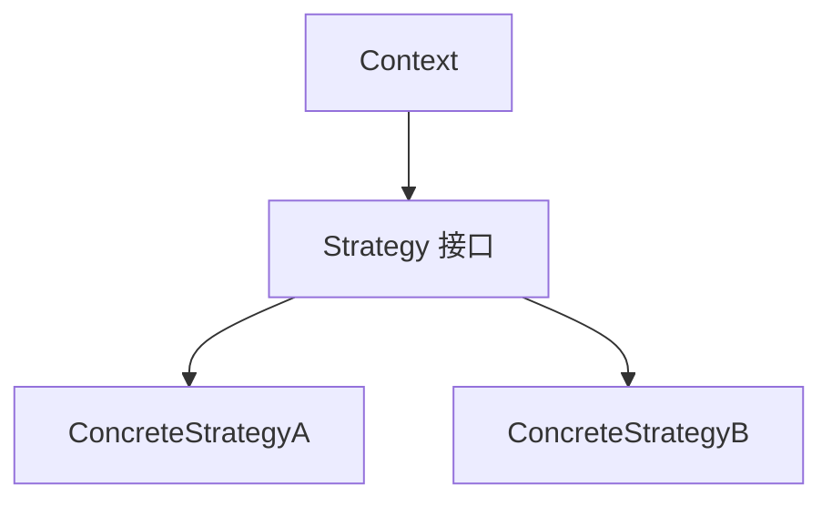
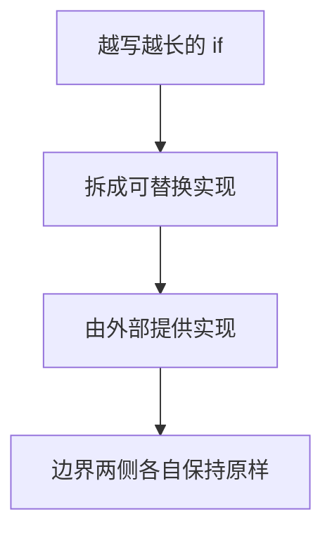
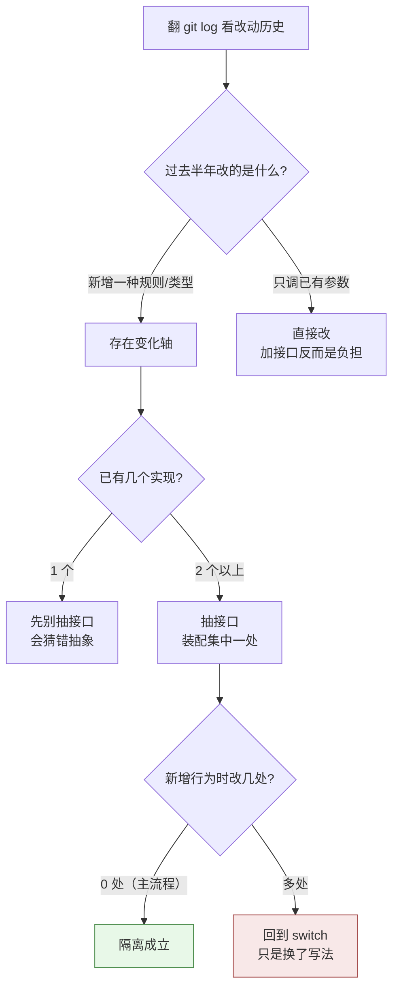

# 策略与依赖注入把变化关在边界外

## 要解决的问题：变化轴怎样识别

**业务规则的数量随上线次数持续增加，每加一条就要改动同一个函数并重跑全部相关测试，改动之间互相影响**。本篇回答：**变化轴怎样识别、抽象应当在有几个实现之后进行、依赖由谁提供以及三种注入方式各自的取舍**，**还有哪种依赖获取方式会让调用方无法判断自己需要什么**。

## 它是怎么做到的，本质是什么

**把随业务变化的部分抽成接口之后，调用方依赖的是接口而不是具体实现**，**新增一种行为对应新增一个实现类与一行装配，主流程保持不动**。**依赖注入决定实现由谁提供：构造器注入使依赖关系留在方法签名里**；**容器注入指由 Spring（Java 生态的应用框架，提供依赖注入与事务管理等容器能力）、Guice 这类框架按配置自动装配**，**装配动作从代码移到配置里，依赖关系不再体现在阅读路径上**。

## 这件事发生在什么场景：那段越写越长的 if

**一个定价服务，最初只有一个规则**：

```go
func Price(o Order) Money {
    return o.BasePrice
}
```

三个月后变成：

```go
func Price(o Order) Money {
    p := o.BasePrice
    if o.UserLevel == VIP { p = p * 0.9 }
    if o.Coupon != nil { p = p - o.Coupon.Amount }
    if isPromotionPeriod(time.Now()) { p = p * 0.8 }
    if o.Channel == "app" { p = p - 5 }
    return p
}
```

**代码长只是表象**，**每加一条规则都要改同一个函数，所有定价的测试都要重跑**才是问题。**而且 `Price` 现在依赖了用户等级、优惠券、时间、渠道——它知道得太多了**。

"知道得太多"是这里的关键。函数本身只该负责"把价格算出来"，现在它还要知道用户分几级、促销从什么时候开始、渠道有哪些。**每多知道一样东西，就多一条它被牵连改动的理由**。

## 方案是什么：把每条规则变成可替换的实现

策略模式的核心动作只有一个：**把"怎么做"从调用方移到被注入的实现里**。

```go
type PriceRule interface {
    Apply(o Order, current Money) Money
    Name() string
}

func Price(o Order, rules []PriceRule) Money {
    p := o.BasePrice
    for _, r := range rules {
        p = r.Apply(o, p)
    }
    return p
}
```

**装配在组合根完成——组合根是应用里集中组装全部依赖的那一处入口代码（应用启动时执行）**，业务代码只依赖接口：

```go
rules := []PriceRule{
    VIPDiscount{}, CouponDeduct{}, PromotionDiscount{}, AppRebate{},
}
```

**这样新增一条规则 = 新增一个实现了 `PriceRule` 的文件 + 在装配处加一行**。**`Price` 函数本身零改动。**

**这套结构在 UML（Unified Modeling Language，统一建模语言）上的形态就是策略模式的标准样子**：**调用方（Context）只持有接口，具体实现挂在接口之下，两者之间没有直接连线**：


*图源：Wikimedia Commons，作者 Jason S. McDonald，公有领域，https://commons.wikimedia.org/wiki/File:Strategy_Pattern_in_UML.png。Context 与 Strategy 之间是聚合关系，与两个具体实现之间没有任何连线——"新增规则不动主流程"在这个结构里是几何事实，**新增一个实现类只需要挂到接口下面**。*



## 依赖注入：谁来提供实现

**依赖注入要解决的是「谁提供实现」，防腐层要解决的是「两套模型怎么共存」**。后者**把转换放在两个系统边界上，一侧说新模型的语言，另一侧说老模型的语言**——**边界两侧各自保持原样，谁也不用迁就谁**。


*图源：Microsoft Learn 中文文档，CC BY 4.0，https://learn.microsoft.com/zh-cn/azure/architecture/patterns/anti-corruption-layer。*


策略定义了"怎么变"，依赖注入解决"谁来决定用哪个实现"。**「组合根集中装配」这个思想出自 Martin Fowler 的经典文章**：下图是他 2004 年给出的注入器结构——**MovieLister 只依赖 MovieFinder 接口，MovieFinderImpl 实现接口，Assembler 在一旁把两者装配起来**，**MovieLister 自己不 new 任何实现**。**组合根就是 Assembler 的工程化放大**：


*图源：[Martin Fowler《Inversion of Control Containers and the Dependency Injection pattern》](https://martinfowler.com/articles/injection.html)。Assembler 就是组合根的原始形态——业务类只声明依赖，装配集中在一处。*

**注入有三种方式，差别在依赖怎么进来**：

| 方式 | 怎么做 | 适用 | 陷阱 |
| --- | --- | --- | --- |
| 构造器注入 | **依赖通过构造函数传入** | 必需依赖，**默认选择** | 构造参数可能变多 |
| 方法参数注入 | **每次调用时传入** | **依赖每次不同（如请求上下文）** | 调用方要自己找依赖 |
| 容器/框架注入 | **Spring、Guice 等自动装配** | **大型应用减少样板代码** | **依赖关系变隐式，难以静态分析** |

**优先用构造器注入**。**原因很实际：依赖关系显式写在签名里，看构造参数就知道这个类依赖什么**；**测试时直接传 mock（模拟对象：测试里替代真实依赖的假实现），不需要启动容器**。

**容器注入的陷阱在于依赖关系的可见性**。构造器把"我需要什么"写在签名里，读代码的人一眼可见；**容器把装配移到配置之后，同样的问题要翻配置才能回答，静态分析工具也跟不到**。**容器可以用，大型应用里样板代码本身就是负担**，但用了之后，**依赖关系需要额外手段（依赖图、启动校验）来保证它仍然可见**。

**服务定位器（`ServiceLocator.Get<IPayment>()`）要避开**——**它把依赖从签名里藏起来，调用方不知道自己到底需要什么，测试也必须先配置全局状态**。

三种方式在"依赖是否可见"上的差别画成对照：



**三档的取舍是可见性递减、样板代码也递减**。选哪一档取决于团队能否接受"依赖不可见"带来的排查成本，而不是哪种写法更新。

## 效果从哪儿来，要付什么代价

**加一层边界换来了可替换性，代价是多一处要维护的转换**。防腐层把这笔账说得很清楚：**在新旧系统之间放一层转换，两边的模型各自保持原样，转换逻辑集中在这一层里**。


**收益**

- `Price` 函数的测试从"覆盖所有规则组合"变成"验证规则被按序应用"——**用一组假规则就能测**
- **每条规则可以独立测试，互不干扰**
- **规则可以在独立条件下被替换，无需改动主流程**

**代价**

- **规则之间可能有隐式顺序依赖**：`先打折再减券` 和 `先减券再打折` 结果不同。**接口上看不出顺序要求，要靠文档或显式建模（比如给规则加 `Order()` 字段）**
- **类数量增加**：**每条规则一个类。4 条规则 = 4 个文件**，看起来比一个 20 行函数"重"
- **过度使用的信号**：**如果某个策略永远只有一个实现，且没有测试替身的需求，那这个接口就是纯负担**

**第一条代价是这套方案里最容易被低估的**。**顺序依赖在接口上完全不可见**——`PriceRule` 的签名里没有任何东西表明"我必须在优惠券之后执行"。**它只在某个订单金额算错时才现形，而且现形时看起来像计算错误，不像设计问题**。**显式建模（给规则加顺序字段，并在装配处断言顺序）比写在文档里可靠**。

## 从什么地方做

1. **找到变化轴** —— **翻 Git log（Git：分布式版本控制系统），看这个模块过去半年改的是什么**。是"新增规则"还是"改某个规则的参数"？

前者适合策略，后者直接改就行
2. **先写两个具体实现再抽接口** —— **只有一个实现时抽象，多半会猜错接口**
3. **定义接口时问"实现方需要什么"** —— **如果实现方需要访问数据库、配置等，通过构造器注入给它**，**不要让 `Apply` 方法参数越来越长**
4. **装配放在一处** —— **所有的 `rules := []PriceRule{...}` 集中在一个文件/包里，不要在业务代码里零散地 new**
5. **用测试锁定不变的部分** —— 写测试验证"任意规则组合都能被按序应用"，**这样以后加规则不会破坏框架**

第 1 步的"翻 Git log"是识别变化轴最可靠的办法。**人的直觉倾向于按当前代码结构想象未来改动**，**而 Git log 记录的是这个模块实际被改动的历史——它比任何预测都准**。改的是"新增一种"才需要策略；改的是"调整已有参数"，加一层接口只是把一次简单修改变成改两个地方。



## 常见错误

**错误 1：策略里塞满了不同维度的变化**

**一个 `PriceRule` 既处理折扣又处理税费又处理运费——这不是策略，这是把原来的大函数分成了三个大函数**。**应该按变化轴分开**：`DiscountRule`、`TaxRule`、`ShippingRule`。

**错误 2：用字符串/enum 分发替代多态**

```go
switch rule.Type {
case "vip": ...
case "coupon": ...
}
```

**这又回到了原点。每个分支还是会碰同一个 switch**。**判断标准：新增一种类型时，你要改几个地方？如果超过一个，就是没隔离。**

**错误 3：接口方法过多**

`PriceRule` 被塞进 `Apply`、`Validate`、`Describe`、`Serialize` 四个方法，**于是每个实现都要写一堆自己不需要的方法**。应按**接口隔离原则**划分成多个小接口，**让实现只依赖它需要的**。

**错误 2 里的判断标准可以直接用：数改动点的数量**。策略模式解决的问题是"新增行为时改动点从一个变成零个（主流程）"，**如果加了接口之后新增行为仍要改 switch、改配置、改文档三处，那隔离就没有真正发生**——**只是把 if 换了个写法**。


## 怎么自己动手验证

**注入点要与行为对账——做法是给同一个注入点换上两个以上实现，各跑一遍同一用例，再逐项比对两者的行为差异**。**差异只允许出现在注入边界内（也就是被替换的那个实现自己的行为）**；如果边界之外——调用方这段代码——的行为也跟着变了，**说明抽象漏了：本该关在实现里的东西渗进了调用它的那段代码**。

**最小验证：用两个测试替身实现规则接口，断言主流程按顺序应用它们且无需改动主流程代码**。**新增一条规则，断言改动范围只涉及新文件与装配处，主流程函数的测试全部保持通过**。

**顺序验证：交换两条规则的顺序，预期结果随之变化，并且顺序要求在代码或文档中被显式表达**；**若交换后结果不变，说明这两条规则之间并不存在真正的顺序依赖**，显式声明的顺序要求就是多余的。

**对账验证：把每个注入点的实际行为与它声明的职责逐项对比，预期差异只出现在注入边界内**；**边界外的行为对不上，就说明抽象漏了**。

相关（容器实现）：[[工程知识/软件构建：让变化可以理解、验证与交付/语言与运行时/Spring代理与Bean生命周期会改变调用边界]] —— 依赖注入在容器中的代理与生命周期约束

## 接着读哪几篇：同在软件构建里的相邻问题

- [[工程知识/软件构建：让变化可以理解、验证与交付/架构与代码/设计模式解决的是变化点的隔离]] · [[工程知识/软件构建：让变化可以理解、验证与交付/架构与代码/分层与依赖方向决定可测试性和演进成本]]
