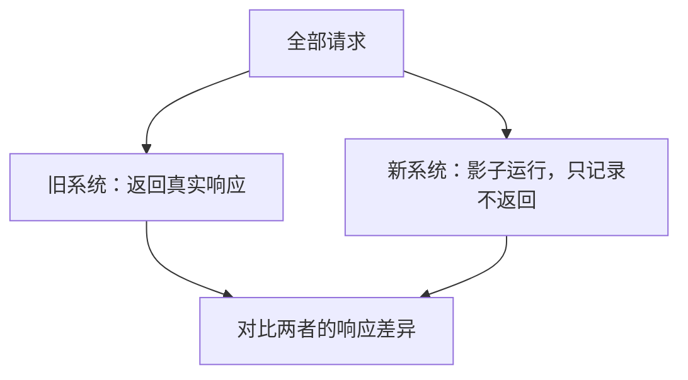
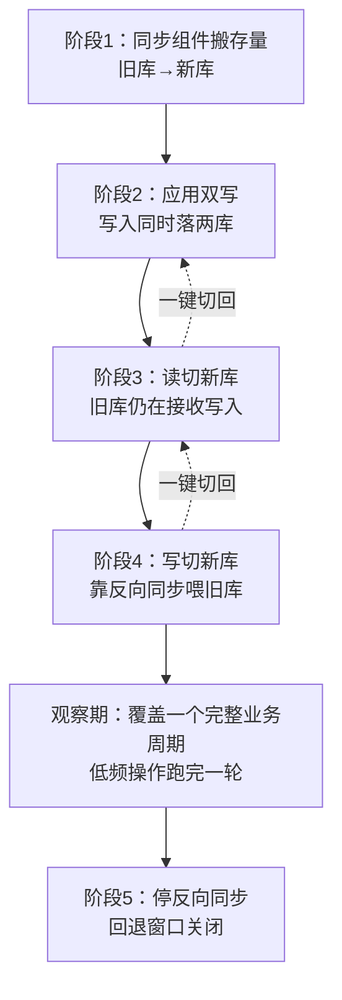
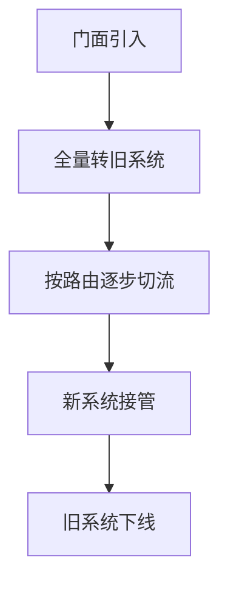

# 绞杀者模式用增量迁移替代整体重写

## 机制与要解决的问题：为什么重写了 8 个月，上线就回滚

**一个跑了 6 年的单体，决定重写。8 个月后新系统完成，切流（把流量整体从旧系统切到新系统）当天**：

- **3 个旧功能新系统没实现（因为没人记得有这些功能）**
- **2 个报表结果和旧系统对不上（规则在旧代码里，且没文档）**
- **一个定时任务只有旧系统有**

**回滚（把系统状态退回到改动之前的版本）。又花了 3 个月补齐**，**前后 11 个月**。

**大爆炸式重写的问题**：

1. 旧系统里埋着大量"没人记得但有人在用"的功能
2. **业务在重写期间还在变化，新系统上线即落后**
3. **长时间没有可交付的东西，风险在最后一天集中爆发**

**这三个问题各有成因，指向同一个交汇点**。问题 1 的成因是**旧系统的真实行为有相当一部分只存在于旧系统的代码和运行记录里，文档与人的记忆覆盖不全**；**问题 2 的成因是需求随时间漂移，新系统按立项时的理解实现，交付时已滞后于业务**；**问题 3 的成因是大爆炸的交付节奏把风险压在最后一天**。**三者交汇的结果是同一个：切流那一刻同时面对三类未验证的差异——漏实现的功能、对不上的规则、没人记得的任务**。

绞杀者模式（在旧系统继续承接生产流量的同时，经代理层逐个接口替换其实现的迁移方式）不改变这个事实，但改变了暴露的节奏：**把一次性的全量对账，切成若干次小范围对账，每次只面对一个接口的差异**。

## 方案是什么：新旧并存，逐步绞杀

先把形状说成一件事：**渐进迁移像老桥旁边修新桥**——**不停老桥（旧系统一直在线服务）**，**先在旁边打桥墩（门面层：新旧都从这里进出）**，**然后一条车道一条车道地改走新桥（每次只把一小类请求切过去）**，**每换一条车道就观察一段时间（验证）**，**出问题随时把这条车道摆回老桥（可回退）**。**整体重写则是封桥三个月从两头重修，通车那天所有问题一起爆出来**。**这个比喻到「摆回老桥」为止**——现实里门面怎么搭、车道怎么切，下面分节展开。

### 整体思路是什么

这套「门面 + 逐步转移」的做法在业界有一个固定的名字和稳定的形状：**请求先全部打到旧系统，新系统与旧系统并行上线，每条功能迁移完成就把这一类请求从旧系统切到新系统，全部迁移完成后撤掉门面**。**四个阶段里只有第三阶段在真正动业务代码，前后两阶段分别是准备与收尾**：

*图源：DevIQ《Strangler Fig Pattern》，https://deviq.com/design-patterns/strangler-fig-pattern/。注意每个阶段旧系统都还在服务——迁移的风险被摊在多个可回退的小步里，而不是压在一次切换上。*

**整体重写的麻烦在于切换点只有一个，全部风险压在一次发布上**。**渐进迁移把它拆成许多个**：前置一层门面，先全量转给旧系统，随迁移推进逐步把请求转给新系统，旧系统的流量一点点被抽走。

*图源：Microsoft Learn 中文文档，CC BY 4.0，https://learn.microsoft.com/zh-cn/azure/architecture/patterns/strangler-fig。*

**在旧系统前面加一层代理（网关/路由），新功能用新系统实现、路由指向新系统，旧功能逐个迁移、迁移一个切一个，旧系统流量逐步降到 0 后最后下线**。

**关键是：任何时刻都有一套系统在承接流量**，**出问题时影响面限于刚切换的那个接口，且可快速回滚**。**这是设计目标而非无条件保证**——已迁移接口自身有 bug 或路由配置错误时，对应流量仍然会失败；绞杀者保证的是"失败范围可控、可回退"，不是"永不失败"。

**路由层是整个模式的基础设施：有它，切换动作才是一次配置变更、回滚才是一键；没有它，切换就要改调用方代码，回滚就变成又一次发布**。

整体演进分四步走：

*图示：四个阶段对应本篇的推进顺序——先加代理层（阶段 1）、逐个迁移功能（阶段 2）、旧系统流量归零并退役（阶段 3）、撤掉代理层由客户端直连（阶段 4）。图源：[Microsoft Learn · Strangler Fig 模式](https://learn.microsoft.com/zh-cn/azure/architecture/patterns/strangler-fig)（官方中文文档，图由微软以 Visio 导出，可自由用于学习引用）。*

### 两种切入方式各切哪里、怎么验证

**方式 1：按路由切（最常用）**

| 路由 | 去向 |
| --- | --- |
| `/api/users/*` | 旧系统 |
| `/api/orders/*` | 新系统（已迁移） |
| `/api/reports/*` | 旧系统 |

在网关层配置路由。**每迁移一个接口，改一条配置。**

**方式 2：按流量比例切（灰度——新版本先放一小部分流量验证，逐步放大到全量）**

**5% 流量走新系统（观察），再 50%，再 100%。适合风险高、需要对比验证的迁移**。

**方式 3：影子流量（验证用）**

**这是价值很高的验证手段**：**影子流量是请求复制——入口把同一份请求同时发给新旧两套系统，只有旧系统的响应返回给用户，新系统的响应只用于记录与比对**。**它的前提是影子调用与生产隔离：不写生产库、不外呼下游，否则验证本身就在制造副作用（操作对外部状态产生的额外影响）**。**在这个前提下它对用户接近零风险。发现差异就去修**。

方式 2 与方式 3 的分工：影子流量用真实请求但不影响用户，适合**发现差异**；灰度切流让真实用户承担真实风险，适合**验证差异已被修完**。**先用影子跑出差异清单，修完再灰度，是这两步的常规顺序**。

### 数据迁移为什么要双写加校验

**真正的难点不在流量切换，而在数据：迁移期新旧两套存储并存，要同时写入、持续同步，直到旧库可以停掉**。**这一步往往比切流量长得多**。

*图源：同上（Microsoft Learn 中文文档），CC BY 4.0。*

**比代码更难的是数据：代码差异在切流前就能通过影子对比发现，而数据差异要等业务周期跑完——月度报表、季度结算跑过一轮——才暴露得出来**。

这里的"双写（迁移期间同一份数据同时写入新旧两个存储）"指应用每次写入同时落旧库和新库，与阶段 1 的"由同步组件把旧库数据搬运到新库"是两件事：**同步解决存量，双写解决增量**。

数据迁移分五个阶段推进，真正要看清的是一键切回的窗口开在哪几段、在哪一步之后彻底关闭。

**图里能一键切回的只有两个位置：阶段 3 切回阶段 2、阶段 4 切回阶段 3**。**阶段 5 停掉反向同步后，切换以来产生的新数据会随回退一起丢失——回退能力在这里到顶**。

**每个阶段都要能回退。** **读切到新库（阶段 3）与写切到新库（阶段 4）之后各有一段可切回的窗口**：旧库仍在接收写入或靠反向同步保持新鲜时，发现问题就能一键切回。

**阶段 4 是回退能力的终点：写一旦切到新库，旧库就不再由业务写入，此后靠反向同步（新库 → 旧库）维持旧库的新鲜度，为回退保留最后一段窗口**。**这个观察期至少要覆盖一个完整业务周期**——**低频操作只有跑过一轮才能确认新库行为正确**；**跳过这一步的代价是问题在几个月后的报表里才现形，而那时旧库已经下线，连对账的参照都没有了**。

阶段 5 停掉的就是这条反向同步。**停掉之后旧库不再更新，回退意味着丢失切换后产生的新数据**——**所以这一步的前提是观察期结束且完成标准达成**。

### 抽象分支怎么在不分叉代码库的情况下换实现

**当无法在网关层切分时（比如改的是内部模块，不是接口）**：

1. 在旧实现外面包一层抽象接口
2. 调用方改为依赖接口
3. 写新实现
4. 逐步把调用方切到新实现
5. 删除旧实现

**好处：每一步都在主干上，不需要长期分支。**

抽象分支解决的是"切分点不在网络边界上"的情况。**网关（站在客户端与后端服务之间的入口层，集中处理路由、鉴权与协议转换）按 URL 切分的前提是改动可以被一个请求路径圈定**；**改的是内部模块时没有这个路径可用，于是先在代码里造出一个等价的边界——接口本身**。**两种做法的机制不同，共同点是都先造出可切换的边界，再逐个切换**。

## 效果从哪儿来，要付什么代价

**收益**

- **随时可交付**：**每迁移一个功能就有一次价值交付，不用等 8 个月**
- **风险分散**：**每次切换的影响范围小，出问题回滚一个接口就行**
- **能发现隐藏功能**：迁移过程中会不断发现"原来还有这个功能"
- **业务不冻结**：**重写期间业务照常演进，新旧系统都能加功能**

**代价**

- **两套系统并存期长**：**可能要维护 6-18 个月，运维成本明显上升、接近翻倍**（**迁移早期新系统只承接部分功能，成本是逐步加上去的，并非从一开始就翻倍**）
- **数据同步复杂**：**双写期间的一致性、冲突处理都要处理**
- **总工作量更大**：比起"理想的一次重写"，绞杀模式的重复工作更多
- **需要网关/代理层**：**如果原来没有，要先建**

"总工作量更大"这一条常被当成反对理由，但它比较的对象是"理想的一次重写"——即重写过程中不会发现任何未知功能、业务不发生变化。**真实的大爆炸重写包含了上线失败、回滚、补齐这三项额外工作，把这部分算进去之后，两者的差距比看上去小得多**。**真正的差别在于绞杀模式把成本摊在过程中，大爆炸把成本压在最后一天**。

两种切入方式与一种验证手段并不互斥，**一次迁移里常见的是组合使用：按路由切分是主节奏，每个接口切换前先跑影子，风险高的接口再叠一层灰度比例**。**选择哪种作为主节奏，取决于切分点是否落在网络边界上**——**能按 URL 切的用方式 1，只能按模块切的走抽象分支**。

代价那四条里，"总工作量更大"这一条之所以容易被误读，是因为两种模式的成本在时间上的分布完全不同：

左栏的"逐步累加"常被看成缺点，因为账一直在涨；**右栏的成本长期不显形，看上去便宜，实际上线失败、回滚、补齐这三项都压在最后**。**把这部分算进去，两者总量差距远小于直觉**。**真正的差别在失败时的损失半径：一个是回滚一个接口，一个是回滚整次上线**。

## 从什么地方做

**第一步：先加代理层，不改任何逻辑**

**在旧系统前面加网关，100% 流量转发到旧系统**。**确保这一层不影响现有功能**，这是后续所有工作的基础。

**第二步：选最容易的模块先迁**

**不要从最难的入手。选依赖最少的功能、有明确输入输出定义的功能、出问题影响小的功能**。**先建立信心和流程。**

**第三步：加影子流量对比**

**对要迁移的功能，先跑影子模式**。**响应一致了再切真实流量。** **这一步能拦住大部分 bug**。

**第四步：一个一个切，每次只切一个**

**切一个 → 观察（至少一天）→ 再切下一个**。**不要一次切多个。**

**第五步：保留回滚能力直到旧系统下线**

**路由配置要能一键切回**。**不要过早删除旧代码**——宁可多留几个月。

第二步的排序标准里，"出问题影响小"排在"依赖少"之后但同样重要。**第一个迁移的模块同时承担两件事：验证流程是否跑得通，以及给团队建立信心**。**选一个故障影响面大的模块，第一次切换时团队同时维护新旧两套实现，排期压力会让影子对比这类不直接产出功能的环节被首先砍掉，验证价值因此压不过交付压力**。

**迁移过程中还有一个容易被忽略的产物：差异清单本身**。**每次影子对比发现的差异、每条差异的归因与处置方式，合起来就是一份旧系统行为的实测记录**——**它比任何文档都更接近旧系统的真实行为**。**这份记录在迁移结束时，恰好回答了开篇那个问题：旧系统里到底有哪些没人记得但有人在用的功能**。

## 常见错误

**错误 1：没有代理层就直接改**

**在旧系统里直接改代码加分支——那是在把新系统的复杂度塞进旧系统，绞杀无从谈起**。**先加路由层。**

**错误 2：同时迁移太多**

**一次切 10 个接口，出问题不知道是哪个**。**一次一个。**

**错误 3：跳过影子验证**

**直接切流量，发现不一致时已经影响用户了**。**影子模式是验证成本最低的保险**——**前提仍是影子调用与生产隔离，且要为它搭一套比对链路**。

**错误 4：过早删除旧代码**

**新系统跑了 2 周就删旧代码 → 3 个月后发现有个季度报表依赖它**。**旧代码保留到确认无流量后至少 1 个月。**

**错误 5：忽略数据迁移的难度**

**代码迁移完了，数据迁移卡住半年**。**数据迁移要先于代码迁移开始。**

**错误 6：没有定义"完成"的标准**

**绞杀模式最怕无限期**。明确定义：**旧系统流量降到 0，且持续时长覆盖最长的业务周期（至少 30 天，低频功能按自身触发周期放宽），即可下线。**

错误 6 里的"持续 30 天"对应前面说过的低频操作：有些功能一个月才被触发一次，流量为零只说明这一周没人用。把完成标准定成"零流量 + 持续足够长的时间"，才能让低频功能也有机会暴露。

## 怎么自己动手验证

1. **路由可切换：代理层上线后 100% 流量转发旧系统，预期业务指标与上线前无差异**；**任一接口可在不改调用方的前提下切到新系统并切回**。
2. **影子对账：对目标接口开影子流量，预期差异清单可逐条归因；差异未清零前不切真实流量**。
3. **数据双写：阶段 2 的对比校验应能报出人为注入的不一致；未报出说明校验覆盖不全**。
4. **回滚有效性：在已切换的接口上触发一次回滚，预期在一分钟内恢复旧系统响应且无数据丢失**。
5. **断言锚点：切换动作是配置变更而非发布，影子差异有清单，完成标准写成可判定的条件**。

## 接着读哪几篇：同在软件构建里的相邻问题

- [[工程知识/软件构建：让变化可以理解、验证与交付/架构与代码/适配器与防腐层隔离外部模型]] · [[工程知识/软件构建：让变化可以理解、验证与交付/架构与代码/技术方案先写清约束、取舍与验证]]

- [[工程知识/软件构建：让变化可以理解、验证与交付/架构与代码/重构的安全边界由测试网和绞杀者模式共同划定]] —— 模式的安全前提