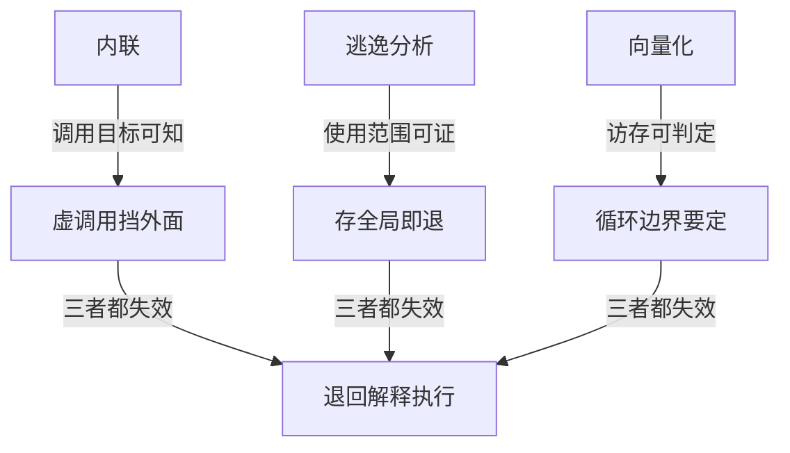
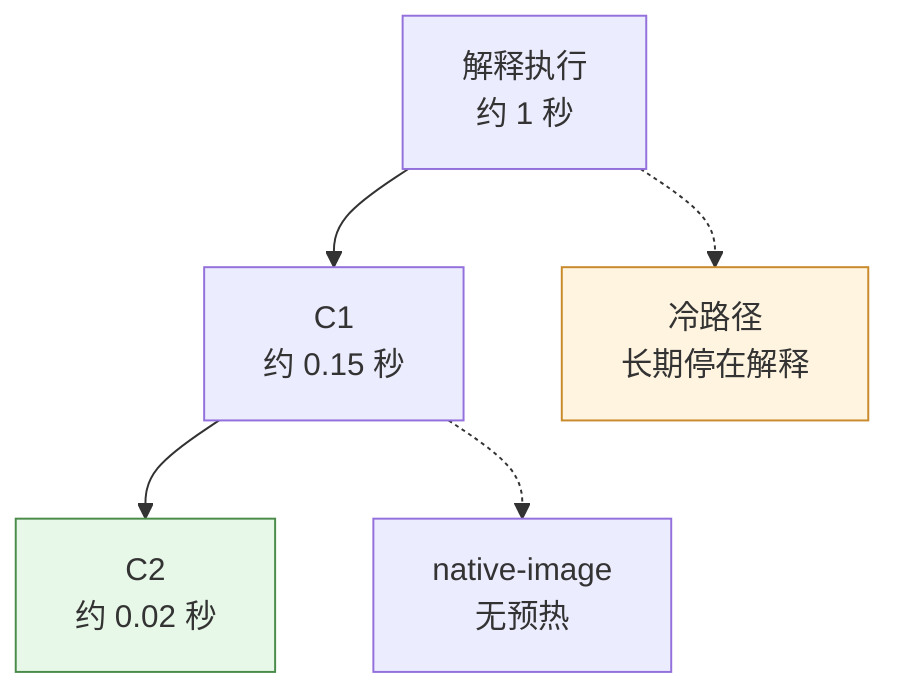

# 编译器与 JIT把源码变成可执行行为

## 要解决的问题：编译期优化与运行时优化各自靠哪些信息

**同一份源码在不同机器上的性能表现差异明显，或者服务重启之后一段时间内延迟高于稳态，而代码没有变化**。**本篇回答：编译期（代码编译成可执行文件时发生的阶段）优化与运行时优化各自依据什么信息、哪些代码路径无法被优化、预热（上线前提前加载数据或建立连接，避免初期变慢）期的延迟分布为什么不同于稳态，以及跨编译器或架构升级需要核对哪些内容**。

编译器和 JIT（Just-In-Time，即时编译：运行时把热点代码编译成机器码） 的边界是：**它们只能优化已经可见且可证明的代码路径，不能保证业务语义、外部依赖或冷启动（缓存或服务刚启动、还没有数据与连接的状态）性能**。收益是**把抽象代码变成高效指令**，代价是**构建身份、预热和可观测性复杂度增加——构建身份在「构建身份」节展开，预热在「量化锚点：预热与稳定」节展开，可观测性（优化器做了什么、做得对不对无法从源码直接看出，只能查优化记录与生成代码）在「验证」节展开**。

源码经过词法/语法分析、类型与语义检查、中间表示 IR（Intermediate Representation，编译器中间表示：源码与机器码之间的中间形式，各阶段优化都在它上面做）、优化、代码生成、链接和加载，才成为 CPU 执行的指令。解释器、AOT（提前编译：运行前就把源码全部编译成机器码）、JIT 和混合运行时，在启动速度、峰值性能、可观测性和环境依赖之间取舍。

词法分析把字符流切成记号（token）序列，语法分析再把它组织成一棵抽象语法树——源码的结构形态在优化开始前就已经定型。欧几里得算法的 AST（Abstract Syntax Tree，抽象语法树：把代码按语法结构拆成的树）长这样：


*同一表达式的抽象语法树与有向无环图：DAG（Directed Acyclic Graph，有向无环图：任务依赖关系的常用表达） 通过共享相同子树消除重复计算（图源：博客园「编译原理笔记」）*

*图源：Wikimedia Commons「Abstract syntax tree for Euclidean algorithm」，作者 npmushun，许可 [CC BY-SA 4.0](https://commons.wikimedia.org/wiki/File:Abstract_syntax_tree_for_Euclidean_algorithm.svg)。*

**同一份源码在不同机器上跑出不同性能，根源是优化所依据的信息不同**。**静态编译器只能依据编译当时可见的东西——源码、目标架构、选项；运行时编译器还多依据一份实际执行画像（哪些分支常走、哪些类型实际出现）**。**后者是动态的，因此同一份字节码在负载 A 下可能被优化得很好，在负载 B 下几乎没被优化**。**这个差别解释了为什么微基准与生产读数经常对不上：两者的画像不是同一份**。

## 它是怎么做到的，本质是什么

编译与执行之间隔着的边界，和用户态（普通程序运行的低权限受限状态）与内核态（内核代码运行的高权限状态）是同一类：看得见调用，看不见对面的实现，性能差异恰恰产生在跨过去的那一下。


静态优化依据源码与目标架构，运行时优化依据采集到的执行画像。编译产物由源码、编译器版本、选项与目标架构共同决定，运行时优化结果由实际调用次数与分支分布决定，因此同一份源码在不同环境下可以得到不同的性能表现。
## 最小编译实验怎么做

打个比方：测油耗要在同一条路线、同一箱油的前提下分开记冷车打火、热车、巡航的读数，否则分不清省的油省在哪一段。固定源码、依赖、目标架构和输入，分别测解释/AOT/JIT 的冷启动、预热、稳态吞吐、峰值延迟和产物大小；保存编译器选项、优化记录和生成代码。升级编译器或 CPU 特性时，用相同基线（正常状态下的指标水平、用来对比异常）验证功能、ABI、性能和回滚（把系统状态退回到改动之前的版本）。这个比喻只到「同一前提分开记读数」为止，各指标的定义以下文为准。

## 为什么性能会变化

好比裁缝改衣服，只能改看得见尺寸的地方：能当面量到的部位可以收腰（内联、常量折叠），寄回来的旧衣不知道主人的身形，一剪刀都不敢动（反射、动态加载对优化器不可见）。内联、逃逸分析、常量折叠、向量化、去虚拟化（把虚调用确定成直接调用）和 profile-guided 优化（PGO（Profile-Guided Optimization，按运行画像优化）：先跑一遍采集实际分支数据，再按这份数据重新优化）可能减少调用、分配和分支；但动态加载、反射、未预热路径、调试构建和不同 CPU 特性会阻止优化。

一次短 benchmark 可能主要测编译或 JIT warm-up。这个比喻只说明「可见性决定能不能改」，三道关卡的具体条件看下文。

**能被优化的路径远少于写出来的代码**。**内联要求调用目标在编译期可知——虚调用、函数指针、动态加载的类都挡在这一关外面**；**逃逸分析要求对象的使用范围可证明，一旦被存进全局结构或传给未知方法就退出**；**向量化要求循环边界与内存访问模式可判定**。**这些条件的共同点是：它们依赖编译期能看见多少东西**。**反射（程序在运行时读取和操作自身结构的机制）、动态代理、运行时生成的字节码之所以慢，它们对优化器不可见——优化器只能把看不懂的地方当成不可动的黑盒（不接触代码内部、只看输入输出的测试或分析方式），而不是因为机制本身重**。

三道关卡各卡在一种不可见上，卡住之后优化器只能把它当黑盒：



## 构建身份怎么定义

**编译器版本、目标架构、ABI、链接器、编译选项、生成代码、依赖和环境都属于产物输入**。**可执行文件能启动不代表 ABI（应用程序二进制接口：编译产物之间互相调用的二进制约定）、符号、时区、证书（CA 签发的公钥凭证、证明持有者身份）、CPU 指令集或容器运行库兼容**，兼容性的具体判据以下文与依赖类文章为准。

## 动手跑一遍会看到什么：同一份代码在三种执行形态下的差距

Java 的一段热循环，分别以解释执行、C1（快速编译）、C2（完全优化）跑，差距可以直接量出来：

被测程序 HotLoop.java：

```java
public class HotLoop {
    static long sum = 0;
    static long run(int n) {
        long s = 0;
        for (int i = 0; i < n; i++) s += i * 3 + 1;
        return s;
    }
    public static void main(String[] a) {
        for (int i = 0; i < 200; i++) sum += run(2_000_000);
        System.out.println(sum);
    }
}
```

```bash
javac HotLoop.java
java -Xint HotLoop          # 纯解释执行
java -XX:TieredStopAtLevel=1 HotLoop   # 只用 C1
java HotLoop                # 默认分层编译（C1+C2）
```

**典型读数（同一段数值循环）：解释执行约 1 秒，C1 约 0.15 秒，C2 约 0.02 秒——C2 与解释执行的差距在 50 倍量级，来源是方法内联、逃逸分析消除分配、循环展开**。JVM（Java 虚拟机，Java 程序的运行时）参数 `-XX:+PrintCompilation` 能看到每个方法在什么 tier 被编译，**第 4 层（C2）出现在热循环累计被调用约 1.5 万次之后**。

## 这些量是什么数量级：预热与稳定

预热要测的是稳态吞吐，而稳态吞吐常常卡在批量能力上。共享内存这条路径给出的答案是：一次带走一批，把跨界的次数压到最低。


*图源：腾讯云开发者社区《图解原理 Linux I/O 神器之 io_uring》，CC 4.0 BY-SA，https://cloud.tencent.cn/developer/article/2187655。*

JIT 的代价是**预热：服务重启后前几分钟 C2 还没就位，延迟分布的长尾（少数请求耗时远高于其余大部分）全在预热期**。**预热预算按 tier 触发次数对账**（默认 C2 需要累计约 1.5 万次调用），**冷路径（每分钟一次的定时任务）长期停留在解释执行——单次执行很短，优化收益覆盖不了编译成本**；按每分钟一次的频率，要累积到触发阈值**需要好几天**。**静态编译（GraalVM native-image）取消预热，代价是放弃运行时画像，峰值性能通常低于充分预热的 C2**。

三种执行形态在同一段热循环上的读数与代价对照：



图中每往下一级都更快，代价分别是编译开销与预热时间；两条虚线是阶梯之外的两种结果：冷路径够不到触发次数而长期停在解释执行，静态编译直接省掉整段爬梯但峰值通常低于 C2。

**升级编译器或 CPU 之后重新测一遍是必要的，因为优化结果依赖具体的实现与架构**：**同一份源码在新编译器上可能因为某个优化通过而变快，也可能因为某个假设不再成立而变慢**。**这类变化不会体现在源码 diff 里，只能靠固定基线的回归测试（改动后重跑旧用例、确认没有破坏既有功能）发现**。**基线要记录的因此不只是代码，还包括编译器版本、选项、目标架构与运行时版本——少记任何一项，下次的读数都无法与这次比较**。

## 怎么自己动手验证

**预热期的读数不算数，要等连续多轮的数字稳定了才记下来（收敛）**。**分别测冷启动、稳态、编译/JIT 时间和峰值**。**度量点若落在预热期内，读数会随运行时间持续变好，这编译还没完成——判断方法是看连续多轮的读数是否收敛，而不是性能提升**。**查看生成代码、优化记录、profile、系统调用（程序请求内核提供服务的入口）和业务延迟**。**跨编译器/架构升级做 ABI、功能、性能、内存和回滚回归，记录不可重现差异**。

## 接着读哪几篇：编译器版本与选项是产物身份的一部分

- [[工程知识/软件构建：让变化可以理解、验证与交付/开发工具/依赖供应链需要锁定来源与构建输入]] —— 编译器版本与选项是产物身份的一部分
- [[工程知识/性能工程：从用户等待到资源瓶颈/处理器与内存/CPU缓存与分支决定有效执行时间]] —— 微架构侧的同一笔账怎么测
- [[工程知识/软件构建：让变化可以理解、验证与交付/语言与运行时/动态链接把符号绑定推迟到装载与首次调用]] —— 流程链里「链接和加载」那一步的展开：符号绑定如何推迟到装载与首次调用
