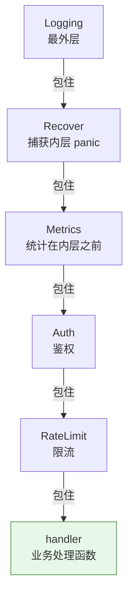
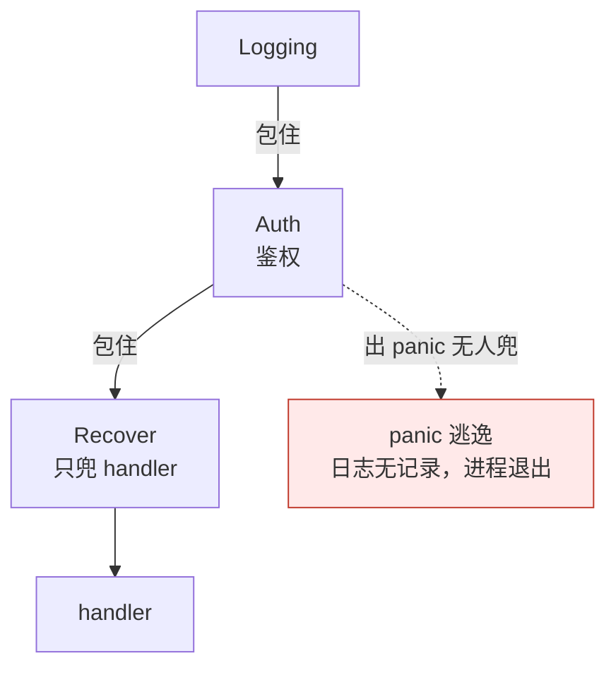
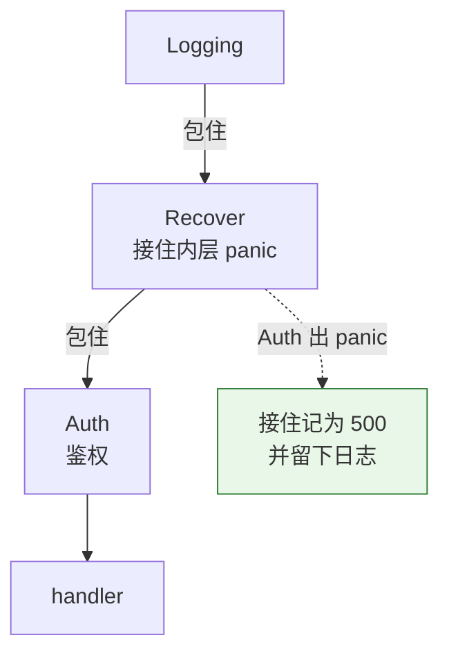
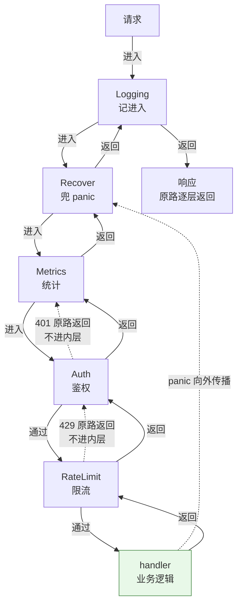

# 装饰器与中间件把横切关注点串成链

## 为什么说每个函数开头都重复十行是病：要解决的问题

**鉴权、限流（控制单位时间放进来的请求数量，超过配额就拒绝）、日志、指标、panic 兜底（panic 是 Go 的运行时异常，兜底指捕获它不让进程退出）这些逻辑散落在每个处理函数的开头和结尾**，**改动一处要同步修改多个入口，遗漏一处就出现行为不一致**。本篇回答：**这些逻辑怎样抽成可组合的链、链的顺序依据什么确定、顺序错误会造成什么后果**，以及链上不应该放哪些开销大的操作。

**读完这一篇，你能判断哪些逻辑该从业务函数里剥出去、剥出去之后各层的先后顺序该怎么定**。一句话说清它是什么：装饰器与中间件都是"给一个函数套上一层额外行为"的做法，套出来的多层连在一起就是一条链。

## 套一层到底改变了哪些东西：机制与本质

中间件（middleware：串在请求进出路径上的一段公共处理）与装饰器（decorator：给某个处理函数套一层额外行为）把横切逻辑从业务代码里剥出来，串成一条链。文中 Recover 指兜底中间件（本例装配的 WithRecover），它靠 Go 的小写内建函数 recover() 实现：Go 的运行时异常机制是 panic，recover() 捕获它不让进程退出。

**链的本质是把「一个函数」变成「一串函数」**。**可以想成洋葱：请求从最外层一层层往里钻，响应再从里往外一层层出来**，这就是下面反复出现的洋葱模型。这个比方只到「请求进、响应出的次序」为止，链上每一环怎么拿到控制权、异常怎么往外传要看正文。

这个比喻到"层次包含关系"这一步为止——洋葱能让你记住进出的方向，但"哪一层能拦住哪一层的错误"要靠下面的具体规则算。

**顺序属于这条链对调用方的承诺**：**每层中间件只能看见它外层的输入与内层的输出，顺序一变，各层看到的东西就跟着变**，整条链对外表现出的行为随之改变，所以**调用方依赖的行为里天然含着顺序**。**放在外层的中间件能拦截一切（包括内层的失败），代价是它自己的失败无人拦截**——**Recover 必须靠外正是这个道理，而它自己出了 panic 就没有更外层可兜**。**这条约束决定了顺序不能随意调整**。
## 重复的十余行长什么样：现场样本

```go
func GetUser(w http.ResponseWriter, r *http.Request) {
  start := time.Now()
  user := auth.GetUser(r)     // 1 鉴权
  if user == nil { w.WriteHeader(401); return }
  if !rateLimiter.Allow(user.ID) { // 2 限流
    w.WriteHeader(429); return
  }
  log.Infof("request %s user %s", r.URL, user.ID) // 3 日志
  defer func() {
    metrics.Observe("get_user", time.Since(start)) // 4 指标
    if err := recover(); err != nil {        // 5 兜 panic
      log.Error(err); w.WriteHeader(500)
    }
  }()
  // ... 真正的业务逻辑 3 行
}
```

**20 个 handler，同样的十余行样板重复 20 遍**。更糟的是：要给"限流"加一个例外规则，得改 20 个地方。

这些鉴权、限流、日志、指标、panic 兜底叫做**横切关注点（cross-cutting concerns）**——**它们和业务逻辑无关，但每个入口都需要**。

## 怎么把重复逻辑剥出来串成链

**剥出来的横切逻辑串成链之后，层的包含关系长这样：每一层包住它内层的全部**。这里取 Logging（日志中间件，记请求进出）最外；若更看重 panic 本身也被记录，则 Recover 与 Logging 对调——两者竞争最外层，按取舍决定，不是固定次序。**请求穿过所有层才到业务处理函数，响应按相反顺序再穿一遍**。



**包含关系决定了两件事：被外层拒绝的请求根本走不到内层**（所以日志与统计必须在被拒绝的那一层之外），**内层抛出的 panic 一定会被它外层的 Recover 接住（兜底逻辑放在鉴权内层时，鉴权自身的 panic 会逃逸）**。

**把同一组中间件换个顺序，行为差别直接体现在可观测性（通过系统对外输出判断内部状态的能力）与兜底能力上**：

顺序一是 Recover 在 Auth 内层，链路形态：



顺序二是 Recover 在 Auth 外层，链路形态：



**两张图用的是同一组中间件，差别只在 Recover 与 Auth 的相对位置**。**顺序二里 Auth 的 panic 被接住，记为 500 并留下日志；顺序一里同样的 panic 没人接住，进程直接退出**。**顺序之所以属于接口约定而非实现细节，正因为它决定失败是否被记录**，而不只是影响性能。

### 中间件靠什么包住函数

**框架把「套一层」做成了标准件**：**每个中间件是一个接收下一个处理步骤并返回一个新处理步骤的函数，注册顺序即执行顺序，最内层的处理函数才是业务本身**。ASP.NET Core 官方文档给出的管道图把这条链画成了一个一个套起来的环——请求由外向内穿，响应由内向外走：


*图源：Microsoft Learn 中文文档《ASP.NET Core 中间件》，MIT，https://learn.microsoft.com/zh-cn/aspnet/core/fundamentals/middleware/。**请求与响应走同一条链但方向相反**，因此**「日志写在 next 之前还是之后」决定了记录的是进入时间还是耗时，顺序为什么重要在图上直接可见**。*

```go
type Middleware func(http.Handler) http.Handler

func WithAuth(next http.Handler) http.Handler {
  return http.HandlerFunc(func(w http.ResponseWriter, r *http.Request) {
    user := auth.GetUser(r)
    if user == nil { w.WriteHeader(401); return }
    next.ServeHTTP(w, r.WithContext(ctxWithUser(r.Context(), user)))
  })
}

func WithRateLimit(next http.Handler) http.Handler { /* ... */ }
func WithLogging(next http.Handler) http.Handler  { /* ... */ }
```

装配时把中间件按上面的次序串起来，写法是：

```go
handler := chain(GetUserHandler,
  WithLogging, WithRecover, WithMetrics, WithAuth, WithRateLimit)
```

改造后 handler 里只剩业务逻辑：

```go
func GetUser(w http.ResponseWriter, r *http.Request) {
  user := auth.FromContext(r.Context())
  // 3 行业务逻辑
}
```

### 顺序为什么重要又容易错

链的执行是**洋葱模型**，请求从最外层逐层进入，响应再按相反顺序逐层返回：



**进入与返回共用同一批节点，只是方向相反——这就是洋葱模型**。**前两条虚线是短路（鉴权失败 401、限流拒绝 429）：被拒绝的请求不进入内层，沿原路逐层返回**，**这也是 Logging 与 Metrics 必须靠外的原因，否则 401 和 429 不会留下任何记录**。第三条虚线方向相反：**panic 由内层（handler）向外传播，被 Recover 捕获，是异常传播不是短路**。

几条默认的顺序规则（Recover 与 Logging 竞争最外层，按取舍决定）：

| 规则 | 原因 |
| --- | --- |
| `Recover` 尽量靠外 | **才能捕获内层所有中间件和 handler 的 panic** |
| `Logging`/`Metrics` 靠外 | **才能记录被 `Auth` 拒绝的请求（401 也要有日志）** |
| `Auth` 在 `RateLimit` 之前 | **限流通常按用户维度，需要先知道是谁** |
| 超时中间件尽量靠外 | **才能给整条链设总时限**（本例未装配，实践中与 Recover 争最外层，按需要二选一） |

**顺序错了不会报错，但行为会悄悄不对**——**比如 `Auth` 放在 `Recover` 外面，鉴权里的 panic 就没人兜**。

### 装饰器和中间件差在哪

**两者是同一个思想，差别只在粒度与作用对象**：

| | 装饰器 | 中间件 |
| --- | --- | --- |
| 作用对象 | 任意对象/函数 | 通常是请求处理链 |
| 典型场景 | 给 Reader 加压缩、加密、缓冲 | HTTP/gRPC 的横切逻辑 |
| 组合方式 | `NewGzipReader(NewEncryptReader(f))` | `chain(handler, mw1, mw2)` |

下面是装饰器模式的类图：`Decorator` 与 `ConcreteComponent` 实现同一个 `Component` 接口，`Decorator` 内部持有一个 `Component`，**调用时转发给内层对象并附加自身的行为——包装多少层，行为就叠加多少层**：


来源：[CSDN @bjmayor《图解分布式事务模式》](https://bjmayor.blog.csdn.net/article/details/154004146)（CC 4.0 BY-SA）

**`ConcreteComponent` 不知道自己被谁包装，`Decorator` 也不关心内层是基础对象还是另一层包装**，**两层解耦正是层层嵌套能够成立的原因**。

**装饰器的经典例子是 I/O 流的层层包装**：

```go
r := bufio.NewReader(    // 加缓冲
   gzip.NewReader(    // 解压
   file))         // 原始文件
```

## 换来什么、要付出什么：效果与代价

**收益**

- **横切逻辑一处修改，全局生效**：**改限流规则只改一个文件**
- **业务代码干净**：**handler 里只有业务逻辑，可读性大幅提升**
- **可组合**：**不同路由可以用不同的中间件组合（比如管理后台多加一层审计）**

**链上的横切关注点不止进程内一层**。同样的「给主调用套一层额外行为」在部署形态上有两个直接对应物：Ambassador（大使服务，替主容器处理对外调用的横切逻辑）包住对外的每次远程调用，**重试、鉴权、限流这些「出站横切逻辑」从业务代码里剥到旁路（绕开主流程的备用路径）容器**：


*图源：Microsoft Learn《Ambassador pattern》，CC BY 4.0，https://learn.microsoft.com/en-us/azure/architecture/patterns/ambassador。**对内是一条中间件链，对外这条链长成独立进程，处理的关注点同源**。*

Sidecar（边车模式，辅助容器与主容器同生共死）**则包住进出的通用流量，语言运行时无关——同一份代理配置，Java 与 Go 的服务都能套用**：


*图源：Microsoft Learn《Sidecar pattern》，CC BY 4.0，https://learn.microsoft.com/en-us/azure/architecture/patterns/sidecar。*

**代价**

- **执行路径变隐式**：看 handler 代码不知道它外面包了几层。**排查问题时要知道整条链是什么**
- **调用栈变深**：**10 层中间件意味着 panic 的调用栈有 10 层噪音**
- **上下文传递靠 context**：**中间件之间的数据传递依赖 `context.Context`（Go 里随请求携带取消信号与键值对的上下文对象，沿调用链传入）**，**滥用会变成隐式的全局状态**
- **顺序 bug 难发现**：前面说的，顺序错了不报错

## 动手时该从哪一步开始：先做哪件事

**第一步：找出每个入口都重复的代码**

**搜 handler 的开头和结尾，找重复出现的样板**。**3 个以上 handler 都有的，就该抽成中间件。**

**第二步：先抽最稳的三个**

`Recover`、`Logging`、`Metrics`——**这三个几乎每个服务都需要，且逻辑稳定。先做这三个，立刻见效**。

**第三步：明确链的顺序，并写在注释里**

```go
// 顺序：Logging(最外) → Recover → Metrics → Auth → RateLimit → handler
// Recover 必须在 Auth 外层，才能兜住鉴权的 panic
```

**第四步：不要在中间件里做重活**

**中间件在每个请求上都跑。里面做数据库查询、远程调用会显著增加延迟**。**需要的数据尽量在进入时就解析好放 context。**

**第五步：给中间件加开关**

**某些环境（比如健康检查、静态资源）不需要完整链**。**支持按路由跳过中间件**，避免健康检查也要过鉴权。

洋葱模型有一个容易被忽略的推论：**同一个中间件会看到两次请求**——进入时一次，返回时一次。**写在 `next.ServeHTTP` 之前的代码属于进入阶段，写在之后的代码属于返回阶段**。**这既是能力（计时、统计响应码要写在后面），也是陷阱（把只该执行一次的动作写在前面，会在每次重试或内部转发时重复执行）**。

## 哪几种写法一定出问题

**错误 1：中间件里写响应但不 return**

```go
func WithAuth(next http.Handler) http.Handler {
  return http.HandlerFunc(func(w http.ResponseWriter, r *http.Request) {
    user, ok := auth.Verify(r)  // 从鉴权服务取当前用户
    if !ok { w.WriteHeader(401) }  // 没 return！
    next.ServeHTTP(w, r)       // 继续往下走了
  })
}
```

这是最常见的 bug：**返回了 401 但请求继续处理**，业务逻辑照常执行。

**错误 2：滥用 context 传数据**

**往 context 里塞十几个值，中间件和 handler 隐式耦合**。**只放真正跨层需要的东西**（用户身份、trace_id（链路编号，串联一次请求跨服务的调用链）——分布式追踪的链路标识）、request_id。

**错误 3：中间件顺序依赖没文档**

**半年后有人加了一个中间件放在最外层，把 Recover 挤到里面——panic 开始逃逸**。**在装配处写明顺序和原因。**

**错误 4：所有路由套同一条链**

**健康检查也要过鉴权、过限流，导致监控系统拿不到响应**。**按路由分组装配。** 中间件链运行在一个个容器进程里，健康检查探针（向系统注入的检测点或检测请求）与业务流量在同一条链上排队时，**探针读到的就是业务链路的拥堵程度**：


*图源：Wikimedia Commons，DaniloBarros，CC BY-SA 4.0，https://commons.wikimedia.org/wiki/File:Docker_Installation_Overview.png。*

**错误 5：装饰器嵌套过深**

`A(B(C(D(E(f)))))` —— **5 层以上就该考虑用配置化的 pipeline 而不是手写嵌套**。

## 想自己验一遍怎么动手：验证

**最小验证：在链上加一个什么都不做的新中间件，断言业务 handler 零改动**；**再断言移除它后行为完全不变，以此确认横切逻辑确实被关在链上而非散在 handler 里**。

**顺序验证：断言鉴权中间件排在限流之前——顺序错了，未鉴权的请求会先占用限流配额**。

**职责对账：抽查请求轨迹，预期链上每个关注点只出现一层**；**同一关注点在装饰器与中间件各记一遍，与预期对不上就合并或删除那一层**。

**对账规则：统计横切逻辑在 handler 内的重复次数，改造成链之后重复应归零；仍有残留说明剥离不完整**。

## 这套链式做法在哪儿会失效：边界

- **链的执行顺序依赖装配而不是类型系统：顺序写错时编译与运行都不报错，行为却已经改变**。
- **panic 的兜底范围取决于位置：兜底逻辑放在鉴权内层时，鉴权自身的 panic 会逃逸**。
- **链路越深排查越费力：panic 栈里混入每层中间件的帧，定位原始位置需要在栈中找到业务帧**。
- **跨层传值依赖请求上下文：放入的键值对越多，中间件与处理函数之间的隐式耦合越强**。
- 中间件在每个请求上执行：**把数据库查询或远程调用放进去，会让所有请求都承担这份开销**。

以下情况不该建链：**横切逻辑只有一处使用时，抽成中间件只是把代码挪远**；**执行顺序没有约束要求时，链带来的顺序隐式化是纯粹的负担**；**团队规模小、所有人都能看到全部调用路径时，显式写在 handler 里反而更容易排查**。

## 接着读哪几篇：横切关注点之外的另一类变化点

- [[工程知识/软件构建：让变化可以理解、验证与交付/架构与代码/设计模式解决的是变化点的隔离]] —— 横切关注点之外的另一类变化点
- [[工程知识/软件构建：让变化可以理解、验证与交付/架构与代码/观察者与事件解耦发布者与订阅者]] —— 同样是解耦，作用在处理完成之后的通知环节