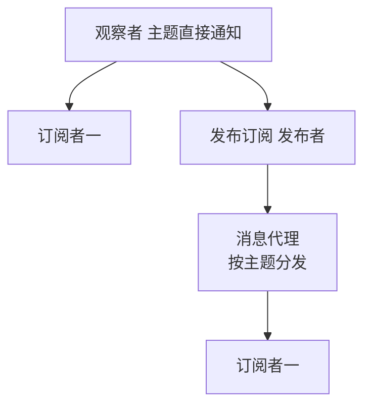
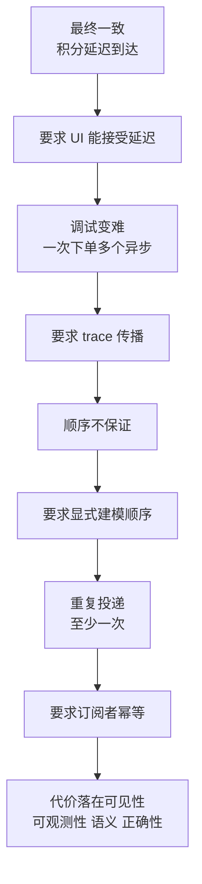
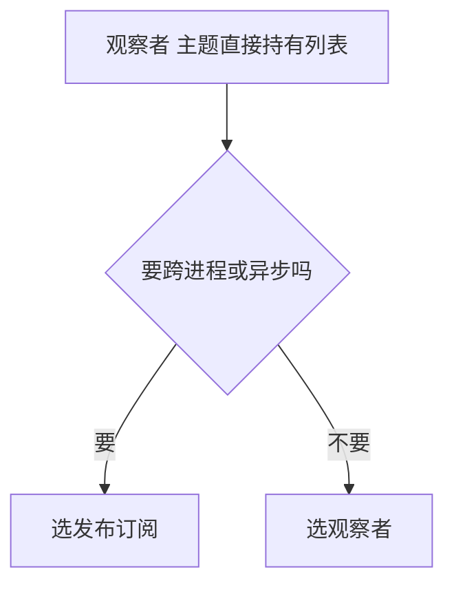

# 观察者与事件解耦发布者与订阅者

## 要解决的问题：事件与业务写入之间怎样获得同一份提交结果

**一次下单之后要触发通知、积分、索引与仓库等多个动作，把它们依次写在主流程里会让下单耗时随动作数量增长，任一环节故障都会影响下单**。本篇回答：**事件与业务写入之间怎样获得同一份提交结果、订阅者为什么必须幂等（同一个操作执行一次和执行多次的结果相同，重复执行不会产生额外副作用）**、**事件结构演进与顺序要求如何表达，以及消费侧的哪些指标能说明出了故障**。


## 它是怎么做到的

**发布者只记录事实，订阅者各自决定如何处理，两者之间通过事件格式与投递语义连接**。业务提交与事件发出分属两个系统，**把事件先写入业务事务之内的表中再由后台投递，使两者获得同一份提交结果**；**投递语义为至少一次（at-least-once：同一条消息可能被投递多次，保证不丢但允许重复）时，重复消费的消除责任由每个订阅者承担**。


来源：[腾讯云开发者社区《消息队列：听我解释，我真的不是只有Kafka！》](https://cloud.tencent.com.cn/developer/article/1866156)（CC 4.0 BY-SA）

## 这件事发生在什么场景：一个下单要改 6 个地方

**下单成功后要做：发短信、加积分、更新推荐模型、通知仓库、写分析事件、给用户发优惠券**。

**最初的实现是在下单函数里顺序调用**：

```go
func PlaceOrder(o Order) error {
    if err := repo.Save(o); err != nil { return err }
    sms.Send(o)          // 1
    points.Add(o)        // 2
    recommend.Update(o)  // 3
    warehouse.Notify(o)  // 4
    analytics.Track(o)   // 5
    coupon.Grant(o)      // 6
    return nil
}
```

这个实现随时间暴露出三个问题：

1. **下单接口的延迟 = 6 个操作之和**。分析服务慢 500ms，用户就多等 500ms
2. **任何一步失败都会影响下单**。优惠券服务挂了，用户下不了单——但它们本该无关
3. **每加一个后续动作都要改下单代码并重新部署**

## 方案是什么：发布事件，而不是调用函数

下单只做一件事：**保存订单 + 发布"订单已创建"事件。**

```go
func PlaceOrder(o Order) error {
    return tx.Run(func(ctx Context) error {
        if err := repo.Save(ctx, o); err != nil { return err }
        return outbox.Publish(ctx, OrderCreated{Order: o})  // 与业务同事务
    })
}
```

**各个后续动作变成独立订阅者，各自处理**。

**类的结构决定了这种解耦可以成立：发布者只认识一个订阅者接口，具体订阅者随便加**：


来源：Refactoring Guru「Observer」模式页（官方教学插图，作者 Alexander Shvets）。图上 Publisher 只依赖 Subscriber 这个接口、不依赖任何 ConcreteSubscribers，「加第 7 个后续动作只加一个类」的收益就落在这个结构上；Client 负责把订阅者注册进发布者，对应 Go 实现里向观察者列表追加的动作。

### 该选同步还是异步：怎么定

| 方式 | 实现 | 适用 | 代价 |
| --- | --- | --- | --- |
| 进程内同步 | 观察者列表，依次调用 | **同一进程、必须立即完成** | **耦合仍在进程内；一个慢全慢** |
| 进程内异步 | 事件循环 / channel | **同进程、可容忍延迟** | **进程重启丢事件** |
| 消息队列 | Kafka（分布式消息队列：靠日志追加支撑高吞吐的发布订阅） / RabbitMQ | **跨服务、需要可靠性** | **运维复杂度、最终一致** |

**默认选消息队列（生产者写入、消费者读取的缓冲中间层）**，因为"下单"这种核心流程的后续动作几乎都不该阻塞主流程。

消息队列那一格画成拓扑，就是微软 Azure 架构中心给出的这五件套：**Publisher 发出即返回，Message Broker 居中按通道分发，三个 Subscriber 各自订阅各自的输出通道**——**发布者不知道订阅者是谁，扩到第 N 个订阅者也只是一条配置**：


*图源：Microsoft Learn《Publisher-Subscriber pattern》，CC BY 4.0，https://learn.microsoft.com/en-us/azure/architecture/patterns/publisher-subscriber。*

三种方式对应的是"发布者要不要知道订阅者是谁"这条分界线，画成拓扑就是中间那层从无到有：



左边那张对应进程内同步的观察者列表：**主题依次调用，一个订阅者慢下来会拖住其余，调用栈也是连着的**。右边多出来的代理层把"谁发的"和"谁收的"分开，发布者发出即返回，**代价是要额外维护一个组件，并且交付变成最终一致**。

对照参考中文资料：[观察者模式（维基百科中文）](https://zh.wikipedia.org/wiki/%E8%A7%82%E5%AF%9F%E8%80%85%E6%A8%A1%E5%BC%8F)、[发布订阅模式和观察者模式（CSDN）](https://blog.csdn.net/u013380694/article/details/161048253)。

### 怎么用 Outbox 保证不丢事件

**直接发消息有个经典问题——两步不在一个事务里，中间崩掉就两头不认**：

```go
repo.Save(o)          // 成功
mq.Publish(event)     // 失败 → 订单存在但没人收到通知
```

因为这个原因，正确做法是 **Outbox（发件箱模式：业务数据与待发事件同库落盘、再异步投递，保证不丢） 模式**：**事件先写进数据库表（和业务在同一个事务里），由后台任务读表发消息**。

```
事务内：INSERT orders + INSERT outbox(event)
事务提交后：poller 读 outbox → 发消息 → 标记已发
```

这样"业务成功"和"事件会被发出"是原子的。代价是多一张表和一次轮询延迟。

## 效果从哪儿来，要付什么代价

**收益**

- **下单延迟与后续动作解耦**：**从 6 个操作之和降到 1 次写库 + 1 次写 outbox**
- **故障隔离**：**优惠券服务挂了，下单照常成功，优惠券稍后补发**
- **开闭原则**：**加第 7 个后续动作，只加一个订阅者，下单代码零改动**

**代价**

- **最终一致**：**用户下完单，积分可能 200ms 后才到**。**UI（User Interface，用户界面）要能接受这个延迟**
- **调试变难**：**一次下单引发 6 个异步流程，出问题要跨服务追踪**。**必须有 trace 传播**（把一次请求在各服务间的调用关系用同一个追踪标识串起来，才能跨服务定位）
- **顺序问题**：**多个订阅者的处理顺序不保证。如果有依赖关系，需要显式建模或分区保证顺序**
- **重复投递**：消息至少投递一次，**所有订阅者必须幂等**

**这四条代价各自对应一条不能省的工程要求**，对应关系见下图：



**四条里只有第一条是用户能直接感知的——最终一致表现为积分延迟到账，UI 要能接受**。**后三条都是工程侧的要求，其中第二条决定了出问题时能不能定位**：一次下单引发 6 个异步流程，**没有把各服务调用关系串起来的追踪标识，跨服务排查无从下手**。**第四条最硬：消息至少投递一次，所以幂等订阅者的准入条件，而不是优化项**。

## 从哪些地方做

**第一步：找到"一个动作触发多个后续"的地方**

**搜代码里连续调用 ≥3 个不相关服务的函数。这些是事件化的候选**。

**第二步：先做 Outbox，再独立出订阅者**

**不要直接 `mq.Publish`。先保证事件不丢，再谈解耦。顺序反了会出数据问题**。

**第三步：所有订阅者必须幂等**

**至少一次投递意味着可能重复消费。用 `event_id` 做去重**：

```go
if consumed(event.ID) { return nil }   // 已处理过，跳过
process(event)
markConsumed(event.ID)                  // 与 process 同事务
```

**第四步：给事件加版本号**

**事件结构会演进。加 `version` 字段，让消费者能处理新旧格式**：

```json
{ "type": "order.created", "version": 2, "data": {...} }
```

**第五步：监控消费延迟和积压**

**最少三个指标：队列积压数、消费延迟 P99（99 分位延迟：99% 的消息快于这个值）、死信队列（多次消费失败的消息转入的兜底队列）大小**。**积压上涨通常意味着某个订阅者挂了或变慢。**

Outbox 解决了"事件不丢"，没有解决"事件不重"。**后台投递在发出消息之后、标记已发之前崩溃，同一条事件会被再发一次——这是常态，所以投递语义只能承诺至少一次**。**去重只能落在每个订阅者身上：发布侧关不掉重复，因为投递语义本身就允许重发**。

## 有哪些常见错误

**错误 1：用事件做同步调用**

**发布事件后等结果——那还不如直接调用**。**事件化的前提是"不关心何时完成"。**

**错误 2：事件里塞整个实体**

**把完整订单对象放进事件，订阅者依赖了所有字段。字段一改，所有订阅者都要改**。**只放订阅者需要的字段 + ID。**

**错误 3：没有死信队列**

**消费者一直失败的消息会阻塞队列**。**必须有 DLQ（死信队列，存放反复投递仍失败的消息的专用队列），把反复失败的消息移出去人工处理**。

**错误 4：忽略顺序要求**

"订单创建"和"订单取消"可能乱序到达。如果业务有顺序依赖，**用同一个分区键**（订单 ID）：相同分区键的消息进同一个分区，而分区内保证先进先出，因此同一订单的事件按发出顺序被消费。

**错误 5：把事件当成数据库读取替代**

**订阅者不存自己的数据，每次都去查原服务——又耦合回去了**。**订阅者应该维护自己的读模型**（read model：订阅者自己存一份按查询需要组织好的数据副本，而不是每次回头查原服务）。

## 怎么自己动手验证



**两种模式的差别集中在有没有中间这一层**：


**对账规则：发布 N 次事件后核对每个订阅者的处理计数（含失败与重试），多消费或少消费都与发布次数对不上，说明订阅端有静默失败或重复注册**。

**最小验证：在下单流程中人为让事件发布失败，断言业务事务回滚（把系统状态退回到改动之前的版本）或事件在补偿后仍被发出**，**不出现订单已存在而下游始终收不到通知的状态**。**让一个订阅者故意重复消费同一条事件，断言业务事实只被写入一次**。

**积压验证：暂停一个订阅者，断言队列积压与消费延迟指标上涨，恢复后断言积压回落，且没有消息被丢弃或重回主队列**。

## 接着读哪几篇：同一类变化点隔离思路的更一般形式

- [[工程知识/软件构建：让变化可以理解、验证与交付/架构与代码/设计模式解决的是变化点的隔离]] —— 同一类变化点隔离思路的更一般形式
- [[工程知识/数据系统：在并发与故障中保存事实/事务与存储/事务边界应覆盖完整业务用例]] —— Outbox 所依赖的事务边界约定
