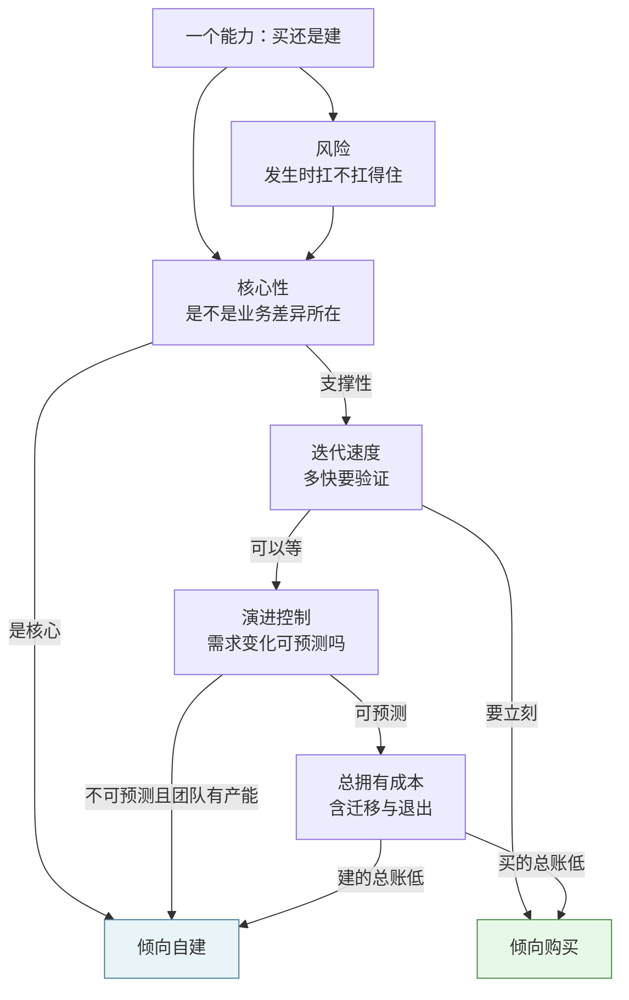
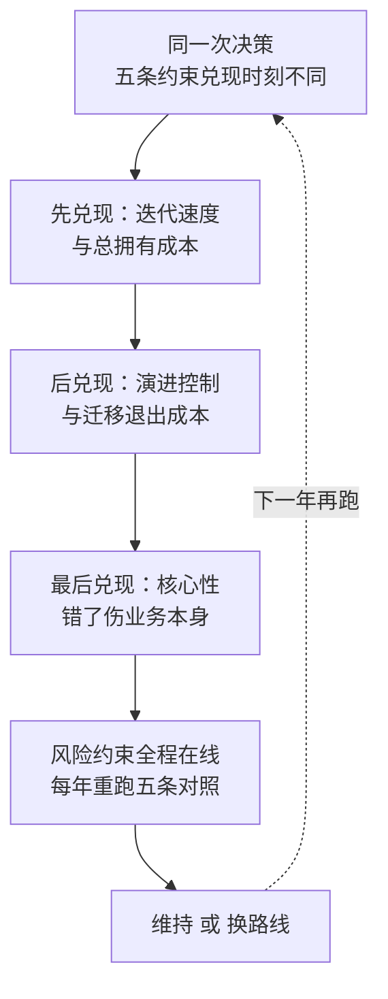

# 购买与自建的决策框架：每条约束都摆上桌面

## 要解决的问题

购买与自建要解决的问题，是在"用现成的东西快速起步"和"自己掌控关键能力"之间做可审计的决策。这里说的可审计，是**把五条约束的清单、每条的对照结论与依据留下来，事后能回答"当时为什么这么选"——决策依据可复查，而不是只留一个结论**。拍脑袋的结果两头都是坑：买了贵的，功能对不上、迁移困难，发现时钱已花掉；自建了不该自建的，走上漫长维护黑洞，最初解决的问题反而被淡忘。**这个决策的机制本质是把需求整理成约束清单，逐条对照买方与建方的真实满足度，让权衡显式化**。

**图是一棵分层初判的树，不是最终结论：走到"自建"或"购买"只是倾向，五条约束仍要全部对照一遍再定**——核心性上判定为核心，不等于可以忽略迁移成本。风险约束画在最前面，是因为它要对每一条反问"**这个风险发生时扛不扛得住**"。

## 决策骨架要把哪五条约束摆上桌

购买与自建要走五条约束逐条对照的决策，见下图：

1. **核心性约束**。这个能力是不是业务的差异化所在？**是核心（推荐算法之于内容平台、撮合引擎之于交易所）则自建倾向重，因为外部方案通常按行业平均需求设计，差异化无处安放**。是支撑性（登录、支付、邮件）则购买倾向重，因为各家需求趋同，外部产品已经过大量用户的打磨。
2. **迭代速度约束**。需要多快验证？购买当天可用，自建以周/月计。**验证期业务（新方向试错）买比建显著更快，先用买的跑通商业模式，确认后要不要自建再议**。
3. **演进控制约束**。需求会怎么变？购买锁定在供应商的演进路线上（roadmap 由别人定），自建锁定在自己的团队产能上。**需求变化快且方向不可预测时，供应商路线图会频繁对不上；但自建的"演进自由"要拿团队长期产能来换**。
4. **总拥有成本约束**。购买的成本是订阅费 + 集成成本 + 迁移成本（离开时的），自建的成本是开发 + 运维 + 机会成本（团队没去做的事）。**两边都按全周期账算。购买便宜的标价配上天价迁移成本，总账可以高过自建——标价只是全周期账里最显眼的那一笔**。
5. **风险约束**。这里的"上游"指所用开源项目的官方主线。供应商倒闭/停服/改价的单点风险 vs 自建团队流失/能力断层的单点风险。**风险看"发生时你能不能扛"，有没有倒在其次**。依赖供应链要锁定来源与构建输入（见 [[工程知识/软件构建：让变化可以理解、验证与交付/开发工具/依赖供应链需要锁定来源与构建输入.md]]），**把供应商风险做成可审计的供应链问题**。

五条约束逐条对照的官方决策形态，Microsoft Learn 的计算服务选择决策树是一个现成的参照：每一问对应一条约束（要完全控制吗、要托管吗、要全部编排能力吗），每个答案分支通向一个明确的选型，**判断停在第一个不满足的约束上——购买与自建的对照表同构，约束问完，结论落在表上**：

*图源：[Microsoft Learn《Azure 计算服务决策树》](https://learn.microsoft.com/zh-cn/azure/architecture/guide/technology-choices/compute-decision-tree)，CC BY 4.0。*

## 它从哪儿来，要付什么代价

这个框架的思想背景是"工具决策是架构决策"，替代的旧做法是两个极端：技术驱动派（"这东西有技术能力就能自己写"——忽视维护黑洞）与采购驱动派（"现成的便宜"——忽视锁定与总账）。**框架的立场是把这个决策从个人偏好拉回工程审计**。

**核心性约束排第一**。多数框架把成本排第一，钱最有说服力；但**成本是短周期账，核心性是长周期账——买错了支撑件可以换，买错了核心件伤的是业务本身**。把核心性放第一，**强制决策者先回答"这是不是我的命"再谈钱**。代价：五条约束要维护。供应商的路线图、团队的产能、迁移成本都在变，**这个决策每年要重跑，属于审计动作**。

## 动手跑一遍会看到什么：决策表的实录

"要不要自建消息队列（生产者写入、消费者读取的缓冲中间层）"的决策表（约束全上桌面）如下：

| 约束维度 | 买（用开源/云服务） | 自建 |
| --- | --- | --- |
| 功能覆盖 | 开箱约九成 | 开箱从零，余下需自补 |
| 运维责任 | 云服务归厂商 / 自托管归自己 | 全归自己（24h 值班） |
| 定制自由度 | 受限于扩展点 | 完全自由 |
| 团队学习曲线 | 文档与社区现成 | 全部自己积累 |
| 长期演进 | 跟随上游（被动但省力） | 自己背（主动但昂贵） |
| 退出成本 | 数据迁移即可（可达，但仍有工时） | 沉没：已投入的研发无法收回，且没有外部改进输入 |

判定规则是框架的输出形态，见下图：

- 约束里出现"需要上游没有的能力且是核心业务差异点"，倾向自建
- 约束里全是"通用场景 + 团队规模有限"，倾向买
- 模糊地带，先买后评（买的退出成本低于自建的沉没成本）

自建理由不成立的实录——"开源的性能不够"触发自建，两年后复盘发现**当时的性能瓶颈其实在调用方（使用姿势问题），开源版本升级后差距归零，自建版维护吞掉两个编制**；反向实录——核心业务（计费）对投递语义有上游不支持的精确要求（例如要求恰好一次投递，而非至少一次），**自建后这个约束被完整满足，差异化优势成立**。判定回头的成本实录：买错再换的成本是迁移（周级），自建错的成本是沉没（年级）——**框架里"退出成本"一栏的权重经常被低估，评估时把两条退出路径各写一遍（迁去哪、谁来迁、数据怎么搬），写不出来的自建方案等于没有退路**。同一决策纪律在模型域的形态见 [[工程知识/AI 系统工程：从模型能力到生产能力/模型与上下文/预训练、后训练、RAG与工具改变不同层次.md]] 的四层杠杆成本表。

「能回头的增量投入」的实物原型是石笼墙：挡土墙工程里，土坡支护用铁丝网笼装石头垒成——材料随时可以拆开重装，墙体按水势分期加高，没有一道工序是不可撤销的浇筑：

*图源：Wikimedia Commons，作者 Encik Tekateki，CC0，https://commons.wikimedia.org/wiki/File:Gabion_Wall.jpg。*

购买与自建的选择放在这个谱系上读就直观：**买是石笼——不合适就拆掉迁走，损失的是搬运费；自建浇成桥墩——改主意的代价是把整段作废重来**。五条约束里「退出成本」那一栏，**问的正是你要的究竟是石笼还是浇筑**。

## 这套说法在哪儿会失效

- **这个框架不适用于个人项目与原型验证**。个人项目无采购流程无长期产能约束，**五条约束里四条失效，直接用最快能跑起来的方案**。
- **"购买"的谱系比想象宽**。SaaS（Software as a Service，软件即服务：供应商把现成软件跑在云上，你按订阅使用，数据也存在对方那里）、开源自部署、云托管开源、纯商业闭源，四种"买"的锁定程度完全不同。**开源自部署的迁移成本接近自建（都受你控制），闭源 SaaS 的迁移成本最重。谱系要展开对照，不能拿"买"一个字带过**。
- **混合形态是常态**。**核心自建 + 边缘购买是多数成熟公司的实际形态，决策粒度到"能力子域"（支付网关自建、清结算买），不是到"系统"**。
- **架构决策的演进边界**：这框架本身也是演进物，重跑审计时若发现某条约束失重（如供应商生态成熟到趋同），**对应约束可以降权**，见 [[工程知识/软件构建：让变化可以理解、验证与交付/架构与代码/架构组织高成本决策与演进边界.md]]。

## 怎么自己动手验证

五条约束不是在同一时刻兑现的：迭代速度与总拥有成本先兑现，演进控制与迁移退出成本后兑现，核心性最后兑现——把它们摆到一条时间轴上，再补上每年重跑的回路。

时间轴从「同一次决策」出发，沿「维持 或 换路线」收口，收口后下一年回到起点重跑。**先兑现的那两挡最容易主导决策，而排在最后的核心性才是错不起的那一挡，所以这条时间轴要配一次年度重跑才闭环**。

- **回溯验证**：拿一个已做的购买/自建决策回放，用五条约束重新对照，预期结论一致或找到当初漏掉的约束。**对不上就停下查：是当初信息不全还是约束权重错了**。
- **年度审计验证**：每个"购买"决策每年重跑一次五条对照（供应商还在演进吗、迁移成本涨了吗），自建决策重跑产能对照（团队还在吗、能力还在吗）。预期审计有记录可查，**长期不审计的依赖是隐性风险**。
- **数据支撑**：迁移成本不用拍，**拿一次真实迁移的工时回推（从决定迁移到新系统承接全部流量），下次决策有真实数字可用**。

## 接着读哪几篇：购买路线的供应链风险治理

- [[工程知识/软件构建：让变化可以理解、验证与交付/开发工具/依赖供应链需要锁定来源与构建输入.md]] —— 购买路线的供应链风险治理
- [[工程知识/软件构建：让变化可以理解、验证与交付/架构与代码/架构组织高成本决策与演进边界.md]] —— 架构决策的组织视角
- [[工程知识/AI 系统工程：从模型能力到生产能力/生态与选型/精调与RAG的边界：什么时候微调更划算.md]] —— 选型决策的同族方法
- [[工程知识/软件构建：让变化可以理解、验证与交付/架构与代码/架构适应度函数：把架构约束写成可执行检查.md]] —— 选型边界是适应度函数的一类检查物
