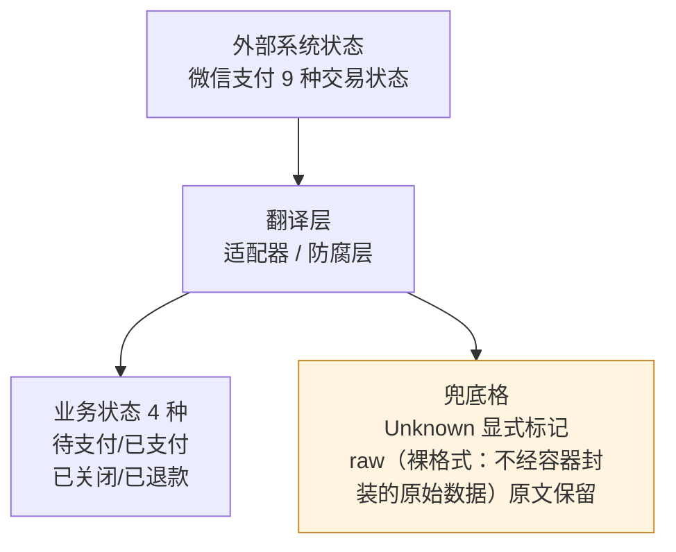
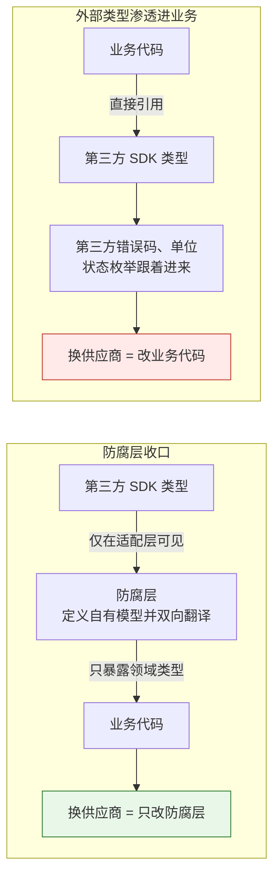
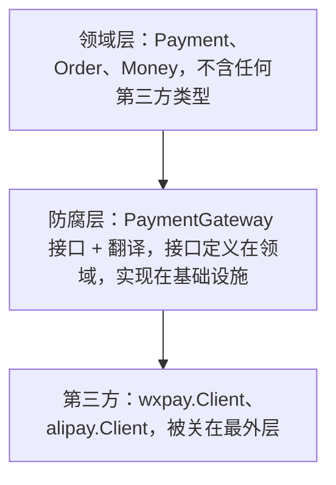

# 适配器与防腐层隔离外部模型

## 外部类型渗进业务代码怎么办：要解决的问题

**接入外部服务之后，第三方的类型与术语出现在业务代码各处，单位转换与状态映射散落在多个文件，更换供应商需要改动业务逻辑本身**。本篇回答：**接口应当在哪一侧定义、翻译集中在哪里、第三方状态多于自有状态时如何映射、丢失的信息怎样保留，以及什么情况下不值得增加这一层**。

**出国旅游的插头转接头是这个问题最小的生活版**：**外国的插座制式（第三方接口）与你的电器插头（业务模型）形状不同，转接头（翻译层）插在中间，电器一个不用改**；**要是把每台电器都换掉插头（第三方类型渗进业务代码），换一个国家就得全部返工**。**比喻到「转接头隔离形状」为止：转接头只管插头形状，电压制式不符（概念模型不同）它管不了，那是防腐层的活**。

读完这一篇，你能判断自己的项目该不该加这层、加的话翻译放在哪个位置。一句话说清它是什么：**在业务模型和外部系统之间加一层专门做翻译的代码，让外部的东西进不来、业务的改动传不出去**。

## 翻译层到底改变了哪些东西：机制与本质

翻译层做的 ACL（Anti-Corruption Layer，防腐层：把外部模型的状态压成业务需要的形状）**把外部的一堆状态压成业务需要的几个状态，不做逐项搬运**——**压掉的那部分就是信息丢失的位置，也是要显式兜底的位置**。**可以把它想成入境时的海关：外面的货物什么样它不管，过检之后一律换成境内通行的规格和标签再流通**。这个比方只到「压掉的那部分就是信息丢失的位置」为止，丢失的部分怎么显式兜底要看正文。

这个比喻到"谁承担转换成本"为止——海关挡住了外部规格的渗入，但代价是每批货都要多走一道手续，翻译层也是每次调用都要多算一遍，这笔开销省不掉。



**状态数变少意味着必然有外部状态落在业务状态之外**；没有 Unknown（未知：留给"认不出的状态"的兜底枚举值）这一格，那些状态就只能被硬塞进某个业务状态，静默错账由此产生。

**外部系统的类型、术语与约束随供应商变化，业务模型随业务语义变化，把两者直接相连时任何一侧的改动都会传导到另一侧**。**适配器与防腐层在两者之间建立一层翻译，接口定义在业务侧、实现放在最外层，使外部系统的改动被限制在翻译层内部，业务代码只依赖自己的模型**。


图取自 [AWS（Amazon Web Services，亚马逊云服务） 官方示例仓库 anti-corruption-layer-pattern](https://github.com/aws-samples/anti-corruption-layer-pattern)，1713×730，AWS Samples 依据 MIT-0（MIT No Attribution，无需署名的 MIT 许可证）发布。图里单体（monolith，一体化部署的旧应用）侧的调用先经过防腐层（UserServiceACL）翻译成微服务的语义，再走 API Gateway 进 Lambda（AWS 的无服务器函数运行服务）——**调用方对翻译毫不知情，这正是防腐层的目标形态**。

MS Learn 的防腐层模式图把同样的结构画得更概括：左侧遗留系统的模型经 Anti-Corruption Layer 翻译后进入右侧新系统的防腐门面，两个子系统各自的模型互不渗透：


*图：Microsoft Learn《防腐层模式》官方架构图，CC BY 4.0。**两个子系统各自拥有自己的模型与数据存储，全部交互都收口到中间的翻译层**——**业务侧看不到对端的任何类型**，与本文「业务代码里完全不出现第三方类型」的判据一致。*

*图源：Microsoft Learn，[Anti-Corruption Layer pattern](https://learn.microsoft.com/en-us/azure/architecture/patterns/anti-corruption-layer)，CC BY 4.0。*


## 第三方类型怎么渗进业务代码

接了微信支付之后，代码里到处是第三方类型和字段判断：

```go
func PlaceOrder(o Order) error {
  req := &wxpay.UnifiedOrderRequest{  // 第三方类型
    OutTradeNo: o.ID,
    TotalFee:  int(o.Amount * 100),  // 浮点乘法转分，精度与舍入都不可靠
    Body:    o.Desc,
    TradeType:  "JSAPI",
    SpbillCreateIP: o.ClientIP,
  }
  resp, err := wxpayClient.UnifiedOrder(req)
  if resp.ReturnCode == "SUCCESS" && resp.ResultCode == "SUCCESS" {
    // ...业务代码
  }
}
```

**半年后要接支付宝，发现三处被微信支付焊进了业务代码**：

- `wxpay.UnifiedOrderRequest` 出现在 15 个文件里
- 金额单位是"分"，而业务代码用的是 `Money` 类型，转换散落各处
- 判断成功要检查 `ReturnCode` 和 `ResultCode` 两个字段——**这个规则被复制了 8 次**
- **更麻烦的是：微信的 `OutTradeNo` 长度限制 32 个字符，本系统的订单 ID 是 UUID（36 个字符），这个约束被硬编码在了业务代码里**

**第三方模型渗进了领域层。** 换供应商的成本等于重写。**装修时把出租屋的家具固定在地板上是同一个形态**：房东的家具（第三方类型）本应摆着用，你却把自家的柜子（业务代码）跟它钉在一起（第三方类型出现在 15 个文件里），**搬家（换供应商）时柜子只能砸了重做**——比喻到「固定住就要砸」为止：**家具固定了还认得出哪部分是房东的，代码里第三方类型与业务逻辑缠在一起，边界要靠 import 检索才能找出来**。

## 在系统边界上怎么翻译

### 适配器怎么解决接口不匹配

**接口不匹配是每个系统边界上都会发生的事，云厂商把这份翻译工作做成了平台里可见的一层**：**服务网格的边车代理在业务容器旁边接管进出流量，完成协议转换、身份与策略检查，再把请求交给业务容器**——**翻译职责被挪到业务代码之外，业务容器只需要处理自己定义的那套接口**：


*图源：Microsoft Learn 中文文档《边车模式》，CC BY 4.0，https://learn.microsoft.com/zh-cn/azure/architecture/patterns/sidecar（边车：与应用同生命周期部署的辅助进程）。**翻译层的代价在图上同样清楚：多一个进程要部署、要升级、要观测，因此「适配到哪一层为止」是用运维成本换业务代码整洁度**。*

把第三方接口包装成自己的接口，具体做法是这样：

```go
// 本系统的领域接口
type PaymentGateway interface {
  Charge(ctx Context, req ChargeRequest) (ChargeResult, error)
}

type ChargeRequest struct {
  OrderID   OrderID
  Amount   Money   // 金额 + 币种（CNY/USD），与"以分为单位的整数"是两回事
  Description string
}

// 微信适配器：翻译发生在这一层
type WechatAdapter struct{ client *wxpay.Client }

func (a *WechatAdapter) Charge(ctx Context, r ChargeRequest) (ChargeResult, error) {
  resp, err := a.client.UnifiedOrder(&wxpay.UnifiedOrderRequest{
    OutTradeNo: truncate32(string(r.OrderID)),  // 第三方约束在这里处理（见下方说明）
    TotalFee:  r.Amount.ToFen(),        // 单位转换在这里
    Body:    r.Description,
    TradeType:  "JSAPI",
  })
  if err != nil {
    return ChargeResult{}, classifyError(err)   // 错误也翻译成领域错误
  }
  // 第三方的"双字段成功判断"只在这一处
  if resp.ReturnCode != "SUCCESS" || resp.ResultCode != "SUCCESS" {
    return ChargeResult{}, ErrPaymentRejected
  }
  return ChargeResult{TransactionID: resp.TransactionID}, nil
}
```

### 防腐层为什么比适配器更彻底

适配器解决"接口形状不同"，**防腐层解决"概念模型不同"**。

差别在下表里逐项对照：

| | 适配器 | 防腐层 |
| --- | --- | --- |
| 解决 | 接口形状不匹配 | **概念模型污染** |
| 做法 | 包装调用，做字段级转换 | 定义自己的模型，双向翻译 |
| 范围 | 单个接口或单个外部系统 | 整个外部系统的边界 |
| 业务代码能否见第三方类型 | 可以（作为参数或返回值） | 不能 |

两者是深浅两档而不是互斥的两类，分界线只有一条：**业务代码里还能不能看到第三方类型**。下面的 `WechatAdapter` 入参出参都是领域类型，**第三方类型关在它的实现内部，业务代码看不到——按这条判据它已经落在防腐层那一档**；**只做到「包装调用、外部类型仍出现在签名（用私钥对数据生成可验证的防篡改标记）里」的，才是浅一档的适配器**。

防腐层的关键是：**业务代码里完全不出现第三方的类型和术语。**同声传译员是这条判据的实物版：**他不用客户的行话向主会场转述（业务代码里不出现第三方术语），而是把每一句翻成自己的普通话（定义自有模型）**，**客户口音变了（第三方 API 升级）他一个人适应，主会场毫无察觉**——比喻到「翻成自己的话」为止：**译员偶尔漏翻一个词可以追问，翻译层丢的状态要靠 raw（裸格式：不经容器封装的原始数据）字段兜底，这是比同传更严的地方**。

**这条判据在依赖方向上可以直接看出来。两种画法的差别不在类的数量，而在箭头指向**：



**污染链的箭头从业务指向第三方，外部概念随之进入业务代码；隔离链把箭头收在防腐层内部，业务只依赖自己定义的模型**。**判断一个项目是否真的做了防腐，看业务代码里有没有 `import` 第三方类型即可，与目录命名无关**。

```go
// 领域模型：用本系统自己的语言
type Payment struct {
  OrderID  OrderID
  Amount  Money
  Status  PaymentStatus // Pending / Succeeded / Failed / Refunded
}

// 防腐层负责双向翻译
//  本系统的 PaymentStatus ←→ 微信的 trade_state（SUCCESS / REFUND / NOTPAY / CLOSED /
//  REVOKED / USERPAYING / PAYERROR / ACCEPT / REFUNDING，共 9 种）
//  本系统的 Money     ←→ 微信的 TotalFee（分，int）
```

**翻译表要显式写出来**，这是防腐层最有价值的产出，代码如下：

```go
var statusMapping = map[string]PaymentStatus{
  "SUCCESS":  StatusSucceeded,
  "REFUND":   StatusRefunded,
  "NOTPAY":   StatusPending,
  "CLOSED":   StatusFailed,
  "REVOKED":  StatusFailed,
  "USERPAYING": StatusPending,
  "PAYERROR":  StatusFailed,
  // 未知的第三方状态 → 明确标记为 Unknown，而不是猜
}
```

### 翻译层该放在哪一层

**翻译层放在哪一层，决定了公共功能是不是跟着业务一起重复实现。外交官模式给了一个明确答案：把网络调用这类公共功能放进一个伴生进程，业务代码只跟本地打交道**。




**接口定义在领域侧（或独立的 port 包，port 即端口：领域对外暴露的能力接口，实现可替换），实现放在基础设施层。**

## 换来什么、付出什么：效果与代价

**多一层伴生进程，换来的是重试、观测、熔断（依赖持续报错时暂时不再调用它，直接走失败路径，防止拖垮自己）都收在一处**。**代价是每个业务进程旁边多了一个要部署、要监控的东西**。


**收益**

- **换供应商成本可控**：**新增一个适配器，业务代码零改动**
- **第三方约束被集中处理**：**`truncate32`、单位转换、状态映射只在一处**
- **可测试**：**业务代码用假的 `PaymentGateway` 测试，不需要真的调第三方**
- **领域语言纯净**：**业务代码里只有 `Payment`、`Money`，没有 `OutTradeNo`**

雇翻译常驻是同一笔账：**各国客户来谈生意（外部系统变化），翻译一个人切换语言（适配器集中翻译），老板不用学外语（业务代码纯净）**——这是收益。**代价**

- **多一层翻译代码**：**每个外部系统一个适配器 + 一套映射表**
- **翻译可能丢信息**：第三方的 9 种状态压缩成本系统的 4 种，**细节会丢失**。要在转换时保留原始值（存 raw 字段）以备排查
- **同步维护**：**第三方 API 升级时，适配器和映射表都要跟着改**
- **过度使用的风险**：**内部系统之间也加防腐层，会把简单调用复杂化**

## 动手时该从哪一步开始

**第一步：找出业务代码里的第三方类型**

搜 import 里的第三方包，看它们的类型有没有出现在 service/领域层。**出现即污染。**

**第二步：定义自己的领域接口**

站在业务这边问："我需要支付网关（对接外部支付渠道的收单接口）做什么？" **写下最小接口（通常 2-4 个方法）**。

**第三步：写适配器，把所有翻译集中进去**

单位、ID 长度、状态映射、错误分类——**全部放在适配器里，一处都不要漏到外面。**

**第四步：保留原始响应**

```go
type Payment struct {
  // ...领域字段
  RawResponse string  // 原始的第三方响应，用于排查
}
```

**翻译丢信息是必然的，保留原始值能救回来**。

**第五步：对未知状态显式处理**

第三方返回了没见过的状态 → **标记为 Unknown + 告警**，而不是默认映射成 Failed（失败）或 Succeeded（成功）这两种已认识的枚举。

两者怎么选，取决于变化来自哪一侧。只换供应商而概念不变（都是"支付"，只是字段不同）时适配器够用；外部概念本身就与业务概念不同（第三方把"已付款未发货"和"已发货"合成一个状态，而业务要区分）时，字段映射无法表达这个差异，必须定义自己的模型——这时才是防腐层。判断标准只有一条：**外部类型出现在业务代码里，业务就要跟着外部改。**

## 哪几种写法一定出问题

**错误 1：把第三方 DTO（Data Transfer Object，外部接口定义的数据传输对象）直接当领域对象用**

`Order` 就是 `wxpay.Order` —— 换供应商时全盘重写。**必须有自己的模型。**

**错误 2：翻译逻辑散落各处**

`int(amount*100)` 出现在 8 个文件里。**单位转换只能在适配器里出现一次。**

**错误 3：静默吞掉未知状态**

`default: StatusFailed` —— 第三方新增了一种"处理中"的状态，被当成失败。**未知要显式标记。**

**错误 4：防腐层里写业务逻辑**

适配器里开始判断"VIP（Very Important Person，平台的高价值等级用户）用户打九折"——这是领域逻辑，混进防腐层后会难以测试和复用。**防腐层只做翻译。**

**错误 5：对所有外部系统都做防腐层**

内部微服务之间、同团队维护的系统，**直接调用 + 共享约定就够了**。防腐层的成本只在应对"不受控的外部变化"时才值得。

**错误 6：截断外部 ID 而不留映射**

`truncate32` 把 36 字符的 UUID 截成 32 字符，**两个不同订单可能截出同一个值——外部系统侧的唯一性被破坏，而对账时无法还原原始 ID**。**截断必须配一张自有 ID 与外部 ID 的映射表并持久化**，否则"信息保留"这一条就是空话。更好的做法是一开始就生成符合外部约束的自有 ID。

## 想自己验一遍怎么动手：验证

**海关抽检是同一套验证动作：不定期开箱核对报关单与实际货物（检索外部类型是否渗入领域层），发现单货不符立即扣下（断言领域层不出现第三方类型）**；**再安排一场「走私演练」（第三方返回映射表外的状态），看系统能不能按预案标记为未知并告警**——比喻到「单货相符」为止：海关还管缉私，**这里的验证只管类型与翻译是否对得上，业务正确性另有评测管**。

**对账规则：外部模型的每个版本变更都过一遍翻译器的字段映射，缺字段与改语义的映射点在兼容测试里现形**。**对不上的映射要升级防腐层，放任上游模型渗入就是失守**。

**最小验证：在业务代码中检索外部接口包的类型与术语，断言领域层不出现；新增一个外部实现，断言业务代码零改动**。**第三方返回一个映射表中未出现的状态值，断言系统标记为未知并告警，而不是进入某个既有分类**。

**信息保留验证：对一次翻译过程，断言原始响应被完整保存，凭原始值可以还原第三方给出的全部细节**。

## 接着读哪几篇：同一类变化点隔离思路的更一般形式

- [[工程知识/软件构建：让变化可以理解、验证与交付/架构与代码/设计模式解决的是变化点的隔离]] —— 同一类变化点隔离思路的更一般形式
- [[工程知识/软件构建：让变化可以理解、验证与交付/架构与代码/分层与依赖方向决定可测试性和演进成本]] —— 接口定义在领域侧所依赖的分层约定
