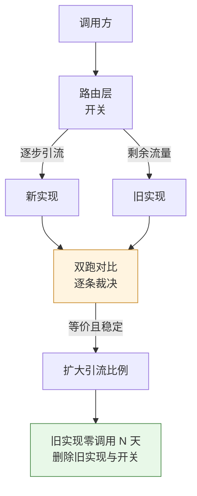
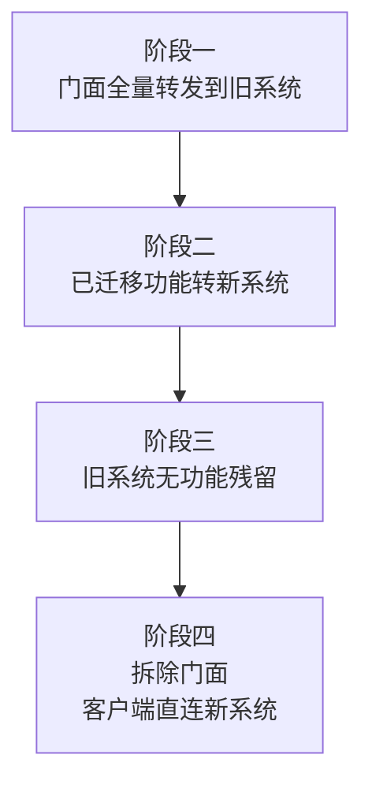

# 重构的安全边界由测试网和绞杀者模式共同划定

重构的定义是"不改变外部行为的前提下改善内部结构"。工程实践里这句话的成立条件经常被忽略：**"不改变行为"必须可验证，验证靠测试网；"改善结构"必须可增量，增量靠绞杀者模式**。**没有这两样，重构就是赌博——改完祈祷没坏，坏了不知道坏在哪**。

重构要解决的问题只有一个：**改完之后行为不能变，还要有人能证明这一点**。测试网就是回答这件事的，先回答"测试网在吗"。**测试网指行为层面的回归防护：单元测试锁定函数约定、集成测试锁定模块边界、金样测试（golden test）锁定输出快照**。重构前先问"测试网在吗"：**覆盖了要动的路径吗？测试本身可信吗（断言的是行为不是实现细节吗）？测试网不在，先补网再动刀——补测试是重构的入场券**。

测试网按层级布置，各层成本与数量成反比：底层单元测试数量最多、跑得最快、失败时定位范围最小；顶层端到端测试数量最少、跑得最慢、但覆盖真实用户路径。马丁福勒的经典金字塔图画出了这个比例——塔尖朝上表示越往上的测试越少而越贵，箭头标注越往上集成度越高、隔离度越低、速度越慢：


*图源：Martin Fowler《Practical Test Pyramid》原书插图，martinfowler.com，https://martinfowler.com/articles/practical-test-pyramid/testPyramid.png（unit test 单元测试 / service test 服务测试 / UI test 界面测试；more integration 集成度更高 / more isolation 隔离度更高）。*

两类改动的安全策略为什么不同（机制）

| 改动类型 | 风险特征 | 安全路径 |
| --- | --- | --- |
| 行为保持的结构改动 | 测试网可验证 | 小步提交，每步全绿 |
| 行为变化的演进 | 测试网会红（预期的红） | 特性开关隔离，双路径并存验证 |

**第二类常被误当第一类做：顺手"改进"了边界行为（返回值、错误码、时序），测试红了就改测试——这正是测试被操纵的信号**。行为变化要走显式的开关（见 [[工程知识/软件构建：让变化可以理解、验证与交付/测试与交付/配置与特性开关分离部署与发布]]），**新旧路径并存、流量可切换，而不是混在结构改动里静默上线**。



路由层把"替换一个实现"从一次性切换变成一串可撤销的小决策，分歧在执行前暴露。

绞杀者模式的增量迁移

大范围重构（模块替换、存储迁移、协议升级）不能一次切换，绞杀者模式的路数是**增量拦截**：**在旧系统外建新实现，用拦截层把一部分调用引到新实现，验证通过后逐步扩大引流比例，旧系统被一点点绞杀到无人调用后删除**。

这个模式的名字来自真实的植物——绞杀无花果先在宿主树冠里发芽，新藤逐圈包裹宿主、自己长成支撑结构，宿主枯萎后留下的空壳再被撤走：


*图源：Wikimedia Commons《A Strangler fig covering up a palm tree》，作者 RIT RAJARSHI，CC BY 4.0，https://commons.wikimedia.org/wiki/File:A_Strangler_fig_covering_up_a_palm_tree.jpg。*

图上新藤的每一圈都对应迁移路上的一次增量：**包裹完成前宿主一直在工作，新结构逐段接管支撑**；绞杀者迁移同理——**旧系统在引流比例涨到 100% 之前持续服务，新实现的每个阶段都要以行为等价证据为出口条件**。

把引流过程按时间摊开，是四个可停可回滚（把系统状态退回到改动之前的版本）的阶段，见下图：



四个阶段从「门面全量转发到旧系统」起步，到「旧系统无功能残留」收尾，最后拆除门面。**每个阶段的出口条件都是行为等价证据，而不是"时间到了"**。**阶段二到阶段三之间最容易出问题：旧系统还剩一部分功能没迁，新系统要反过来调它，两边互相依赖，这一步要留防腐层**（见 [[工程知识/软件构建：让变化可以理解、验证与交付/架构与代码/绞杀者模式用增量迁移替代整体重写]]）。

四阶段划分参考微软 Azure 架构中心《Strangler Fig 模式》，官方把四个阶段各画成一张架构状态图——门面在旧新两系统间分流、功能逐块搬进新系统、旧系统退役、门面拆除后客户端直连：


*图源：Microsoft Azure Architecture Center《Strangler Fig pattern》，https://learn.microsoft.com/en-us/azure/architecture/patterns/strangler-fig，CC BY 4.0；中文版见 https://learn.microsoft.com/zh-cn/azure/architecture/patterns/strangler-fig 。*

行为等价的验证形态：**录制真实流量回放到两个实现（双跑对比，diff 输出）；或对齐快照（同一输入集的输出快照逐条对比）**。双跑期间发现的差异逐条裁决——**真 bug（旧实现错）则修规格，行为差异（语义变化）则确认是否预期**。

小步重构的操作纪律

小步重构（提取函数、内联、搬移）的纪律来自"每步可停"：**一次提交只做一种变换、提交前全量测试、提交信息写变换意图（"提取函数 X"而不是"重构"）**。**这把"重构改坏了"的排查范围从"一大团 diff"缩到"一个变换"**。

IDE（集成开发环境） 与静态分析工具（见 [[工程知识/软件构建：让变化可以理解、验证与交付/架构与代码/静态分析发现结构问题但不能证明行为正确]]）能做大部分机械变换（改签名、搬移定义），机械变换的价值正是"工具保证行为不变"——**能用工具做的不手改，手改留给设计级变化**。工具的边界同样要清楚：**改名字、改签名（用私钥对数据生成可验证的防篡改标记）是机械的；改边界、改职责是设计判断，工具帮不了**。

可运行示例：绞杀者模式的迁移动作分解

旧接口 `OrderService.calculatePrice()` 要换成新版定价引擎，绞杀者路线的每一步都可验证：

```python
# 第 0 步：给旧行为上测试网（特征测试，不改一行旧代码）
def test_legacy_price_vip_bulk():
    # 用真实历史订单当用例，锁定现状行为（包括怪癖）
    assert legacy.calculate_price(items, user="vip") == 8800   # 单位分

# 第 1 步：引入路由层，100% 走旧实现（行为零变化，纯结构准备）
def calculate_price(items, user):
    return legacy.calculate_price(items, user)
#   发布 → 监控对比 → 无差异，才进第 2 步

# 第 2 步：按流量比例切新实现（5% → 25% → 100%）
def calculate_price(items, user):
    if use_new_engine(user, items):        # 灰度开关
        return new_engine.calculate(items, user)
    return legacy.calculate_price(items, user)

# 第 3 步：影子比对期间记录分歧，逐条裁决
#   新实现对的 → 修旧用例的预期；旧实现对的 → 修新引擎
# 第 4 步：100% 后删除旧实现与开关（绞杀完成，代码回到只有一个实现）
```

跑一遍的收获：测试网先于任何改动存在（第 0 步的用例来自生产真实输入），路由层把"换引擎"变成一个可灰度、可回退的发布动作——大爆炸式替换的全部风险被分解成每次 5% 的可撤销决策。

量化锚点与案例回流

步长的账：**每步迁移的 diff 控制在一次可 review 的规模（公开经验：一次提交百行级、一个分支存活以天计），超过就再切小——大分支的合并冲突成本随存活时间超线性涨**。灰度（先放开给一小部分用户验证、再逐步加量的发布方式）比例的账：**5% 起步的目的是让分歧样本在扩大前先收敛（5% 流量一天攒够裁决样本，直接 100% 放量则分歧以生产事故形态出现）**。绞杀节奏与 [[工程知识/软件构建：让变化可以理解、验证与交付/测试与交付/灰度与功能开关的边界：交付节奏与配置漂移.md]] 的开关纪律衔接：**开关是迁移的载体，迁移完成必须拔掉**。案例回流：[[工程知识/缺陷分析：从个案到体系/缺陷分析方法——三分离、判定树与五步法.md]] 的五步通用模型里，"改动引入回归"类缺陷的根治动作就是**缩小步长——第 0 步的特征测试网正是 [[工程知识/软件构建：让变化可以理解、验证与交付/测试与交付/发布门禁必须绑定真实证据.md]] 所说"真实证据"在重构场景的形态**。

边界

重构的停止条件：**结构改善到"下一个改善的收益 < 拐点处维护成本"就该停，无限重构是病**。判据与性能优化的调优闭环同构（见 [[工程知识/性能工程：从用户等待到资源瓶颈/性能工程：从用户等待到资源瓶颈]]）：**递减曲线在哪，停在哪**。

遗留系统没有测试网时的特殊路径：先做**特征测试**（characterization test）——**不写"应该怎样"的断言，写"现在实际怎样"的快照，把当前行为（包括 bug 行为）锁住，再开始重构**。**锁 bug 的目的在防止重构把"已知缺陷"变成"未知缺陷"，与承认 bug 正确无关**。

验证

重构前检查：**目标路径的测试覆盖率与测试可信度（抽几个测试，确认断言的是行为不是实现）**。**覆盖率不足的先补特征测试**。

重构中验证：**每个小步提交后全量测试全绿；绞杀者模式的每步引流后，对比新旧实现的监控曲线（错误率、延迟、吞吐）与双跑 diff**。

重构后验证：**删除旧实现前，确认流量审计（旧入口连续 N 天零调用）**——这个审计方法与在线 schema 变更的收缩阶段一致（见 [[工程知识/数据系统：在并发与故障中保存事实/可靠性与运维/在线schema变更走expand与contract，不锁表是底线]]）。

相关

关系：[[工程知识/软件构建：让变化可以理解、验证与交付/架构与代码/绞杀者模式用增量迁移替代整体重写]] · [[工程知识/软件构建：让变化可以理解、验证与交付/测试与交付/配置与特性开关分离部署与发布]] · [[工程知识/软件构建：让变化可以理解、验证与交付/测试与交付/测试策略从风险选择证据]]

- [[工程知识/软件构建：让变化可以理解、验证与交付/测试与交付/发布门禁必须绑定真实证据]] —— 重构提交的门禁要求
- [[工程知识/软件构建：让变化可以理解、验证与交付/架构与代码/静态分析发现结构问题但不能证明行为正确]] —— 机械变换的工具与边界
- [[工程知识/软件构建：让变化可以理解、验证与交付/架构与代码/分层与依赖方向决定可测试性和演进成本]] —— 结构改善的目标方向
- [[工程知识/AI 系统工程：从模型能力到生产能力/Agent与工作流/代码智能体需要结构索引、任务探索与运行证据]] —— AI 辅助重构的证据要求
