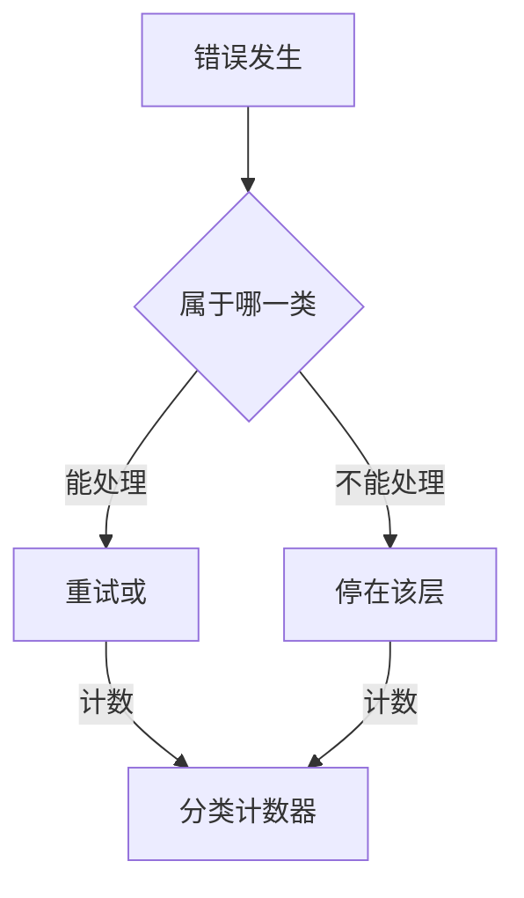
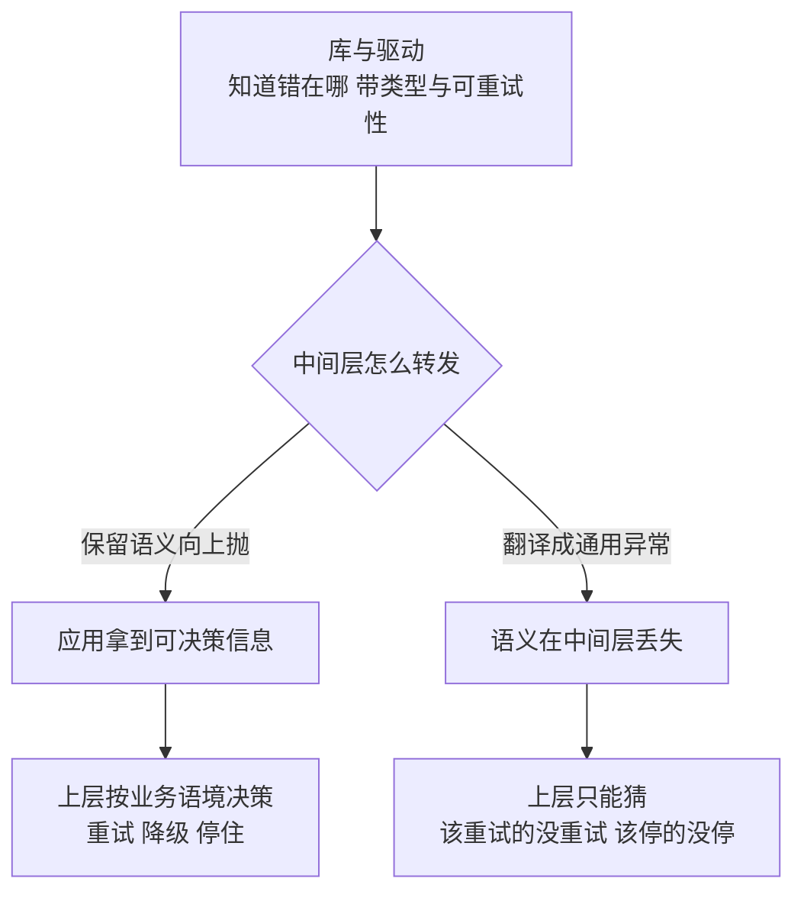

# 错误处理是策略问题，异常只是运输手段

## 错误为什么总被就近吞掉：要解决的问题

错误在发生的位置被记录一行日志之后继续向上返回，**抛出时携带的类型信息在转换过程中丢失，可恢复与不可恢复的情况被同样对待，重试把暂时性问题放大成更严重的事故**。本篇回答：**错误的传递形式与处理策略为什么是两件事、每个错误应当由哪一层处理、哪些位置不允许吞掉错误、重试与退避依据什么区分，以及异常路径上的资源清理由谁负责**。

**代码怎么抛错（异常、错误码、Result 类型）是机制问题；每个错误该被谁处理、怎么处理、什么时候不许吞是机制之上的策略问题**。语法层面没人不会写 try-except，常见失败出在策略层面：**错误被就近吞掉、异常类型丢失语义、可恢复与不可恢复混为一谈、重试把暂时错误放大成灾难**。**策略不清，机制再完备也要到处漏**。

「异常是运输工具、策略决定送哪」的实物原型是急救转运：救护车只负责把病人快速送到医院，它的价值全在运输本身；去哪家医院、进急诊还是进普通门诊、要不要通知专科，是急救调度按病情分类决定的——车再快，送错医院就是二次伤害：

*图源：Wikimedia Commons，作者 Pedro Simões，CC BY 2.0，https://commons.wikimedia.org/wiki/File:Health_emergency_car_speeding_in_Lisbon.jpg。*

异常机制就是错误处理里的救护车：**把错误从发生点快速运到处理点，运输途中不改变病情、不决定疗法**。**抛出方式（异常、错误码、Result）是选哪种车，分类与处置是调度策略**——**把不可恢复的错误装上车反复转运（重试），等于对一个必然失败的操作重复发压**。

**分类之所以是起点，是因为后面所有动作——重试几次、要不要降级、该不该停——都由类别决定**。**类别判错，动作就全错**：**把不可恢复的错误拿去重试，等于对一个必然失败的操作重复发压；把需人工介入的错误自动兜底，等于把数据不一致藏起来**。

策略的起点是**错误分类**，按处理方式分四类：

| 类别 | 例子 | 策略 |
| --- | --- | --- |
| 可重试的暂时错误 | 网络超时、限流（限制单位时间内放行的请求数量）、锁冲突 | 有限重试 + 退避，见 [[工程知识/后端系统：在并发、失败与变化中维持服务/分布式可靠性/超时、重试与幂等共同定义调用语义]] |
| 可兜底的降级（主动关闭次要功能、保住核心链路的自保手段）错误 | 非核心依赖失败 | 有损服务降级，见 [[工程知识/后端系统：在并发、失败与变化中维持服务/服务设计/服务降级是有损服务，损什么损多少要变成业务决策]] |
| 不可恢复的程序错误 | 断言失败、不变量破坏 | 快速失败（fail-fast），不捕获不重试 |
| 需人工介入的 | 数据不一致、审计告警 | 上报 + 停在该层，不自动处理 |

**第四类最考验纪律：有些错误的正确处理就是"停"**。静默修一下（吞异常填默认值继续跑）**短期看是恢复力，长期看是把异常变成静默失真**——**错误从"报警找人"变成"数据悄悄错了"，检测成本从分钟变成月**，静默失真的机制见 [[工程知识/缺陷分析：从个案到体系/正确性/静默失真的检测靠对账与不变量而不是报错]]。

## 错误跨层怎么传播：边界即接口

跨层传播最典型的例子是系统调用（程序请求内核提供服务的入口）：用户态（普通程序运行的低权限受限状态）的 `read()` 跨到内核态（内核代码运行的高权限状态）的 `sys_read()`，错误码沿原路返回。边界在哪，错误的形状就在哪被决定。

错误跨层（库 → 应用 → 服务边界）传播的规则：**下层报语义，上层做决策**。**下层（库、驱动）知道自己错在哪（连接断了、约束违反），但不知道业务上该怎么办；上层知道业务语境，但看不到底层细节**。所以**下层错误要带着语义信息向上传播（错误类型、可重试性、上下文），不许在中间层翻译成通用异常丢失语义**——**中间层捕获再抛出 `RuntimeException("something failed")` 是最常见的语义丢失点**。

错误跨层向上走的时候，语义可能在中间层丢掉也可能保住，两条分支通向完全不同的上层动作。

上层拿到的是语义还是一句通用异常，决定了**重试、降级、停住这三个动作选得对不对**；类型签名（用私钥对数据生成可验证的防篡改标记）只是让这条链不会被编译器悄悄跳过。

**Go 的显式错误返回与 Rust 的 Result 类型把错误处理写进类型签名，价值正在这里：调用方无法假装错误不存在**（编译器强制处理）。异常机制（Java/Python）的代价是**控制流隐式化——异常从哪抛、谁捕获**，签名上看不出来。**语言优劣倒在其次，这是同一策略的两种机制表达**：无论哪种，策略检查点（定期保存进度、故障后从最近一次保存处恢复）都一样——**捕获时必须能回答"为什么捕获、捕获后做什么"，答不出来的 catch 就是吞错**。

## 哪些位置不许吞错：判定

吞错常发生在结果没人收的时候。完成队列里的结果如果一直不被取走，错误就静静躺在里面——这和异常被 catch 掉不往上抛是同一件事。

*图源：腾讯云开发者社区《图解原理 Linux I/O 神器之 io_uring》内核处理流程一图，CC 4.0 BY-SA，https://cloud.tencent.cn/developer/article/2187655。*

吞错（catch 后不处理继续跑）只有一种情况合法：**错误确实不影响后续路径的正确性，且有注释说明为什么**。判据三问：

1. **这个错误的下游消费者是谁？（没有人消费错误信息 = 信息断流）**
2. **吞掉后系统状态仍一致吗？（部分完成的写、未释放的资源）**
3. **事后再现这个错误的路径还在吗？（日志、计数器，至少要留痕）**

**三问任一不过，吞错就是缺陷**。第 2 问命中的最多：**异常路径上资源不释放（连接、锁、临时文件），本身制造资源泄漏**——库内案例二十一（异常路径上没有完成——永不兑现的 future）正是异常路径未走清理逻辑的机制标本。

## 错了之后怎么被看见：分类与可观测

错误处理策略要做到**可观测：每类错误的计数器、分类报表，把"错误处理得对不对"变成可监控的**。失败要分类才能对症下药，见 [[工程知识/AI 系统工程：从模型能力到生产能力/质量与运营/失败要分类才能对症下药]]，运维侧同理：**错误率告警不分类，值班看到的就是一团无法行动的噪声**。

## 这套策略在哪儿会失效：边界

fail-fast 的适用边界是**进程内**：**单进程的快速失败把问题暴露在最早时刻**。跨服务场景 fail-fast 的含义变化——**下游 fail-fast 返回错误，上游怎么响应是上游的策略（重试、降级、排队）**，**不能把"快速失败"误用为"立刻向上游用户报 500"**。**进程内快速失败 + 跨服务优雅响应，两层策略要分开设计**。

错误处理的测试边界：**异常路径的测试普遍薄（正常路径覆盖 80%，异常路径 20%），而缺陷恰恰多发在异常路径**（案例二十一、案例三十四都是异常路径缺陷）。**异常路径的测试策略要显式设计——注入故障（超时、半失败、重复）验证策略行为**，这属于测试从风险选择证据的范畴，见 [[工程知识/软件构建：让变化可以理解、验证与交付/测试与交付/测试策略从风险选择证据]]。

## 想自己验一遍怎么动手：验证

错误策略要与吞错清单对账——**预写每处空捕获或仅打日志的块都应能说出为何不向外抛，说不出与预期对不上，即列入整改顺序**。

**吞错扫描**：grep（文本搜索工具） 所有 catch/except 块，**对每个空块或仅打日志的块过三问**。**产出是吞错清单与整改顺序，按影响面排**，估算方法见 [[工程知识/缺陷分析：从个案到体系/影响判断/影响面估算先于修复——从改一行到伤多少服务]]。

**异常路径注入测试**：对核心链路注入三类错误（暂时、不可恢复、数据不一致），**验证各层行为与策略表一致：暂时错误被重试且退避、不可恢复快速失败且不重试、数据不一致停住并告警**。

## 接着读哪几篇：可兜底错误的降级策略

- 关系：[[工程知识/后端系统：在并发、失败与变化中维持服务/分布式可靠性/超时、重试与幂等共同定义调用语义]] · [[工程知识/缺陷分析：从个案到体系/稳定性/案例二十一：异常路径上没有完成——永不兑现的 future]] · [[工程知识/AI 系统工程：从模型能力到生产能力/质量与运营/失败要分类才能对症下药]]
- [[工程知识/后端系统：在并发、失败与变化中维持服务/服务设计/服务降级是有损服务，损什么损多少要变成业务决策]] —— 可兜底错误的降级策略
- [[工程知识/软件构建：让变化可以理解、验证与交付/测试与交付/测试策略从风险选择证据]] —— 异常路径测试的证据选择
- [[工程知识/缺陷分析：从个案到体系/缺陷分析方法——三分离、判定树与五步法]] —— 错误处理缺陷的归类入口
- [[工程知识/后端系统：在并发、失败与变化中维持服务/任务与并发/任务生命周期必须覆盖进程、日志、超时与清理]] —— 异常路径的资源清理
