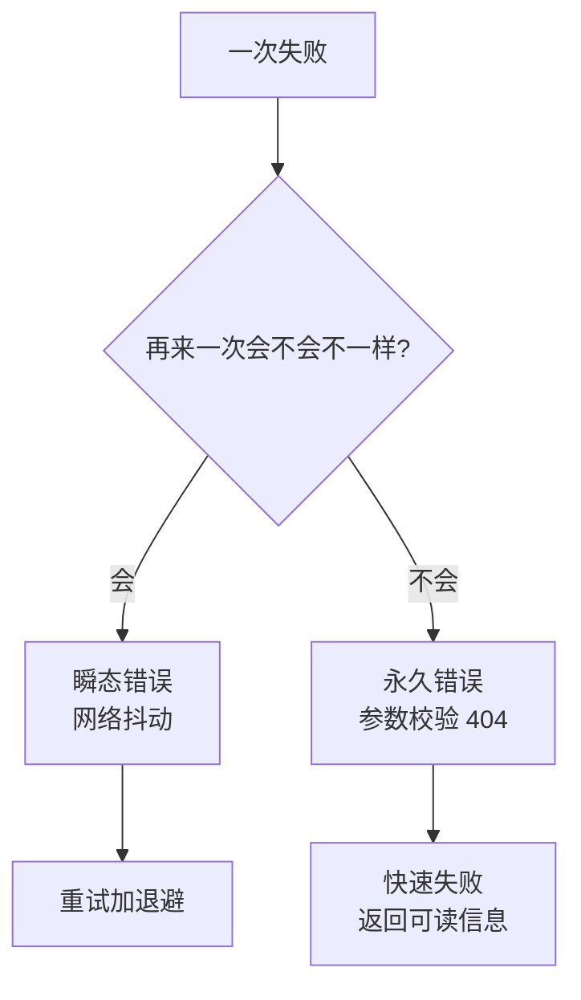
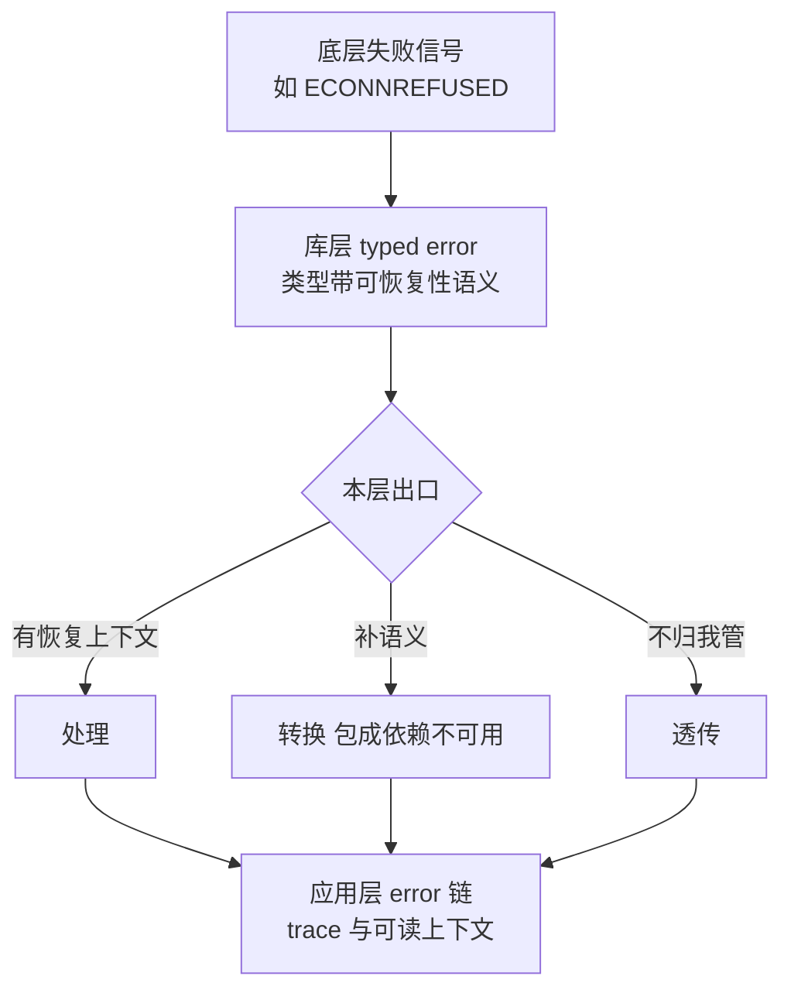
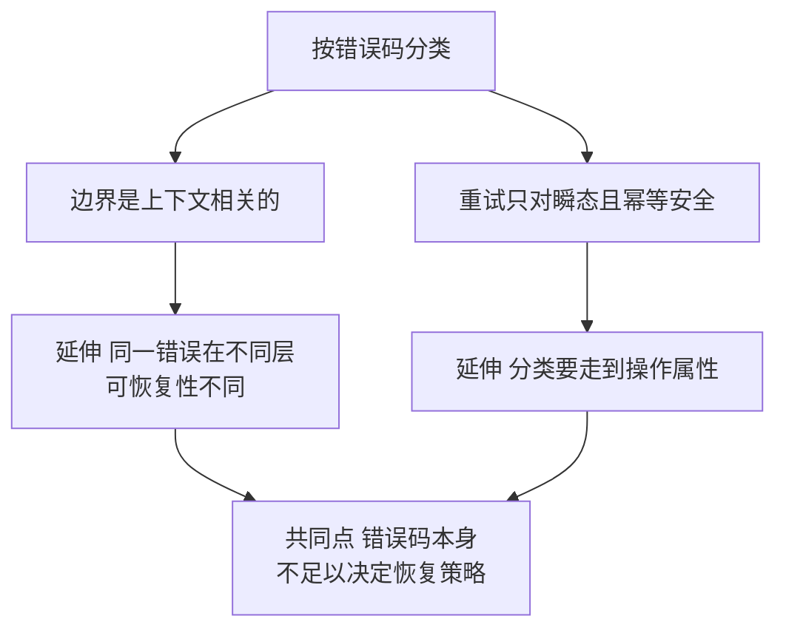
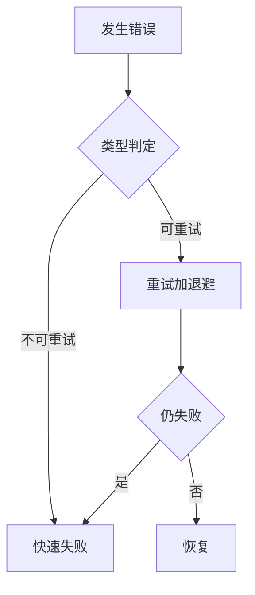

# 错误处理的分类学：错误类型与恢复策略的映射

## 要解决的问题

同一个"失败"字眼，底下混着三种完全不同的东西：网络抖动（重试就好）、参数错误（重试一万次也是错）、磁盘坏了（重试有害）。**把三者塞进同一个 catch 块统一处理，是线上事故的常见配方**：**临时故障被当永久错误直接放弃，用户输入错误被当系统故障触发告警风暴，不可恢复的错误被盲目重试打成雪崩（一处故障沿依赖链放大成级联失效）**。

问题的本质：**"错误"是一族现象的统称，恢复策略必须按错误的可恢复性与归属分层映射，分类错了，后续每一步（重试、告警、降级——主动牺牲部分功能或精度，保住核心链路）、放弃都跟着错**。错误处理的分类学就是先问"这是哪类错误"，再决定"用什么动作"。

## 错误怎么分类、动作怎么跟：机制

先把形状说成一件事：**错误处理像分诊台——每次失败进门先分诊**：**瞬态错误是擦伤，环境的问题，消毒等一等就好，对应重试加退避**；**永久错误是先天性疾病，输入或代码的问题，治不好但能管理，对应快速失败并给出可读解释**；**协议错误是需要特殊流程的病，比如手术前的核对单，动作自带步骤，恢复手段对应重读再写或带幂等（同一操作执行多次与执行一次效果相同）键重试**。**分诊错了，后面全错：把擦伤当重病引发告警风暴，把重病当擦伤就放过真故障**。这个比喻到"分诊决定动作"为止：医院分诊有护士凭经验，代码里的分诊要在错误类型里写明语义，让每个处理点不用猜。

**第一刀：可恢复性切两半**。

第三档是这套分类里最容易漏掉的一支。前两档都能用"要不要重试"回答，第三档不能——**超时之后重发请求，对端可能已经执行过一次；并发冲突之后重试，要先重读再写**。**这一类错误的恢复动作自带协议，不是单纯再来一次**。

**瞬态错误（transient）：环境暂时不满足，等一下就恢复——网络抖动、限流（限制单位时间内放行的请求数量） 429、锁竞争（多个执行流争抢同一把锁造成的等待开销）失败、DNS（Domain Name System，域名系统：把域名解析成 IP 地址） 抖动**。恢复策略是重试 + 退避。**永久错误（permanent）：同样的输入再来一次还是错——参数校验失败、404、非法状态转换、权限拒绝**。**恢复策略是快速失败，把可读的错误信息还给调用方或用户**。

"瞬态"与"永久"这对名字点出了判定的依据：在不改变输入的前提下重复执行同一操作，结果会不会变。会变的是环境的问题，不变的是输入的问题。

判定问题：**有些错误在两可之间（5xx 可能是瞬态可能是永久），HTTP 语义用状态码划线（5xx 服务端问题可重试、4xx 客户端问题不可重试），但 500 也可能是代码 bug 导致的永久错误**——**可恢复性是部署上下文的属性，不纯是错误码的属性**。

**第二刀：归属切出第三类**。除了"我这边的问题"与"你那边的问题"，还有"没人出错但就是不行"：**操作超时（对端可能已成功，重试会重复执行，需要幂等保护）、并发冲突（两个人同时改一行，后写者需要重读重试）、部分失败（批量操作一半成功，需要补偿或断点续传）**。这类错误的恢复策略是**携带协议的恢复**（幂等键、版本号、断点游标），简单重试无效。

**第三刀：按层级决定谁处理**。错误在调用栈向上传播时，每层有三个选择：处理（我有上下文能恢复）、转换（包一层语义：底层 ECONNREFUSED 转成"依赖服务不可用"+重试决策）、透传（不是我的事）。Go 的 error wrapping（%w 链）、Rust 的 thiserror（库层 typed error）/anyhow（应用层动态 error）就是这套分层的语言化：**库定义精确错误类型（调用方可 match 分支处理），应用打包上下文链条（人可读、可追溯），两层职责不同**。panic/异常与错误的分界：**异常留给编程错误（invariant 被打破，调用栈已不可信），错误留给可预期的失败（业务流程的一部分）**。

**这套分类学的词汇地基大多来自 Unix 血统**：errno 的 ECONNREFUSED/EAGAIN（资源暂不可用时返回的错误码，意为稍后重试）、POSIX（Unix 系统调用标准）的错误分组，直到今天仍在 Go 与 Rust 的错误类型里延续——**这些 E 开头的常量诞生在电传终端与 PDP（Programmed Data Processor，DEC 的小型机产品线）小型机上，一台 1970 年代的工作站就是错误分类词汇的出生证明**：

*图源：Wikimedia Commons，Michael Hicks，CC BY 2.0，https://commons.wikimedia.org/wiki/File:NeXT_computer_terminal.jpg。*

错误沿调用栈向上走时，每层有哪些出口、类型信息在哪层被补上、又在哪一层被判定成异常而不是错误。

每层只有处理、转换、透传三个出口，选了转换或透传之后，最终落到调用方身上的动作就是下面的清单。

**恢复动作的清单**。**重试（+指数退避+抖动，只对瞬态）、降级（用缓存/默认值顶替，服务还活着但降质）、排队转异步（把同步失败转成异步重消化）**、**补偿（提前记下抵消操作，出了错执行它来抵消，Saga 的回滚是这一类）、放弃（把错误语义化上抛给最终决策者：用户或运维）**。**告警的映射也要分类**：**永久错误大量出现是入口问题（用户在撞 404，产品问题），瞬态错误恢复成功是正常弹性（不用告警），瞬态错误持续不恢复是容量/依赖问题（要告警）**——**同一错误码，恢复状态不同，告警语义完全不同**。

最后一句是这套分类在运维侧的落点。**同一个 500，恢复成功了说明弹性在工作，反复失败说明依赖或容量出了问题，两者该触发的告警完全不同**。**只看错误码不看恢复状态，值班收到的就是一团无法行动的噪声**。

来源：[CSDN @bjmayor《图解分布式事务模式》](https://bjmayor.blog.csdn.net/article/details/154004146)（CC 4.0 BY-SA）

## 分类学怎么演进来、付什么价：背景与代价

异常处理从 Lisp 的 condition system（1960s-70s，条件与重启点的完整理论）到 C++/Java 的 try/catch 主流化，2000s 后社区反思"异常崇拜"（异常隐藏控制流），Go（2009）选择显式 error 返回值、Rust（2015）用 Result 类型把错误变成类型系统的一等公民。错误分类学在分布式时代重新变得重要。

Google SRE（Site Reliability Engineering，站点可靠性工程：用软件方法做运维）的 book（2016）把"可重试性"作为 RPC（Remote Procedure Call，远程过程调用：像调本地函数一样调远端服务）语义的一等属性。REST（Representational State Transfer，用 HTTP 动词操作资源的接口风格）生态用状态码 + Retry-After 标准化了瞬态信号。

**把"错误的可恢复性"从处理点（catch 块里猜）前移到定义点（错误类型里声明）**。Rust 的 trait 体系里错误类型自带语义：std::io::Error 有 ErrorKind::Interrupted 这类"可重试"标记；gRPC（Google 开源的远程调用框架，服务间用二进制协议通信）的 status code 区分 UNAVAILABLE 与 INVALID_ARGUMENT。**调用方 match 的每一步都带着类型信息决策，catch 块里的 if-else 猜测变成类型系统的穷举检查**。

**分类体系有维护成本（错误类型清单随业务膨胀，粒度太细没人愿意精确分类，太粗等于没分）**；跨语言边界的分类漂移——**Go 的 Sentinel error（阿里流控组件定义的错误类型）到 JSON 网关（站在客户端与后端服务之间的入口层，集中处理路由、鉴权与协议转换）变字符串，类型信息丢失，恢复策略只能靠字符串匹配回猜，这是微服务错误传播的经典痛点**；**过度设计分类学是真实风险**（小工具搞 20 种错误类型，收益不抵复杂度——分清瞬态/永久/协议三档已覆盖大部分事故场景）。

## 只按错误码分类会漏掉哪些恢复路径：边界

- **分类的边界是上下文相关的，同一错误在不同层可恢复性不同**。ECONNREFUSED 在重试层是瞬态（可能对端重启中），在启动健康检查层是永久（服务起不来就别进入流量）。**写分类时标注适用层，防止下游拿错语义**。
- **错误信息的安全边界**。**对外的错误信息要脱敏（不漏内部堆栈、SQL、机器名），对内的错误要全量（堆栈、trace id、上下文）**。**两套序列化（把内存对象转成可存储或传输的字节格式的过程）路径是错误处理基础设施的标配**。
- **重试的分类边界**。**重试只对瞬态且幂等操作安全。非幂等操作（支付扣款）的重试必须带幂等键（请求自带唯一标识，重复提交只生效一次），否则重试本身制造新错误（重复扣款）**。**分类学要延伸到操作属性，不能停在错误码**。
- **"忽略错误"有时是正确分类**。_metrics 上报失败、日志写入失败，分类结论可以是"瞬态、无协议、放弃"——明确写出来（Go 的 `_` 接、Rust 的 `let _ =`），与遗漏处理区分开。**显式忽略是分类决策，静默吞掉是 bug**。

四条边界把分类学往四个方向延伸，每一条都补上了只按错误码分类会漏掉的东西：

最下面那行是这四条合起来要说明的事：**错误码本身不足以决定恢复策略**。**同一个 ECONNREFUSED 在重试层是瞬态、在启动健康检查层是永久，只看错误码会把语义传错**；重试是否安全取决于操作是否幂等，这需要分类延伸到操作属性；而"瞬态、无协议、放弃"也是一种分类结论，明确写出来与遗漏处理区分开——显式忽略是分类决策，静默吞掉才是 bug。

## 分类对不对怎么验证：验证

映射关系决定了恢复策略，先分类再选动作：

- **分类穷举实验**：**对一个真实服务的错误日志按瞬态/永久/协议三类打标统计（一周样本）**。预期：**三类占比结构清晰（大量 4xx 永久、小量 5xx 瞬态、少量超时协议类），打标过程会暴露分类模糊地带（如反复出现的 500），模糊点即需要人工定义的错误**。分类体系可用性的实测。
- **重试策略对照实验**：对同一个下游故障（注入 50% 失败率），分别用"不区分错误类型的重试"与"分类重试（瞬态退避/永久放弃）"两版客户端。**预期：不区分版对永久错误浪费重试预算、延迟放大；分类版永久错误快速失败、瞬态错误恢复率抬升。分类映射收益的可复现证据**。
- **跨边界传播审计**：**微服务链上故意抛出带类型的错误，在各层网关/序列化边界后捕获，对比类型信息存活率**。**预期：gRPC原生链类型存活，经 JSON REST 转发后类型信息丢失（退化为字符串）。分类漂移的一手观测，为网关层补类型映射提供依据**。

## 接着读哪几篇：约定定义了跨服务错误的语义边界

- [[工程知识/软件构建：让变化可以理解、验证与交付/测试与交付/接口约定测试的适用边界：消费者驱动与提供者验证]] —— 约定定义了跨服务错误的语义边界，本篇是错误侧的分类与恢复
- [[工程知识/后端系统：在并发、失败与变化中维持服务/服务设计/背压的传递链路：从下游饱和到上游减速]] —— 429 是瞬态错误的标准信号，背压（下游处理不过来时把压力传回上游减速）把瞬态错误的处理从重试升级为减速
- [[工程知识/软件构建：让变化可以理解、验证与交付/架构与代码/架构适应度函数：把架构约束写成可执行检查]] —— "异常只能留给编程错误"这类约定，可作为适应度函数的检查物
- [[工程知识/软件构建：让变化可以理解、验证与交付/架构与代码/API演进的兼容性纪律：废弃流程与版本策略]] —— 410 Gone 的语义稳定性是错误分类的接口侧约定
