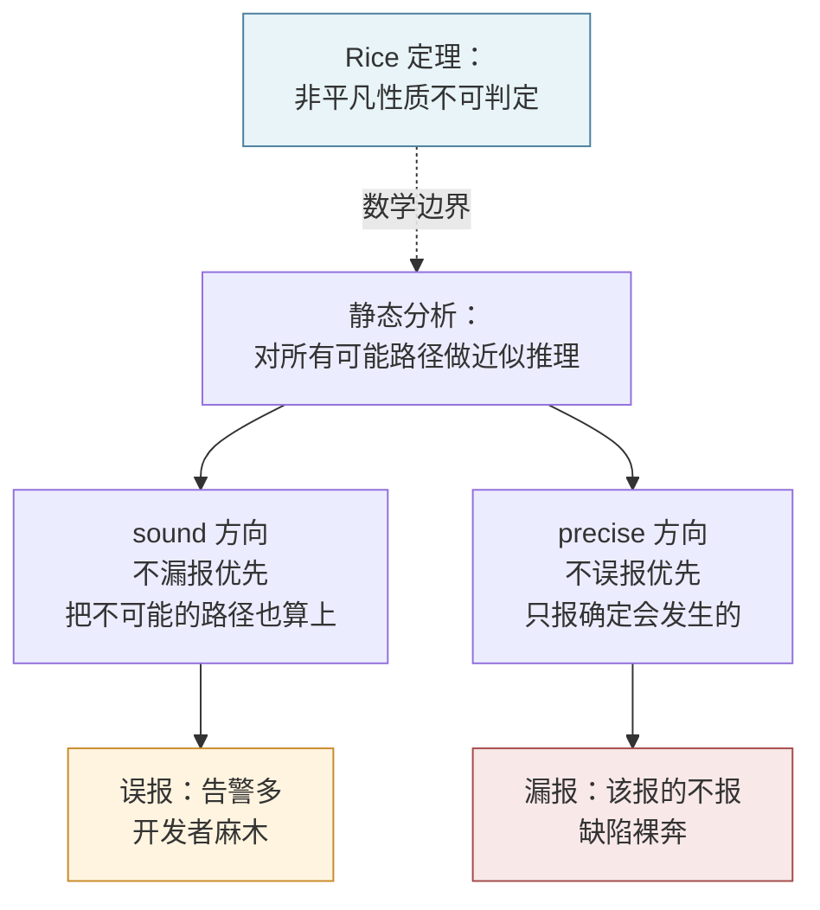
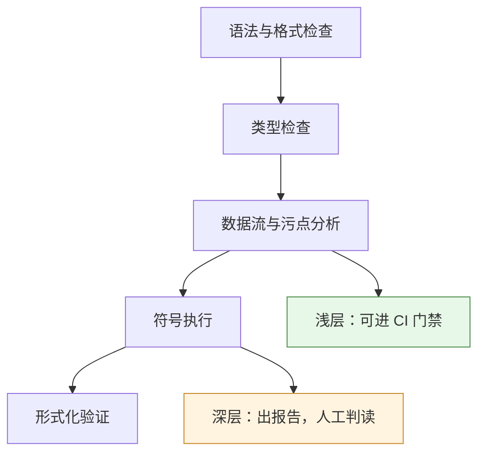
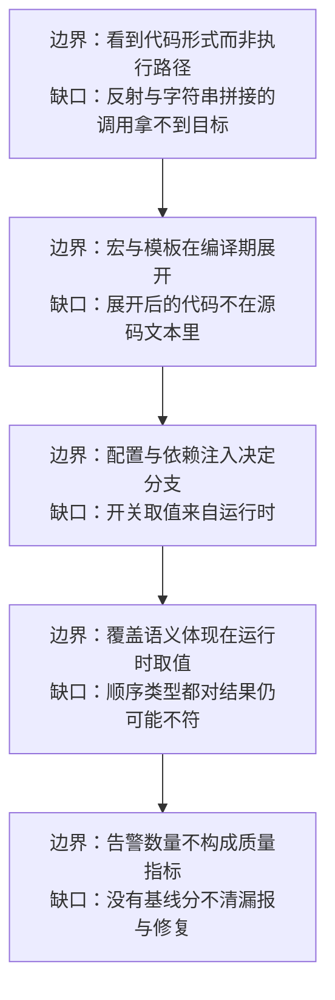

# 静态分析发现结构问题但不能证明行为正确

它解决的是在运行程序前快速发现语法、类型、资源路径和已知模式错误的问题。静态分析的本质是**对可能执行路径做近似推理**，收益是**反馈快、适合大仓库**，代价是**误报、漏报和动态行为不可见**；因此必须与测试、coverage（覆盖率，测试实际执行到的代码占比）、trace（分布式追踪，跨服务记录同一次请求的完整调用路径）和真实缺陷样本对照检验。



**顶部那条从 Rice 定理下来的虚线是全文的根据：两个方向无法同时占满，只能按场景选一边**。

## 要解决的问题：静态分析在各层能发现哪些问题

提交前的自动检查全部通过，上线后仍出现依赖版本带漏洞、配置层级互相覆盖、认证分支被绕过这类缺陷。本篇回答：静态分析在各层能发现什么、哪些问题它结构上无法证明、误报率与真实缺陷召回率（被找回来的相关样本占全部相关样本的比例）怎样测，以及它的结论要和哪些运行证据配合才能构成验证。

## 为什么"零告警"不等于正确

先把形状说成一件事：静态分析像只看菜谱试菜——食材（代码）全摆在你面前，你可以确认有没有放盐、步骤顺序对不对（结构与模式），但你没点火（不运行），尝不到这道菜咸淡合不合适、客人会不会过敏（运行时行为）。**零告警的意思是"菜谱检查通过"，不是"这道菜一定好吃"**。这个比喻到"没点火"为止——现实的分析器比这更纠结：它为了不漏掉问题，会把菜谱上所有可能的食材替换都当成会发生（误报），又会在菜谱写"按客人口味调整"的地方彻底失明（反射与配置导致的漏报），**两个方向都由"只有文本没有运行"这个输入上限决定**。

静态分析做的是**近似**：它不知道运行时会走哪条分支，只能把所有分支都算进去。这个近似有两个固定后果，方向相反——

- **漏报**：动态派发、反射、配置开关、代码生成这些路径，分析器看到的调用图是残缺的，告警根本不会生成。
- **误报**：为了不漏，分析器会把不可能的路径也算上，于是报出一堆在真实运行中永远不会发生的问题。

这两个后果无法同时消除，只能权衡。**所以"零告警仓库"真正成立的唯一情况是：你的代码里没有反射、没有动态加载、没有配置分支、没有外部依赖，且分析器的规则集正好覆盖了你用的所有模式。现实里不满足，所以零告警通常只说明分析器没看到**。

案例五正好位于这一格：BookKeeper 打包的 ZooKeeper 3.8.3 存在认证绕过、Vert.x（JVM 上的响应式工具集） 4.5.7 带着 CVE（Common Vulnerabilities and Exposures，公开披露的安全漏洞编号）-2024-8391，**两个 P0 都是靠依赖扫描（一种静态检查：比对版本与已知漏洞库）发现的**，修复动作是升级依赖版本，没有改 BookKeeper 自己的一行代码。反过来，认证绕过这个行为本身，任何对 BookKeeper 源码的静态分析都查不出来——**漏洞在依赖里，行为在运行时**。

要理解这个边界为什么是硬的，可以从分析器的工作方式看：它拿到的输入只有代码文本与类型信息，而"这次运行会走哪条分支"取决于**运行时的输入、配置与外部状态**——这些信息在静态阶段根本不存在。分析器不能等，只能在两个方向里选一个：要么把所有分支都当成可能（于是报出实际不会发生的），要么只报确定发生的（于是漏掉依赖运行时信息的那些）。**实现再好也到不了更高，输入的信息量决定了输出的上限**。

静态分析"只看文本、看不到运行"的边界，在它出现之前就有实物。下图是一台 DuKane 缩微胶片阅读机：把拍摄在胶片上的源代码投影放大供人审读——审查者看到的一切都在胶片上，程序真正跑起来之后的寄存器、内存与时序，胶片上一个字节都没有。**静态分析器面对源码时的处境与此相同：文本之外的信息，输入端就不存在**。


> 图：DuKane 缩微胶片阅读机与源代码胶片，来自 [Wikimedia Commons](https://commons.wikimedia.org/wiki/File:Microfiche_reader_and_source_code.jpg)，CC BY-SA 3.0，摄影 Autopilot。

## 对照实验怎么跑：可运行示例

判断一个分析器在你的仓库上到底能看见什么，别读文档，跑一遍。semgrep 官方 Playground 是最短路径：左侧写规则、右侧放代码、点 Run 看命中——示例规则 `print("...")` 只匹配字符串字面量参数的调用，右栏代码里五处 print 只命中两处，命中数与误报漏报全摆在页面上：


*图源：semgrep.dev Playground 页面截图（2026-09-27），https://semgrep.dev/playground/new。*

```bash
# 1. 建基线：全量告警存下来，后续每次都跟它比
semgrep --config auto --json --output baseline.json src/

# 2. 统计告警总数与去重后的规则数——这两个数要分开看
python3 -c "
import json
d=json.load(open('baseline.json'))
r=d['results']
print('告警总数:', len(r))
print('命中规则数:', len({x['check_id'] for x in r}))
print('涉及文件数:', len({x['path'] for x in r}))
"

# 3. 最关键的一步：人工判定误报率
#    随机抽 30 条，逐条判断"这条在真实运行中会发生吗"
#    误报率超过 30% 说明规则集不匹配这个仓库，先调规则再谈清零
```

**判定误报率的活不能省**。告警数量本身没有意义：改一版 parser 让告警从 400 掉到 120，可能只是漏报变多了，质量一点没变。**这就是要保留基线（正常状态下的指标水平、用来对比异常）的原因——没有基线，数量变化会被当成质量变化**。

分析手段按证据强度排成阶梯，越往上越贵、越接近「证明」，也越难进 CI（Continuous Integration，持续集成：代码合并后自动构建与测试）：（持续集成，每次改动自动构建与测试）



AST（Abstract Syntax Tree，抽象语法树：把代码按语法结构拆成的树）层是一切静态分析的起点，下图是一段含 while 循环与 if 分支代码解析后的语法树——语句、条件、赋值各占一个节点，分析规则就在这棵树上匹配模式：


*一段代码解析成的抽象语法树（图源：Wikimedia Commons，Dcoetzee 绘，CC0）*

## 五层各自看得见哪些问题：分层能力

| 层 | 能发现 | 不能证明 | 典型漏报来源 |
| --- | --- | --- | --- |
| lexer/parser/AST | 语法、结构和模式 | 运行路径和数据语义 | 宏展开、模板实例化 |
| 类型/约定 | 接口形状、可空、部分状态 | 外部输入真实性和时序 | 反射、动态代理 |
| 静态数据流 | 部分污点、未使用、资源路径 | 所有动态反射和配置 | 配置开关、依赖注入 |
| 符号/调用图 | 定义、引用和影响范围 | 实际执行与覆盖 | 字符串拼出的类名 |
| 运行测试/trace | 具体行为、时序和资源 | 未覆盖路径 | 未覆盖分支 |

**五层的证据强度从上到下递增，工程成本也递增：越往下越接近真实执行，也越贵。CI 的常见配置是让浅层做门禁、深层做报告——浅层快而准，深层慢且误报要人看**。


案例三十五演示了这张表最下面两行的落差。Pulsar（分布式消息与流平台）的策略分主题级、命名空间级、集群级三级，取值时"最具体的优先"。这个语义写在代码里，静态分析能看到 `setLocalPolicies()` 被调用、看到参数被写入——**但它看不出这次写入把上层的值一起写进了局部**，于是局部策略永远盖住上层，用户改上层再也不生效。**这类"改了没用"的缺陷，调用图完整、类型正确、没有告警，只能靠运行时的值来证明**。

两种模式的选择还可以再具体一步。**CI 里设门禁的应该是"快而准"的那一层：语法、类型、已知漏洞依赖，这些模式固定、误报低，挡下来几乎不需要人判断**。需要人判断的那一层——数据流、符号执行——设成报告而不是门禁，因为它们的告警里混着大量需要上下文才能判定的条目，**一旦设成门禁，团队会学会批量豁免，门禁随即失去意义**。

## 该用它做哪些事，不该用它做哪些事

该做：把静态分析当**快速筛选器**——在提交前挡住语法、类型、已知危险模式，**把人工审查的注意力留给分析器看不到的部分**。

不该做：**拿告警数当质量指标**。要按可利用性、误报成本、修复风险排序，而不是按数量。

具体分工可以这样定——

| 问题类型 | 交给谁 | 理由 |
| --- | --- | --- |
| 语法、类型、已知漏洞依赖 | 静态分析 | 反馈快，模式固定 |
| 动态派发、反射、配置分支 | 运行测试 + trace | 静态看不到真实路径 |
| 分层/覆盖语义 | 断言运行时取值 | 语义在值里不在代码里 |
| 跨服务时序、并发竞争 | 压力测试 + 真实缺陷样本 | 需要真实调度 |

AI 代码工具能加速探索、重构和测试生成，但**它的结论必须回到源码、构建、测试、trace 和产物证据**——这一条对静态分析同样适用：**AI 说"这里没问题"和静态分析"零告警"是同一类证据，都不构成行为正确的证明**。

## 怎么自己动手验证

分析能力要与真实缺陷召回率对账——预写拿历史上真实发生过的缺陷跑一遍当前配置应能发现其中若干条，一条都发现不了，与预期对不上。

用真实缺陷、动态代码、生成代码、配置开关和跨模块调用评估分析覆盖；比较静态结论与运行 trace/coverage。升级 parser、规则、类型库或 AI 模型时保留基线和误报样本——**基线不保留，告警数量变化就会被误读为质量变化**。

一个具体的验收标准：拿历史上真实发生过的缺陷（案例库里的那些）跑一遍当前的分析配置，看它能发现几条。**这个"真实缺陷召回率"比任何告警统计都更能说明分析器在你的场景里有没有用。如果召回率是 0，规则集再完备也是装饰**。

关系：[[工程知识/软件构建：让变化可以理解、验证与交付/架构与代码/AST提供语法结构，语义仍需符号与运行证据]] · [[工程知识/AI 系统工程：从模型能力到生产能力/Agent与工作流/代码智能体需要结构索引、任务探索与运行证据]]

案例：[[工程知识/缺陷分析：从个案到体系/安全/案例五：安全两例——认证绕过与带漏洞依赖]] · [[工程知识/缺陷分析：从个案到体系/配置/案例三十五：后写的覆盖了先写的——策略层级的覆盖顺序]]


## 这套说法在哪儿会失效

- 分析器看到的是代码形式而非执行路径：经过反射（程序在运行时读取和操作自身结构的机制）、动态代理或字符串拼出的调用，静态阶段拿不到目标。
- 宏与模板的展开发生在编译期（代码编译成可执行文件时发生的阶段）：展开后的代码不在源码文本里，基于文本的分析覆盖不到。
- 配置与依赖注入决定了**分支走向：开关的取值来自运行时**，静态分析无法判定实际走到哪一支。
- 分层的覆盖语义体现在运行时的取值上：写入顺序正确、类型正确，取值结果仍可能不符合预期。
- 告警数量不构成质量指标：规则调整后数量下降可能是漏报增加，没有基线无法区分。

五条边界指向的是同一类缺口——静态阶段拿不到的东西，归纳见下图：



**前四条说的是静态分析看不见的东西**：反射与动态代理让调用目标在静态阶段不可知，宏与模板展开后的代码不在源码文本里，配置与依赖注入让分支走向取决于**运行时取值**，而分层的覆盖语义最终体现在运行时的取值结果上——写入顺序正确、类型正确，取值仍可能不符合预期。第五条最实用：规则调整后告警数量下降，既可能是真修好了，也可能是漏报增加了，**没有基线无法区分，所以告警数量不能当质量指标用**。

## 接着读哪几篇：让证据走完一圈

- [[工程知识/AI 系统工程：从模型能力到生产能力/安全与治理/执行证据必须独立于AI结论]] · [[工程知识/缺陷分析：从个案到体系/复现与回归/从复现到回归——让证据走完一圈]]
