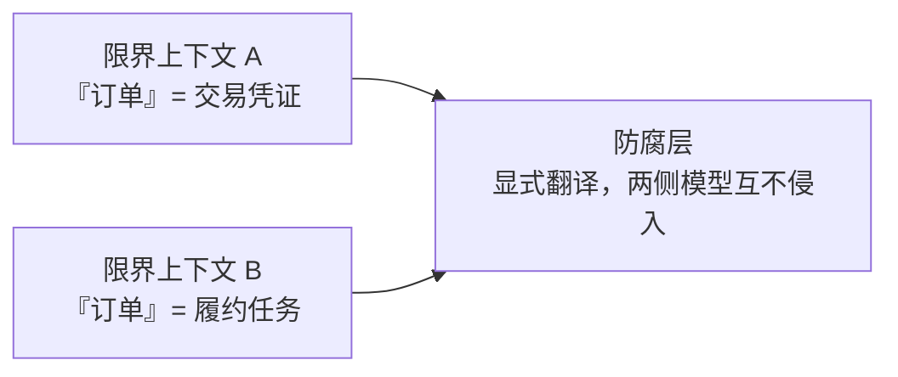
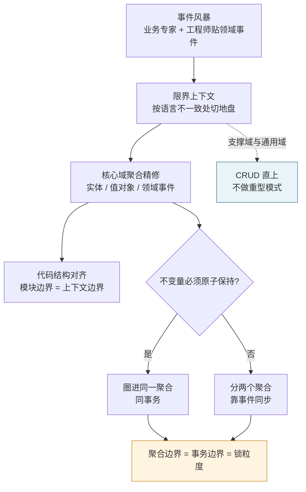
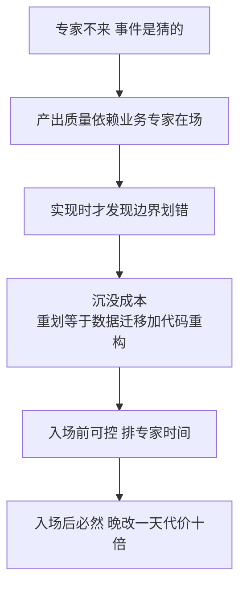

# 领域建模的实施路径：从事件风暴到聚合边界

## 要解决的问题

业务说"订单"，代码里有个 Order 类，数据库有张 order 表——三个"订单"长得一样，语义各说各话：**业务嘴里的订单生命周期（下单、支付、履约、售后）在代码里散落在五个服务的方法名里，改一个流程要跨五个团队协商**。**模型缺位才是根源，代码风格倒在其次：系统没有一个让业务与技术共享的语言和结构，双方各自维护对同一现实的心智模型，每次对话都要现场翻译**。领域驱动设计（DDD）的实施路径要解决的：怎么从业务对话里把模型挖出来（事件风暴），怎么把模型变成代码结构（聚合与边界），让"改业务"变成"改模型"的局部手术。

## 它是怎么做到的，本质是什么

事件风暴产出的领域事件，最终要落成可执行的模型。事件溯源的形态正好对上：**命令触发事件，事件追加进存储并驱动视图更新，读方查的是视图，写方留的是事件序列**。


**事件风暴：从动词挖模型**。**工作坊形式：业务专家与工程师一起，把业务流程写成领域事件（过去式短语：订单已提交、支付已确认、库存已锁定），事件按时间线贴墙**。**从事件反推：每个事件由什么命令触发（提交订单）、命令作用于什么聚合（Order）、聚合依赖哪些规则（一个订单只能有一个支付单）**。**事件是稳定锚点**——业务流程天天变，业务事件（"支付已确认"）比任何实现（支付服务的方法）都活得久。产出物：事件清单、命令清单、聚合候选、边界轮廓（哪些事件属于同一伙）。

**聚合：一致性的事务边界**。**聚合是一组总被一起读写的对象簇，由一个根实体对外（Order 是聚合根，OrderItem 藏在根后，外部只能通过根访问内部）**。**纪律三条：外部只持根的 ID（不持 OrderItem 引用）、聚合内一次事务修改（跨聚合不共事务）、聚合间只靠事件同步（下游订阅 OrderSubmitted 事件，不直接改 Order）**。**聚合的判定标准是业务不变量**：必须原子保持的规则（"订单总价 = 明细之和"）圈在同一聚合内，不要求原子的规则（"库存数 ≥ 0" 与订单状态）分成两个聚合。**边界划对了，并发冲突就对了**：两个操作改同一聚合才冲突，聚合边界即锁粒度（锁保护的范围大小、直接影响并发度），**划太大（全库一个聚合）并发困难，划太碎（每字段一聚合）不变量没处放**。

**限界上下文：语言的边界**。

**限界上下文解决同一词的多义，防腐层在边界上做显式翻译**：**共享一套「万能商品模型」会膨胀成各部门语义的并集，各自建模加防腐层则把差异限制在翻译层内部**。



**图上两个上下文里「订单」的含义完全不同：A 侧是一张交易凭证，B 侧是一件履约任务，翻译进防腐层，两侧模型互不侵入**。同一词在不同部门语义不同（"商品"：销售侧是 SKU——Stock Keeping Unit，库存量单位——与价格、仓储侧是货位与批次、财务侧是科目与税率）。**限界上下文给每个语义划地盘，地盘内有统一语言（ubiquitous language，即业务与技术共用的一套术语），地盘间靠防腐层（anticorruption layer，做模型翻译的一层）互相隔离**——不是共享一个"万能商品模型"（**共享模型会变成所有部门的并集，谁都用不动**），是各自建模 + 显式翻译。



主干是"先粗后细"的四步，右侧那两个分支是判定规则：是否进重型模式看域的类型，是否圈进同一聚合看不变量要不要原子性。两条判定都不看"数据长得像谁"。

**事件风暴出全景（大图）→ 限界上下文切地盘（战略设计）→ 核心域的聚合精修（战术设计，实体/值对象/领域事件）→ 代码结构对齐（模块边界 = 上下文边界，包结构 = 模型结构）**。**战术设计（实体、值对象——无身份、按属性判等的不可变对象）、工厂、仓储（以集合式接口存取聚合的组件）只做核心域**：**支撑域与通用域用 CRUD（Create/Read/Update/Delete，增删改查四种基本操作）直上**，**DDD（Domain-Driven Design，领域驱动设计：以业务领域模型为核心的软件设计方法） 的重型模式全铺是过度设计的标准形态**。

## 它从哪儿来，要付什么代价

**按租户分片是建模结论落到存储时的常见形态：每个租户的数据落在自己的分片里，租户之间天然隔离**。**边界画在业务上，隔离落在存储上，两者要能对齐**。Azure 官方多租户模型文档把这层隔离画成两种档位：共享应用层、每个租户一个存储分片（隔离画在数据边界上），与每个租户一整套独立部署（隔离画在整个部署单元上）。**选哪一档由聚合边界与租户规模决定——隔离档位是建模结论在存储与部署层的投影**：


*图源：Microsoft Learn《Tenancy models for a multitenant solution》，CC BY 4.0，https://learn.microsoft.com/en-us/azure/architecture/guide/multitenant/considerations/tenancy-models。*


*图源：同上（Microsoft Learn《Tenancy models for a multitenant solution》），CC BY 4.0，同上。*


*图源：Microsoft Learn 中文文档，CC BY 4.0，https://learn.microsoft.com/zh-cn/azure/architecture/patterns/sharding。*

Eric Evans《Domain-Driven Design》（2003）提出战略/战术两层；Vaughn Vernon《Implementing DDD》（2013）补实施纪律（聚合设计原则）；事件风暴由 Alberto Brandolini（2013 前后）发明，把建模从"读蓝皮书"变成"贴便利贴"的协作工作坊。**社区在微服务潮（2015+）把限界上下文当服务划分的判据用，DDD 从 OOP（Object-Oriented Programming，面向对象编程）社区小众方法论升为主流架构工具**。

**把"模型"从文档里的名词表变成"事件驱动的一致性边界"**：**传统建模画实体关系图（静态名词），事件风暴以动词（事件）为锚，聚合把动态流程与静态结构焊在一起**——边界由"不变量要什么原子性"决定，不是由"数据长得像谁"决定。**事件锚定让模型与并发正确性挂钩：聚合边界即事务边界即锁粒度，模型错误直接变成线上锁冲突或一致性漏洞，可观测、可修**。代价：**事件风暴的产出质量依赖业务专家的在场**——专家不来，工程师自己贴的事件是猜的，模型精致地错；**建模沉没成本（重划聚合等于数据迁移加重构，晚改代价成倍涨）**；DDD 生态的教条化风险（实体/值对象/仓储四件套当圣旨套到 CRUD 场景，社区有大量"Hello World 级 DDD"的反面教材）；**适用判定：业务逻辑复杂度是入场券**——规则多、变化频繁、长期演进的领域（交易、履约、风控）值回票价；**纯技术域（网关、存储封装）与简单 CRUD 上 DDD 是负收益**。

## 这套说法在哪儿会失效

- **聚合边界第一次划错是常态**。实施纪律：先按业务专家直觉划，上线后用观测校准（聚合锁冲突热区、跨聚合"分布式事务"打补丁的地方，就是边界错的信号），模型是演化的产物不是设计一次性产物。
- **事件风暴挖出的不全是领域事件**。工作坊贴的"已生成报表"是流程事件（技术动作），不是领域事件（业务关心的事实）。判定问句：业务复盘时会说"这个事实发生了，后续都受它影响"吗？不是的话剔除。
- **CQRS（Command Query Responsibility Segregation，命令查询职责分离：读写两套模型各自优化）不是 DDD 的必选项**。**命令查询职责分离在读写模型差异大（复杂查询 vs 严格写入）时有账可算，但引入读写两套模型 + 事件同步管道的复杂度。多数聚合读写同构，直接一套模型**。
- **微服务 ≠ 限界上下文一对一**。**一个上下文可以先是一个模块（同进程内包边界），边界稳定后再独立成服务**。跳过模块阶段直接上微服务，是把"将来可能要独立"提前付成"现在必须运维分布式"的利息。

四条代价的触发条件不一样，其中只有一条是方法论本身的问题，对照见下图：



图上从「专家不来 事件是猜的」走到「入场前可控 排专家时间」，再到「入场后必然 晚改一天代价十倍」。右边两栏的分界就是"业务逻辑复杂度是入场券"这句话的依据：**教条化与专家缺席都可以在入场前规避，沉没成本则是入场之后必然要付的，只能靠尽早在实现阶段校准来压低**。**复杂度不足这一条最容易被忽略——它说它解决的问题在纯技术域里根本不存在**，而不是说 DDD 不好。

## 怎么自己动手验证

- **事件风暴工作坊实验**：**对一个真实业务流程（如退换货）跑 2 小时迷你事件风暴，产出事件/命令/聚合清单**。预期：业务专家与技术对同一流程的分歧在墙上显形——同一"退货"两人贴的事件不同，分歧点即翻译损耗所在。模型缺位的一手证据。
- **聚合边界审计**：对存量系统列出"跨服务事务/TCC（Try-Confirm-Cancel，三阶段提交式补偿，与 saga 同属最终一致路线）/saga 编排"的位置清单，对照聚合定义。预期：每个跨聚合强一致的地方对应一条"本应同聚合却被分成两处"的不变量，清单长度即边界债。模型与实现错位的审计方法。
- **统一语言检验**：**随机抽 10 个业务对话中的名词（站会、需求评审），检查代码里是否有同名概念（类/方法/表）**。**预期：高频业务名词在代码缺席——用 process_data 这类通用词顶替，缺席清单即语言缺失。统一语言执行程度的可量化检验**。

## 动手跑一遍会看到什么：建模的账

```text
一次事件风暴的推演账（通用形态）：

列事件：贴橙色便签，全部用过去式业务语言（"订单已取消"），不提表和接口
  找命令与角色：什么动作触发事件、谁触发 → 顺带暴露流程断点
    （"订单已发货"找不到触发者 → 仓储系统是流程黑洞）
  聚合划界：事件按"必须同事务一致"聚堆 → 堆就是聚合，堆边界就是事务边界
  限界上下文：语言不一致处就是边界（销售叫"客户"、客服叫"工单主体" → 两个上下文）
  验收账：聚合内不变量能写成一条可检查的规则才成立
    （"账户余额 ≥ 0"能查；"用户体验良好"不能查 → 后者进上下文级约束）
```

**事务边界失守的实录——订单与库存划在一个聚合外却同库强一致更新，高峰期锁冲突把下单 P99（把所有请求响应时间从小到大排，第 99 百分位的值，99% 的请求比它快） 拖到 4 秒**；**按事件风暴重新划界、库存改最终一致后回到 200ms**。语言不一致没建上下文的实录——销售侧"客户等级"与客服侧语义不同却共用一张表，改字段两头炸（各建上下文 + 防腐层隔离后互不影响）。

**便签直接翻成表的实录——事件风暴开完当天就把橙色便签一对一建表（事件是业务事实，表是存储实现，一对一映射把建模成果全部丢掉）；先出聚合与上下文，存储选型后置**。事件驱动的一致性代价见 [[工程知识/后端系统：在并发、失败与变化中维持服务/服务设计/事件驱动架构的解耦代价：最终一致与可追溯性.md]]、聚合与事务边界的配合见 [[工程知识/数据系统：在并发与故障中保存事实/事务与存储/事务边界应覆盖完整业务用例.md]]、防腐层隔离外部模型见 [[工程知识/软件构建：让变化可以理解、验证与交付/架构与代码/适配器与防腐层隔离外部模型.md]]。

## 接着读哪几篇：聚合间靠事件同步

- [[工程知识/软件构建：让变化可以理解、验证与交付/架构与代码/设计模式解决的是变化点的隔离.md]] —— 聚合是模式思想在业务建模层的放大版：隔离变化点与一致性边界
- [[工程知识/软件构建：让变化可以理解、验证与交付/架构与代码/架构适应度函数：把架构约束写成可执行检查.md]] —— "跨聚合不得共事务"这类边界纪律可写成适应度函数
- [[工程知识/后端系统：在并发、失败与变化中维持服务/服务设计/事件驱动架构的解耦代价：最终一致与可追溯性.md]] —— 聚合间靠事件同步，事件驱动的代价在链路篇展开
- [[工程知识/后端系统：在并发、失败与变化中维持服务/服务设计/微服务划分的判据：从团队认知到数据边界.md]] —— 聚合边界是数据边界的建模方法