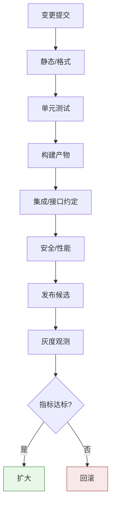
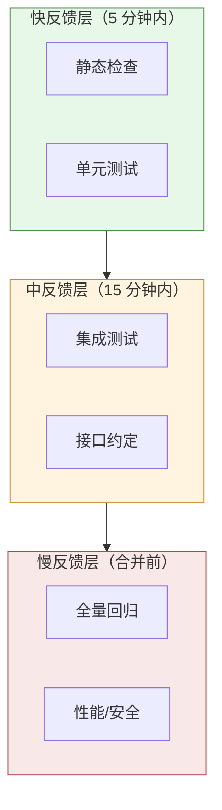

# CI流水线把反馈速度和发布证据连接起来

## 要解决的问题：一次变更从源码身份到发布候选要经过哪些判断点

**变更在本地通过全部检查，进入干净环境却重现不了，或者发布之后无法说明当时验证的是哪个版本、跑过哪些检查**。**本篇回答：一次变更从源码身份到发布候选要经过哪些判断点、每一段需要保存什么证据、反馈时长怎样影响提交行为，以及哪些失败不能被重试掩盖**。

## 它是怎么做到的，本质是什么

**流水线把一次变更的多个判断点串成一条链，每个判断点输出的是绑定到具体源码版本的证据，链的整体价值来自证据的可追溯性**。**反馈时长由最慢的判断点决定，因此阶段划分与并行化决定开发者是否在提交后等待结果**；缓存与影响面分析（识别一次改动会波及哪些模块与用例的计算）的作用在后文收束句统一交代。

**CI（Continuous Integration，持续集成：代码合并后自动构建与测试）/CD（持续集成与持续交付：每次提交都自动构建、测试，并把产物推进到可发布状态）把一次变更从源码身份带到可验证产物、环境和回滚（把系统状态退回到改动之前的版本），命令排成 YAML（缩进层级的配置文件格式）只是它的外观**。**快反馈检查发现明显错误，慢反馈检查证明集成、性能、安全和发布行为；两者需要按风险分层**。

**流水线上其实跑着两条链：一条是判断链，从静态检查一路走到灰度（新版本先放一小部分流量验证，逐步放大到全量）观测，每一环回答"这个变更能不能往前走一步"；另一条是证据链，每一环把 revision、环境、命令、退出码和产物存下来，回答"凭什么这么判断"**。**判断链决定流水线严不严格，证据链决定事后能不能查**。**多数流水线的毛病出在只建了前一条——绿灯该亮的时候亮，但三个月后没人说得清那次发布验了什么**。

**这张图画的是判断链；证据链不画在上面，它伴随每一环把同一份证据清单存下来**。**把两条链叠起来看，缓存与并行化的位置也就清楚了：缓存、并行化与影响面分析只改变判断链的长度，不改变任何一环的严格程度，也不影响证据链存什么**。

**「缓存只加速可重建结果」的实物原型是木活字印刷：单字刻成活字（输入的缓存键），一版书排坏了拆掉重排（结果可重建），活字本身不因为排错版而作废；刻工在字模上留名（证据链），书出了错能追到是哪一副字模、谁刻的——缓存命中与证据追溯用的是同一副活字**：

*图源：Wikimedia Commons，作者 Popolon，CC BY-SA 4.0，https://commons.wikimedia.org/wiki/File:Beijing_printing_museum.wooden_movable_types.jpg。*

**流水线缓存与活字的边界也一样：字模（缓存键）必须覆盖排这本书用到的每个字——漏了一个字（输入没进缓存键），重排出来的书就悄悄少了内容，表面看印刷稳定，实际把差异藏进了纸里**。

## 一条可信的流水线要满足什么

**每一步保存 revision、环境、依赖、命令、退出码、日志和产物**。**缓存只加速可重建结果，不能隐藏输入变化；并行任务要避免共享可变目录和相互清理**。

**"可重建"是缓存的适用边界**。**若一个结果依赖的输入没有被完整缓存键覆盖，缓存命中就会返回本应变化的旧结果——这时流水线看似稳定，实际是把真实差异藏起来了**。**判断标准是：把缓存清空重跑，结果应当一致。不一致说明缓存键漏了输入，而不是**构建不稳定**。

## 质量门禁卡在哪几道

**门禁要对应风险：schema 兼容、迁移、并发、权限、依赖漏洞、性能回归不能被一个绿色单测（针对最小可测单元的自动化测试）代替；产出模型制品或搜索索引的仓库，还需门禁模型与索引质量**。**失败分类要区分代码、测试、环境、网络、权限和数据问题，重试预算不能覆盖失败事实**。

门禁环节的摆位决定了**反馈环的形状**。下图是持续交付的触发链时序：交付团队的每次签入（check in）触发构建与验收测试，红线表示该轮反馈失败，绿线表示通过并推进到下一环，用户验收与发布两环需要人工批准（approval）才继续：

*DevOps 工具链全景：项目管理、持续集成与持续测试、持续交付、持续运维四段，以及各段使用的工具（图源：CSDN 博客）*

*持续交付的触发与反馈时序（图源：Wikimedia Commons，Grégoire Détrez 绘，基于 Jez Humble 原图，CC BY-SA 4.0）*

**红线在早环出现时修复成本最低，这是「快反馈层先跑」的直观解释：同样的失败，越晚暴露，牵连的环境与人员越多**。

## 这些量在什么数量级：反馈时长的预算表

**流水线各阶段的时长预算决定开发者行为：单次提交的反馈在 10 分钟内，开发者会等结果再切任务；超过 30 分钟，开发者批量提交、问题定位单元变大，缺陷修复成本随定位延迟上涨**。**预算的常见分法：静态检查与单测 5 分钟内（并行化）、集成测试 15 分钟内（按变更影响面裁剪）、全量回归（改动后重跑全部既有用例）只在合并前跑**。**提速的手段按收益排：测试并行分片（收益线性）、依赖缓存（首次构建省 50-80%）、影响面分析跳过无关测试（大库收益显著）**。

**三层自快到慢排序，也是从便宜到贵：快反馈层失败一次只花几秒到几分钟，慢反馈层失败一次可能要几小时**。**反馈时长预算的本质就是这个排序——把能在快反馈层抓到的错误漏到慢反馈层去抓，是在用最贵的手段解决最便宜的问题**。

**下面的部署流水线图把这条链画成了贯穿形态：提交从左侧进入，构建、自动化测试、类生产环境测试逐段推进，越靠右环境越接近生产，越靠右的问题修复成本越高——这与上文「快反馈层先跑」的预算排序是同一件事**：

*图源：Martin Fowler《Continuous Integration》部署流水线插图，martinfowler.com，https://martinfowler.com/articles/practical-test-pyramid/buildPipeline.png（maintenance，deployment pipeline，构建→测试→类生产验证的推进方向）。*

## 真实案例里发生了什么：门禁证据的衔接

**流水线的门禁环节与** [[工程知识/软件构建：让变化可以理解、验证与交付/测试与交付/发布门禁必须绑定真实证据]] **一脉相承：流水线不只是跑测试，是给发布决策供证据（哪个 commit、哪些测试过、什么环境验过）**。**反面教材在缺陷分析知识库有实录：类配置漂移（实际生效的配置逐渐偏离预期值）问题：**[[工程知识/缺陷分析：从个案到体系/配置/案例四：配置不生效——recover 速率与重复日志]] **类的配置漂移问题，正是流水线里缺"配置生效值核对"这一步证据的后果——门禁链条上一环缺失，问题就会在产线现形**。

## 这套说法在哪儿会失效

- 流水线的可信度取决于**执行环境与开发机状态分离**：**依赖本地缓存或本地服务时，干净环境重建会失败**。
- **缓存只加速可重建的结果**：**把输入变化一起缓存会掩盖真实的构建差异**。
- **并行任务之间不能共享可变目录**：**共享时相互清理与相互覆盖会让失败无法定位到具体任务**。
- **门禁覆盖的范围由检查项决定**：**单测通过不覆盖 schema 兼容、迁移、权限与性能回归**。
- **重试会掩盖失败事实**：**区分不了代码问题与环境问题时，重试把真实缺陷留在流水线之外**。

## 效果从哪儿来，要付什么代价

**收益是反馈与发布证据连续——每次变更都能回答"验了什么、在哪验的、结果如何"，事故复盘能定位到具体的判断点缺口**；**代价是运行时间、维护矩阵（多平台多版本组合）和 flaky 治理的持续投入**。**跳过流水线的代价在于发布决策失去依据：一次无法说明验证内容的发布，其排查成本与信任损失远超流水线本身的运行开销**。

## 怎么自己动手验证

- **故障注入（主动向系统注入故障来验证容错能力的测试方法）对账**：**预写注入不稳定用例（flaky：同代码同环境偶现失败的用例——依赖不可用、缓存污染、取消、超时、执行机崩溃、部分发布），重跑后核对结果是否可解释、产物是否绑定正确 revision、报告能否支撑发布结论**。
- **干净环境重建**：**周期性在全新环境全量重建，验证流水线不依赖开发机状态**；**重跑结论与预期对不上时，先查缓存键是否漏了输入**。

## 接着读哪几篇：同在软件构建里的相邻问题

- [[工程知识/软件构建：让变化可以理解、验证与交付/测试与交付/发布门禁必须绑定真实证据]]
- [[工程知识/软件构建：让变化可以理解、验证与交付/开发工具/依赖供应链需要锁定来源与构建输入]]
