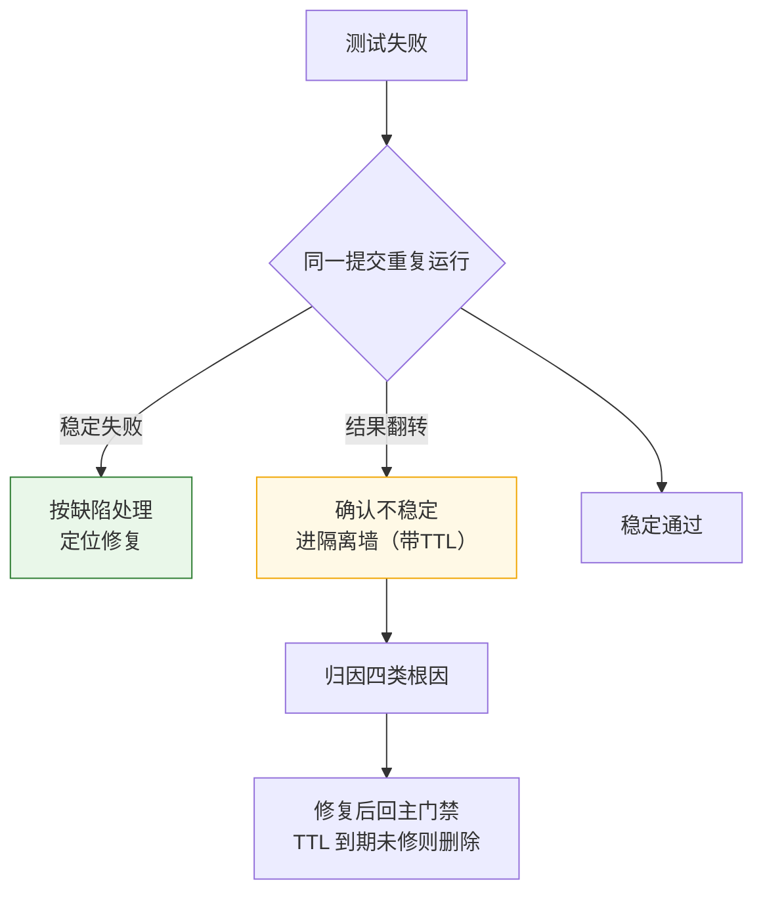

# 不稳定测试的判定与归因：从无限重跑掩盖到按失败形态分诊

**不稳定测试（flaky test，同一提交下时而通过时而失败的测试）的工程问题不在「测试偶尔失败」，在失败信号失去语义：红灯不再指向代码问题，团队学会重跑绿灯，防线整体失效**。 读完你能回答：**怎么量化判定一个测试不稳定、四大根因各自怎么修、重跑策略在什么前提下合理、隔离与分诊的流程怎么搭**。

## 要解决的问题

CI 里红灯的处理成本由信号的可靠程度决定。**稳定测试红灯 → 代码问题，修复；不稳定测试红灯 → 三种命运：无脑重跑（掩盖）、标记跳过（防线减员）、花半天排查（成本失控）**。**三条路都源于同一个缺失：没有把不稳定本身当作被诊断、被治理的对象**。**治理的单位因此不是单个测试，是全仓库的不稳定率（同一提交多次运行的结果不一致比例）——它决定整个 CI 信号的可信度**。

## 机制：判定、归因、分诊三段闭环

### 判定：用重复运行量化不稳定率

判定一个测试是否不稳定，标准方法是同一提交重复运行 N 次（自动化工具：`go test -count=N`、`pytest -n` 配合 rerun 插件、gtest 的 `--gtest_repeat`），**统计结果翻转比例**。仓库级的持续监测：**CI 记录每个测试的「同提交历史结果」，翻转率超阈值的测试自动进入不稳定清单——判定是常态机制，不是出事后的专项排查**。

### 归因：四大根因各有修法

| 根因 | 指纹 | 修法 |
| --- | --- | --- |
| 时序与并发 | 跑得越多越易翻车；与负载相关 | 显式同步替代 sleep；虚拟时钟；减少真实并发依赖 |
| 环境与外部依赖 | 换机器/时段就翻车 | 依赖容器化与契约测试；测试数据自造不共享 |
| 测试间污染 | 单跑过、串跑挂；顺序敏感 | 每测试独立夹具与数据；随机顺序暴露依赖 |
| 断言过弱或过强 | 比较浮点不设误差；断言实现细节 | 容差比较；断言语义而非结构 |

归因的通用手法与缺陷分析一致：**稳定复现（单跑/串跑/换环境对照）→ 缩变量 → 定位根因类别**。

### 分诊：隔离墙与修复队列

判定与归因之间的流程位：确认不稳定的测试**立即移出主门禁**（隔离，quarantine），**防止单点污染整条 CI 的信号语义**；**同时进修复队列按根因与 owner 排期**。**隔离墙要带 TTL（两周不修自动删除测试）——隔离是缓刑不是赦免，否则隔离区变成跳过区的委婉说法**。**主门禁里只允许稳定测试存在，信号纯度优先于覆盖率数字**。

### 重跑的合理前提

重跑（retry on failure）本身不错，错在无差别重跑。合理前提：重跑次数固定且记录（重跑通过 ≠ 通过，要留痕）、不稳定清单里的测试不许靠重跑回主门禁、重跑率进监控（仓库重跑率上升说明不稳定率在涨）。无前提的自动重跑等于把判定权交给了运气。

## 案例：信号失真的家族缺陷

[[工程知识/缺陷分析：从个案到体系/正确性/日志级别的语义：把提示当告警，告警就成了背景噪音]] 是告警域的同构：低级别信号刷屏后真告警失效。不稳定测试是测试域的同一结构：翻转信号多了，团队对红灯脱敏，真实缺陷在重跑文化里流通上线。[[工程知识/软件构建：让变化可以理解、验证与交付/测试与交付/可重复构建把产物可信从来源信任换成证据信任：非确定性来源清单与消除]] 把同一原理推到构建域：非确定性来源（时间戳、路径、随机序）要显式消除——测试不稳定的四大根因与构建非确定性的来源清单高度重叠，治理手法同族：**把「偶尔不一样」的所有来源找出来，逐个消除或显式化。**

## 怎么测

- 不稳定率报表：每个测试的历史翻转率、仓库重跑率、隔离区数量三指标月报，趋势上升即治理动作。
- 判定自动化：CI 集成重复运行工具，新出现的翻转测试自动进隔离与队列，不靠人报。
- 隔离墙审计：隔离区清单按 TTL 审计，超期未修的删除或降级为冒烟外测试。
- 根因分布复盘：季度统计四大根因的占比，占比最高的一类指向仓库级的系统性改进（如测试夹具架构）。

## 哪些认识一看就错

- 「重跑通过就当没事」——翻转本身就是缺陷信号，重跑通过只是把判定推迟到生产环境；重跑必须留痕且受清单约束。
- 「不稳定测试先跳过，有空再修」——跳过是永久性防线减员；隔离带 TTL 的缓刑结构才有退出机制。
- 「不稳定率是测试质量问题」——它同样是产品代码问题的信号（真实竞态缺陷往往先以测试不稳定的形式出现）；归因时两个方向都要查。
- 「覆盖率优先，稳定可以容忍」——不稳定的覆盖是虚数：翻车的用例在关键时刻不提供判定力；信号纯度是覆盖率的前提。

## 效果从哪来、要付什么代价

判定自动化让不稳定无处藏身，隔离墙保住主门禁的信号语义，根因分类让修复从经验玄学变成按类施工。代价是**治理机制的持续运行：重复运行的 CI 时长成本**（抽关键路径跑）、隔离墙与队列的管理成本、根因修复的工程投入。收益按 CI 的整体价值结算：红灯恢复「指向代码问题」的语义后，所有测试的投资回报同时回升——不稳定治理是测试资产的保值手段。

关系：[[工程知识/软件构建：让变化可以理解、验证与交付/测试与交付/可重复构建把产物可信从来源信任换成证据信任：非确定性来源清单与消除]] —— 非确定性来源的构建域同族治理。[[工程知识/缺陷分析：从个案到体系/正确性/日志级别的语义：把提示当告警，告警就成了背景噪音]] —— 信号失真的告警域同构。[[工程知识/软件构建：让变化可以理解、验证与交付/测试与交付/测试环境与生产的差距要按维度补偿：并发、数据量、配置与故障注入的逃逸清单]] —— 环境类根因的系统性视角。
