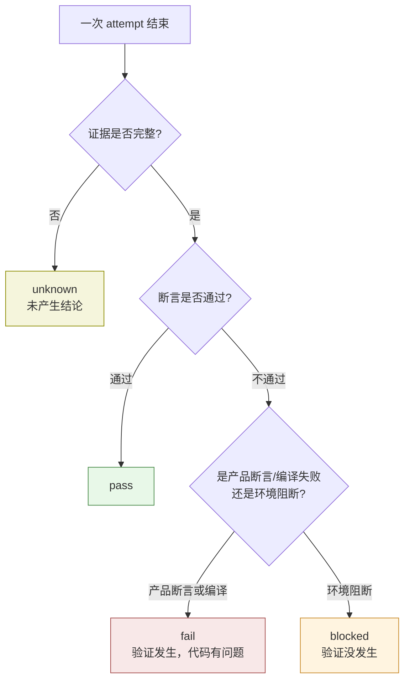
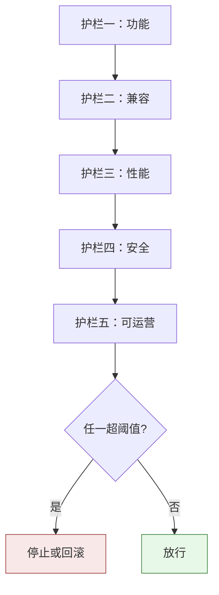
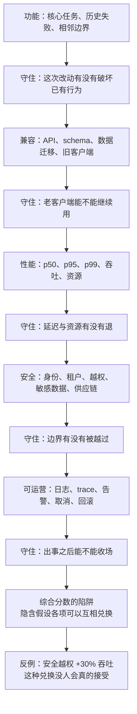

# 发布门禁必须绑定真实证据

一个步骤成功，不能自动扩大成整个目标成功。格式检查通过不等于**编译通过**，编译通过不等于**测试通过**，测试进程退出 0 不等于**目标代码被覆盖**，部署完成也不等于**用户任务正确**——**一列绿灯为什么靠不住，就是这篇要讲清的问题**。读完你能给自己的发布流程加上真正查状态的门禁，不再被一列绿灯骗过。

发布门禁的对象是可验证事实，不是流程勾选：**每条结论都要绑定源码 revision、命令、环境、退出码、产物和断言粒度；证据不足时保持 unknown，而不是为了绿色发布猜一个成功**。

下文把一次验证执行称为一次 attempt：同一 revision 可以有多次 attempt，每条事实绑定到具体某一次。

事实的粒度不能被放大

流程里相邻的两步，粒度常常差着一整级。流水线把几十个步骤排成一列绿灯，看着像一条完整的证据链，**实际上每个绿灯只证明它自己那一格**——`validate` 的绿只覆盖到 `validate` 这个阶段（Maven——Java 的构建与依赖管理工具） 生命周期里的一个 phase，`exit 0` 的绿只覆盖到那个进程按自身语义退出。

**危险之处在于，人眼看到一整列绿灯时，会不自觉地把最弱的那一格读成最强的那一格，"测试通过了"被理解成"这个修复验证过了"**。粒度放大之所以反复发生，是因为**它不需要任何步骤的执行者犯错——每一格的报告都是真的，错的只是把它们连起来读的那个动作**。

一列绿灯对应一排各自为政的机器。下图是一个装满 1U 服务器的机架：每一台跑流水线的一段，机器上的状态灯各自闪各自的绿——**把一排绿灯读成一条证据链的动作，正是门禁要拦的那个动作**。


> 图：装满 1U 服务器的机架，来自 [Wikimedia Commons](https://commons.wikimedia.org/wiki/File:Servers_in_a_Rack.jpg)，CC BY-SA 3.0，摄影 Abigor。

门禁要拦的正是这个动作。

本质：证据与结论的配对关系

门禁运行起来是一组配对——**每条结论必须绑一条同粒度的事实，且这条事实要能在事后被重新取出来独立核验**。检查项会随使用的技术变化（今天的最小单元是 Maven，Java 的构建与依赖管理工具）phase，明天可能是 Bazel action——Bazel 构建图里的一个执行动作，配对关系不变：**结论的力度永远不能超过它脚下那条证据的力度**。

把配对关系看清之后，门禁新增一项的判断标准也随之确定——**第一问永远是"这条结论靠什么证据支撑"，答得出证据再谈"要不要加一道检查"**。就证据绑定这个目标而言，答不上来证据的检查项很难让发布更安全，往往只是让绿灯更长。

| 已确认事实 | 可以结论 | 不能结论 |
| --- | --- | --- |
| 命令被模型输出 | 生成过命令文本 | 命令实际执行过 |
| 命令退出 0 | 该进程按自身语义成功退出 | 目标行为正确 |
| Maven validate 通过 | validate 阶段完成 | compile/test 完成 |
| 测试套件通过 | 运行的断言均通过 | 目标分支或修复被覆盖 |
| coverage 命中目标行 | 此次运行经过该位置 | 所有语义和边界正确 |
| 部署控制器 Ready | 资源满足就绪条件 | 业务 SLO（Service Level Objective）与数据正确 |

**报告只能引用与声明同粒度或更强的证据**。这张表的用法是向右读：拿到一条事实，先看它能支撑到哪一列，超出就退回 unknown，**不要在报告里写成已确认**。

一次可审计验证

```yaml
verification:
  target:
    repository: repo-id
    revision: immutable-sha
    dirty: false
  attempt_id: attempt-3
  execution:
    argv: [...]
    cwd: ...
    environment_fingerprint: ...
    started_at: ...
    exit_code: 0
    stdout_ref: artifact://...
    stderr_ref: artifact://...
  coverage:
    target_symbol: package.Type.method
    evidence_ref: artifact://...
  result:
    assertion: "回归用例触发目标代码且结果符合预期"
    verifier: deterministic-test
```

`artifact://` 是产物寻址 scheme，指向本次 attempt 归档的日志与 coverage 文件，事后可按同一地址取回。

日志、报告和 coverage 都应绑定同一源码 revision、构建产物和 attempt，**不能拿旧报告证明新代码**。

`revision` 必须写不可变 sha 而不是分支名。**分支会移动：今天指向 A 提交的 main，下周可能指向 B 提交，用分支名绑定的证据在三个月后无法可靠还原当时跑的是哪份代码**。`dirty: false` 排除本地未提交的改动，否则报告对应的源码与真正进仓库的源码是两份不同的东西。`environment_fingerprint` 记录编译器版本与依赖版本，因为**同一份源码在不同工具链下可能表现出不同行为**。

**这三项合起来解决的是同一个问题：证据能不能在事后被独立取出并重新核验。缺任何一项，报告的可核验性都会断掉一环**。

失败状态不可折叠

至少区分下面几类：

- 产品断言失败（代码不对，这是真失败）；
- 编译或类型失败（同上，但修法不同）；
- 依赖、网络或权限造成的环境阻断（结论未产生，不是失败）；
- 测试基础设施失败（同上）；
- 超时、取消或资源耗尽（同上）；
- 未执行、未收集证据或证据不完整（同上）。

**区分的意义在于后四类都不是"产品有问题"，把它们折叠进一个红色 failed，会让团队去查一个根本不存在的代码缺陷，同时真正的信息——这次验证没发生——被丢掉了**。前两类是验证确实发生了、结论是**代码有问题**，与后四类的处置路径完全不同。

**"测试不适用"是需要证据的语义判断，不能用于覆盖依赖下载失败；unknown 也不能被投影成 pass**。



已确认事实单调累积

后续 attempt 失败不能抹掉先前已经确认的事实。例如 attempt 1 已稳定复现缺陷，attempt 2 因网络失败没有完成修复验证，最终报告应同时保留"缺陷已复现"和"修复验证被环境阻断"。

这条规则针对的是"最后一次文本覆盖全部历史"的默认行为。多数系统会用最新状态覆盖旧状态，于是 attempt 2 的网络失败把 attempt 1 花了很久才拿到的复现结论一起冲掉了，下次再跑又要从头复现一遍。**事件日志追加事实，投影层按类型计算当前状态，历史才留得住**。

发布门禁

发布前将证据分成独立护栏，护栏结构见下图：

- 功能：核心任务、历史失败与相邻边界；
- 兼容：API、schema、数据迁移和旧客户端；
- 性能：代表性负载下的 p50/p95/p99、吞吐和资源；
- 安全：身份、租户、越权（访问了权限范围之外的资源）、敏感数据和供应链；
- 可运营：日志、trace、告警、取消、回滚（把系统状态退回到改动之前的版本）与恢复。



灰度（新版本先放一小部分流量验证，逐步放大到全量）期间比较版本，而不是**只看新版本绝对值——新版本的 p99 单独看可能是达**标的，但相对旧版本退了 30%，绝对值会把这个回归藏起来。

任一关键护栏超过阈值**即停止或回滚**；**不要用综合分数让性能提升抵消正确性或安全回归**。综合分数是个陷阱：**它隐含假设各项之间可以互相兑换，而"安全越权 +30% 吞吐"这种兑换没人会真的接受**。

五道护栏各自守的是不可兑换的东西，综合分数会掩盖的正是这一点：



第三条还藏着一个读法问题：灰度期间要比较版本，而不是**只看新版本绝对值——新版本的 p99 单独看可能达标**，但相对旧版本退了 30%，绝对值会把这个回归藏起来。**可运营那一栏最容易被当成"软要求"，但它决定的是出事之后能不能收场：日志、trace、告警、取消、回滚与恢复，缺一项都会让事故处理时间成倍拉长**。

AI（人工智能辅助，这里指自动化生成或判定类工具）的正确位置

AI 可以理解项目、选择工具、适配测试、解释失败并提出下一步；框架负责隔离、真实执行、证据采集、结构校验、版本绑定和状态一致性。详细模型见 [[工程知识/AI 系统工程：从模型能力到生产能力/安全与治理/执行证据必须独立于AI结论]]。

**分界线画在"谁产生事实"上：AI 输出的命令文本只是意图，框架真实执行后的 exit code 与产物才是事实。让 AI 自己报告自己成功，等于把粒度放大的入口开在源头**。

效果与代价

Google SRE（Site Reliability Engineering，站点可靠性工程，用软件方法运营大规模服务的工程实践）把这套循环画成了圈：发布自动化带来更快更频繁的发布，每次发布的变更更少、引入的缺陷更少，于是有更多时间继续投入自动化——**门禁是让这个圈转起来的前提，缺了证据门禁的快，转的是另一个方向**：


*图源：Google SRE Workbook《Canarying Releases》，https://sre.google/workbook/canarying-releases/。*

证据门禁的收益是**发布质量可审计**（每次发布带的证据可回查，事故复盘能定位到门禁缺口），代价是**门禁建设与维护的工程投入、以及证据采集对发布速度的轻**度拖累；跳过门禁的代价不对称——一次未带证据的坏发布，其召回成本与信任损失远超日常的采集开销。

代价也不是一成不变的：证据采集的开销随流水线成熟度下降，而"查不出那次发布跑了什么代码"的成本随系统复杂度上升。**门禁该在哪个阶段建，取决于这两条曲线的交点出现在哪里**。

验证的锚点

门禁结论要能与历史回查对账——任取一次已发布版本，应能凭其证据记录还原当时的 revision、执行环境与断言粒度，并复算出与当时一致的结论；**对不上说明证据绑定缺项，而不是结论错了**。

## 门禁为什么要查真实状态，而不是进程在不在

「进程还活着」和「能正常服务」是两件事。健康检查端点模式把这两件事分开：外部监控按周期访问一个专门的端点，由应用自己汇报能否服务，而不是**只看端口通不通**。


*图源：Microsoft Learn 中文文档，CC BY 4.0，https://learn.microsoft.com/zh-cn/azure/architecture/patterns/health-endpoint-monitoring。*

这张图对发布门禁的直接含义是：门禁判定「这次发布成功了吗」，依据应当是应用自检后的结论，而不是**部署动作本身返回了成功。只查端口通的门禁会把「进程起来了但依赖没连上」判成通过**。

## 接着读哪几篇：门禁前的半径评估


- [[工程知识/软件构建：让变化可以理解、验证与交付/测试与交付/测试策略从风险选择证据]] · [[工程知识/AI 系统工程：从模型能力到生产能力/Agent与工作流/AI辅助研发必须形成证据闭环]]


- [[工程知识/缺陷分析：从个案到体系/复现与回归/回归风险评估把修复的爆炸半径圈出来]] —— 门禁前的半径评估