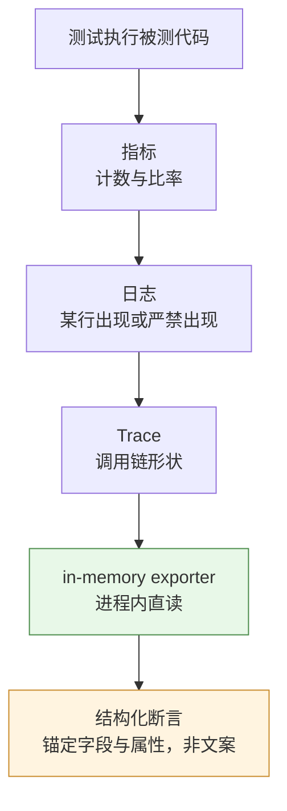
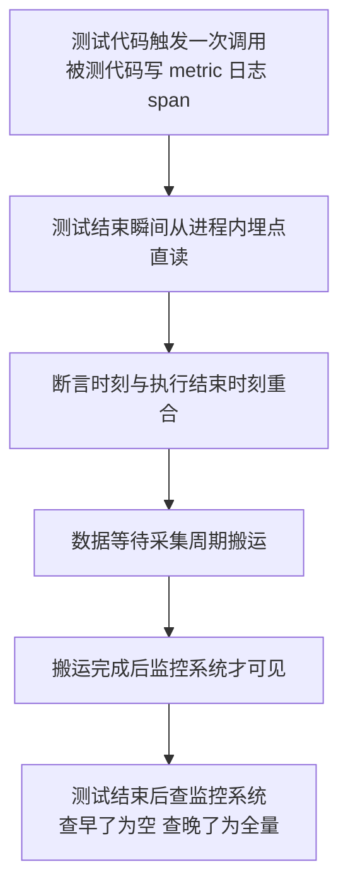

## 要解决的问题

传统测试断言的是返回值（调用 f(x) 得到 y），但很多正确性不在返回值里：这个请求是否走了缓存、慢查询有没有发生、重试了几次、日志有没有打出错误、资源有没有泄漏。这些运行时行为靠"跑完看监控"是人肉验证，**不可重复也不进 CI**（持续集成，每次提交自动构建并跑测试）。可观测性断言要解决的问题是**把运行时行为的期望写成机器可执行的断言**：**测试同时检查输出与"执行过程中发生了什么"**。

这是把可观测性[[工程知识/性能工程：从用户等待到资源瓶颈/观测与诊断/指标、日志、Trace与剖析各答一问，合起来才构成证据.md]]的信号体系接进测试体系的桥，与测试策略从风险选择证据[[工程知识/软件构建：让变化可以理解、验证与交付/测试与交付/测试策略从风险选择证据.md]]的"证据从哪来"问题衔接。

## 三类信号怎么变成断言：机制

先把形状说成一件事：普通测试像只看菜端上桌的样子（返回值对不对），可观测性断言像后厨装了摄像头与计时器——这道菜走了几次冰箱（缓存）、有没有超时重做（重试）、灶上是不是糊了（日志报错），都留下可回放的记录，验收时一并核对。这个比喻到"回放核对"为止——摄像头是事后人看，**断言要机器每次自动判**，所以**信号必须取成结构化数据**（指标数值、日志字段、调用链树形），这正是三类信号的断言形态要展开的内容。

**三类信号的断言形态**。

*图：OpenTelemetry（可观测性标准与配套工具集，统一采集日志、指标与链路）官方文档的链路瀑布图（中文版）。Trace 断言验证的对象就是这棵 span 树——链路必经鉴权 span（/authN）、调用顺序、父子关系与耗时上限；测试里用 in-memory exporter 拿到同一棵树，把图上的形状写成机器可执行的断言。*

*图源：OpenTelemetry 中文文档，[可观测性入门](https://opentelemetry.io/zh/docs/concepts/observability-primer/)。*

**「运行时行为要留证据」在嵌入式硬件上是逐件装出来的实物**：设备里的传感器以固定周期采样（只采集一部分数据以控制记录开销）、MCU 把读数写入环形缓冲区（固定大小首尾相接的缓冲区，写满后旧数据被覆盖），正常时无人翻看，一旦异常，**缓冲区里的时间序列就是复盘的全部依据**：

*图源：Wikimedia Commons，Mister rf，CC BY-SA 4.0，https://commons.wikimedia.org/wiki/File:IoT_Internet_of_Things_(1).jpg。*

（航班正常时无人翻看飞行记录仪，但它持续记录的高度、航向、操纵输入，**让任何一次异常都能复盘到秒**）。

**三类信号回答的是不同层面的问题，因此不可互相替代**：指标回答"发生了多少次"（错误数为零、命中率够高），日志回答"有没有留下这条证据"（降级即主动牺牲部分功能或精度、保住核心链路，触发时打了 WARN、审计事件已记录），Trace 回答"事情是按什么顺序发生的"（链路必经鉴权 span、慢链路里没有 N+1）。

- 指标断言：测试跑完后查询 metric（如 `http_requests_total{status="500"} == 0`，cache_hit_ratio > 0.9）。适用：**计数与比率类期望**（无错误、命中率高）。实现：测试进程内埋点（在代码里插入统计上报语句、收集用户行为数据）直读（micrometer 类 registry 断言）或测试后查询监控系统（Prometheus 的 PromQL in test）。
- 日志断言：期望某日志行出现（或严禁出现）。适用：**关键路径的日志证据**（降级触发时打 WARN、审计事件记录）。实现：日志 appenders 拦截（测试内捕获）或结构化日志的断言库。陷阱：**日志文案变化导致断言脆**（断言结构化字段而非自由文本）。
- Trace 断言：期望调用链的形状（span 数量、顺序、父子关系、duration 上限）。适用：**链路级期望**（RPC（Remote Procedure Call，远程过程调用：像调本地函数一样调远端服务）链路必经鉴权 span、慢链路无 N+1 查询）。实现：OTel SDK（软件开发工具包）的 in-memory exporter 在测试里断言 span 树。

**实现层次：进程内优先**。

进程内档与黑盒（不接触代码内部、只看输入输出的测试或分析方式）档的差别不在数据本身，而在取数的时刻——**这条时序把两条取数路径放到同一条时间轴上**：进程内那支在测试结束瞬间直读埋点，黑盒那支要等采集管道把数据搬进监控系统才查得到。

两条路径的取数时刻一个与执行结束重合、一个落在采集延迟之后，**这个时刻差就是同一份断言跑出两种结果的原因**。

进程内直读拿到的就是测试结束那一刻的状态；黑盒查询要等采集周期把数据搬运到监控系统，于是同一份数据在不同时刻查到的结果不同，**这个延迟差就是黑盒档 flaky 的主要来源**。

黑盒档最终查询的是监控系统里已经入库的时序面板，Grafana（监控面板工具）官方文档的这张仪表盘就是数据搬运完成后的形态——memory/CPU、logins、server requests 各面板按时间轴铺开，**断言在这个层面上查询的正是这些序列**：

*图源：Grafana 官方文档（grafana.com/grafana/），官方产品截图。*

**优先进程内：断言的是自己的行为，不需要外部系统的间接性**。**黑盒档留给需要真实基础设施的集成测试**。

**断言漂移与噪声治理**。可观测性断言的新风险：**断言本身会漂移**（埋点改名、span 结构重构后断言全红）与噪声（非确定行为：异步任务的日志时序、GC 触发的 duration 抖动）。治理：**断言的结构化锚定**（锚定 span.name 与 attribute 而非文案）、**非确定的容忍窗口**（duration 断言给区间而非点值）、**断言分层**（核心行为必断言，次要行为可选断言）。

**与接口约定测试的分工**。接口约定测试[[工程知识/软件构建：让变化可以理解、验证与交付/测试与交付/接口约定测试的适用边界：消费者驱动与提供者验证.md]]验证接口形状（请求/响应兼容），可观测性断言验证执行行为（调用链上发生了什么）。**互补：约定管"接口对不对"，可观测性断言管"过程对不对"**。**一个完整的服务级测试金字塔：单元（逻辑）+ 接口约定（接口）+ 可观测性断言（行为）+ 少量端到端（业务流）**。

## 这套做法从哪来、付什么价：背景与代价

可观测性断言的实践源头混沌工程（chaos engineering，Netflix 2011+）：故障注入后的系统行为（降级是否触发、流量是否切走）靠断言监控信号验证，**这是"运行时行为写进测试"的第一次大规模工程化**。OpenTelemetry统一了信号模型（metric/log/trace 的标准 SDK），**让断言有稳定的编程接口**。测试端的产品化（Honeycomb/Lightstep 的 CI 集成、OTel 的 assertion 库）是 2023+ 的事。

**"用 in-memory exporter 把 Trace 变成测试可以检查的返回值"**。OTel 的 SDK 架构天然支持 exporter 可插拔：生产环境导出到收集器，测试环境换 in-memory exporter，**测试代码直接遍历 span 树断言形状**。测试直读 span 树把"黑盒的运行时行为"变成"白盒（能接触代码内部、按代码逻辑做的测试或分析方式）的结构化数据"，**Trace 从诊断工具升级为测试证据源**。代价：**可观测性断言是第三种测试成本**——埋点维护（断言锚定 span 名与 attribute，埋点重构即断言碎，与业务代码耦合度上升）、非确定性（异步与并发的行为断言天然 flaky，要容忍窗口与重试逻辑）、调试成本（断言失败时要读 trace 才知道哪层错，比调用栈跟踪难读）。适用边界：**只对"行为即正确性"的场景值得**（降级、重试、审计、安全链路），普通 CRUD（Create/Read/Update/Delete，增删改查四种基本操作）的返回值断言仍是大头，别为了时髦给全部测试加可观测性断言。

## 这套说法在哪儿会失效

- **进程内断言优先，黑盒断言按需**。同进程直读 SDK 快且确定，黑盒查询外部系统有采集延迟与时序噪声。**只有测试真实基础设施（真实的 Prometheus、真实的日志管道）时才用黑盒档**。
- **断言锚定结构而非文案**。日志文案、span 名的重构频率高，**断言锚定结构化字段（event.type、span attribute）才稳定**。**文案断言是维护负担的制造机**。
- **行为断言的 flaky 治理要前置**。异步行为的断言（"日志最终出现"）要有等待与超时机制（awaitility 类），duration 断言给区间。**无治理的行为断言会把 CI 的红噪声推向不可用**。
- **不要把可观测性断言当覆盖率替代品**。它验证的是关键路径的行为证据，代码覆盖仍是覆盖证据[[工程知识/软件构建：让变化可以理解、验证与交付/测试与交付/覆盖率的三种读法：行分支与路径覆盖的证据强度.md]]，**两者维度不同不能互替**。

## 怎么自己动手验证

- **降级行为断言实验**：依赖故障注入（mock 依赖超时），断言降级日志 + fallback 指标出现。预期：**断言精确捕捉降级行为——返回值断言看不出降级是否真发生**。行为证据的直接演示。
- **span 树断言实验**：OTel in-memory exporter 断言典型链路的 span 形状（服务 A→B→C 的父子关系与顺序）。预期：**链路重构（B 内部改异步）后断言红，捕捉到行为变更**。链路行为回归的检测演示。
- **断言稳定性实验**：同一测试跑 100 次统计 flaky 率。预期：**无容忍窗口的 duration 断言 flaky 率 >10%，加区间后 <1%**。非确定性治理必要性的量化。

## 接着读哪几篇：信号体系与测试体系的桥

- [[工程知识/性能工程：从用户等待到资源瓶颈/观测与诊断/指标、日志、Trace与剖析各答一问，合起来才构成证据.md]] —— 信号体系与测试体系的桥
- [[工程知识/软件构建：让变化可以理解、验证与交付/测试与交付/测试策略从风险选择证据.md]] —— 行为证据在测试策略中的位置
- [[工程知识/软件构建：让变化可以理解、验证与交付/测试与交付/接口约定测试的适用边界：消费者驱动与提供者验证.md]] —— 接口证据与行为证据的分工
- [[工程知识/性能工程：从用户等待到资源瓶颈/观测与诊断/性能回归门禁：把性能预算写进CI.md]] —— 同一套断言思路在时间轴的另一端：它在合并之前拦回归，本篇在运行之后查行为
