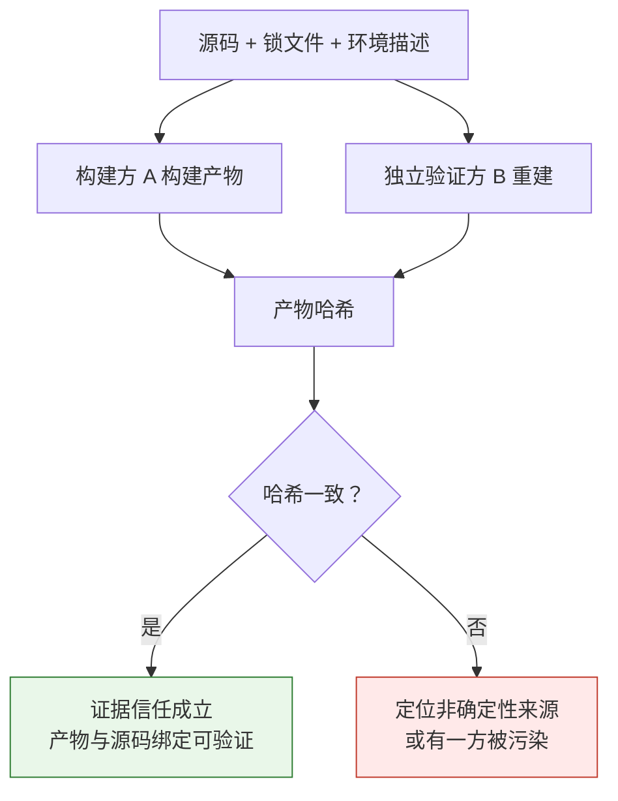

# 可重复构建把产物可信从来源信任换成证据信任：非确定性来源清单与消除

**可重复构建（reproducible build，同一源码在相同环境下重复构建产出逐字节相同产物的性质）的工程价值：产物验证从「信构建机」变成「对哈希」——供应链安全的锚点，也是构建缺陷的自检工具。** 读完你能回答：非确定性的来源清单有哪些、时间戳与路径怎么消除、验证闭环怎么搭、哪些不确定性要显式锁定而不是消除。

## 要解决的问题

常规构建流程里，产物可信依赖一条信任链：信构建机的环境干净、信依赖源没有被投毒、信 CI 没被篡改。**链上每一环都是攻击面**——SolarWinds 事件里，攻击者改的正是构建环节，产物带官方签名却内含后门。可重复构建改写这条链的可信结构：**构建过程变成纯函数（源码 + 环境描述 → 产物），验证方式变成重算比对**——两个人（或两台机器）独立构建同一源码，**产物哈希一致即互相证明环境干净；不一致即有一方被污染**。**信任从「来源权威」换成「证据可验证」**。

## 机制：非确定性来源清单与消除手法

**非确定性来源的消除是逐类施工**：

| 来源 | 表现 | 消除手法 |
| --- | --- | --- |
| 时间戳 | 嵌入构建时间到产物头 | `SOURCE_DATE_EPOCH` 环境变量统一时间源；归档文件 mtime 固定 |
| 文件路径 | 调试信息/日志含绝对路径 | 相对路径编译；`-fdebug-prefix-map` 重映射 |
| 随机序 | map 遍历、并行输出顺序不定 | 排序后输出；语言层 `PYTHONHASHSEED=0`、Go map 排序 |
| 并行度 | 产物字节序依赖编译并行 | 单线程验证模式；固定并行参数 |
| 环境差异 | 编译器版本、libc 不同 | 容器化构建环境 + 锁定镜像摘要 |
| 依赖解析 | 版本区间漂移 | 锁文件（lockfile）提交进仓库 |

**大多数语言生态已有现成方案**：Java 的 `jlink` 支持确定性布局，Go 构建缓存天然确定性，Python 的 wheel 用 `SOURCE_DATE_EPOCH`，Debian 的 `reprotest` 工具自动探测非确定性来源。

### 验证闭环

发布产物的哈希随发布说明公开，**任何人可独立重建比对**——供应链攻击（构建机被植入、依赖被投毒后重新打包）**在比对环节必然暴露哈希不一致**。

### 边界：显式锁定 vs 消除

并非所有不确定性都该消除：随机化测试（靠随机输入探索边界）、模糊测试、某些带运行时熵的产物（签名时间戳）属于**语义上有意的不确定**。**处理方式是显式锁定范围**：随机种子进测试配置、签名时间戳独立于产物体（分离签名）。判据：**影响「同源码同产物」判定的不确定性要消除，不影响判定语义的不确定性要显式声明**。

## 案例：确定性是测试可信与产物可信的共同地基

[[工程知识/软件构建：让变化可以理解、验证与交付/测试与交付/不稳定测试的判定与归因：从无限重跑掩盖到按失败形态分诊]] 处理测试域的同源问题：非确定性来源（随机序、时序、环境）让测试信号失真。**两域共享同一张来源清单与同一套治理手法**——**把「偶尔不一样」逐个显式化**。测试不确定的代价是**信号失真**，构建不确定的代价是**信任链崩塌**，**后者更贵也更容易被忽略**（产物「反正能跑」）。案例四十四（[[工程知识/缺陷分析：从个案到体系/安全/案例四十四：投毒不是写错，是写给你看——依赖投毒的三个真实剧本]]）提供反面动机：依赖投毒的剧本全部依赖「产物无法独立验证」这个前提，**可重复构建把这个前提拆掉**。

## 怎么测

- 重复构建验证：**同一提交连续构建两次哈希比对**； CI 集成双机器重建比对，作为发布门禁。
- 环境扰动测试：`reprotest` 或手工变更路径/时间/用户/locale/内核版本逐一重建，定位仍存在的非确定性来源。
- 锁文件审计：依赖锁文件与镜像摘要进仓库且变更走评审；CI 禁用「最新版本」类动态解析。
- 供应链核对：发布说明附产物哈希与构建环境描述（镜像、编译器版本），**验证方按说明独立重建**。

## 哪些认识一看就错

- 「可重复构建是安全团队的专项」——**它的日常价值首先是构建质量自检**：哈希漂移暴露构建脚本里的隐性依赖（读环境变量、读当前时间）；安全收益在供应链事件时兑现。
- 「我们的构建没什么不确定性」——**时间戳与路径几乎存在于所有默认构建配置**；不信断言，跑一次扰动测试。
- 「完全可重复才能上线」——**分阶段实现：先锁定依赖与环境（收益最大、成本最低），再逐类消除产物内的非确定性**；每个阶段都独立产生验证价值。
- 「验证方必须有完整环境」——**环境本身就是描述的一部分（容器镜像 + 锁文件）**，描述不全的可重复构建只对构建方自己有意义。

## 效果从哪来、要付什么代价

非确定性来源逐类消除后，**产物与源码的绑定关系变成可独立验证的证据**，供应链攻击的构建环节**在哈希比对处必然暴露**，构建缺陷（隐性环境依赖）**在平时就被自检出来**。代价是**构建管道的改造投入**（逐类施工）与双机器验证的算力成本，以及发布流程多一道哈希公开与重建验证的环节。**收益与发布物的敏感度成正比**：面向外部分发的二进制、安全组件、固件类产物收益最高，只供自己团队使用的工具可按风险分级降配。

关系：[[工程知识/软件构建：让变化可以理解、验证与交付/测试与交付/不稳定测试的判定与归因：从无限重跑掩盖到按失败形态分诊]] —— 非确定性治理在测试域的同族应用。[[工程知识/缺陷分析：从个案到体系/安全/案例四十四：投毒不是写错，是写给你看——依赖投毒的三个真实剧本]] —— 供应链攻击剧本与可重复构建的对抗关系。[[工程知识/缺陷分析：从个案到体系/安全/最小权限把爆炸半径变成设计输入：从能力枚举到撤权闭环]] —— 构建环境权限与凭据的最小化原则。
