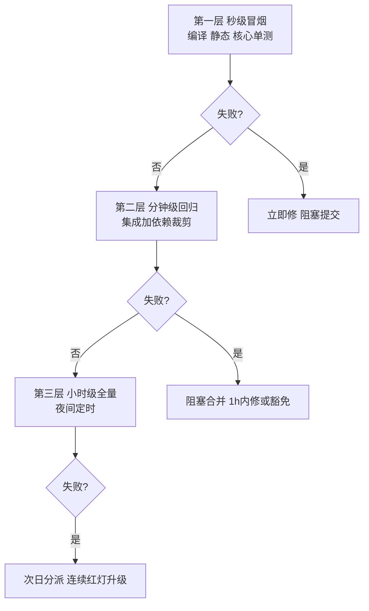
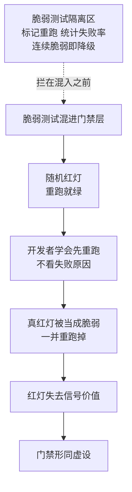

# 回归测试的耗时分层：快速反馈层先跑，全量层收尾

> **要点**：回归测试按耗时与证据价值分三层——秒级冒烟（提交即跑）、分钟级回归（合并门禁）、小时级全量（夜间收尾），每层的失败处置与阻塞权限不同；分层的关键是每层失败的"下一跳"明确，耗时与反馈速度的平衡才有裁判规则。

**测试金字塔的标准形态就是这篇文章的出发点**：底宽顶窄的三层，越往上数量越少、单次运行越慢、证据越接近真实组合。**下面的分层与它的三层一一对应，区别只在每层绑定了明确的触发时机与失败处置**：


*图源：Wikimedia Commons，作者 Abbe98，CC BY-SA 4.0，https://commons.wikimedia.org/wiki/File:Testing_Pyramid.svg。金字塔描述的是数量与耗时的理想关系，本文补的是这个形态落到执行端之后的触发时机、时长上限与失败分流规则。*

**金字塔模型的原始出处是 Ham Vocke 发在 martinfowler.com 的《The Practical Test Pyramid》**——**左侧标注隔离与集成程度、右侧标注速度，两根轴正是本文分层的依据**：


*图源：martinfowler.com《The Practical Test Pyramid》，作者 Ham Vocke，https://martinfowler.com/articles/practical-test-pyramid.html。*

## 要解决的问题

回归测试套件的自然生长方向是"越加越多、越跑越慢"——直到单次运行超过开发者的等待意愿，**反馈循环断裂**：**开发者批量提交改动再集中跑测试（定位成本翻倍），或干脆跳过（质量靠上线后验证兜底）**。**测试金字塔（底宽顶窄的分层测试结构，底层海量单测、顶层少量端到端）的有效性依赖一个隐含前提：每层的等待时间不超过该层触发者的意愿阈值**——**提交者等 10 分钟可以，等 2 小时不行**。本库软构域"测试策略从风险选择证据"讲过按风险挑测试；本篇回答执行端的问题：**按耗时组织分层，让每个触发场景跑得起、等得起**。

## 它是怎么做到的：三层的职责与失败处置

**第一层：秒级冒烟（提交即跑，本地与 CI（Continuous Integration，持续集成：代码合并后自动构建与测试）并行）**：**编译、静态检查、核心单测（针对最小可测单元的自动化测试）**——跑的是"这次改动有没有破坏基本结构"。**失败处置：立即修，阻塞后续一切**——**这一层的失败修复成本最低（刚写完的代码，上下文在脑内），拖延的成本最高**。

**第二层：分钟级回归（合并门禁，受影响面裁剪）**：**集成测试 + 按变更面选择的相关测试**——跑的是"改动与其依赖方合起来是否正确"。**裁剪依据是依赖图（改了哪个模块，哪些测试覆盖它的下游），全量回归（改动后重跑全部既有用例）不进这一层**。**失败处置：合并阻塞，1 小时内修复或明确豁免**——**豁免要有记录（为什么这层失败可以放过），无记录的豁免是红色信号**。

**第三层：小时级全量（夜间定时，不阻塞任何人）**：**全量测试 + 长时压测 + 端到端场景**——跑的是"整体在真实组合下是否健康"。**失败处置：次日分派，连续两天红灯升级为紧急项**——全量层的红灯不阻塞开发，但**红灯天数是质量趋势指标**，**连续红灯说明某层职责错配（把该在下层暴露的问题留到了夜间）**。

**三层的耗时与职责来自同一个母体**：Ham Vocke 在 Martin Fowler 站上画的实用测试金字塔。**塔形本身就是「分层回归」的依据**——底层数量最多、跑得最快，顶层数量最少、跑得最慢，**把每一层的等待时间压在该层触发者的意愿阈值内，塔才立得住**：


*图源：同上（martinfowler.com《The Practical Test Pyramid》），作者 Ham Vocke。*



**同一套「每级更慢、证据更强、失败处置更重」的结构**，Amazon 的持续交付管道画到了工业级规模——Source→Build 之后 Test 阶段展开为 Alpha→Beta→Gamma One Box→Gamma 四级，**每级按风险配验证手段**：Alpha 只跑健康检查与功能测试，**Gamma One Box 加指标监控与自动回滚（把系统状态退回到改动之前的版本）加烘焙时间**，Gamma 再加滚动部署、集成测试与负载测试，**金丝雀（新版本先以小比例试水的发布方式）测试在整条 Test 阶段持续运行**：


*图源：[Amazon Builders' Library《Automating safe, hands-off deployments》（Clare Liguori），© Amazon，引用注明出处。](https://aws.amazon.com/cn/builders-library/automating-safe-hands-off-deployments/) 本篇的三层（秒级冒烟、分钟级回归、小时级全量）与这四级是同一原则在两个规模上的展开：越往后的级越慢、验证越深、失败时回滚的保障越厚。*

三层的失败处置之所以不同，是因为**失败发生的位置决定了修复成本**：**离改动越近的失败，上下文越完整，修起来越便宜**。**冒烟层的失败发生在代码刚写完时，全量层的失败发生在改动已经合入、开发者已经切走之后**——**同样是修一个错误，后者的成本可能是前者的十倍**。

三层落到持续交付流水线上是五个环节——构建、测试、备环境、部署、再测试，**测试在这条链上出现两次：一次在部署前（快速反馈），一次在部署后（深度证据）**：


*图源：同上（martinfowler.com《The Practical Test Pyramid》），作者 Ham Vocke。*

**分层的裁判规则**：**某类失败反复出现在夜间全量、冒烟层却测不出来——说明裁剪规则漏了这类依赖（回归面算小了），把对应的测试上移一层**；**反之，合并门禁层的测试大量与改动无关地失败（测试自身脆弱），下移或修复测试**。**层级间失败的迁移是分层的持续调优，初始分层不是终局**。

## 读完这一段你能判断什么：等待阈值与反馈循环

**触发者意愿阈值是分层的依据**：提交者（秒到分钟级意愿）、合并审核者（分钟级）、夜间调度（小时级无感）——**每层的运行时长上限按触发者意愿定**，超限的测试要么裁剪、要么下沉到下一层。"测试太慢所以大家不跑"的团队病灶，多数是分层缺失而非测试多余。

**反馈速度与证据强度的交换**：**越快的层证据越浅（结构正确），越慢的层证据越深（真实组合正确）**——**快速反馈的价值是定位快（失败离改动近），深度证据的价值是覆盖广（失败离改动远但覆盖真组合）**。两者都要，分层就是让它们各就各位。

**Flaky 测试的分层处置**：**脆弱测试混进门禁层，红灯的信号价值崩塌（大家学会无视红灯）**——**脆弱测试隔离区**（标记重跑、统计失败率、连续脆弱即降级到全量层或修复）是门禁层可信的前提。**上游开源项目的同类实践（BookKeeper CI 的 flaky 隔离）可参考**：**脆弱测试不修就隔离，不让它污染门禁信号**。

**红灯可以被无视之后，门禁就失去了全部价值**——**它的价值在于让人相信红灯意味着真的出了问题**。**这个信任建立得慢、崩塌得快，一次误报容忍度的放宽可能抵掉几个月的积累**。

**门禁信任崩塌的路径不长，每一步单独看都合乎情理，连起来就是红灯失去信号价值**：



**「开发者学会先重跑」是转折点**：一旦"先重跑再说"成为习惯，人就不再读失败输出了，而**真红灯与假红灯在界面上长得一模一样**——**重跑就绿的假红灯先教会大家不看失败原因，随后真红灯被当成脆弱一并重跑掉，最后门禁形同虚设**。**隔离区的作用是在脆弱测试混进门禁层之前把它挪出信号通道，让留在门禁里的红灯都是可信的**。

## 这套说法在哪儿会失效

**三条边界防止防线走形**。

**分层不是三层孤岛**：**同一测试可以在多层出现（核心路径的测试既在冒烟也在全量）**，**层的划分按触发时机，不按测试文件目录——按目录分层会让目录结构与证据强度错位**。

**裁剪规则要可审计**：合并门禁按依赖图裁剪，**裁剪掉的测试清单在合并记录里可见**——"为什么这次没跑这个测试"要能从记录回答，**不可审计的裁剪等于随机丢证据**。

**全量层不是垃圾场**：夜间层收容的是"太慢但重要"的测试，收容"没人敢删但没人维护"的测试会让全量层缓慢腐化——**全量层的测试同样有维护责任与淘汰机制**，**连续一年失败的测试要么修复要么删除**。

## 怎么自己动手验证

**验证路径要可复现，四条断言分别覆盖时长核对、失败定位、脆弱治理与断言锚点**。

1. 时长核对：**三层各自的运行时长按 P95（第 95 百分位的耗时值，剔除偶发长尾后仍不超线才算达标）统计，对照触发者意愿阈值**——**冒烟层超 30 秒、门禁层超 15 分钟即触发调优**；
2. 失败定位验证：**抽样夜间失败的用例回放，预期其中过半可以在门禁层被依赖图裁剪规则捕获（捕获率低的裁剪规则要修）**；
3. Flaky 治理验证：**脆弱测试标记后重跑 20 次，失败率与标记一致；隔离区的测试不出现在门禁**；
4. 断言锚点：**三层的时长上限有数字、裁剪清单可审计、脆弱隔离区在运转**——三者齐备，回归测试从"跑不完的负担"变成"分层的证据流水线"。

```text
时长断言 = 各层 P95 在意愿阈值内
裁剪断言 = 裁剪清单随合并记录可查
隔离断言 = 脆弱测试不进门禁
```

**耗时分层的用意是给证据组织反馈回路：快的负责即时定位，慢的负责深度覆盖，中间的负责守门**——**回路通了，测试规模的生长才不会反噬它自己的价值**。

## 接着读哪几篇：按风险挑测试的选择层

- [[工程知识/软件构建：让变化可以理解、验证与交付/测试与交付/测试策略从风险选择证据]] —— 按风险挑测试的选择层，本篇是执行端的耗时组织层；依赖图裁剪的方法来源也在这篇
- [[工程知识/性能工程：从用户等待到资源瓶颈/观测与诊断/性能回归门禁：把性能预算写进CI]] —— 门禁机制的姊妹场景
- [[工程知识/缺陷分析：从个案到体系/复现与回归/回归风险评估的通用骨架：从变更面到测试选择]] —— 变更面到测试选择的判定树
