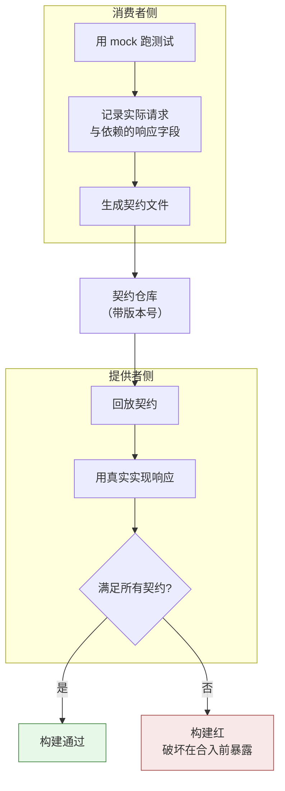
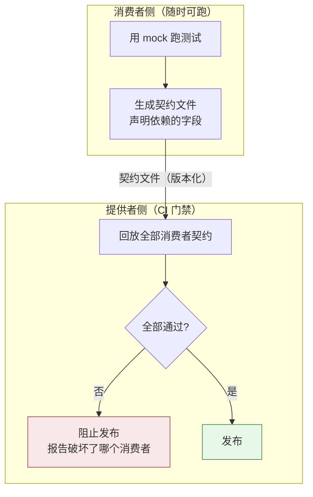

# 接口约定测试的适用边界：消费者驱动与提供者验证

## 要解决的问题

服务一多，接口正确性通常只有两种验证方式——起全套环境跑端到端（慢、脆、反馈在发布之后），或者各自 mock（快，但 mock 与真实实现会漂移，"两边都绿、一上线就炸"）。**中间缺一层：不改真实依赖，也能证明双方对接口的理解一致**。

## 它是怎么做到的：把约定从口头抽成制品

这套机制把"接口约定"从口头与文档里抽出来，变成一份可被双方各自执行验证的制品：**消费者侧声明我只依赖哪些字段，提供者侧回放验证我确实满足了这些声明**。**机制上分成两步独立验证，所以任何一边单独改动都会被对侧捕获，不需要两边同时在线**。

消费者侧这一步的内部结构，**Pact（消费者驱动契约测试的事实标准工具）**官方文档画得很准确：消费者单元测试实际发出的请求（Actual request）与交互定义（Interaction）里的期望请求（Expected request）比对，mock 提供者只回放契约里承诺的最小响应（Minimal expected response）——**契约文件记录的就是这次比对里被消费者真正依赖的那部分**：


*图源：[Pact 官方文档《How Pact works》](https://docs.pact.io/getting_started/how_pact_works)，MIT 许可。*

"不需要两边同时在线"是它相对端到端的关键优势。**端到端要求所有服务同时可用，于是任何一方的环境问题都会让整条链路红掉**；**契约测试把一次联合验证切成两次独立验证，失败也就只能归因到其中一方**。**代价是它验证的是两份声明的吻合，而不是真实链路的行为**。

契约测试解决的是中间那层：**不改真实依赖，也能证明双方对接口的理解一致**。

**它替代不了端到端，也不是万能的 mock 升级版**。**先划清它能证明什么、不能证明什么，再决定放哪一层**。




来源：[腾讯云开发者社区《消息队列：听我解释，我真的不是只有Kafka！》](https://cloud.tencent.com.cn/developer/article/1866156)（CC 4.0 BY-SA）


## 消费者驱动契约怎么跑

1. **消费者侧**：消费者测试里用 mock 提供者，把"我实际会发什么请求、我只依赖哪些响应字段"记录成契约文件。
2. **契约进共享仓库**（Pact Broker 之类），带版本号。
3. **提供者侧**：**用契约回放，验证真实实现对这些请求确实给出被依赖的响应**。
4. **进流水线**：提供者改动如果让任一契约失败，构建就红——破坏在**合入前**被发现，而不是在联调或线上。

关键约束：契约里只写**消费者真正依赖的字段**。**把整个响应都写进契约，等于把提供者永久固定在实现细节上，之后任何加字段都算破坏**——**这正是契约测试被用坏后反遭嫌弃的原因**。

第 4 步把验证真正接上流水线。**契约只在消费者侧生成、不进提供者流水线，等于只做了一半：契约仍是一份文档，提供者改了之后没人回放，漂移照样发生**。**判断一个团队是否真的在用契约测试，看提供者的流水线里有回放这一步就够了**。

## 能证明什么、不能证明什么

**消费者与提供者两侧的验证各自独立执行，改动的传播路径决定谁能捕获它**：



任何一边单独改动都会被对侧捕获：**消费者改了依赖字段，提供者回放时失败；提供者改了响应结构，消费者下次生成契约时暴露分歧**。两次验证不需要同时在线。

| 能证明 | 不能证明 |
|---|---|
| 请求/响应的**结构**一致（字段名、类型、必填） | 业务语义正确（这个订单该不该成立） |
| 提供者改动没有破坏**已知**消费者 | 未知调用方是否被破坏 |
| 状态码与错误结构符合约定 | 性能、超时、并发下的行为 |
| 契约覆盖到的错误分支确实可达 | 数据状态与跨接口流程（创建→查询→取消） |

"已知消费者"这个限定要留意。**契约只能覆盖登记进来的调用方，一个没写契约的下游服务被破坏时，提供者流水线照样绿**。**契约测试降低的是已知依赖的破坏概率，不是全部**。

**契约只覆盖登记进来的调用方，没登记的下游被破坏时流水线照样绿，这一块漏检只能靠真实集成来兜**。所以端到端测试仍然需要，只是可以缩小到**少量流程级用例**：契约守住结构，端到端守住流程与真实集成，单元守住业务规则。**三者是分工关系，不是替换关系**——整体取舍见 [[工程知识/软件构建：让变化可以理解、验证与交付/测试与交付/测试策略从风险选择证据]]。

## 它和测试替身是什么关系

契约回放本身是一条流水线：生成契约、发布、回放、判定，每一级的输出接下一级的输入。管道过滤器结构把它画得很清楚：

**这个结构决定了失败定位的粒度**。**整条链任一环节失败都是非零退出，所以要能指到具体是哪一级——是本侧生成的契约不对，还是对方改了实现**。**替身替代的是链上的某一级，契约替代的是级与级之间的约定内容，两者不在同一层**。

契约测试里的 mock 是"由真实契约约束的替身"，与手写 stub 的差别在于：契约会被提供者侧回放验证，漂移会被发现；手写 stub 不会。替身的选型与分类见 [[工程知识/软件构建：让变化可以理解、验证与交付/测试与交付/测试替身按依赖行为而非名字分类]]。

**契约的达成形态与人之间的约定同源：双方当面把条件对齐、握手确认，之后各自履行**——**契约文件就是这份握手的可执行版本，提供者流水线里的每次回放都在重新确认当年的握手条件仍然成立**：


*图源：Wikimedia Commons，rawpixel.com，CC0 1.0，https://commons.wikimedia.org/wiki/File:Business_agreement_handshake_at_coffee_shop.jpg。*

## 在哪儿会失效，失败模式有哪些

- **契约漂移**：**提供者已经改了，契约没更新但因为只在自己的流水线跑而没被发现**。判据：契约必须在**提供者**流水线里回放，而不只是消费者侧生成后归档。
- **契约过宽**：**把整个响应写进契约，把加字段变成破坏性改动**。判据：契约失败时先问"这个字段消费者真的读了吗"。
- **只测结构不测状态**：**异步、事件驱动接口里，消息顺序与重复投递不在结构契约范围内，需要单独的语义测试**；顺序与一致性问题见 [[工程知识/后端系统：在并发、失败与变化中维持服务/服务设计/事件驱动架构的解耦代价：最终一致与可追溯性]]。
- **契约不是文档**：它记录的是当前被依赖的集合，不能用来推断接口的全部能力。

最后一条常被误解。契约回答的是"谁在依赖我"，不是"我能做什么"——**它是一个被依赖集合的快照，而不是接口能力的完整说明**。**拿契约当接口文档读，会漏掉所有当前无人使用但确实存在的能力**。

## 怎么自己动手验证

```bash
# 消费者侧：跑测试并生成契约文件
npx pact-js-mocha --consumer MyWeb --provider OrderAPI

# 发布契约（带版本号，破坏性改动要能被追溯）
npx pact-broker publish ./pacts --consumer-app-version "$(git rev-parse --short HEAD)" --broker-base-url https://pact.example.com

# 提供者侧：回放全部消费者契约，任一失败即非零退出
npx pact-js-mocha --provider OrderAPI --broker-url https://pact.example.com
```

**预期结果**：**提供者流水线里契约回放失败率必须为 0**；**契约失败时能在失败用例里看到是哪个消费者的哪条契约、哪个字段不匹配**；**删掉契约里某个字段后提供者仍能通过（说明该字段不是真实依赖，契约该收窄而不是放宽）**。**能同时满足这三条，契约测试才在正确的位置上起作用**。

**第三条是一条反向检验，用来确认契约没有过宽**。**删掉字段后提供者仍通过，说明这个字段从未被真正读取，留在契约里只会把未来加字段变成破坏性改动**。

**与预期对不上时**：**先看契约是不是过宽（加字段也算破坏，说明写了没被读的字段）**，**再看契约是不是只在消费者侧生成、没进提供者流水线（漂移没人管）**，**最后确认失败是不是来自真实依赖的字段而不是路径、鉴权一类的环境差异**。

## 效果从哪儿来，要付什么代价

**收益是接口破坏在合入前暴露，且不需要起全套环境——反馈点从联调或线上提前到提供者构建阶段**；**代价是契约仓库与流水线的维护投入，以及契约书写纪律的持续成本（过宽的契约会把收益反过来变成束缚）**。跳过这层的代价是"两边都绿、一上线就炸"：mock 与真实实现各自漂移，直到集成时才被发现。
