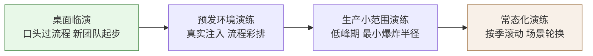

# 故障演练把预案、工具与人串成可执行的响应链

预案写得再厚，没跑过就只是文档；告警响起来那一刻，真正干活的是人和工具的衔接。读完这篇你能设计一次演练的组织形态：角色怎么分、信息差怎么用、评分怎么定，以及演练和混沌实验各自站在哪个位置。

## 先记住哪几句

| 维度 | 回答 |
| --- | --- |
| 要解决的问题 | 预案、runbook、升级路径、工具链从未被完整执行过，真事故时人会慌、流程会断、工具会对不上号。 |
| 本质 | 用一次有剧本的彩排，把"纸面能力"变成"肌肉记忆"：队伍里每个角色在压力下真跑一遍自己的那段动作。 |
| 做法 | 场景设计→角色分工→信息差控制→注入→响应窗口→复盘：指挥、记录、通讯、响应、观察、安全六个角色缺一不可。 |
| 效果与代价 | 收益是预案更新、监控校准、沟通链路打通与人员信心；代价是数小时的集体时间投入与演练本身的风险敞口。 |
| 边界 | 演练检验的是响应链，不能覆盖未注入的故障；成功不等于系统无缺陷，只等于这条链路这次走通了。 |
| 验证 | 检测延迟、缓解延迟、MTTR、runbook 遵循度、沟通清晰度五项量化评分；复盘产出带负责人与期限的行动项并追踪到关闭。 |

## 预案为什么会被高估

runbook（响应手册，写明某类故障的判定与处置步骤）最大的问题在于它是好天气的产物：写它的时候系统是健康的，写它的人想象的是理想路径。三件东西在纸面上完好，在事故现场经常失效：

- **联系人清单过期**。值班表换了三轮，手册里的电话号码还是一年前的；升级路径的第一环就在这里断裂。
- **工具链没串过**。预案里写"通过控制台执行流量切换"，但控制台三个月前改版了，按钮换了位置，权限也没做迁移——第一次发现这些的时刻，不该是真实事故。
- **人没在压力下做过决策**。判定严重级别、决定要不要拉群、要不要通知客户，这些决策在平静时人人会做；告警连环响起、群里三个人同时在问"现在什么状态"时，新手会僵住。

预案还可以在写下之前就先被推翻一遍：起草任何一条处置动作之前，先自问三个问题——"照着这条步骤做的人，此刻手里有什么信息？这一步依赖的面板、权限或下游，最近一次被确认还能用是什么时候？这一步做完，下一个动作的人怎么知道该接手了？"三问里任何一问答不上来，这条步骤还没有资格进预案。缺陷分析域的案例三十六（写操作被自己挂起的回调堵住）给出过真实反例：预案里写"先摘除实例止血"，摘除动作却依赖一个同样被堵死的控制面，写预案的人没想到止血手段会与故障共用同一条命脉。把这类反例在预写阶段过一遍，比在演练里第一次踩到便宜得多。

消防演习的逻辑在这里完全成立：疏散路线平时都贴在墙上，但不真的走一遍，你不知道哪个楼道口堆了杂物。演练做的事就是把这三件纸面品放进一次受控的压力环境里各跑一遍。

## 一次演练的组织形态

演练与混沌实验的分工要先说清：[[工程知识/软件构建：让变化可以理解、验证与交付/测试与交付/混沌工程验证系统是否真的能处理故障|混沌工程验证系统是否真的能处理故障]] 验证的是系统在注入故障后的行为（假设、稳态指标、爆炸半径），是实验方法论；演练验证的是人和流程在故障中的响应（角色衔接、决策速度、沟通质量），是彩排方法论。两者常在同一场活动里出现——演练日里注入一个故障，系统行为交给混沌实验的假设去判，人的响应交给演练的评分去量——但考核对象完全不同，一个盯系统，一个盯人。

### 角色分工


六角色的关键约束只有两条：**注入者与响应者必须是不同的人**——响应者知道今天有演练，但不知道注入什么、何时注入，信息差就是这场彩排的真实感来源；**安全官有绝对中止权**——任何时刻认为风险越界，不需要请示任何人即可叫停。

外部材料的角色表是同一套：事件指挥官（IC）执行中止标准、记录员记时间线、通讯负责人管状态更新、响应者执行 runbook 里的缓解措施、观察员评分、平台负责人处理故障转移与回滚（把系统恢复到上一个可用版本）。Amazon 与 Google 的公开实践都把 IC 的中止权列为第一位的设计约束。

### 节奏

| 阶段 | 时长 | 内容 |
| --- | --- | --- |
| 开幕与简报 | 10-30 分钟 | IC 宣布目标、范围、成功标准与中止条件 |
| 基线捕获 | 5-15 分钟 | SLO（Service Level Objective，服务级目标：对可靠性的量化承诺） 快照、当前告警、流量水位，确认稳态（系统运行指标进入平稳区间后的状态） |
| 注入 | ≤15 分钟 | 操作员按剧本注入计划中的故障 |
| 响应窗口 | 15-60 分钟 | 响应者按真实流程响应；观察员记指标 |
| 恢复或中止 | 按预案 | 系统回稳态验证，或安全官触发中止回滚 |
| 热回顾 | 15-30 分钟 | 即时教训、卡点、计划偏差 |
| 正式复盘 | 72 小时内 | 时间线、根因、行动项（带负责人与期限） |

注入到恢复的完整窗口在公开实践里通常是 15-60 分钟；热回顾当天完成，正式复盘 72 小时内产出。响应窗口里响应者的每个动作都被记录员打了时间戳——这套时间线就是复盘的全部原材料。

### 三种披露模式

```text
公告模式：响应者知道有演练、知道场景 → 检验流程本身的顺畅度
半盲模式：知道有演练、不知道场景 → 检验诊断路径与信息传递
盲测模式：不知道有演练（只有管理层知情）→ 最接近真实，风险与组织成本最高
```

模式选择的判据是演练目的：要让新人熟悉流程，用公告模式；要检验"告警能不能让人找对方向"，用半盲模式；要检验整条响应链包括升级路径的真实性，才动用盲测。多数团队的合理路径是公告模式起步，半盲模式常态，盲测按年做一次。

## 评什么：演练的量化产出

演练的价值靠五个指标度量，全部来自记录员与观察员的时间线：

1. **检测延迟**：故障真实生效到响应者说出"我知道哪里坏了"的时间。检测延迟长的普遍原因是告警设计：告的是症状不是方向，响应者要花时间在多个面板间排除。

2. **缓解延迟**：定位到缓解动作生效的时间。缓解延迟长的普遍原因是 runbook 与现实脱节：手册里的命令在当前环境跑不通。

3. **MTTR（平均恢复时间）**：全程口径的恢复时长，运营成熟度的先行指标。
4. **runbook 遵循度**：响应者的实际路径与手册的偏离度。

适度偏离不扣分——发现手册与现实不符恰恰是演练的重要产出；系统性偏离说明手册该重写。
5. **沟通清晰度**：状态更新是否准确、及时、到位。常见事故形态是群里三个人同时扮演指挥，命令互相矛盾——演练把这个暴露出来。

DORA（DevOps Research and Assessment，研发效能度量体系）的研究把这五项与组织绩效连在一起，其中 MTTR 是运营成熟度的领先指标。

## 演练暴露的东西与混沌实验不同

演练最容易暴露的三类问题，全部在"衔接"上：

- **人与工具的衔接**。控制台改版、权限迁移缺步、证书过期——工具单看都正常，串不起来。
- **人与人的衔接**。升级路径断裂、指挥缺位、通讯模板没人维护。case 实录：某平台团队季度演练多区主库切换，自动切换两分钟内完成，结果发现一个微服务里残留硬编码指向旧主库的 endpoint，"切换成功"后那个服务还在静默失败。这类缺口在任何架构图与代码评审里都不可见，只有端到端跑一遍才现形。
- **预案与现实的衔接**。预案写的是三个月前的系统。演练是让预案保持新鲜的唯一常规机制——复盘产出的手册更新，就是下一次演练的输入，形成回路。

回路的另一端要接上混沌实验的产出：[[工程知识/软件构建：让变化可以理解、验证与交付/测试与交付/混沌工程验证系统是否真的能处理故障|混沌工程验证系统是否真的能处理故障]] 里稳态被打破产出的修复项，其验收方式是修复后重跑同一实验；而演练产出的手册更新与工具修复，验收方式是下一次演练里遵循度回升。两条回路在"整改后重验"这一点上是同构的。

## 从桌面临演到生产演练的阶梯度



阶梯度对应组织成熟度：桌面临演只动嘴不动系统，适合流程上线前统一认知；预发环境演练真实注入但流量隔离；生产小范围演练在低峰期以最小爆炸半径验证真实环境（这也是混沌工程篇里小流量灰度的同一逻辑）；常态化演练按季度滚动、场景轮换覆盖不同故障家族。开源 SRE（Site Reliability Engineering，网站可靠性工程：用软件方法做运维）手册把这条梯度称为从 tabletop 到 production exercise 的成熟路径，与混沌工程的自动化持续注入是互补关系：演练是离散的手工设计事件，混沌是连续的自动执行，一个练人，一个练系统。

## 实践要点与陷阱

- **准备比演练本身长**。公开经验的配比是每 1 小时演练配 2-4 小时准备：场景设计、监控确认、通知干系人、排练中止流程。准备不足的演练大概率在现场失控，然后组织得出"演练没用"的错误结论。
- **复盘不追责**。无责备复盘（blameless postmortem）是演练能持续的前提。追责一次，之后所有演练里响应者都会表演安全动作，时间线失真，指标全部作废。
- **行动项必须闭环**。复盘产出"单点修复"与"系统性修复"两张清单，每项带负责人与期限，与 SLO 或生产风险关联，弹性记分卡跟踪到关闭。只演不修的演练是表演。
- **频率按风险定**。核心服务季度一次是底线，与 [[工程知识/软件构建：让变化可以理解、验证与交付/测试与交付/灰度与功能开关的边界：交付节奏与配置漂移|灰度与功能开关的边界：交付节奏与配置漂移]] 里长寿命开关季度巡检同频；高危变更前加演专项。
- **跨团队演练先桌面临演**。涉及多个团队边界的场景，第一次一定用桌面临演把接口对齐，直接真注入会让某个团队在毫不知情的情况下承受冲击。

## 怎么自己动手验证

- **评分对账**：完成一次演练后核对五项指标是否全部拿到数值；哪一项拿不到数值，说明观察与记录的角色缺位，补上再演。
- **遵循度审计**：复盘后抽查 runbook 三处步骤的时效性（命令是否还能跑通、联系人是否还在岗、面板是否还在），预期全部可执行；任何一处失效就是演练的直接产出。
- **中断注入演练**：在响应窗口中途由安全官触发中止，预期中止生效时间小于注入命令声称的生效时间，响应者能按预案收尾而不是卡在半途。

## 接着读哪几篇

- [[工程知识/软件构建：让变化可以理解、验证与交付/测试与交付/混沌工程验证系统是否真的能处理故障]] —— 实验方法论的对面：系统侧怎么验证
- [[工程知识/后端系统：在并发、失败与变化中维持服务/分布式可靠性/健康检查只能提供有时效的失败证据]] —— 检测延迟的机制源头：健康检查的证据边界
- [[工程知识/性能工程：从用户等待到资源瓶颈/观测与诊断/拨测与合成监控：在用户之前从外面敲一遍门]] —— 检测能力的兜底：从外部探测入口失效
