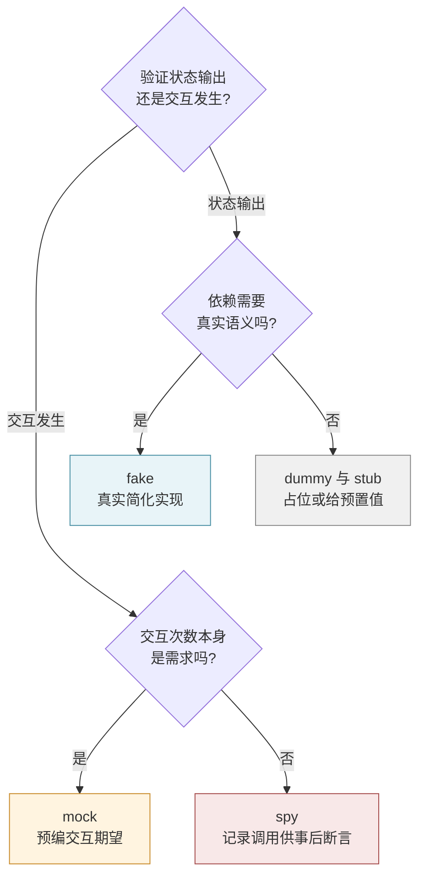
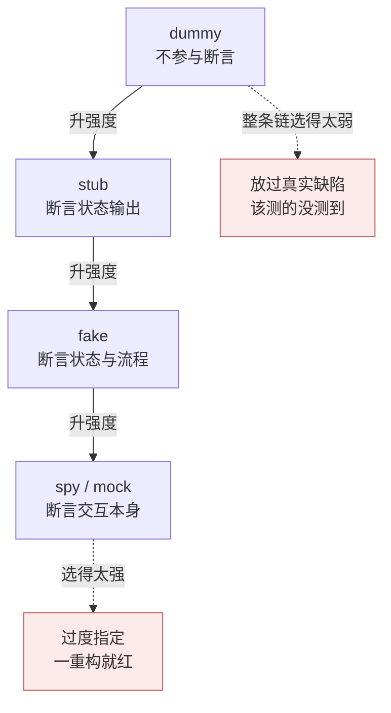
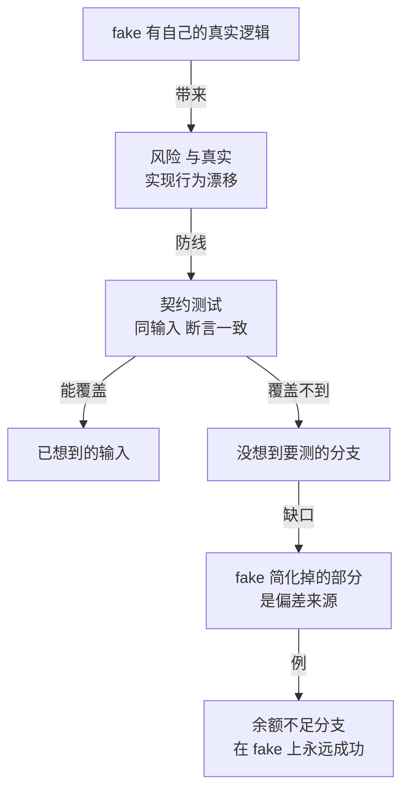

# 测试替身按依赖行为而非名字分类

## 要解决的问题

**单元测试要隔离依赖，于是有人 mock（模拟对象：测试里替代真实依赖的假实现）数据库、有人 stub 支付接口、有人 fake 整个仓储层——名词满天飞，分歧却在更深处：替身返回什么、断言什么、能不能复用**。**要解决的问题：替身选错型，测试要么验证了不存在的交互（交互断言过强，一重构就失败），要么放过了真实缺陷（状态断言缺位，mock 绿了线上炸了）**。**本文按替身的行为约定分类，而非传话筒式的名词分类；分对类型的收益是测试既验证真实行为又给重构留空间，分错类型的代价是测试套件与实现绑定过紧**。

## 本质是什么：按行为约定分类，不按名词分类

**同一个依赖在社区里被叫成 mock、stub、fake、spy，叫法不同的背后其实是不同的行为约定——替身返回什么、记录什么、预先断言什么、实现到什么程度**。**按名词分类会陷入争论，按行为分类则直接给出选型判据：这次要验证的是状态变化，还是交互发生**。

选替身要连问两个问题：这次验证的是状态输出还是交互发生？若是状态，依赖需不需要走得通的真实语义；若是交互，调用次数本身是不是需求——四个叶子由这两问定下：



**两道分岔把替身分到不同的验证目标：dummy、stub、fake 回答“结果是什么”，mock、spy 回答“怎么调用的”；其中 mock 与 spy 只差一件事——期望是提前编好还是事后检查**。

## 四种替身各自的行为怎么定义

| 替身 | 行为 | 验证什么 |
| --- | --- | --- |
| dummy | 占位，从不被使用 | 不验证任何东西 |
| stub | 返回预置值 | 被测单元的状态输出 |
| spy | 记录调用供事后断言 | 被测单元对外的副作用（操作对外部状态产生的额外影响） |
| fake | 有真实简化实现 | 被测逻辑与轻量实现的组合 |

**mock 这个词在社区有两层含义：狭义 = spy + 交互期望，广义 = 一切替身**。**本文用行为定义避开名词之争，与** [[工程知识/软件构建：让变化可以理解、验证与交付/测试与交付/测试策略从风险选择证据]] **的弱证据/强证据表同构**。

**五分法的原始谱系一张图看清：dummy 是虚线的占位（从不被使用），stub 与 spy 各守"预置返回"与"事后检查"，mock 带预编期望，fake 是唯一有真实实现的替身——这张图与上文决策树的两道分岔是同一分类的两种画法**：


*图源：Gerard Meszaros《xUnit Test Patterns》官网 xunitpatterns.com 的 Test Double 分类页，http://xunitpatterns.com/Test%20Double.html，文档引用。*

**名词并非全无来历**。**Gerard Meszaros 在《xUnit Test Patterns》里给这一族起了总名 test double（借自电影替身 stunt double），并分出五种；Martin Fowler（软件设计领域的技术作者）的文章让这套词汇流行**。**五分法与本文的取舍表可以对照着看：dummy（占位、从不被使用）、stub（预置返回值）、fake（可工作的简化实现）三者服务「验证状态输出」的一侧，mock与 spy（记录调用、事后断言）同站「验证交互」一侧——spy 与 mock 的分界只在期望何时编程：mock 提前编好、spy 事后检查**。**这正是上文决策树的两道分岔**。**业内把一切替身都叫 mock 的口语习惯，恰好磨掉了这道分岔，本文按行为重新画出来**。

**stunt double 这个词源有实物可看：1955 年《PIX（Cisco 的防火墙产品）》杂志记录的替身演员 Von Rosen——替身的工作与 fake 的风险是同一件事：替身替正主上场完成动作，观众看到的"演员"与实际完成动作的不是同一个人；fake 替真实依赖上场跑通流程，测试看到的"依赖"与生产行为的不是同一个实现**。**替身在片场要跟正主对戏（契约测试），测试里的 fake 也要跟真实组件对同一套输入**：


*图源：Wikimedia Commons，PIX Magazine 摄影师（澳大利亚），公有领域，https://commons.wikimedia.org/wiki/File:Von_Rosen,_stunt_performer,_1955.jpg。*

## 交互断言过度指定会出什么问题

**orderService（被测的订单服务）的 create（下单方法）"被调用了一次"——验证这句话是交互断言**。**它的脆弱性：实现从一次调用改成两次批量调用，行为没变（订单都创建了），测试红了——这叫过度指定（over-specification）**。**判据：断言的交互是需求的本质（"必须发送恰好一封确认邮件"）还是实现细节（"调用了一次 mailer"）**。**前者合法，后者把测试与实现绑得过紧**。

**这个判据之所以难用，是因为两者在写代码时看起来一样——都是"验证调用了一次"**。**区别在于问一句"用户会不会在意"：用户在意收到几封邮件**，不在意服务内部调了几次。**问不出来的那个，通常就是实现细节**。

**四类替身在"验证强度"这条轴上各有位置，选偏一端就会付出对应代价**。**这条轴与上面的两问是两个视角：两问决定替身回答哪类问题，强度轴回答验证压得多重——先按两问选型，再按强度检查有没有选得太弱或太强**：



**开头那对失败模式在这里各占一端：验证弱的那一端拦不住状态错误，验证强的那一端把实现细节也固定了下来**。**选型时看被测的那件事需要哪种证据，替身的叫法不参与判断**。

## fake 凭什么被信任

**fake 是有简化实现的替身（内存数据库、内存队列）**。**它的风险：与真实实现行为漂移**。**防线是与真实实现跑同一套接口约定测试（contract test）：同一组输入，断言 fake 与真实组件行为一致**。**没有接口约定测试的 fake 是第二个待测系统**，见 [[工程知识/软件构建：让变化可以理解、验证与交付/测试与交付/测试策略从风险选择证据]] **的"关键依赖用真实组件"行**。

**"第二个待测系统"这个说法点出了 fake 的隐藏成本：它有真实逻辑，也就有自己的缺陷，而且这些缺陷不会被测出来——因为测试跑在 fake 上时，fake 自己就是被测环境的一部分**。**真实实现会余额不足，内存版扣款永远成功，于是所有余额不足的分支在测试里从未被执行过**。

契约测试能补上这个洞，但它自己也有边界：



契约测试只能验证你列出来的那些输入。而 fake 的简化之处——例如内存版扣款不作余额校验——恰恰在列表之外，因为写测试的人当初就没意识到那是个分支。所以契约测试是必要防线，不是充分防线：能缩小漂移，不能证明没有漂移。

**事件驱动的异步契约是同一思想的实现形态：Pact 官方对 Message Pact 的流程图把消息契约的双向约定画成闭环——消费方声明它需要的事件结构并生成契约，提供方回放消息验证契约，漂移在发布前暴露而不是在消费端炸开**：


*图源：Pact 官网《Message Pact》，https://pact.io，MIT 许可。*

## 动手跑一遍会看到什么：同一个依赖，四种替身的取舍

**好比拍电影不请真警察出镜，按剧情需要选替身：只出背影的（桩，给固定反应）、会走位能搭戏的群众演员（假对象，行为真实）、要按剧本说每句台词的（模拟，验证台词）、全程跟拍取证用的（间谍，只记录不干预）——戏不一样，替身的贵贱和用法不一样**。**被测对象是订单服务，依赖是支付网关（对接外部支付渠道的收单接口），四种替身各管一种测试问题**：**比喻到「按戏选替身」为止，各自代码形态见下文**。

```python
# 桩（Stub）：给定返回，不验证交互 —— 测"拿到支付结果后系统怎么反应"

只看「拿到支付结果后的反应」，不检查桩是否理解业务语义。
gateway = Stub(charge=lambda order: {"status": "paid", "txn": "T1"})
result = order_service.submit(order, gateway)
assert result.state == "confirmed"

# 假对象（Fake）：可用实现，轻量捷径 —— 测"流程在真实语义下能否走通"

扣款语义真实存在但不能真上流通——用它把整个付账流程走一遍，账目对得上才算通过。
gateway = InMemoryGateway()   # 内存记账，扣款语义真实存在
result = order_service.submit(order, gateway)
assert ledger.balance_of(order.user) == before - order.amount

# 模拟（Mock）：预编交互期望 —— 只在"交互本身是需求"时用
gateway = Mock()
order_service.submit(order, gateway)
gateway.assert_called_once_with(charge=order)   # 需求就是"钱只扣一次"

# 间谍（Spy）：只记录调用，事后断言 —— 审计类需求
events = Spy()
order_service.submit(order, events)
assert events.recorded("order.confirmed")
```

跑一遍的收获：选型判据只有一个——这次测试要验证的是状态变化还是交互发生。验证状态用桩和假对象（断言返回值与账目结果），验证交互才用模拟和间谍；把"调没调、调几次"写成期望是最容易过度指定的形态（被测对象的结构一改就红，红得毫无意义）。

## 这些结论的量级靠什么数字支撑

**维护成本的账：交互断言类用例的重构脆弱性远高于状态断言类——被测对象的结构重构后 mock 密集套件的假警报率是状态断言套件的数倍，每个假警报都要人工判一次"红得对不对"，这就是过度指定的日常代价**。**假对象的信任账：上文"内存版扣款永远成功、真实版会余额不足"的语义分叉正是事故源，所以 fake 也要有对账测试（即上文的接口约定测试）对着真实实现定期跑**。

**案例回流：替身语义分叉的实录见** [[工程知识/缺陷分析：从个案到体系/稳定性/案例二十三：一次抖动变成一次重算——SASL 拉取没有重试]]**——测试环境的客户端替身不重试、生产客户端重试，同一段业务代码跑在两种语义上，这正是 fake 信任问题在缺陷域的表现**。**替身在流水线的分工见** [[工程知识/软件构建：让变化可以理解、验证与交付/测试与交付/回归测试的耗时分层：快速反馈层先跑，全量层收尾]]**——快层用替身换速度，全量层用真实依赖换可信**。

## 怎么自己动手验证

**替身分类要与重构不变量对账：先预写一次纯重构，跑一遍测试套件，核对交互断言过强的那批测试是否失败**。**预期能失败、实际全部通过，说明那批测试没有把调用方式写进断言**。

- **重构不变量测试：做一次纯重构（不改行为），交互断言过强的测试会失败——失败的那批就是过度指定**。
- **约定一致性：fake 与真实组件跑同一套输入集，diff 输出与状态变化**。
- **替身密度审查：一个测试里替身数量与被断言对象数量的比例，替身多于断言对象时测试在验证替身自己**。

**第三条是个容易忽略的检查。替身本身需要配置，配置代码往往比断言还长；一个测试里替身比断言多，说明大量工作花在搭台子上，真正验证的东西反而很少**。

## 这套说法在哪儿会失效

- **替身选择是测试策略的下游决策**：**先定风险与证据等级**（[[工程知识/软件构建：让变化可以理解、验证与交付/测试与交付/测试策略从风险选择证据]]）**，再选替身型，顺序不能反**。
- **并发与时序依赖不适合 stub**：**竞态、超时、重试路径需要真实异步组件或故障注入**（[[工程知识/软件构建：让变化可以理解、验证与交付/测试与交付/混沌工程验证系统是否真的能处理故障]]）。
- **AI 生成测试的替身选择常系统性倒向交互断言（容易生成、容易过），审查时按「四种替身的行为定义」逐个核对断言类型**。

**第二条说的是 stub 的能力边界：它只能返回一个预设值，而竞态（多个执行流争抢资源、结果取决于时序）与重试这类问题恰恰发生在时序里——什么时候返回、返回几次、间隔多久才是关键**。**stub 无法表达这些，硬要用它测并发，测出来的只是"返回值被正确接收"**。**dummy 与 stub 这类弱替身也停在同样的分界上：它们只回报固定结果、不校验调用方式，断言因此集中在被测单元的状态输出上——这类状态断言与实现的耦合低，重构后不易失败，多数测试应该归入状态断言这一类**。

## 效果从哪儿来，要付什么代价

**按行为分类的收益是替身选择有判据——每个替身对应一个明确的验证目标，测试既验证真实行为又给重构留空间**；**代价是需要在写测试前先想清楚"这次验证什么"，比随手 mock 慢一点**。**分错类型的代价是不对称的：交互断言过强导致一重构就失败（每次重构都要人工判红得对不对），状态断言缺位导致 mock 绿了线上炸（测试通过而缺陷仍在）**。

## 接着读哪几篇：同在软件构建里的相邻问题

- [[工程知识/软件构建：让变化可以理解、验证与交付/测试与交付/测试策略从风险选择证据]]：替身选择的上层策略，本文细化它的替身分类行
- [[工程知识/软件构建：让变化可以理解、验证与交付/测试与交付/调试从假设到最小复现]]：测试失败后的调查路径，与替身分类互补
- [[工程知识/软件构建：让变化可以理解、验证与交付/架构与代码/分层与依赖方向决定可测试性和演进成本]]：依赖方向决定哪里能插替身，架构与测试的连接点
- [[工程知识/软件构建：让变化可以理解、验证与交付/测试与交付/接口约定测试的适用边界：消费者驱动与提供者验证]]：替身按约定行为实现的思想源头
