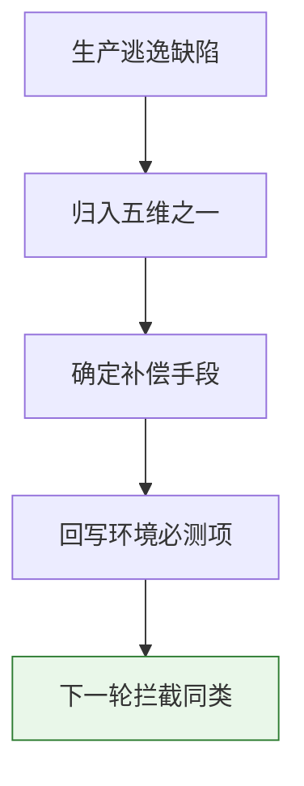

# 测试环境与生产的差距要按维度补偿：并发、数据量、配置与故障注入的逃逸清单

**测试环境永远不等于生产——工程能做的是把差距按维度显式化，逐维决定补偿方式；「测过了」的可信度等于未补偿维度的清单长度。** 读完你能回答：**差距的五个维度各怎么补偿、哪些差距适合等比缩放哪些必须全量、环境分级怎么配预算、逃逸缺陷怎么反哺清单**。

## 要解决的问题

**「测试环境通过、生产出事」不是测试疏忽，是差距结构问题**。**测试环境在五个维度上与生产存在系统性差距**：**并发量**（生产峰值 QPS 的百分之一）、**数据量与分布**（开发数据没有长尾与倾斜）、**配置差异**（超时、连接池、内核参数各不相同）、**拓扑与依赖**（生产的多可用区、真实第三方、流量 mix），以及**故障形态**（生产的故障是组合的、缓慢演化的）。**每维差距都对应一类只在生产显形的缺陷族**——并发缺陷、数据倾斜慢查询、配置漂移故障、依赖行为差异、混沌盲区。**显式化是补偿的前提：清单里没有的维度，一定以生产事故的形式补测。**

## 机制：五维补偿表与环境分级

### 五维补偿

| 维度 | 典型逃逸缺陷 | 补偿方式 |
| --- | --- | --- |
| 并发 | **竞态、连接池耗尽、锁争用** | **压测环境按生产峰值比例模拟；确定性并发测试工具单独覆盖竞态** |
| 数据量与分布 | **N+1 在小数据隐形、倾斜分片** | **数据构造器生成生产分布画像（长尾、热点、空值比例）；关键路径用生产量级回放** |
| 配置 | **超时链路错配、内核参数差异** | **配置即代码：测试与生产同一配置源，仅参数分级；环境差分自动比对** |
| 拓扑与依赖 | **第三方限流行为、CDN 缓存语义** | **契约测试锁定依赖行为；关键第三方用影子流量或沙箱账号** |
| 故障形态 | **组合故障、缓慢劣化** | **混沌实验带不变量断言；预生产环境做故障演练** |

两维要全量：**配置**（配置差异是超时链路、重试风暴类故障的根源，等比缩放没有意义）与**依赖行为语义**（第三方限流、幂等行为必须真实验证）。**三维可等比：并发、数据量、故障频率按预算缩放，比例写在环境文档里**。

### 环境分级与预算

**环境不是越多越好，每级环境要有明确的覆盖目标与成本**：**单测/集成**（逻辑正确性，依赖全 mock 契约化）→ **集成环境**（配置一致性，真实中间件拓扑的小副本）→ **预生产**（生产配置全量、数据画像缩比、混沌与压测场地）→ **生产**（金丝雀与影子流量做最后验证）。**判定句：每一级环境回答一个问题，答案不重叠；两级环境回答同一问题的，砍掉便宜的那级。**

### 逃逸反哺

**每个生产逃逸缺陷复盘时补两问：这个缺陷属于哪个维度的差距？哪个补偿手段能拦截它**？**答案回写进维度清单与对应环境的必测项**——**清单是活的，逃逸是清单的更新事件**。

## 案例：差距维度的归因视角

[[工程知识/缺陷分析：从个案到体系/复现与回归/复现范围先于复现次数：坏提交的二分定位要靠可判定的复现条件]] 的缩范围手法与本篇的显式化同构：**测试环境复现不了生产缺陷，多数时候是某个维度的条件（数据分布、并发时序）没被复制**——**差距维度清单同时是复现条件的排查清单**。[[工程知识/软件构建：让变化可以理解、验证与交付/测试与交付/不稳定测试的判定与归因：从无限重跑掩盖到按失败形态分诊]] 的环境类根因是本篇在单测试粒度的特例：**环境与外部依赖的差距让测试信号失真——治理手法一致（依赖显式化、契约锁定），粒度不同（单测试 vs 全环境）**。

## 怎么测

- 差距审计：**按五维逐项核对本组织的补偿现状，未补偿维度列出并标注风险等级，作为测试基建的规划输入**。
- 配置差分：**自动化比对测试与生产的全部配置项，差异清单按「有意分级/遗漏」分类，遗漏项整改**。
- 数据画像回放：**从生产日志采样生成数据分布画像，验证测试数据构造器覆盖长尾（命中率低的分支在测试里也要被执行）**。
- 逃逸追踪：**每个生产缺陷按维度归因，季度统计各维度逃逸占比，占比最高维度的补偿手段优先加强**。

## 哪些认识一看就错

- **「环境做得越像生产越好」——相似度与成本超线性增长；按维度补偿（该全量的全量、可等比的等比）比整体复制便宜且拦截面更明确**。
- **「测过了就是安全的」——可信度要看五维清单的未补偿项；「测过」是相对陈述，相对的是清单不是生产**。
- **「差距清单一次建好」——系统演化（新依赖、新流量形态）持续产生新差距；清单靠逃逸反哺与差距审计保持新鲜**。
- **「金丝雀可以替代预生产」——金丝雀的生产验证以真实用户风险为代价，预生产的演练成本更低；两者互补**，**金丝雀不是便宜的环境，是生产的最后防线**。

## 效果从哪来、要付什么代价

**五维显式化让「测试可信度」从模糊感觉变成可审计的清单，补偿投入按逃逸风险定向分配，环境分级砍掉冗余环境的维护成本**。**代价是清单机制本身的运行：差距审计的周期投入、配置差分与数据画像的基建、逃逸复盘的流程**。**收益按逃逸率结算：同一维度的逃逸缺陷第二次出现，说明补偿手段没回写**——**机制在运行的标准是「同类逃逸不重复发生」**。

关系：[[工程知识/软件构建：让变化可以理解、验证与交付/测试与交付/不稳定测试的判定与归因：从无限重跑掩盖到按失败形态分诊]] —— 环境差距在单测试粒度的同族治理。[[工程知识/缺陷分析：从个案到体系/复现与回归/复现范围先于复现次数：坏提交的二分定位要靠可判定的复现条件]] —— 差距维度清单同时是复现排查清单。[[工程知识/缺陷分析：从个案到体系/复现与回归/断言要锚定在不变量上：注入前后该不变的数字与该变的数字]] —— 预生产故障演练的判定基础。
